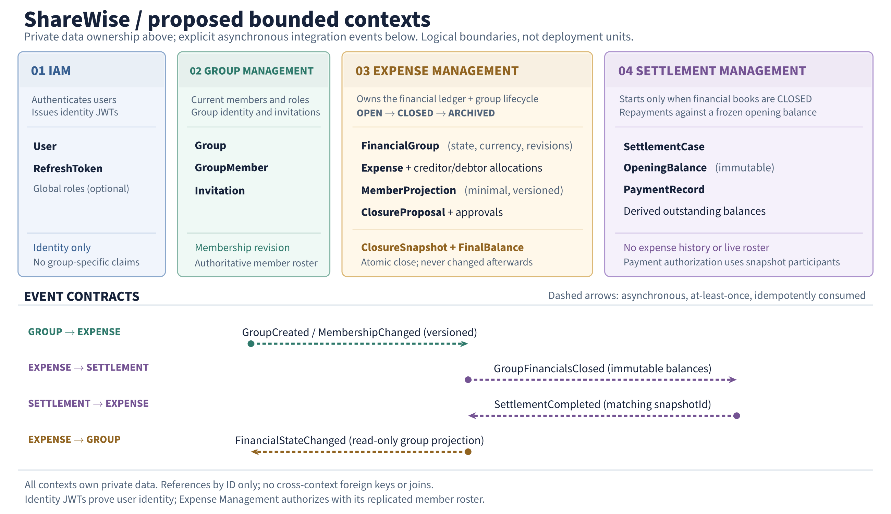
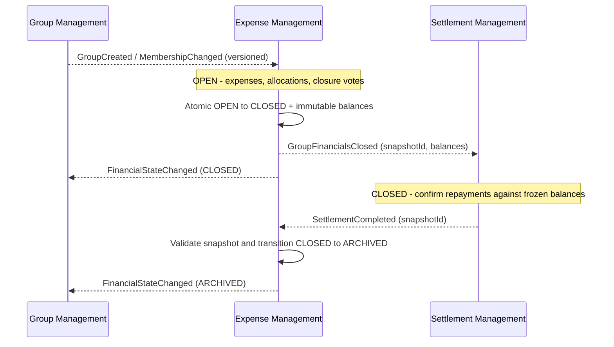
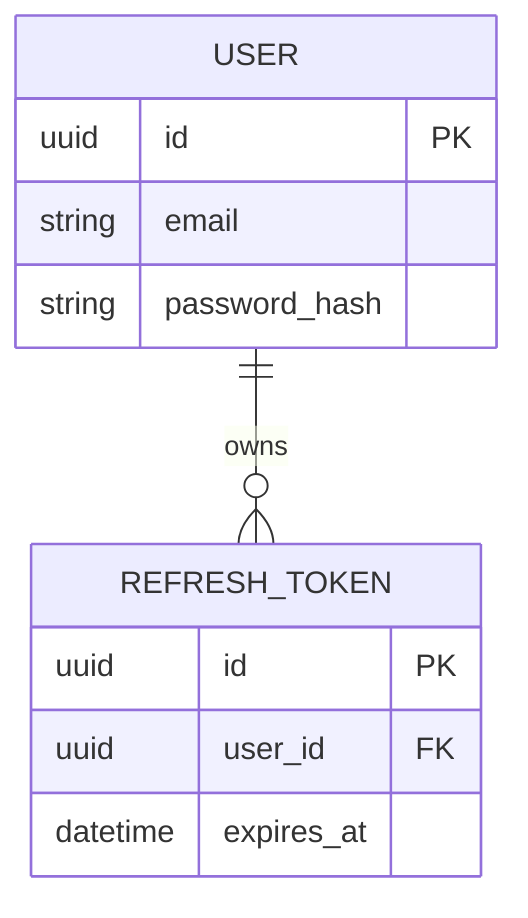
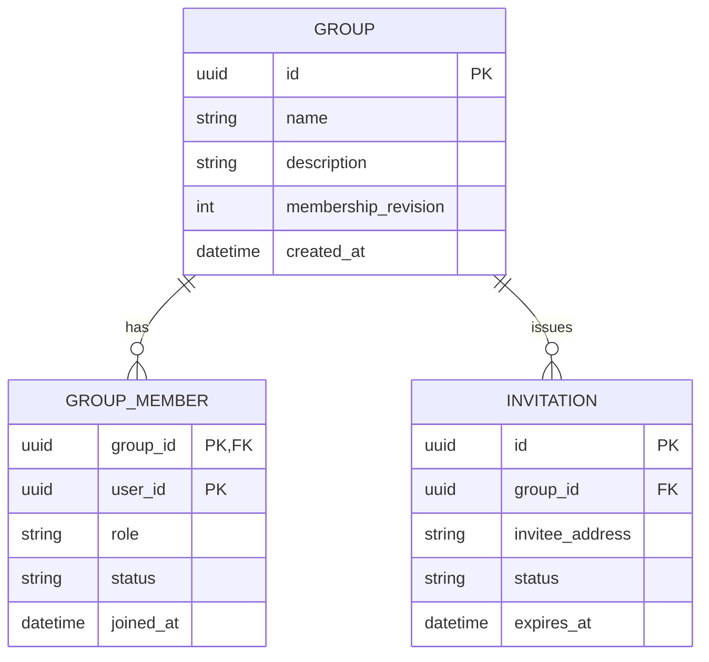
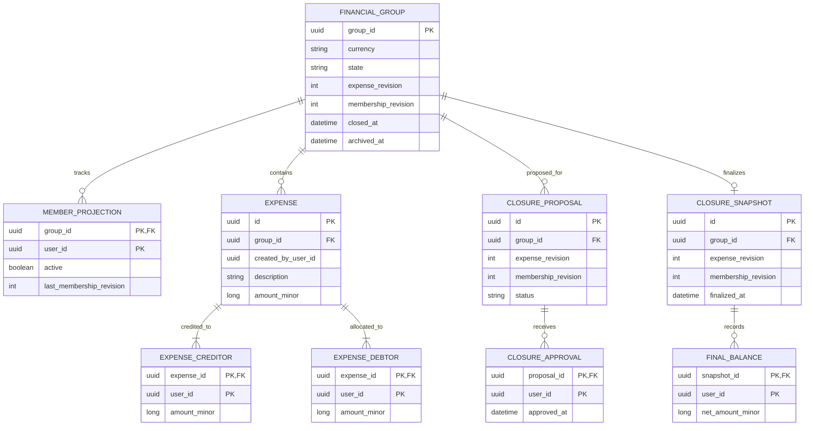
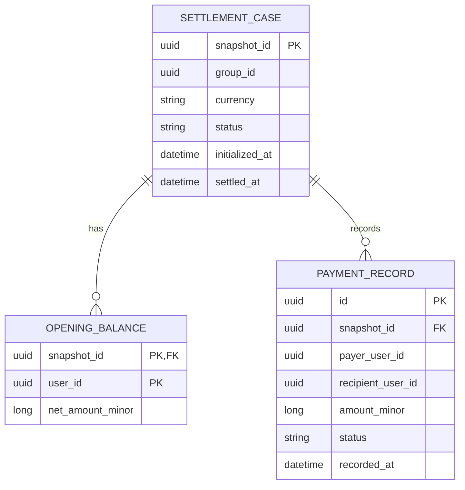
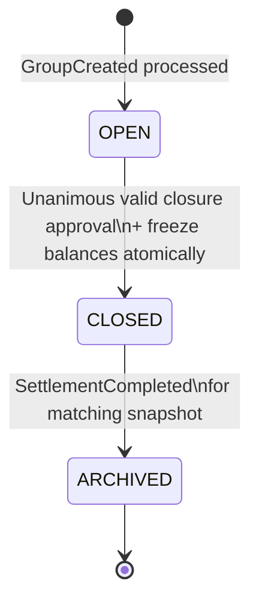

# ShareWise: Proposed Domain Boundaries and Financial Lifecycle

**Status:** Draft for review  
**Date:** 2026-10-14  
**Scope:** Conceptual domain/data model and cross-context contracts; not a final physical database schema or deployment decision.

## 1. Summary

We propose four **bounded contexts**, each with private data ownership:

| Context | Authoritative responsibilities | Local data |
| --- | --- | --- |
| **Identity & Access Management (IAM)** | User accounts, authentication, global access policy | Users, credentials, refresh tokens; global roles if needed |
| **Group Management** | Group identity and metadata, invitations, current membership, membership roles | Groups, memberships, invitations; monotonic membership revision |
| **Expense Management** | Expense ledger, expense participants and allocations, closure voting, **authoritative group financial lifecycle**, frozen balances | Expenses, creditors/debtors, minimal membership projection, closure approvals and snapshot |
| **Settlement Management** | Settling finalized group debts, payment records, outstanding balances | Settlement case, immutable opening balances, repayment records |

**Core proposal:** The group has a strictly forward-only **financial lifecycle**: `OPEN -> CLOSED -> ARCHIVED`. Expense Management atomically freezes the ledger and calculates per-user net balances at `OPEN -> CLOSED`. Only then does Settlement Management receive a **single immutable closing snapshot**. Neither financial context reads the other's database, and Settlement Management does not need the expense history.

## 2. Context boundaries and data flow

The manually laid-out overview below shows the **four logical bounded contexts**, their **private data ownership**, and the **four asynchronous event contracts**. It intentionally separates events into dedicated horizontal lanes rather than connecting every entity across service boundaries.

The overview excludes the UI and individual local entity relationships to remain readable. Clients invoke the relevant context's interface with an IAM identity token; **IAM is not a forwarding service and does not own group permissions**. Solid entity-level relationships and full attributes appear in the ER diagrams in §3.

The sequence diagram adds the **causal lifecycle**, including the events that travel back toward earlier contexts. Each context's outbound event is delivered asynchronously; the vertical order does **not** imply a globally ordered event stream.

All cross-context event arrows represent **asynchronous integration**; they are not synchronous service calls or cross-database relationships. Events are delivered with retries and deduplication. The exact initialization, voting, and settlement rules are specified in §§3–5.

### Data ownership rules

- **No cross-context SQL foreign keys, joins, or writes.** Shared identifiers (`userId`, `groupId`, `snapshotId`) are references, not cross-service relational constraints.
- IAM authenticates **who** the user is; Group Management determines **who belongs to a group**; Expense Management checks expense/voting eligibility against a **local, minimal membership projection**.
- Membership **roles remain in Group Management** unless a specific financial use case demonstrably requires them. Initial policy: any active member may add expenses and vote; no privileged financial role is needed.
- Group Management may display the financial phase through an event-fed **read-only projection**, but cannot change it. The authoritative `state` field is in Expense Management.
- Settlement Management consumes a finalized snapshot and does **not** replicate mutable membership or the expense ledger. Historical financial participants can remain eligible to view/confirm settlements after leaving the group.

## 3. Proposed conceptual data model

The following diagrams show **logical fields and relationships**, not complete ORM mappings. `PK`/`FK` denote **within-context** keys only. IDs referencing other contexts intentionally have no database-level FK. Financial amounts are integer minor currency units (e.g., cents).

### 3.1 IAM (deliberately simplified)

IAM may separately retain global roles and trusted issuers, as in the initial sketch. **This proposal does not require IAM group claims, group-aware global roles, or delegated group JWT issuance.** IAM's user ID is the common identity reference.

### 3.2 Group Management

- `GROUP_MEMBER` represents **present administrative membership**. Its group-scoped `role` controls membership/invitation operations; roles are not replicated to financial contexts by default.
- Membership changes increment `GROUP.membership_revision` and publish versioned `GroupMembershipChanged` events. A full snapshot/resynchronization endpoint should be available for recovery from event gaps.
- Membership changes never cascade-delete expenses, closing balances, or payment history.
- No financial `state` here. Optionally store `financial_state_view` as a **clearly marked projection** for display only; it is not authoritative.

### 3.3 Expense Management (authoritative financial phase)

**Invariants and intended semantics:**

- `FINANCIAL_GROUP` is initialized from `GroupCreated`. This is a **local financial aggregate**, not a second owner of group identity or metadata. `state` is one of `OPEN`, `CLOSED`, `ARCHIVED`, and is strictly monotonic.
- Each expense has a positive amount and creditor/debtor allocations. The sum of creditors equals the expense total; the sum of debtors equals the same total. Multiple creditors are supported. A single creditor is an allowed simpler MVP policy.
- `netAmount(user) = sum(credited amounts) - sum(allocated debtor amounts)` for that group and currency. Closing balances across all participants must sum to **zero**. Balances can include **former** members because historical obligations remain valid.
- `MEMBER_PROJECTION` is used to check current participation for **new** expense operations and closure approvals. Only `(groupId, userId, active, membershipRevision)` is needed. Expense Management does not need user names, email addresses, or group roles for these decisions.
- `expense_revision` increments on any modification that affects the expense ledger. A closure proposal records both the expense and membership revisions. If either changes, its prior approvals are invalidated and a fresh vote is required.
- `CLOSURE_SNAPSHOT` is **written exactly once**, in the same local transaction that changes `OPEN -> CLOSED`. Its rows cannot subsequently be modified. An outbox event containing the same snapshot is persisted in that transaction.
- The diagrams omit technical entities such as event inboxes/outboxes and deduplication records.

### 3.4 Settlement Management

- `SETTLEMENT_CASE` is initialized **once**, idempotently, from `GroupFinancialsClosed`; it does not exist for open groups. `OPENING_BALANCE` is an immutable copy of the closing snapshot.
- A confirmed payment decreases the payer's negative outstanding balance and the recipient's positive outstanding balance by the same amount. **Only confirmed payments** count toward completion under the assumed manual-payment model. Payment entries must not permit overpayment or invalid direction.
- `PAYMENT_RECORD` refers to a settlement case, **not to an individual expense**. The financial obligation is group-level and netted, rather than invoice/expense-specific.
- Once all outstanding balances are zero and there are no unresolved payment claims, Settlement Management publishes `SettlementCompleted(snapshotId)`. Expense Management then performs the authoritative `CLOSED -> ARCHIVED` transition. The settlement case may internally be marked completed first; cross-context display convergence is eventually consistent.

## 4. Lifecycle and invariants

| Phase | Permitted financial operations | Required condition to leave |
| --- | --- | --- |
| `OPEN` | Add/edit/remove expenses; review balances; propose/vote for closure | A valid approval set for an unchanged expense ledger and membership set; closure transaction succeeds |
| `CLOSED` | Read frozen expenses; record/confirm repayments; inspect outstanding balances | All obligations satisfied according to Settlement Management |
| `ARCHIVED` | Read-only financial history | Terminal; no reopening |

**Proposed closure sequence:**

1. An active member creates a closure proposal. The application presents the expense ledger and projected active-member roster, both tied to their current revisions.
2. All **currently eligible, active** members approve the same `(groupId, expenseRevision, membershipRevision)` proposal. Ledger or membership changes invalidate the approvals. A vote is an approval of a specific version, not a timeless permission to close.
3. In a **single Expense Management database transaction**, verify phase `OPEN`, compare revisions, verify the vote set, calculate/validate net balances, insert the immutable closing snapshot, change state to `CLOSED`, and append `GroupFinancialsClosed` to an outbox. The transaction serializes appropriately against concurrent expense writes.
4. Deliver the event with retries. Settlement Management deduplicates using the snapshot ID, stores opening balances, and begins settlement processing.
5. When debts are fully settled, Settlement Management emits `SettlementCompleted(snapshotId)` reliably. Expense Management validates the matching snapshot and current `CLOSED` state, changes state to `ARCHIVED`, and publishes a financial-state event for other read models.

There is **no** `CLOSED -> OPEN` or `ARCHIVED -> CLOSED` transition. Failed event delivery must be retried; it must not silently bypass lifecycle rules. `CLOSED` is allowed to persist while a settlement is pending or indefinitely if debt is not repaid.

### Important consistency limit: replicated membership

A local membership projection eliminates synchronous Group Management lookups on the expense hot path, **but it is eventually consistent**. Revision checks in Expense Management detect **changes already received**; they **cannot detect a membership change that Group Management has committed but whose event is still in flight**. Therefore, the baseline model does **not** guarantee strictly up-to-the-instant membership authorization or unanimity at closure.

Two possible policies are under consideration:

- **A. Eventual membership authorization (simpler baseline):** Use the versioned local projection. Votes are invalidated on received membership changes; accept a short consistency window for join/leave/revocation. Clearly state this is a product/security trade-off.
- **B. Strict closure roster (recommended if unanimity is a hard invariant):** Group Management temporarily **freezes membership changes** for a closure proposal and publishes an authoritative frozen roster/revision. Expense Management uses that roster for voting and closing; a cancelled proposal must explicitly release the freeze. This adds an asynchronous coordination protocol, including failure recovery, but avoids the in-flight-membership-change race without introducing synchronous per-expense calls.

**Review decision required:** Is eventual consistency sufficient for group membership and voting, or is a strict closure-roster protocol required? A signed group-scoped JWT **does not by itself solve this**, because expiry and revocation still need a policy. If immediate membership revocation is mandatory for writes, the authorization approach must also be reconsidered (e.g. an authoritative check or stronger coordination).

## 5. Integration contracts and authorization

| Producer | Consumer | Message / contract | Purpose |
| --- | --- | --- | --- |
| Group Management | Expense Management | `GroupCreated(groupId, currency?, ...)` | Initialize local financial group; any initial currency policy must be agreed |
| Group Management | Expense Management | `GroupMembershipChanged(groupId, userId, active, revision)` | Maintain minimal eligibility projection; detect gaps and resync |
| Expense Management | Settlement Management | `GroupFinancialsClosed(eventId, groupId, snapshotId, currency, expenseRevision, balances[])` | Immutable handoff; idempotent case creation |
| Settlement Management | Expense Management | `SettlementCompleted(eventId, groupId, snapshotId)` | Request transition to `ARCHIVED` for the matching snapshot |
| Expense Management | Group Management / UI projections | `FinancialStateChanged(groupId, state, snapshotId?)` | Display financial state without duplicating authority |

**Transport assumptions:** Event delivery may be at least once and out of order; consumers need idempotency, version checks where relevant, retries, and a gap-recovery strategy. A transactional outbox (and consumer inbox/deduplication) is assumed for reliable handoff.

**Authorization proposal:**

- IAM issues ordinary identity tokens with user ID. Other contexts validate tokens and check local business authorization. **No IAM-wide group role list** and **no delegated group-specific JWT issuer** are required initially.
- Group Management owns group roles, invitations, and membership administration.
- Expense Management checks the local active-member projection to authorize recording expenses and voting. Creditor/debtor participants are checked against the chosen participation policy (see open questions). Historical records never become invalid merely because membership changes.
- Settlement Management authorizes repayment/confirmation through **participants named in the immutable closing snapshot**, not via current Group Management membership. Additional rules for admin/dispute access remain open.

## 6. Assumptions and decisions embodied in this proposal

| ID | Proposal / working assumption | Rationale / consequence |
| --- | --- | --- |
| D-01 | Four bounded contexts; data is privately owned | Functional cohesion and independence; not necessarily four deployments |
| D-02 | `OPEN -> CLOSED -> ARCHIVED`, no backward transitions | Enables a clear, one-time financial handoff; disallows late edits |
| D-03 | Expense Management owns **all three financial phase transitions** | Closure and expense immutability can be enforced in one local transaction |
| D-04 | Settlement begins only at closure, from one immutable snapshot | No replication of individual expenses or continuous debt recalculation |
| D-05 | Settle **net per-user group balances**, not individual expenses | Small settlement data model and no expense-level settlement coupling |
| D-06 | Group Management owns membership and roles; Expense Management gets minimal replicated eligibility | Keeps IAM group-agnostic; no role duplication unless required |
| D-07 | Closure voting and approvals live in Expense Management | Approvals are directly bound to the financial revision and checked atomically at close |
| D-08 | Proposed voting rule is unanimity of eligible active members | Makes closure user-authorized; quorum/absence policy still to confirm |
| D-09 | One currency per group; monetary values use integer minor units | Avoids exchange-rate/rounding complexity for initial scope |
| D-10 | Payment recording is initially **manual**, with confirmation; no money movement integrated | Payment provider integration can be added behind Settlement Management later |
| D-11 | Former group members retain their historical financial obligations and necessary settlement access | Membership removal must not erase debts or block legitimate repayment |
| D-12 | At-least-once async events with idempotent consumers/outbox | Prevents service coupling through distributed DB transactions |
| D-13 | Group deletion does not cascade into financial history | History and unsettled obligations must remain auditable |

These are **proposal assumptions**, not claims that the product requirements already mandate them.

## 7. Open business and architectural questions

| ID | Question | Proposed default / impact |
| --- | --- | --- |
| **Q-01** | **How fresh must member status be for expense creation and voting?** | Versioned async projection for MVP. Strict revocation/unanimous roster requires stronger coordination; see §4. |
| **Q-02** | What happens if a member leaves or is removed while they owe/are owed money? | Preserve all existing obligations; allow settlement by frozen-snapshot participants, even after leaving. |
| **Q-03** | Can expenses name **nonmembers**, former members, or people invited but not yet joined? | Initially only active projected members can be included in **new** expense allocations. Historical entries remain intact. |
| **Q-04** | Can current members be added/removed while a closure vote is underway? | Invalidate the proposal when projected membership changes; consider freezing membership for strict voting semantics. |
| **Q-05** | Must **all** active members approve closure? What about unreachable users, zero members, or disagreement? | Unanimity is the tentative policy. Cancellation/reproposal, exceptions, and possible admin override require a decision. |
| **Q-06** | Can an expense be changed while closure voting is underway? | Yes while `OPEN`, but all approvals become stale and must be recollected. Could instead freeze edits during voting. |
| **Q-07** | What if an omitted or incorrect expense is discovered after closing? | Initially no reopening. A correction/dispute process or a new adjustment group would need explicit requirements. |
| **Q-08** | Do payments represent external transfers or does ShareWise actually move money? | Initially record externally performed/manual repayments; payment provider integration is out of scope. |
| **Q-09** | How is a repayment confirmed and who may dispute/reverse it? | Tentatively payer records and recipient confirms; only confirmed payments reduce obligations. Define reversal and dispute rules. |
| **Q-10** | How are partial payments, overpayment, payment direction, and netting handled? | Allow partial transfers between debtors and creditors; reject transfers exceeding outstanding balances; exact allocation algorithm TBD. |
| **Q-11** | Can a group be archived with uncollectable or forgiven debts? | Default **no**; define explicit write-off/forgiveness if required. A group may stay `CLOSED` indefinitely. |
| **Q-12** | Are currencies fixed per group? How are splits rounded? | One immutable group currency; allocations in minor units must total exactly, with deterministic rounding. |
| **Q-13** | Who can create a group, record/edit another user's expense, or initiate closure? | Membership roles govern group admin operations; default financial writes and voting open to active members. Fine-grained edits remain TBD. |
| **Q-14** | What if a group is created but Expense Management has not consumed `GroupCreated` yet? | Use retry/reconciliation; user-facing operations should report setup pending, not fabricate local group state. |
| **Q-15** | What is the retention/deletion policy for archived groups and accounts? | No hard deletion of financial records during active obligations; privacy-compliant retention/anonymization requires policy. |
| **Q-16** | Should users maintain recurring expenses across multiple periods? | Forward-only means a new group or separate future accounting-period abstraction; no reopen. |
| **Q-17** | Are membership changes/invitations permitted after financial closure? | Tentatively freeze the settlement participant set, regardless of later group administration. If membership edits must be prohibited immediately at `CLOSED`, this requires a coordinated Group Management policy, not merely an eventually updated state projection. |

## 8. Review requests and decision order

Before implementing the schema or settling on independent deployments, the team should agree on:

1. **Business semantics:** the irreversible lifecycle, group-level netting, and rules for post-closure corrections (D-02, D-05, Q-07).
2. **Membership correctness:** eventual replication versus strict closure roster; rules for removal and historical financial participation (Q-01 through Q-05, Q-17).
3. **Settlement semantics:** what constitutes a payment, who confirms it, and what happens if debts remain unpaid (Q-08 through Q-11).
4. **Scope:** currency, roles/permissions, and whether groups represent one accounting period or are reusable (Q-12, Q-13, Q-16).

**Recommendation:** Accept the bounded-context split as the provisional target architecture, but **do not treat the voting correctness or payment-recording policy as resolved**. Both influence invariants and therefore the final persistence model. Once agreed, refine the schema, commands/events, authorization matrix, and failure scenarios.

---

*Lecture alignment (context, not additional requirements): MIN-SWA Chapter 1 describes vertical functional decomposition and private service data (pp. 56–61), and notes event-driven replication, distributed transactions, and distributed query trade-offs (pp. 80–86). The particular ShareWise domain rules above are our design proposals, not prescribed by those slides.*
