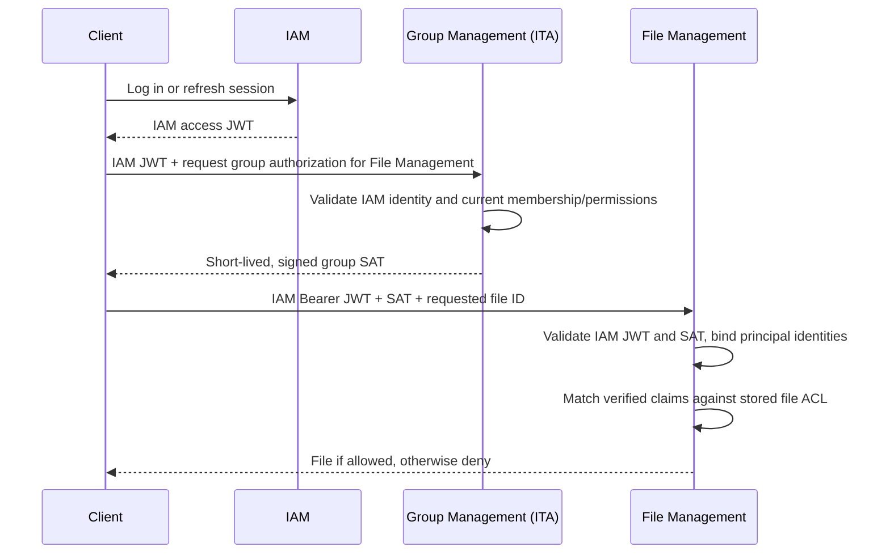

# ShareWise: Scoped Authorization Attestations and Generic File ACLs

**Status:** Proposal for team review · **Date:** 2026-10-17  
**Scope:** Cross-context authorization, with File Management as the primary use case  
**Not a decision to implement a custom authentication system.**

## 1. Problem and motivation

ShareWise has separate bounded contexts for **Identity & Access Management (IAM)**, **Group Management**, **Financial Management**, and **File Management**. IAM knows who a user is. Group Management knows which groups the user belongs to and their group-specific permissions. Financial Management owns expenses and transfers; File Management stores uploaded documents (such as receipts) without needing to understand expenses or groups.

A user who requests an expense receipt may be entitled to read it *because they belong to the group that owns it*. But File Management should ideally not have to:

- Replicate Group Management's membership and role tables solely to authorize downloads.
- Know what a group, expense, or invoice means in other bounded contexts.
- Make a synchronous call to Group Management for every file request.
- Treat an arbitrary client-supplied `groupId` as evidence of membership.

Likewise, IAM should not become the owner of all group-specific or resource-specific authorization rules. A normal IAM access token attests **identity**; the group-specific facts are owned elsewhere.

**Goal:** Enable consumer services to validate narrowly scoped, signed claims from trusted domain authorities, and apply a **generic claim-based ACL** to their own resources. Domain authorities remain responsible for deciding *who is eligible* for an attestation; consumers need only verify and match the resulting claims.

## 2. Proposed separation of responsibilities

| Component | Responsibility |
|---|---|
| **IAM (trust root for identity)** | Authenticate users, issue standard short-lived access JWTs, manage sessions/refresh tokens, and expose public verification keys. |
| **Intermediate Trust Authority (ITA) (e.g., Group Management)** | Validate an IAM-authenticated caller against authority-owned domain rules (e.g., "is this user a member of the group?"), then issue a short-lived (e.g., 2-5 minutes) **Scoped Access Token (SAT)** attesting contextual facts or permissions ("User X is a member of Group Y with role Z"). Group Management is the first proposed ITA. |
| **Consumer (e.g., File Management)** | Authenticate the caller using IAM, independently validate any supplied SAT (signature, expiration, check that SAT.principal = IAM.principal), and check the consumer's own ACL against *verified* claims. No need to interpret the issuing domain model. |

**SATs supplement, rather than replace, IAM authentication.** A SAT is not valid proof of identity on its own. Consumers require a valid IAM principal and bind every accepted SAT to it.

## 3. End-to-end example: access to a group-shared receipt



**Illustrative HTTP request (not a finalized wire protocol):**

```http
GET /files/file-789
Authorization: Bearer <iam-access-jwt>
ShareWise-Attestation: <group-sat-jwt>
```

There is only **one standard `Authorization` header**. A dedicated second header carries the additional attestation. Initially, one SAT per request is sufficient; a multi-SAT collection can be considered later if a real use case needs several authorities at once.

### SAT format

Rather than inventing a JSON+signature encoding, reuse a **standard signed JWT/JWS** with a *distinct token type* and well-defined validation rules. For illustration, a group SAT could contain:

```json
{
  "iss": "https://groups.sharewise.example",
  "sub": "user-123",
  "principal_iss": "https://iam.sharewise.example",
  "aud": "sharewise-files",
  "group_id": "group-456",
  "permissions": ["group:files:read"],
  "iat": 1792240000,
  "nbf": 1792240000,
  "exp": 1792240060,
  "jti": "unique-attestation-id"
}
```

Its **protected JWS header**, not the payload, would declare an explicit token type (for example `typ: sharewise-sat+jwt`) and an approved algorithm/key identifier. These values are examples, not finalized claim names or a registered token profile.

The SAT can be bound to the IAM identity by matching both `(principal_iss, sub)` to the validated primary token. Optionally, stronger session-level or exact-access-token binding could be added later; this improves protection against mixing tokens from different sessions but makes renewal more complicated.

## 4. Generic claim-based File Management ACLs

Each file has zero or more access rules. A rule grants a specific operation only when a **verified claim from an explicitly trusted source** satisfies the stored condition. File Management does not need to know the business meaning of a `group_id` claim.

**Illustrative logical ACL rule (not a prescribed SQL schema):**

```text
FileAccessRule
  fileId
  operation                 // READ, WRITE
  claimSource               // PRIMARY_IAM or SAT
  trustedIssuer             // exact approved issuer / authority (e.g., "group-management")
  claimName                 // e.g., "group_id"
  expectedValue?            // optional (if not present, only the existence of the claim is checked), e.g, "group-456"
```

For the initial version, **any matching rule can grant the operation (OR)**. Default is **deny** / file owner only.

**Example: file `file-789`, attached to an expense in `group-456`:**

| Allowed operation | Source | claimName | claimValue | Meaning to File Management |
|---|---|---|---|---|
| WRITE | IAM | `sub` | `user-123` | File shared with user-123, may be deleted by them. |
| READ | Group Management SAT | `group_id` | `group-456` | Any member of group-456 can read the file. |
| READ | IAM | `sub` | NULL | Any authenticated user can read the file (public access, e.g., for profile pictures). |
| READ | Financial Management SAT | `file_id` | `file-789` | Any user with a valid attestation by Financial Management for this specific file can read it (could easily be extended to share links) |

(A file always has an explicit owner who has full control over it, and who can specify or modify the ACL rules for that file.)

The ACL stores the **trusted issuer and exact expected value**. A JWT carrying `group_id=some-other-group` must not match. Nor should the mere existence of *any* `group_id` claim authorize access to *every* group file.

### Alternative: file-specific attestations

Not every expense attachment must be readable by every group member. If visibility depends on the specific expense, **Financial Management** could issue a short-lived SAT containing `file_id=file-789` and a `file:read` permission after checking expense access. File Management would still perform the same generic claim-matching algorithm. The issuer and matching claim change; **the ACL engine does not**.

This is an intentional trade-off:

- **Group-scoped SAT** works well for files whose ACL is genuinely group-wide.
- **File-scoped SAT** works well for private or resource-specific attachments.

The authority that creates or updates ACL rules must validate the underlying resource association. Otherwise, an uploader could make a private file group-readable just by supplying a chosen `groupId`. Files may therefore start uploader-only, then gain a broader ACL through an authorized Group/Finance operation. Removing an attachment, deleting an expense, or archiving a group needs an explicit retention and access policy.

## 5. Required validation and trust boundaries

The following are essential to making the idea safe; none should be delegated to raw string matching alone.

1. **Authenticate first.** Validate the primary IAM access token using standard security middleware. Invalid IAM authentication rejects the request regardless of SAT contents.
2. **Validate each SAT independently.** Enforce signature, allowed algorithm, trusted issuer/key, explicit token type, expected audience, `nbf`/`exp`, and acceptable clock skew. Issuers/keys must come from *configured trust relationships*, never arbitrary URLs named by an unverified token.
3. **Bind identities.** The SAT's identity issuer and subject must match the validated IAM principal. The SAT cannot authenticate a different user.
4. **Constrain issuer authority.** Trust Group Management only for agreed group-related claims, Finance only for approved finance/file grants, etc. A signed assertion from one issuer must not automatically confer unrelated rights.
5. **Match the requested resource.** Determine the actual `fileId` and its stored ACL server-side. Where a SAT authorizes a group, compare against the ACL's stored group identifier, not an independently trusted user-provided group ID.
6. **Protect ACL administration.** Only authorized business flows may create or change resource ACLs. Uploading a file or knowing its identifier must not permit granting oneself broader access.
7. **Fail closed.** Missing, malformed, expired, unmatched, incorrectly scoped, or ambiguously interpreted attestations never produce authorization. Limit token count and header size; never log raw bearer tokens.
8. **Define revocation behavior.** A revoked member may retain a previously issued SAT until expiry (plus allowed clock skew), unless extra revocation checks are implemented. New SAT issuance must re-check authoritative membership. Short token lifetimes bound normal staleness but do not provide immediate revocation.

This design **does not** remove the need for ordinary authorization and invariants within other contexts. For example, Financial Management must still decide whether a referenced debtor/creditor is eligible for an expense. The caller's group SAT proves *the caller's permissions*, not the membership of every referenced user. Finance can keep a minimal membership projection or use a Group Management API for participant validation.

## 6. Integration with the modular monolith and Spring Security

For the **initial modular monolith**, a synchronous, published authorization interface from Group Management is simpler than SAT issuance and verification. The SAT proposal is a candidate for **later service extraction**, not a requirement for the first implementation.

Spring Security's OAuth2 Resource Server can validate the primary IAM JWT. A custom authorization component (for example a request- or method-level `AuthorizationManager`) can then validate additional SATs with separately configured JWT decoders and evaluate typed, verified claims against File Management's ACLs. **We should use existing JOSE/JWT libraries and Spring integration points, not implement cryptography ourselves.**

The boundary should be designed around the decision (`may this authenticated principal perform operation X on resource Y?`), not around a particular header or token implementation. That permits an in-process authorization adapter now and an attestation-based adapter later.

## 7. Advantages and costs

| Aspect | Expected benefit / trade-off |
|---|---|
| **High: File Management independence** | Generic file ACL checking without local copies of group or financial domain models. |
| **High: Domain ownership** | Group Management remains authoritative for membership; IAM remains authoritative for identity. |
| **Medium: Local request validation** | Consumers usually validate signed attestations without a live call to their issuer. |
| **Medium: Reusable mechanism** | Other bounded contexts could issue tightly constrained attestations when justified. |
| **High cost: Security complexity** | Trust registry, key rotation, claim profiles, token binding, failure behavior, and revocation must be correct. |
| **Medium cost: Client complexity** | Client acquires/renews both IAM JWT and relevant SAT; custom headers can affect proxies/CORS. |
| **Medium cost: Time-limited authorization staleness** | Revocation is not necessarily immediate. |
| **Medium cost: ACL lifecycle** | Resource linkage, grants, unreferenced files, and deletions need explicit ownership and cleanup rules. |

### Alternatives worth comparing

- **Synchronous authorization API:** Simplest within the modular monolith, but creates a runtime dependency after extraction.
- **Replicated group membership:** Allows local checks and domain validation, but requires event propagation/reconciliation and has revocation lag.
- **OAuth token exchange / audience-specific tokens:** More standardized end-to-end token delivery, potentially supported by IAM infrastructure, but may be less naturally composable than retaining a primary identity JWT plus independent attestations.
- **Opaque short-lived file capabilities / signed URLs:** Potentially simpler when access is only to individual file bytes, but less expressive for generic claim-based ACL evaluation.

## 8. Open review questions

1. **Granularity:** Do we initially require only group-wide sharing and uploader ownership, or file-/expense-specific visibility as well?
2. **ACL control plane:** Which owning context may add or revoke each kind of File Management ACL? How does an upload become linked to an expense or group without creating an authorization gap?
3. **Attestation protocol:** One SAT per request initially? Which exact header/profile? Should we prefer standard token exchange if the selected IAM provider supports it?
4. **Identity binding:** Match identity issuer + user ID, or bind SATs more tightly to sessions/access tokens?
5. **Revocation target:** Is a short (e.g. 1-minute) stale-authorization window acceptable for former group members, including file downloads?
6. **Issuer trust:** Which contexts are allowed to issue SATs, for which audiences and claims, and who manages their verification keys?
7. **File lifecycle:** What happens to ACLs and storage when attachments are detached, membership changes, or groups are archived?
8. **Scope:** Is this mechanism worth building for the course's distributed phase, or should File Management start with a narrow synchronous authorization adapter?

## 9. Proposed decision for review

**Propose the trust model, not an immediate custom protocol implementation:**

- IAM authenticates; domain authorities attest narrowly scoped authorization facts; consumer contexts authorize operations through their own resource ACLs.
- File Management's ACL engine evaluates **verified, source-qualified claims** generically, without embedding group or expense semantics.
- Prefer standard JWT/JWS structures and Spring Security extension points if SATs are implemented.
- Keep Finance's participant eligibility and financial invariants separate from SAT-based caller authorization.
- Build the modular monolith with clear in-process module APIs first; revisit SAT-based distribution when extracting services.

This preserves the proposed separation of bounded contexts while making the additional security and operational costs visible for the team to evaluate.

---

### External technical references

- [Spring Security: OAuth2 Resource Server JWT](https://docs.spring.io/spring-security/reference/servlet/oauth2/resource-server/jwt.html)
- [Spring Security: Authorization Architecture](https://docs.spring.io/spring-security/reference/servlet/authorization/architecture.html)
- [RFC 8725: JSON Web Token Best Current Practices](https://www.rfc-editor.org/rfc/rfc8725.html)
- [RFC 8693: OAuth 2.0 Token Exchange](https://www.rfc-editor.org/rfc/rfc8693.html)

*These references inform the technical safeguards and alternatives; the IAM JWT + separate SAT header and generic File ACL combination described here is our proposed design, not a standardized protocol.*
