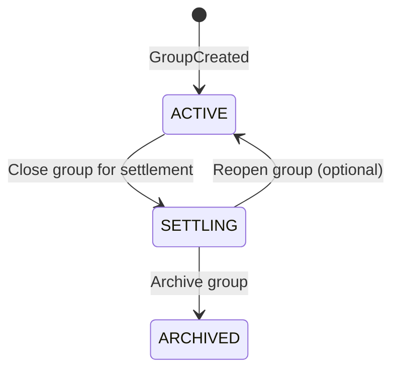

# ShareWise – Benutzerrollen, Berechtigungen und Group Lifecycle

Dieses Dokument fasst die **Benutzerrollen**, die **Berechtigungsmatrix** und den **Group Lifecycle** aus der erweiterten ShareWise-Ausarbeitung zusammen.

> **Status der Anforderungen:** Die Rollen unterscheiden fachliche Perspektiven derselben Person. Die Berechtigungen und Lifecycle-Übergänge sind **vorgeschlagene Produktentscheidungen** und müssen im Projektteam abgestimmt werden.

---

## Benutzerrollen (Actors)

| Rolle | Beschreibung |
|---|---|
| **Visitor** | Nicht registrierter Benutzer. |
| **User** | Registrierter Benutzer mit einem Account. |
| **Group Admin** | Gruppenmitglied mit Rechten zur Verwaltung der Gruppe. |
| **Group Member** | Reguläres Mitglied einer Gruppe. |
| **Invitee** | Person, die eine Gruppeneinladung erhalten hat. |
| **Expense Participant** | Gruppenmitglied, das an einer konkreten Ausgabe beteiligt ist. |
| **Payer** | Gruppenmitglied, das eine Ausgabe bezahlt hat. |
| **Debtor** | Mitglied, das einer anderen Person Geld schuldet. |
| **Creditor** | Mitglied, das Geld zurückbekommen soll. |

### Mehrfachrollen

Eine Person kann mehrere Rollen zugleich besitzen. Zum Beispiel kann **Max** gleichzeitig:

- registrierter **User** sein,
- **Group Admin** der Gruppe „Mallorca 2027“ sein,
- als **Payer** ein Abendessen bezahlt haben,
- als **Expense Participant** einen eigenen Kostenanteil tragen und
- aus anderen Ausgaben als **Debtor** oder **Creditor** hervorgehen.

**Wichtig für DDD:** *User*, *Member*, *Participant* sowie *Debtor/Creditor* beschreiben dieselbe Person in unterschiedlichen fachlichen Kontexten. Sie sind nicht automatisch identische Domänenobjekte.

---

## Kapitel 4 – Berechtigungen der drei Nutzerrollen

Diese Matrix beschreibt einen möglichen Berechtigungsstandard für **Group Admin**, **Group Member** und **Invitee**.

| Aktion | Group Admin | Group Member | Invitee |
|---|:---:|:---:|:---:|
| Gruppe ansehen | ✓ | ✓ | – |
| Ausgaben erfassen | ✓ | ✓ | – |
| Eigene Ausgaben bearbeiten | ✓ | ✓ | – |
| Fremde Ausgaben bearbeiten | ✓ | – | – |
| Ausgaben stornieren | ✓ | Eigene | – |
| Mitglieder einladen | ✓ | – | – |
| Mitglieder entfernen | ✓ | – | – |
| Rollen verändern | ✓ | – | – |
| Gruppendaten ändern | ✓ | – | – |
| Salden ansehen | ✓ | ✓ | – |
| Rückzahlungen erfassen | ✓ | ✓ | – |
| Rückzahlungen bestätigen | ✓ | ✓ | – |
| Gruppe schließen | ✓ | – | – |
| Gruppe wieder öffnen | ✓ | – | – |
| Gruppe archivieren | ✓ | – | – |
| Einladung annehmen | – | – | ✓ |

### Hinweise zur Berechtigungsmatrix

- Ein **Group Admin** ist selbst ein Gruppenmitglied mit zusätzlichen Verwaltungsrechten.
- Ein **Group Member** darf eigene Ausgaben bearbeiten; die Bearbeitung fremder Ausgaben ist hier Admins vorbehalten.
- **Rückzahlungen erfassen/bestätigen** heißt **nicht**, dass jedes Mitglied beliebige Zahlungen anderer Personen bestätigen darf: Die jeweiligen Beteiligten und die Zahlungsberechtigungen müssen geprüft werden.
- Berechtigungen gelten nur, soweit der **Gruppenstatus** die Aktion erlaubt.
- **Invitees** können die Einladung annehmen; Gruppenrechte entstehen erst nach erfolgreichem Beitritt.
- Die konkreten Definitionen von „eigene Ausgabe“ und den erlaubten Zahlungsoperationen sollten im Team festgelegt werden.

---

## Kapitel 5 – Group Lifecycle

ShareWise unterscheidet drei vorgeschlagene Zustände einer Gruppe:

### 5.1 Zustandsdiagramm

### 5.2 Zustände und erlaubte Aktionen

| Gruppenstatus | Erlaubte Aktionen |
|---|---|
| **`ACTIVE`** | Ausgaben erfassen und ändern, Mitglieder verwalten, Salden prüfen, Rückzahlungen erfassen. |
| **`SETTLING`** | Finale Salden prüfen, offene Rückzahlungen erfassen und bestätigen, Gruppe ggf. wieder öffnen. |
| **`ARCHIVED`** | Historische Ausgaben, Rückzahlungen und finale Abrechnungen ansehen (lesender Zugriff). |

### 5.3 Statusübergänge

#### `ACTIVE` → `SETTLING`: Close Group for Settlement

- Nur ein berechtigter Benutzer darf die Gruppe schließen.
- Das System prüft, ob die Gruppe aktiv ist und ihre finalen Salden berechnet werden können.
- Neue Ausgaben sind nach dem Übergang nicht mehr erlaubt.
- Bestehende Ausgaben werden für die Endabrechnung festgehalten.
- **Offene Schulden verhindern das Schließen nicht**; sie sollen im Zustand `SETTLING` ausgeglichen werden.

#### `SETTLING` → `ACTIVE`: Reopen Group (optional)

- Ein berechtigter Admin öffnet die Gruppe wieder.
- Dies kann nötig sein, wenn eine vergessene Ausgabe hinzugefügt oder eine bestehende Ausgabe korrigiert werden muss.
- Nach der Wiedereröffnung sind Aktionen des Zustands `ACTIVE` wieder möglich.
- Diese Funktion ist eine vorgeschlagene Produktentscheidung.

#### `SETTLING` → `ARCHIVED`: Archive Group

- Nur ein berechtigter Benutzer darf archivieren.
- Alle finalen Mitgliedersalden müssen **0 €** betragen.
- Relevante Rückzahlungen müssen bestätigt sein.
- Offene abrechnungsrelevante Streitfälle sollten zuvor geklärt sein.
- Nach dem Archivieren dürfen keine neuen Ausgaben, Zahlungen oder Mitgliederänderungen mehr erfasst werden.
- Die Historie bleibt zur Einsicht erhalten.

### 5.4 Zusätzliche Regeln

- Eine archivierte Gruppe ist grundsätzlich **schreibgeschützt**.
- Eine etwaige **Wiederherstellung aus dem Archiv** müsste separat definiert werden; sie ist im oben dargestellten Standardablauf nicht enthalten.
- Die **Lebenszyklus-Regeln** und die **rollenbasierten Berechtigungen** gelten gleichzeitig: Eine Aktion ist nur erlaubt, wenn die Person berechtigt ist **und** der Status der Gruppe sie zulässt.

---

## Beispiel „Mallorca 2027“

1. **Max** erstellt die Gruppe → Status **`ACTIVE`**, Max ist **Group Admin**.
2. **Anna, Lisa und Tom** treten bei → Sie werden **Group Members**.
3. Die Gruppe erfasst Ausgaben und Rückzahlungen im Alltag → Status bleibt **`ACTIVE`**.
4. Nach der Reise schließt Max die Gruppe für die finale Abrechnung → Status **`SETTLING`**.
5. Alle offenen Rückzahlungen werden erfasst und bestätigt → Die Salden erreichen **0 €**.
6. Max archiviert die Gruppe → Status **`ARCHIVED`**; die Historie bleibt einsehbar.

