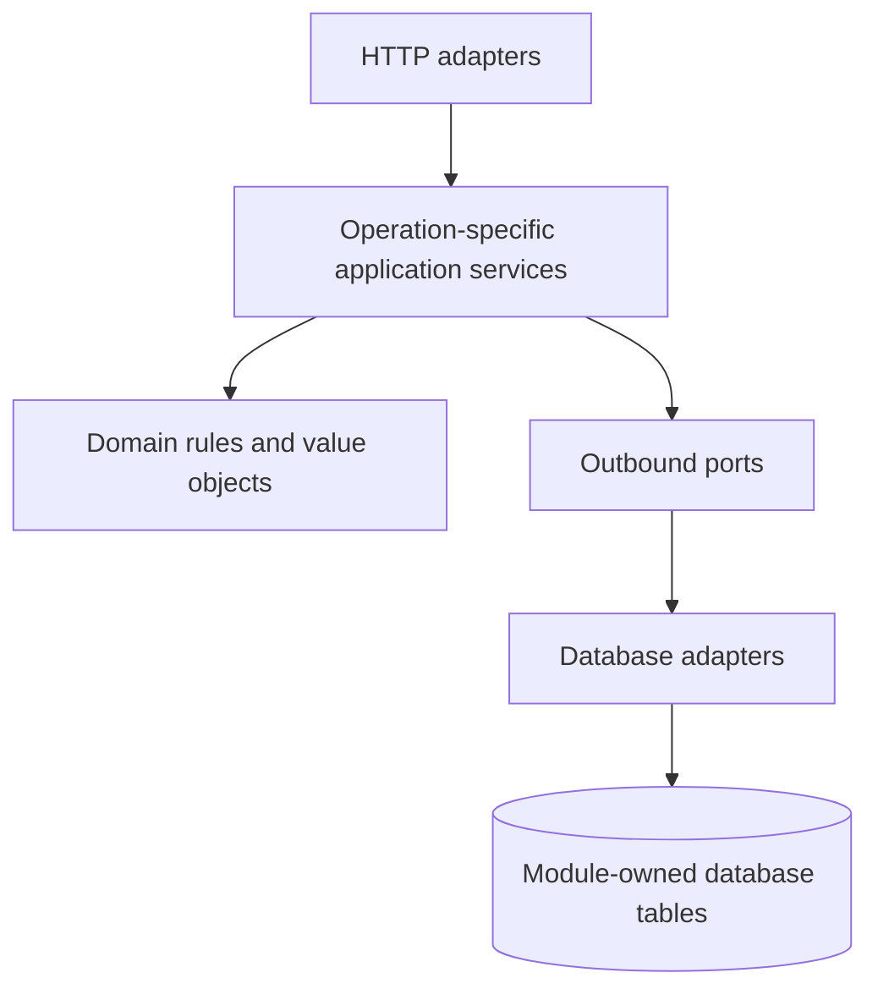

# Application architecture

ShareWise runs as a modular monolith. The backend separates application-operation lifetime, transaction ownership and bounded-context persistence so that sharing a process and database does not imply shared business authority. This document describes the application structure; the [technical stack](stack/overview.md) and [domain model](data-model-design.md) describe the wider target design.

## System organization

ShareWise uses a hexagonal (ports-and-adapters) architecture inside each bounded context. The business modules are User & Identity Management (`identity`) and Financial Management (`finance`). IAM owns account and session workflows; Finance owns the group-root and actor schema and an internal root-locking port. Shared infrastructure (`shared`) and host health endpoints (`system`) have separate modules.

Each module owns its data, domain model and ports. Other modules access it only through explicitly published contracts. Sharing PostgreSQL does not authorize cross-context joins, foreign keys, repositories or business transactions. A synchronous cross-context call requires a reviewed integration boundary with independent operation-scope and transaction semantics; module dependency declarations alone do not establish that contract.

Runtime calls typically travel from inbound adapters to the application core and through outbound ports. Source dependencies point toward the interfaces owned by the core; the infrastructure adapters implement those interfaces. The diagram describes responsibilities rather than requiring a separate facade or package for each layer.

### Module structure and published APIs

Spring Modulith derives application modules from direct sub-packages of `de.hsh.favs.sharewise`. A module's package is created by the first vertical slice that needs it. The host-local `system` module contains monolith-level HTTP probes under `system.api.v1`; it consumes the narrowly published `shared::health` readiness contract while its datasource probe implementation remains internal to `shared`. Business HTTP controllers live under their owning context, as in IAM. The application-root HTTP security composition supplies one `/api/**` chain for all contexts; IAM publishes a narrowly scoped `identity::transport` contribution for bearer admission and its own cookie-authentication protections. This host integration is not an outbound dependency from `shared` to IAM, and the [published identity contracts](architecture/authorization.md#semantic-identity-and-authorization) keep credential evidence independent of resource-specific authorization. `system` is a host-local module, not a business context.

A module's **top-level package is its published API**: the operation-focused command and query contracts and immutable records that other modules may use. Implementation, domain internals and adapters live in sub-packages. These remain internal to the module even when Java requires a type to be `public` for wiring across the module's own packages. A sub-package becomes part of the API only through an explicit Spring Modulith **named interface**, referenced as `module::name`, and only where a module publishes a genuinely separate contract. Types that need no access from other packages stay package-private.

Every module is a closed module and declares its permitted dependencies with `@ApplicationModule(allowedDependencies = {...})` in its base `package-info.java`, listing each module API or named interface it uses. A new cross-module dependency therefore changes that declaration and is visible in review. Wildcard named-interface grants (`module::*` and `module::**`) are forbidden; consumers must name each permitted contract, and `shared` can be accessed only through explicitly named interfaces. The host-local `system` module may depend only on `shared::health`. Other explicit cross-context grants remain subject to architectural review: verification cannot establish whether an unused permission has been approved. The declaration records a dependency but does not approve it: a synchronous cross-context call still requires the reviewed integration boundary described above. Dependencies on `shared` are listed explicitly, for example `"shared :: di"`, rather than implicitly allowed for all modules.

`shared` declares `allowedDependencies = {}`, so infrastructure can never depend on a business context, and the module graph stays acyclic and extractable. Its top-level package publishes nothing; each infrastructure capability has its own named interface. For example, the DI contracts in `shared.infra.di` are published as `shared::di`, the authorization evidence API in `shared.infra.claims` as `shared::claims`, the JWT primitives in `shared.infra.security` as `shared::security`, and the controller error/validation contracts in `shared.infra.web` as `shared::web`, while Spring implementations under `internal` sub-packages are not published.

## Packaging and runtime boundary

The locally runnable deployment has one Nginx/static-export frontend, one Spring Boot modular-monolith backend and one PostgreSQL 18 database. Nginx is the only host-exposed service; it terminates TLS and forwards `/api/*` unchanged over a private application network. The backend alone accesses PostgreSQL on a separate data network. The browser does not connect to PostgreSQL or require a Next.js runtime server. Deployment packaging does not change bounded-context ownership or introduce a distributed business-service boundary.

PostgreSQL initializes separate runtime and Flyway migration roles on an empty persistent data volume. The Spring `production` profile requires distinct runtime secret files and starts Flyway before readiness; Nginx and the backend expose independent health checks. These startup guarantees do not imply automatic rollout, backup, or password rotation for a populated database. See the [persistence foundation](architecture/persistence.md) for database authority and the [deployment guide](../deploy/README.md) for concrete single-host operations.

CI publishes the backend and frontend as separate images and verifies a matching, digest-qualified pair before recording a release descriptor. The `latest` aliases are not a transaction or an authoritative deployment reference. [CI and test guidance](development/tests.md#ci-and-diagnostics) owns the versioning and registry contract.

## Operation- and data-flow-oriented services

Published interfaces expose meaningful command and query operations. DI-managed, normally stateless application services implement them; small cohesive services can be used directly without a pass-through facade. Application input and output contracts use **immutable Java records** where suitable, independently of JPA entities and transport-specific types. Cross-context references use stable business terminology and opaque IDs; navigable entity graphs remain within their owning module.

Input adapters can use the published `shared::validation` `DomainObjectFactory` contract to convert transport DTOs into validated commands, returning `Result<Command, ValidationErrors>`. Domain/application validators remain authoritative; adapters map structured errors into protocol-specific responses, such as HTTP `ProblemDetail`, without requiring domain objects to depend on transport types.

Outbound data ports describe use-case operations rather than generic `findAll()/save()` repositories. They encapsulate targeted queries and conditional SQL mutations instead of loading entire aggregates. Domain invariants and port semantics remain application-owned, while physical queries and ORM entities remain internal to adapters. Integration tests verify database-enforced invariants.

Command and query paths need not be symmetrical. Queries generally return direct projections without change tracking or rich aggregate reconstruction; commands retrieve only facts or state required to validate and commit the operation. Read/write separation does not imply separate databases, event sourcing, or a generic message bus.

## Transaction-aware ports

The application core decides when to commit through an operation-scoped `Transactions` port. The implemented [transaction architecture](architecture/transactions.md) defines its outcomes, sequential physical segments, rollback-only behavior, lifecycle and Spring-managed persistence participation. The [operation DI scope](architecture/dependency-injection.md) owns service lifetime independently of physical transaction boundaries; inbound adapters dispatch operations without owning their commits.

Application services use domain-oriented outbound ports and interpret typed business results to select the disposition of each segment. Infrastructure adapters implement those ports with segment-bound jOOQ or JPA accessors; business APIs do not expose database connections, persistence sessions or transaction status. A segment is local to the owning application's data boundary, not an authorization to write another context's tables.

Finance exposes an internal group-root persistence port on top of this transaction infrastructure. It can provision and lock a root in a caller-owned segment or lock an existing root without creating one. The lookup result distinguishes absence from a snapshot of an existing lifecycle state and provides a typed readiness check; the lock remains held until physical transaction completion. Finance consumes only `shared::jooq` and `shared::result` and publishes no cross-context API. See [Finance persistence](architecture/persistence.md#finance-persistence) for the schema and serialization contract.

## Integration boundaries

The [verified-credential foundation](architecture/authorization.md) verifies primary IAM evidence and exposes operation-scoped identity. The application-root security composition admits requests and IAM owns credential and session behavior. Business authority remains with the resource-owning context, rather than the shared security infrastructure. The [security design](stack/security.md) and [messaging design](stack/messaging.md) describe cross-context integration contracts separately from the runtime architecture.

## Infrastructure integration

The [technical stack overview](stack/overview.md) maps technologies to runtime responsibilities. The [persistence architecture](architecture/persistence.md) defines database authority and adapter access.

Backend services use Spring constructor injection. Stateless shared infrastructure normally remains singleton-scoped, while the [application-operation DI scope](architecture/dependency-injection.md) gives stateful entry services, participants and adapters one explicitly dispatched lifetime. Operation-scoped `Transactions` uses Spring's programmatic transaction manager (normally `TransactionTemplate`) to physically finalize each segment. The dispatcher and REST adapters do not own application transaction completion. Generated jOOQ types and Hibernate entities stay inside persistence adapters.

Application operations generally use straightforward imperative Java; virtual threads remain subject to connection-pool capacity and database locking. Architectural tests enforce allowed module dependencies; the [backend test architecture](architecture/tests.md) separates offline validation, rollback-isolated PostgreSQL checks and durable-commit scenarios.

## Architecture checks

Tests cover domain invariants, invalid input, concurrency races and commit, rollback and failure paths; integration tests exercise real adapters. Fixtures are deterministic, with property-based or invariant tests where they add meaningful coverage. Module dependencies remain acyclic, and architectural changes are reviewable and documented without introducing pass-through abstractions.

Module boundaries are verified with every backend build. A test analyzes the compiled application with Spring Modulith and fails on access to another module's unpublished types, on dependencies missing from a module's `allowedDependencies` declaration, and on cycles between modules. Project-owned checks additionally fail for conditions that Spring Modulith accepts: a module that declares no whitelist, which it treats as unrestricted; a module configured as globally shared through `@Modulithic(sharedModules = ...)`, which it adds to every other module's allowed dependencies without a declaration; an `OPEN` module; wildcard or overly broad module dependency grants (including any `system` dependency other than `shared::health`); and an implementation package published through a named interface. Small fixture applications in the test sources show that each of these violations is detected and that declared dependencies on published APIs pass. Verification is static bytecode analysis and needs neither a running application nor a database.
