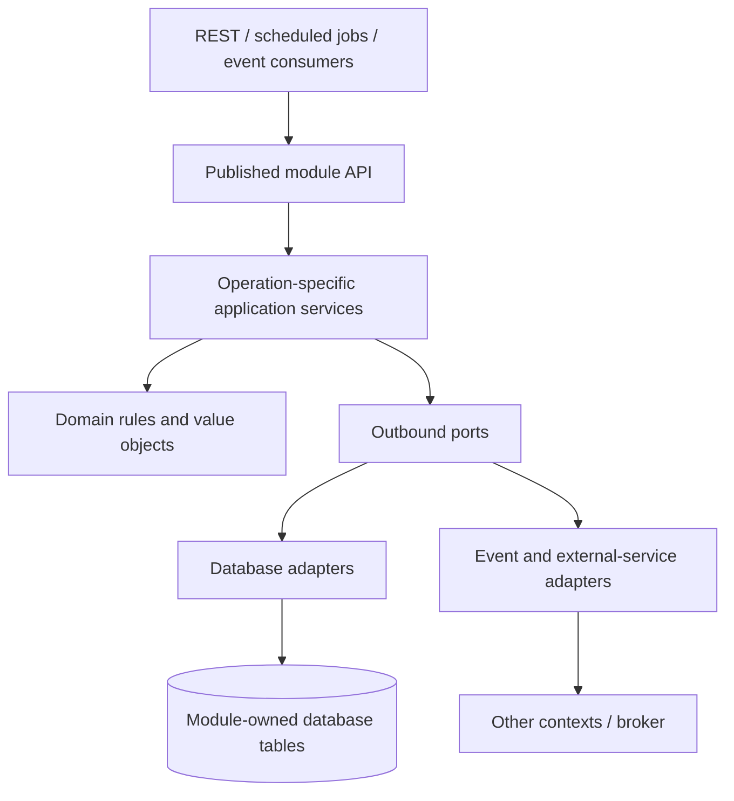

# Application architecture

**Status:** Agreed architectural direction; implementation is at starter stage. This document describes the intended component contracts, not features already present in the repository.

## System organization

ShareWise starts as a **modular monolith** with a hexagonal (ports-and-adapters) architecture **inside each bounded context**. The primary modules are User & Identity Management, Group Management, Financial Management, File Management, and Notification Management. They are ownership and language boundaries, not automatically one deployment each. Consult [the domain model](data-model-design.md) for their responsibilities and invariants.

Each module owns its data, domain model, commands, queries, published APIs and outbound ports. Other modules access it **only via its supported API or integration events**. The initial shared PostgreSQL deployment must not become a license for cross-context joins, foreign keys, repositories, or transactions. Extraction to separate services should replace integration adapters rather than rewrite domain operations. Cross-context synchronous calls are possible, but intentional; event-driven propagation is preferred for independent, asynchronously consistent state.



Runtime calls typically travel from inbound adapters to the application core and through outbound ports. Source dependencies point toward the interfaces owned by the core; the infrastructure adapters implement those interfaces. Diagram layers are conceptual: do not create a facade, interface, mapper, or package for every trivial method merely to mirror this picture.

## Operation- and data-flow-oriented services

Published interfaces expose meaningful command and query operations. DI-managed, normally stateless application services implement them; small cohesive services can be used directly without a pass-through facade. Application input and output contracts use **immutable Java records** where suitable. Keep them separate from JPA entities and transport-specific types. Prefer stable business terminology and opaque IDs for cross-context references; do not expose navigable cross-module entity graphs.

Typical names and responsibilities:

| Contract | Example | Meaning |
| --- | --- | --- |
| Command | `CorrectExpense` | Input to a business mutation, including expected revision |
| Query | `HistoricalBalancesQuery` | Parameterizes a read at a group revision |
| Operation result | `CorrectionResult` | Success or typed expected failure such as not-found/conflict |
| Read projection | `ExpenseSummary`, `GroupBalances` | Consumer-specific, minimal, immutable data |
| Application service | `ExpenseModificationService`, `BalanceQueryService` | Workflow, authorization, result mapping and commit decision |
| Outbound port | `ExpenseCorrectionPort`, `BalanceReadPort` | Data capabilities required by that workflow |
| Adapter | `ExpensePersistenceAdapter` | Efficient implementation of port semantics |

Avoid generic repositories that expose `findAll()/save()` without describing the actual operation. A read port may perform an `EXISTS`, joined validation, filtered pagination, aggregation, window-function history reconstruction, or a conditional SQL mutation **inside the database**. Domain invariants and the meaning of the port remain application-owned. Keep physical queries and ORM entities internal to the adapter. Do not materialize whole aggregates just to evaluate SQL-resident facts; do not duplicate domain decisions independently inside adapters. Verify database-side invariant implementations with integration tests.

Command and query paths need not be symmetrical. Queries generally return direct projections without change tracking or rich aggregate reconstruction; commands retrieve only facts or state required to validate and commit the operation. Read/write separation does not imply separate databases, event sourcing, or a generic message bus.

## Transaction-aware ports

The application core depends on a **technology-agnostic opaque `TransactionSession`**. An application operation establishes its transaction through the `Transactions` port and passes the resulting session explicitly to participating outbound data operations. The session is not a JDBC connection, JPA `EntityManager`, DI request scope, or globally shareable ambient state. Its infrastructure implementation validates lifetime and resolves a common underlying transaction for all participating adapters. The transaction is bound to the operation invocation, independently of DI bean lifetime or HTTP request scope; REST, event and scheduled-job adapters invoke the same application operations.

Illustrative interface shapes (not existing source APIs):

```java
interface TransactionSession {}

interface Transactions {
    <T> T execute(Function<TransactionSession, TransactionOutcome<T>> operation);
}

interface ExpenseCorrectionPort {
    ExpenseCorrectionFacts inspect(TransactionSession tx, CorrectExpense command);
    AppendRevisionResult appendRevision(TransactionSession tx, ExpenseRevision revision,
                                        long expectedEntityRevision);
}
```

A `TransactionOutcome<T>` carries the operation result and a separate, deferred decision such as **commit**, **rollback**, or **abstain**. The enclosing business operation alone authorizes final commit; subordinate data-access results do not imply a transaction decision. A read-only or no-op participant may abstain. Any participant can mark a session **rollback-only**, and later success cannot undo that requirement. Abandoned or exceptional operations roll back; `Transactions.execute(...)` reports a successful commit only after the physical database commit succeeds. An unrelated ambient Spring transaction cannot silently defer that commit. The transaction session is confined to its operation and is not shared across concurrent threads.

Expected outcomes (not found, stale revision, invalid participant) are **typed results**, independent of the enclosing commit decision. An operation may commit after an expected unsuccessful result if its transaction state remains valid, or roll back despite a nominally successful data-access result. An adapter may map *known* database constraints to typed failures, but errors that leave a transaction or ORM context unusable poison the transaction even if represented as results. Unknown infrastructure failures propagate and roll back. Database error classification does not rely on parsing exception messages.

Finance applies an additional business protocol **inside** this generic transaction:

1. Lock the FinancialGroup for the relevant group (or use an equivalent proven serialization protocol); enforce lifecycle/authorization and optimistic entity-revision preconditions.
2. Validate local and database-resident invariants using targeted state/fact projections.
3. Allocate the next **group-local financial revision**, persist the immutable Expense/Settlement state and its children, and append the corresponding ChangeRecord.
4. Persist an integration-event publication record in the same transaction when required; only then authorize commit.

All financial mutations in one group must follow the same ordering and locking protocol. A database sequence or independent auto-increment IDs alone cannot guarantee the required logical commit order. Historical reads at one group revision must be consistent. The exact COW tables and indexes are infrastructure choices; the [persistence architecture](stack/persistence.md) describes the preliminary database and adapter technology decisions. See [domain history](data-model-design.md#financial-revisions-and-history).

## Integration events and extraction

The [preliminary messaging architecture](stack/messaging.md) uses versioned integration facts and Spring Modulith's persistent, JDBC-backed Event Publication Registry for durable asynchronous cross-context propagation. A producer records publication intent atomically with its state change; consumers process independently and idempotently, using a transactional inbox or a proven business-data invariant. Delivery may be duplicated, delayed or out of order; unsuccessful listeners remain recoverable. Failed notifications do not roll back Finance.

**Finance's ChangeRecord journal is business-visible financial history, not the delivery registry or an event store.** Group Management remains membership authority; Finance maintains an eventually synchronized local FinancialActor representation. Rejoining reactivates the same financial identity. An external broker is introduced on justified service extraction without changing context-owned business operations. Avoid remote transactions or cross-context database coupling, even while deployed together.

The [preliminary security architecture](stack/security.md) separates IAM identity/session assertions from issuer-qualified domain attestations. Group Management owns group permissions; consumers validate independently signed claims and enforce their own resource and business rules. Published authorization capabilities remain available for immediate checks within the modulith, and selected sensitive operations may require authoritative introspection after extraction. The [generic file ACL proposal](scoped-authorization-attestations-proposal.md) is a separate, unaccepted extension of this trust model.

## Infrastructure integration

The [technical stack overview](stack/overview.md) maps the selected frameworks and tools to the runtime layers and distinguishes the starter from the intended system. The [persistence](stack/persistence.md), [messaging](stack/messaging.md) and [security](stack/security.md) designs own their corresponding technology-specific contracts; this document owns the module boundaries and application interaction model.

Backend services use Spring constructor injection and are normally stateless singletons. Explicit `@Bean` composition selects implementations and lifetimes where needed. The infrastructure implementation of `Transactions` uses Spring transaction management (typically `TransactionTemplate`) to create and finalize each application-operation transaction. REST controllers, event listeners, scheduled-job adapters and application core services do not require `@Transactional` annotations. Transaction-aware data adapters participate through the explicit session, and publication records participate in the same Spring-managed transaction. Generated jOOQ types, Hibernate entities and event-delivery infrastructure stay inside adapters.

Prefer straightforward imperative Java operations; virtual threads are an option, not a replacement for database connection limits or locking. Once modules are implemented, architectural tests should verify allowed module dependencies and PostgreSQL integration tests should verify the real persistence and concurrency semantics. These are target conventions, not a claim that the starter already implements them.

## Architecture checks

Tests should verify domain invariants, invalid input, concurrency races and commit/rollback/failure paths; integration tests should exercise real adapters. Prefer deterministic test fixtures and property/invariant tests where they add meaningful coverage. Architectural changes should be small enough to review cohesively, accompanied by clear steady-state documentation, and not introduce cyclic context dependencies or pass-through abstractions for their own sake.
