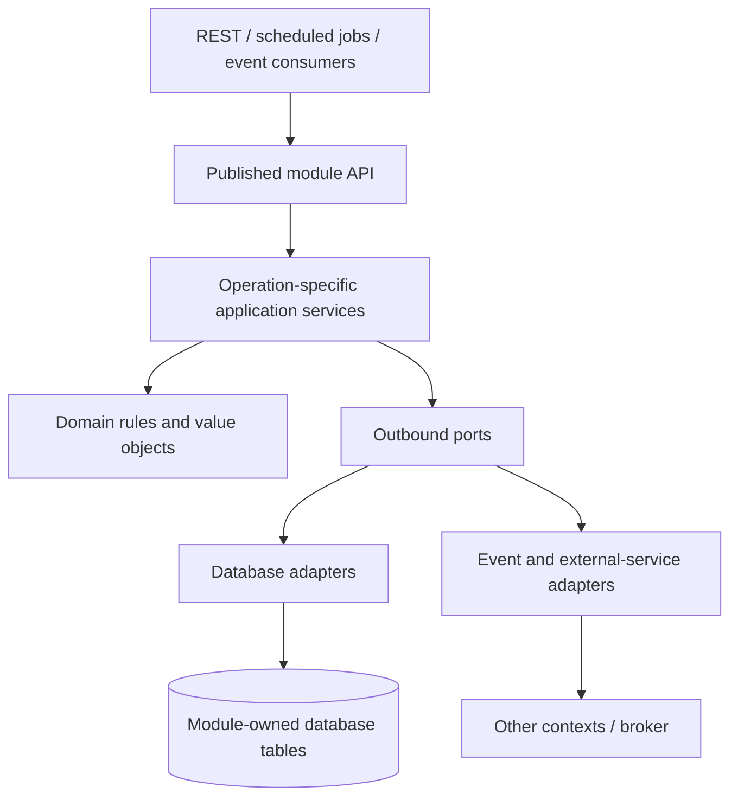

# Application architecture

**Status:** Agreed architectural direction; implementation is at starter stage. This document describes the intended component contracts, not features already present in the repository.

## System organization

ShareWise starts as a **modular monolith** with a hexagonal (ports-and-adapters) architecture **inside each bounded context**. The primary modules are User & Identity Management, Group Management, Financial Management, File Management, and Notification Management. They are ownership and language boundaries, not automatically one deployment each. Consult [the domain model](data-model-design.md) for their responsibilities and invariants.

Each module owns its data, domain model, commands, queries, published APIs and outbound ports. Other modules access it **only via its supported API or integration events**. The initial shared PostgreSQL deployment must not become a license for cross-context joins, foreign keys, repositories, or transactions. Extraction to separate services should replace integration adapters rather than rewrite domain operations. Cross-context synchronous calls are possible, but intentional; event-driven propagation is preferred for independent, asynchronously consistent state.



Runtime calls typically travel from inbound adapters to the application core and through outbound ports. Source dependencies point toward the interfaces owned by the core; the infrastructure adapters implement those interfaces. Diagram layers are conceptual: do not create a facade, interface, mapper, or package for every trivial method merely to mirror this picture.

## Operation- and data-flow-oriented services

Published interfaces expose meaningful command and query operations. DI-managed, normally stateless application services implement them; small cohesive services can be used directly without a pass-through facade. Application input and output contracts use **immutable Java records** where suitable. Keep them separate from JPA entities and transport-specific types. Prefer stable business terminology and opaque IDs for cross-context references; do not expose navigable cross-module entity graphs.

Typical names and responsibilities:

| Contract | Example | Meaning |
| --- | --- | --- |
| Command | `CorrectExpense` | Input to a business mutation, including expected revision |
| Query | `HistoricalBalancesQuery` | Parameterizes a read at a group revision |
| Operation result | `CorrectionResult` | Success or typed expected failure such as not-found/conflict |
| Read projection | `ExpenseSummary`, `GroupBalances` | Consumer-specific, minimal, immutable data |
| Application service | `ExpenseModificationService`, `BalanceQueryService` | Workflow, authorization, result mapping and commit decision |
| Outbound port | `ExpenseCorrectionPort`, `BalanceReadPort` | Data capabilities required by that workflow |
| Adapter | `JdbcExpenseAdapter` | Efficient implementation of port semantics |

Avoid generic repositories that expose `findAll()/save()` without describing the actual operation. A read port may perform an `EXISTS`, joined validation, filtered pagination, aggregation, window-function history reconstruction, or a conditional SQL mutation **inside the database**. Domain invariants and the meaning of the port remain application-owned. Keep physical queries and ORM entities internal to the adapter. Do not materialize whole aggregates just to evaluate SQL-resident facts; do not duplicate domain decisions independently inside adapters. Verify database-side invariant implementations with integration tests.

Command and query paths need not be symmetrical. Queries generally return direct projections without change tracking or rich aggregate reconstruction; commands retrieve only facts or state required to validate and commit the operation. Read/write separation does not imply separate databases, event sourcing, or a generic message bus.

## Transaction-aware ports

The application core depends on a **technology-agnostic opaque `TransactionSession`**. It is created for one business operation and explicitly passed to participating outbound data operations. The session is not a JDBC connection, JPA `EntityManager`, DI request scope, or globally shareable ambient state. Its infrastructure implementation validates lifetime and resolves a common underlying transaction for all participating adapters.

Illustrative interface shapes (not existing source APIs):

```java
interface TransactionSession {}

interface Transactions {
    <T> T execute(Function<TransactionSession, TransactionOutcome<T>> operation);
}

interface ExpenseCorrectionPort {
    ExpenseCorrectionFacts inspect(TransactionSession tx, CorrectExpense command);
    AppendRevisionResult appendRevision(TransactionSession tx, ExpenseRevision revision,
                                        long expectedEntityRevision);
}
```

A `TransactionOutcome<T>` carries the operation result and a deferred decision such as **commit**, **rollback**, or **abstain**. The enclosing business operation alone authorizes final commit; subordinate writes do not. A read-only or no-op participant may abstain. Any participant can mark a session **rollback-only**, and later success cannot undo that requirement. Abandoned or exceptional operations roll back; a reported successful commit must mean the database has actually committed. Transaction lifetime is independent of HTTP request lifetime; do not share a JDBC/JPA session across concurrent threads.

Expected outcomes (not found, stale revision, invalid participant) are **typed results**, not exceptions for control flow. An adapter may map *known* database constraints to typed failures, but errors that leave a transaction or ORM context unusable poison the transaction even if represented as results. Unknown infrastructure failures propagate and roll back. Avoid parsing exception messages as the primary means of classifying database failures.

Finance applies an additional business protocol **inside** this generic transaction:

1. Lock the FinancialGroup for the relevant group (or use an equivalent proven serialization protocol); enforce lifecycle/authorization and optimistic entity-revision preconditions.
2. Validate local and database-resident invariants using targeted state/fact projections.
3. Allocate the next **group-local financial revision**, persist the immutable Expense/Settlement state and its children, and append the corresponding ChangeRecord.
4. Persist an integration-event publication record in the same transaction when required; only then authorize commit.

All financial mutations in one group must follow the same ordering and locking protocol. A database sequence or independent auto-increment IDs alone cannot guarantee the required logical commit order. Historical reads at one group revision must be consistent. The exact COW tables, indexes and Hibernate-vs-JDBC implementation are infrastructure choices. See [domain history](data-model-design.md#financial-revisions-and-history).

## Integration events and extraction

Publish stable, **versioned integration facts** rather than private ORM/domain objects (`MemberLeftV1`, `ExpenseCorrectedV1`, etc.). Include event identity, context/entity identity, appropriate group-local version/sequence and occurrence metadata. Consumers are idempotent and tolerate duplicated, delayed or out-of-order deliveries. Producer state and durable event-publication intent are committed atomically, then delivered after commit. Failed notification delivery does not roll back Finance.

Spring Modulith's event-publication registry is a candidate for the initial in-process architecture; an outbox and message broker can replace delivery infrastructure upon service extraction. **Finance's ChangeRecord journal is business-visible financial history, not the delivery outbox.** Group Management remains membership authority; Finance maintains an eventually synchronized local FinancialActor representation. Rejoining reactivates the same financial identity. Avoid remote transactions between contexts and avoid coupling one context to another's database, even while both are deployed together.

For File Management, use published authorization capabilities within the modulith initially. The [scoped authorization attestation design](scoped-authorization-attestations-proposal.md) remains an optional, unaccepted distributed alternative rather than an implementation requirement.

## Java/TypeScript ecosystem mapping

- **Backend:** Java 25, Spring Boot 4.1, Spring MVC, Maven (wrapper included); standard constructor injection into stateless singleton services. Select adapters through an explicit composition root (`@Bean` or programmatic registration) where implementation/lifetime choice matters. Do not bake framework registration rules into core classes unnecessarily.
- **Transactions:** Implement the `Transactions` port using Spring `TransactionTemplate` or equivalent; adapter operations participate in the same physical database transaction. Do not reimplement Spring's connection manager.
- **Persistence:** PostgreSQL is the target transactional database. Use Spring `JdbcClient`/purpose-built SQL for fine-grained projections and COW history, JPA/Hibernate selectively for simple persistence when helpful. Hibernate change tracking and managed entities remain inside infrastructure.
- **Web client:** Next.js 16/React 19/TypeScript, with explicit API contracts and server/client boundaries. Do not depend on hidden ORM state or server implementation details in frontend components.
- **Concurrency:** Prefer straightforward imperative service code, optionally run on Java virtual threads; connection pools and database locking remain real capacity constraints.
- **Module verification:** Spring Modulith/architecture tests should enforce module-boundary dependencies once modules are implemented. Database adapter tests against actual PostgreSQL are required for lock/isolation/query semantics; mocks alone do not prove transaction correctness.

These are target architectural conventions, not a claim that Spring Modulith, PostgreSQL, event publication, or the transaction ports have already been installed. Consult [development setup](development.md) for the starter's actual dependencies.

## Architecture checks

Tests should verify domain invariants, invalid input, concurrency races and commit/rollback/failure paths; integration tests should exercise real adapters. Prefer deterministic test fixtures and property/invariant tests where they add meaningful coverage. Architectural changes should be small enough to review cohesively, accompanied by clear steady-state documentation, and not introduce cyclic context dependencies or pass-through abstractions for their own sake.
