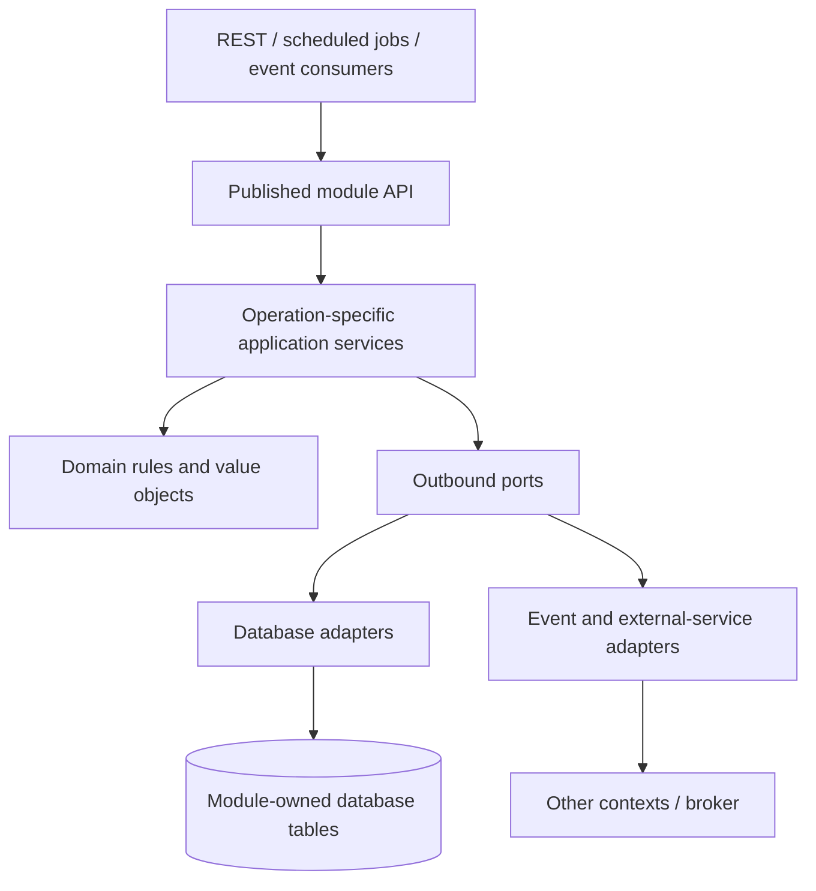

# Application architecture

**Status:** Agreed architectural direction; implementation is at starter stage. This document describes the intended component contracts, not features already present in the repository.

## System organization

ShareWise starts as a **modular monolith** with a hexagonal (ports-and-adapters) architecture **inside each bounded context**. The primary modules are User & Identity Management, Group Management, Financial Management, File Management, and Notification Management. They are ownership and language boundaries, not automatically one deployment each. Consult [the domain model](data-model-design.md) for their responsibilities and invariants.

Each module owns its data, domain model, commands, queries, published APIs and outbound ports. Other modules access it **only via its supported API or integration events**. The initial shared PostgreSQL deployment must not become a license for cross-context joins, foreign keys, repositories, or transactions. Extraction to separate services should replace integration adapters rather than rewrite domain operations. Cross-context synchronous calls are possible, but intentional; event-driven propagation is preferred for independent, asynchronously consistent state.



Runtime calls typically travel from inbound adapters to the application core and through outbound ports. Source dependencies point toward the interfaces owned by the core; the infrastructure adapters implement those interfaces. Diagram layers are conceptual: do not create a facade, interface, mapper, or package for every trivial method merely to mirror this picture.

## Operation- and data-flow-oriented services

Published interfaces expose meaningful command and query operations. DI-managed, normally stateless application services implement them; small cohesive services can be used directly without a pass-through facade. Application input and output contracts use **immutable Java records** where suitable, independently of JPA entities and transport-specific types. Cross-context references use stable business terminology and opaque IDs; navigable entity graphs remain within their owning module.

Typical names and responsibilities:

| Contract | Example | Meaning |
| --- | --- | --- |
| Command | `CorrectExpense` | Input to a business mutation, including expected revision |
| Query | `HistoricalBalancesQuery` | Parameterizes a read at a group revision |
| Operation result | `CorrectionResult` | Success or typed expected failure such as not-found/conflict |
| Read projection | `ExpenseSummary`, `GroupBalances` | Consumer-specific, minimal, immutable data |
| Application service | `ExpenseModificationService`, `BalanceQueryService` | Workflow, authorization, result mapping and commit decision |
| Outbound port | `ExpenseCorrectionPort`, `BalanceReadPort` | Data capabilities required by that workflow |
| Adapter | `ExpensePersistenceAdapter` | Efficient implementation of port semantics |

Outbound data ports describe use-case operations instead of exposing generic `findAll()/save()` repositories. A read port may perform an `EXISTS`, joined validation, filtered pagination, aggregation, window-function history reconstruction, or a conditional SQL mutation **inside the database**. Domain invariants and port semantics remain application-owned, while physical queries and ORM entities remain internal to adapters. Database-resident facts are evaluated with targeted SQL operations rather than by loading entire aggregates. Integration tests verify database-enforced invariants.

Command and query paths need not be symmetrical. Queries generally return direct projections without change tracking or rich aggregate reconstruction; commands retrieve only facts or state required to validate and commit the operation. Read/write separation does not imply separate databases, event sourcing, or a generic message bus.

## Transaction-aware ports

The application core owns commit decisions through an operation-scoped, technology-independent `Transactions` port. A [dispatched application operation](stack/dependency-injection.md) has one Spring-managed **operation DI scope**, whose application services and data adapters may share a scoped transaction manager and persistence-access capabilities. The DI scope does not itself begin a physical transaction; the application service explicitly starts each required transaction segment. The same application service can be dispatched from REST, an event consumer, a scheduled job or a test.

Illustrative interface shapes (not existing source APIs):

```java
interface Transactions {
    <T> T execute(Supplier<TransactionOutcome<T>> work);
    void markRollbackOnly();
}

interface ExpenseCorrectionPort {
    ExpenseCorrectionFacts inspect(CorrectExpense command);
    AppendRevisionResult appendRevision(ExpenseRevision revision,
                                        long expectedEntityRevision);
}
```

`Transactions.execute(...)` begins one physical local transaction through the configured Spring transaction manager and returns only after its commit or rollback completes. Its callback produces one deferred **COMMIT**, **ROLLBACK**, or **ABSTAIN** decision and an independent operation result. The enclosing service alone authorizes commit; participating services can irreversibly mark the current segment rollback-only. An expected typed failure does not automatically mean rollback, and a nominal success cannot override a poisoned transaction. Exceptional, abandoned or failed finalizations do not produce apparent successful commit results.

An operation scope can contain zero or more **sequential** physical transaction segments, but only one active segment at a time. A later failure cannot undo an earlier physical commit. Database adapters use operation-scoped, transaction-aware accessors; the accessor obtains jOOQ/JPA resources for the **currently active segment** and rejects access outside its lifetime. Database technology, transaction status and physical connections remain internal to infrastructure, without explicit session arguments on ordinary business port methods. Nested physical transactions and unrelated ambient Spring transactions cannot silently delay the claimed commit.

Known database constraint errors may become typed results only where the transaction state remains safe or is irrevocably marked rollback-only. Unknown infrastructure failures propagate, and commit-time connection loss may leave the physical outcome uncertain. The detailed outcome and failure semantics belong to the [P1.3 specification](internal/tasks/p1.3-transactions/specification.md).

Finance applies an additional business protocol **inside** this generic transaction:

1. Lock the FinancialGroup for the relevant group (or use an equivalent proven serialization protocol); enforce lifecycle/authorization and optimistic entity-revision preconditions.
2. Validate local and database-resident invariants using targeted state/fact projections.
3. Allocate the next **group-local financial revision**, persist the immutable Expense/Settlement state and its children, and append the corresponding ChangeRecord.
4. Persist an integration-event publication record in the same transaction when required; only then authorize commit.

All financial mutations in one group must follow the same ordering and locking protocol. A database sequence or independent auto-increment IDs alone cannot guarantee the required logical commit order. Historical reads at one group revision must be consistent. The exact COW tables and indexes are infrastructure choices; the [persistence architecture](stack/persistence.md) describes the preliminary database and adapter technology decisions. See [domain history](data-model-design.md#financial-revisions-and-history).

## Integration events and extraction

The [preliminary messaging architecture](stack/messaging.md) uses versioned integration facts and Spring Modulith's persistent, JDBC-backed Event Publication Registry for durable asynchronous cross-context propagation. A producer records publication intent atomically with its state change; consumers process independently and idempotently, using a transactional inbox or a proven business-data invariant. Delivery may be duplicated, delayed or out of order; unsuccessful listeners remain recoverable. Failed notifications do not roll back Finance.

**Finance's ChangeRecord journal is business-visible financial history, not the delivery registry or an event store.** Group Management remains membership authority; Finance maintains an eventually synchronized local FinancialActor representation. Rejoining reactivates the same financial identity. An external broker is introduced on justified service extraction without changing context-owned business operations. Each context owns its transactions and tables even when deployed in the same process.

The [preliminary security architecture](stack/security.md) separates IAM identity/session assertions from issuer-qualified domain attestations. Group Management owns group permissions; consumers validate independently signed claims and enforce their own resource and business rules. Published authorization capabilities provide immediate checks within the modulith. Authoritative remote introspection remains a possible later extension if an extracted service requires stricter freshness. The [generic file ACL proposal](file-management-acl-proposal.md) is a separate, unaccepted extension of this trust model.

## Infrastructure integration

The [technical stack overview](stack/overview.md) maps the selected frameworks and tools to the runtime layers and distinguishes the starter from the intended system. The [persistence](stack/persistence.md), [messaging](stack/messaging.md) and [security](stack/security.md) designs own their corresponding technology-specific contracts; this document owns the module boundaries and application interaction model.

Backend services use Spring constructor injection. Stateless shared infrastructure normally remains singleton-scoped, while the [application-operation DI scope](stack/dependency-injection.md) gives stateful entry services, participants and adapters one explicitly dispatched lifetime. Operation-scoped `Transactions` uses Spring's programmatic transaction manager (normally `TransactionTemplate`) to physically finalize each segment. The dispatcher, REST adapters, message listeners and application-core services need no `@Transactional` annotations; event publication records enlist in the business operation's physical Spring transaction. Generated jOOQ types, Hibernate entities and event-delivery infrastructure stay inside adapters.

Application operations generally use straightforward imperative Java; virtual threads remain subject to connection-pool capacity and database locking. Architectural tests enforce allowed module dependencies, and PostgreSQL integration tests establish real persistence and concurrency semantics as these components are implemented.

## Architecture checks

Tests cover domain invariants, invalid input, concurrency races and commit, rollback and failure paths; integration tests exercise real adapters. Fixtures are deterministic, with property-based or invariant tests where they add meaningful coverage. Module dependencies remain acyclic, and architectural changes are reviewable and documented without introducing pass-through abstractions.
