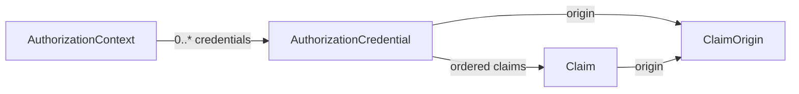
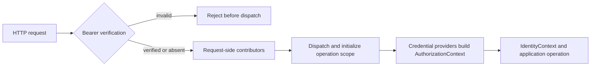

# Verified credentials and operation identity

ShareWise separates credential verification from the application decisions that depend on it. Before an application operation can use assertions supplied by a caller, the security boundary establishes which credentials are authentic and intended for that operation. The application then works with an immutable, operation-local view of their claims rather than with JWTs, servlet requests, or an ambient security principal. This separation lets IAM derive the caller's identity while leaving decisions about access to a particular resource with the context that owns that resource.

A verified credential is therefore **evidence**, not an authorization grant. Its signature and other validation checks establish the trustworthiness of its assertions under a configured issuer policy; they do not establish that an asserted role, identity, or capability permits a particular business action.

## Responsibilities and trust boundaries

The architecture separates four related questions, each answered at a different boundary:

| Responsibility | Question answered | Owner |
| --- | --- | --- |
| **Credential verification** | Is this credential authentic, intended for the expected audience and profile, currently valid, and, where necessary, bound to the primary principal? | Trusted source-specific verification and credential providers |
| **Evidence access** | Which verified assertions and their origins are available to this operation? | Operation-scoped `AuthorizationContext` |
| **Semantic interpretation** | What application concept does that evidence establish, such as the caller's IAM identity? | Context-owned semantic services such as `IdentityContext` |
| **Business authorization** | May the caller perform this action on this resource in its current state? | The resource-owning application context |

This division matters whenever multiple authorities can assert facts about a caller. Claims may have identical names while referring to different resources, sessions, or issuers, so a generic list of claim values would be insufficient for reliable interpretation. Instead, the shared security infrastructure preserves the boundaries between credentials, and semantic contexts interpret those credentials in their own domain. In particular, the IAM identity derived from a primary credential does not also establish Group membership or authorize mutations in another context.

The published contracts follow the same division: `shared::security` provides JWT verification and signing, `shared::claims` exposes accepted evidence, and `shared::di` supplies the operation lifetime. IAM publishes `identity.IdentityContext` as the consumer-facing interpretation of primary identity. Application services can therefore depend on semantic contracts without introducing transport or cryptographic concerns into their domain logic.

## Credential evidence model

An **`AuthorizationCredential`** represents the assertions that arrived together in one accepted credential, abstracting away whether their source was a JWT or another verifiable format. Each credential contains an ordered collection of `Claim` values and a `ClaimOrigin` describing their provenance. The origin records the trusted issuer and credential profile, intended audiences, and applicable subject, credential identifier, and issuance/validity metadata. A claim carries its own type and value **plus the same origin**, so it remains meaningful when retrieved independently of the containing credential.

The two paths to `ClaimOrigin` serve different use cases. Consumers can search for a claim and retain its provenance without navigating back to a credential, while those that need to correlate several assertions can inspect the ordered claims of **one** `AuthorizationCredential`. This avoids a cyclic object graph, yet preserves the grouping needed for correlation. Credential construction also checks that every contained claim has an equal origin and defensively copies its claim list, so repeated claim types and ordering are preserved without allowing a mixed-origin collection.

Origin equality is a provenance comparison, **not proof that two claims came from the same physical credential**. For example, independently issued tokens may share all recorded origin metadata when their optional credential identifiers are absent. Correlation that depends on claims arriving together must therefore use one credential's claim collection, rather than joining matches from independent credentials merely because their origin values agree.

The `AuthorizationContext` provides both forms of access. Its `credentials()` view retains the individual credential groups in provider order; `credentialsFrom(...)` narrows them by origin or by issuer and profile, and `findCredential(...)` selects a uniquely identified credential within an issuer/profile when a credential ID is available. Claim-oriented `find(...)` queries, by contrast, return matching claims with their origins intact. In neither case does selecting evidence imply permission: that interpretation belongs to a semantic or resource-owning context.

Consider an IAM access token whose `sub` identifies a user by canonical UUID and whose `sid` identifies the login session. Once verified, the IAM provider represents it as a credential with the configured IAM issuer, access-token profile, audience, and validity metadata in its origin, alongside the subject and session claims. The identity service can interpret that evidence without knowing the original JWT representation, while the session identifier remains a binding reference rather than a permission.

### Publication and operation snapshots

Although the evidence types enforce structural consistency, constructing a `Claim` or an `AuthorizationCredential` does not establish trust. That responsibility belongs to source-specific `AuthorizationCredentialProvider` services, which publish credentials only after satisfying the source's verification requirements. A provider may contribute no credential when its optional source is absent, but supplied invalid evidence is a failure rather than an invitation to treat the operation as anonymous. Verification of a subordinate credential also includes any required binding to the current primary identity and session before publication.

The operation-scoped `AuthorizationContext` composes these providers through Spring DI and builds one immutable snapshot when first resolved. All providers contribute to the same construction step, and a failure in any provider prevents the whole snapshot from becoming available; application services cannot observe a partially accepted collection of credentials. Once constructed, the snapshot preserves provider and credential order for the rest of the operation, so repeated queries neither reverify signatures nor perform implicit authority lookups.

Consequently, collaborators within one operation observe the same evidence even if they execute in different physical transaction segments. A later or concurrent operation, on the other hand, receives its own providers and snapshot, keeping identity and claims isolated from other callers.

## JWT verification and credential binding

JWT is one possible source format for the evidence model. Its verification begins with a **credential profile** chosen by trusted application configuration, not by fields in the unverified token. The profile identifies the expected issuer, protected token type, audience, credential kind, maximum lifetime, permitted clock skew, and signature strategy, thereby defining which statements the token is allowed to make and which trust keys may validate it.

Verification has two complementary stages. The signature service checks the protected JOSE header and cryptographic signature against the configured keys; the credential validator then checks the typed JWT fields, issuer, audience, token type, timestamps, validity window, and profile-specific identity/session information. A successfully parsed JWT is not accepted evidence unless both stages succeed. In particular, fields supplied by a token cannot select a different issuer, profile, algorithm, or key source to bypass that configuration.

The configured signing strategy uses **ES256 with P-256 elliptic-curve keys**. Locally configured verification keys can overlap during rotation, while removing a key withdraws trust in signatures made with it; embedded token keys and token-supplied key URLs do not add trust anchors. Because the codec depends on an algorithm-independent signature service, its credential and binding rules remain separate from the signing mechanics. The validator uses an injected clock and bounded skew, and failure paths do not disclose credential or key material.

For primary IAM credentials, the verified subject (`sub`) is a canonical user UUID and the `sid` claim identifies the associated login session. Together with the token's issuer, audience, type, identifier, and validity window, these values establish *which principal and session the credential describes*. They are not themselves a statement about Group privileges or the current eligibility of an account in persistent storage.

A subordinate credential introduces an additional trust dependency: its own valid signature is insufficient unless its assertions are bound to the **currently verified primary credential**. The shared verifier checks that the primary credential is still valid, came from an explicitly trusted primary issuer, and agrees with the subordinate credential's subject, primary issuer, and session references. This establishes that the subordinate assertions concern the current principal/session; interpreting their resource-specific meaning remains the responsibility of a domain context. The [security design](../stack/security.md#issuing-and-using-domain-attestations) and [semantic-context proposal](../stack/claims-context-proposal.md) describe the domain-attestation and policy model separately.

## From inbound request to operation identity

An HTTP request and an application operation have different lifetimes, so verified request evidence must cross an explicit boundary before it can become an operation-scoped dependency. Spring Security's API bearer filter first verifies the primary IAM token and keeps the immutable result in request-local state. When no bearer is supplied, the request has no primary evidence to contribute; when a bearer *is* supplied but fails verification, the request is rejected before application dispatch rather than silently treated as anonymous.

The request-side `OperationIngressDispatcher` composes `OperationInputContributor` services from the outer Spring request scope. Each contributor registers its own typed input with the core dispatcher; IAM contributes the previously verified primary credential when one exists. This makes the boundary extensible without requiring controllers to enumerate all sources of operation state, while the separate operation scope keeps request-owned objects out of its bean graph.

Once registration completes, the dispatcher activates the operation scope and runs its ordered configuration initializers before resolving the entry service. For IAM, the initializer treats missing evidence as anonymous and stores verified evidence in a finalized, operation-local configuration. The IAM provider then exposes it through `AuthorizationContext`, from which `IdentityContext` derives the semantic caller identity using normal DI. The sequence ensures that an application service never observes half-initialized security state; the [DI architecture](dependency-injection.md#pre-dispatch-inputs-and-configuration-initialization) defines the general initialization and failure rules.

The same scope boundary also serves non-HTTP callers. Such adapters supply explicitly verified evidence, or omit optional identity inputs, through their own outer context; they neither fabricate an HTTP request nor inherit the identity of an unrelated operation. In particular, a user identifier recorded in a past event is historical event data rather than authentication of the event's current consumer.

### Semantic identity and authorization

`IdentityContext` interprets the evidence snapshot by selecting the credential matching the configured primary IAM issuer and profile. From that credential it derives a canonical user UUID and requires a non-empty session binding, rejecting multiple candidate identities rather than choosing arbitrarily. Its public API expresses this interpretation as `userId()`, `isAuthenticated()`, and `requireUserId()`, so consumers need not inspect raw claims to ask whether the operation has an authenticated IAM principal.

When no credential is present, identity is anonymous and the owning application service decides whether that is acceptable. By contrast, an evidence snapshot containing credentials but no valid primary IAM credential, or containing ambiguous primary identity, cannot be interpreted as a legitimate anonymous operation. This distinction protects the domain-facing identity contract from becoming a fallback for rejected or unrelated evidence.

Identity and evidence remain stable throughout one application operation, even when its work spans several sequential [transaction segments](transactions.md). Because they belong to the operation scope rather than to a database connection, HTTP request attribute, or process-global security context, concurrent operations can use the same Spring singletons without sharing credential state.

## Failure and enforcement boundaries

The boundaries above also determine where failures are handled. Invalid HTTP bearer credentials are rejected with `401` and a Bearer challenge before dispatch, while missing mandatory verifier configuration prevents API ingress with `503`. Within an operation, a provider failure prevents publication of the evidence snapshot, and identity selection rejects missing or conflicting primary evidence except in an explicitly anonymous operation. A service that requires authentication uses `requireUserId()` to reject the otherwise valid absence of a principal.

Successful credential verification is only the first step toward a domain authorization decision. The bearer filter authenticates evidence and the operation context makes it available; neither replaces resource-owned policy checks or authoritative business-state validation. This separation keeps the meaning of a credential tied to its source and the meaning of permission tied to the resource on which an operation acts.
