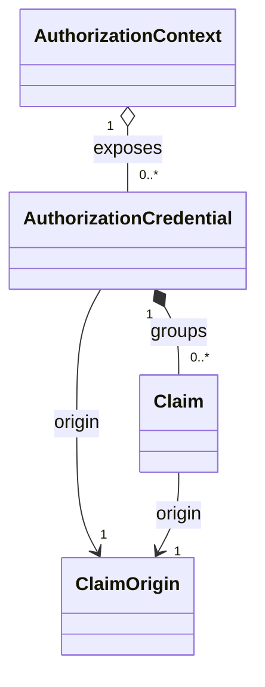
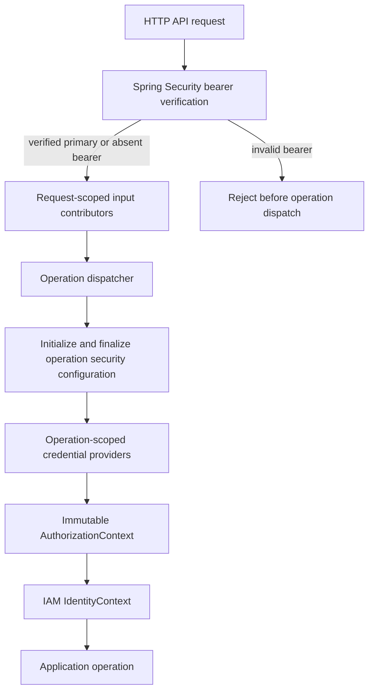

# Verified credentials and operation identity

ShareWise separates **establishing who the caller is**, **making verified assertions available to an operation**, and **deciding whether that caller may act on a resource**. An inbound credential identifies an authority and makes assertions; the security boundary verifies the credential before an application service can use its contents. The application then receives a stable view of those assertions through dependency injection, without depending on JWT parsing, servlet requests, or the lifetime of a database transaction.

A valid signature establishes that a trusted issuer signed a token satisfying the configured verification policy. It does not establish that its claims grant permission to perform a particular business operation. That decision belongs to the context owning the relevant resource and rules.

## Responsibilities and trust boundaries

Four responsibilities cooperate without sharing authority over each other's data:

| Responsibility | Question answered | Owner |
| --- | --- | --- |
| **Credential verification** | Is this credential authentic, intended for this audience and profile, currently valid, and appropriately bound to a primary principal? | Trusted issuer-specific verification and credential providers |
| **Evidence access** | Which verified assertions and their provenance are available within this operation? | Operation-scoped `AuthorizationContext` |
| **Semantic interpretation** | What application concept does the accepted evidence establish, such as the caller's IAM identity? | Context-owned semantic services such as `IdentityContext` |
| **Business authorization** | May this principal perform this action on the current resource state? | The resource-owning application context |

The distinction matters because claims can originate from different authorities, carry overlapping names, or describe different resources. The generic evidence layer preserves these distinctions; it never produces a process-wide set of roles or makes a resource authorization decision. IAM interprets the primary credential as a principal. Resource-owning contexts retain their own authorization and business invariants.

Spring Modulith publishes the common evidence contracts through `shared::claims`, JWT/JOSE verification through `shared::security`, and operation-scope boundaries through `shared::di`. IAM exposes `identity.IdentityContext` as its semantic, consumer-facing interface. This keeps security transport and cryptography out of ordinary application-service dependencies.

## Credential evidence model

An **authorization credential** is the application-level representation of assertions originating together from one accepted credential. This concept deliberately abstracts away the token format: consumers reason about claims and their origin, whether the source was a JWT or another verified credential form.

The evidence model is small and immutable. A `Claim` contains a type, a value, and a `ClaimOrigin`. The origin identifies the trusted issuer and credential profile, intended audiences, and applicable subject, credential identifier, and issuance/validity metadata. An `AuthorizationCredential` groups the ordered claims from one credential alongside their common origin. Its construction requires every contained claim to have an equal origin and defensively copies the claim list.

The two links to `ClaimOrigin` are intentional. A claim returned by a query retains its provenance even when passed independently of its containing credential, while the credential keeps sibling claims together for correlation. There is no back-reference from a claim to its containing credential and thus no cyclic object graph. Repeated claim types are preserved; neither the model nor its queries assume one value per name.

A shared origin describes **equivalent provenance metadata**, not necessarily the identity of one physical credential. Two independently issued credentials may have equal origin values, particularly if their token identifiers are absent. To correlate assertions that must have arrived *together*, a consumer examines the claims of **one `AuthorizationCredential`** rather than joining results from unrelated credential groups.

For example, after the IAM bearer verifier accepts an access JWT with a canonical `sub` (user UUID) and a `sid` (session identifier), the IAM provider contributes one credential. Its origin records the trusted IAM issuer and configured access-token profile, audience, token identifier and validity window; its claims include the subject and session assertions. `IdentityContext` can derive the caller's UUID from that credential without parsing the JWT or treating `sid` as a permission. This is the same model used for any other accepted source: credential format and domain meaning remain outside the generic claim types.

`AuthorizationContext` provides two complementary views of the same evidence. `credentials()` retains complete, ordered credential groups; `credentialsFrom(origin)` and `credentialsFrom(issuer, profile)` narrow that grouping by provenance. Its `find(...)` operations retrieve claims while preserving each claim's origin. When a credential carries an identifier, `findCredential(issuer, profile, credentialId)` finds a uniquely qualified credential or rejects ambiguous matches. A credential ID is optional and not globally unique; issuer/profile qualification is part of its lookup contract. These operations **select evidence**. They do not confer authority merely because a claim name or value matches.

### Publication and operation snapshots

Constructing a `Claim`, `ClaimOrigin`, or `AuthorizationCredential` proves only that the data satisfies the model's structural invariants. **Trust is established before publication**: Spring-managed `AuthorizationCredentialProvider` services are responsible for their source's verification requirements, including any binding to an authenticated primary identity and session. A provider contributes accepted credentials, contributes none when its optional source is absent, or fails when supplied evidence is invalid. Invalid evidence does not become an empty or anonymous result.

The operation-scoped authorization context composes its providers through ordinary Spring DI and takes an immutable snapshot when first resolved. It invokes each provider once, preserves credential group boundaries and provider ordering, and exposes the result through read-only queries. If any provider fails, construction of the entire snapshot fails; no partial evidence is published to application services. Reading a claim later does not repeat cryptographic verification or implicitly query an authority's database.

This produces two useful guarantees. All collaborators resolving the context within one operation see the same accepted evidence, while a later or concurrent operation obtains an independent snapshot. Provider services remain operation-scoped and are never reusable stores of another operation's identity.

## JWT verification and credential binding

JWT is one source format for the evidence model. The trusted application configuration selects an issuer-specific **credential profile**: expected issuer, protected token type, exact audience set, credential kind, maximum lifetime, permitted clock skew, and signing/verification strategy. Unverified JWT fields cannot choose a different profile, issuer, algorithm, or trust key.

The signature service checks the protected JOSE header and signature using the configured trust keys. The credential validator then checks typed JWT claims, issuer, audience, token type, required timestamps, validity window, and profile-specific identity/session fields. Only after both stages succeed does the codec return a verified result suitable for a source provider. A structurally valid JWT, an unsigned token, or an arbitrary `AuthorizationCredential` object is not interchangeable with that verified result.

The JWS strategy uses **ES256 with locally configured P-256 keys**. Key selection is explicit; overlapping verification keys support rotation, and removing a key withdraws trust in credentials signed with it. Token-supplied key locations or embedded key material cannot introduce new trust anchors. The codec depends on an algorithm-independent signing service, so cryptographic mechanics are separate from claim and identity validation. Validation uses an injected clock with bounded skew; failures do not disclose tokens or key material.

For the **primary IAM profile**, the verified subject is a canonical UUID identifying the user, and `sid` identifies the associated login session. The token also has an issuer, protected type, audience, token identifier, and issuance/validity times. The session ID is a binding reference, not a secret bearer token or a permission claim. The primary credential establishes identity, not group membership or another context's privileges.

The shared codec also supports **subordinate credential verification**. In addition to its own signature, issuer, audience, type and validity, subordinate evidence must refer to a still-valid verified primary credential from an explicitly trusted primary issuer. The subject, primary issuer and session binding must agree. This check answers whether the subordinate assertions belong to the current authenticated principal/session, not whether a particular asserted role permits a business operation. The distinction allows provider-specific verification to remain independent of resource-specific authorization policy. The intended domain-attestation and resource-policy rules are detailed in the [security design](../stack/security.md#issuing-and-using-domain-attestations) and [semantic-context proposal](../stack/claims-context-proposal.md).

## From inbound request to operation identity

An HTTP request and an application operation have different lifetimes. Spring Security's API bearer filter verifies the primary IAM token before dispatch and retains the immutable verification result in request-local state. A request without a bearer contributes **no primary evidence**. A supplied malformed, expired, wrong-profile or otherwise invalid bearer is rejected at ingress rather than converted into an anonymous identity. The filter does not install a process-wide current principal for application services to read.

The request-side `OperationIngressDispatcher` assembles caller-side `OperationInputContributor` components through Spring DI. Contributors register typed inputs with the core dispatcher; for IAM, that input is the already verified credential. Several independent contributors can take part in the same dispatch without requiring the controller to know their implementations. Registration finishes **before** the inner operation scope is activated, so externally owned request objects never become Spring-managed operation beans.

Within the newly activated operation scope, ordered initializers receive their declared inputs as optional values and populate designated configuration holders. The IAM initializer interprets a missing primary input as absence of authentication. The dispatcher finalizes the configuration before constructing the application's entry service. The IAM credential provider reads that finalized configuration and contributes the verified primary credential to the authorization snapshot; `IdentityContext` then interprets the snapshot through ordinary DI. The ordering and failure guarantees of this scope boundary are described in [operation-scoped dependency injection](dependency-injection.md#pre-dispatch-inputs-and-configuration-initialization).

Non-HTTP entry points use the same core operation-scope mechanism. Their outer adapters supply explicit trusted evidence, or omit optional identity input, without inventing an HTTP request or borrowing authentication from another operation. An event's initiating user ID is historical event data, not an authenticated caller for a new operation.

### Semantic identity and authorization

IAM's `IdentityContext` selects the credential matching the configured primary issuer and profile from `AuthorizationContext`. It requires an unambiguous primary credential with a valid canonical subject and non-empty session binding. Its application-facing `userId()` returns an optional stable UUID; `isAuthenticated()` reflects its presence, and `requireUserId()` demands an authenticated caller. No separate identity value is seeded at the ingress boundary.

If no credential is present, the resulting identity is anonymous. If the authorization snapshot contains evidence without a valid primary credential, or multiple candidates for the primary identity, identity resolution fails. This prevents unrelated claims from silently standing in for primary authentication. Ordinary application operations decide whether anonymity is acceptable and enforce their own resource permissions using semantic contracts, not arbitrary raw claim matches.

Identity and evidence belong to the **operation scope**, not to a JDBC connection or a physical transaction. One operation may execute several sequential [transaction segments](transactions.md) while its identity and claims remain unchanged. Concurrent operations receive distinct configurations, providers and evidence snapshots even when the surrounding Spring application has shared singleton infrastructure.

## Failure and enforcement boundaries

Verification, evidence publication, identity selection and business authorization fail at different boundaries. An invalid supplied HTTP bearer is rejected before the controller with `401` and a Bearer challenge. Missing trusted IAM verification configuration prevents API ingress and yields `503`. A legitimate anonymous operation can execute where permitted, but a service requiring `requireUserId()` rejects the missing identity as unauthenticated. Provider failure aborts evidence-snapshot construction instead of exposing a partially trusted view.

The bearer filter establishes credential authenticity and transports evidence into the operation. **It is not a universal resource-authorization policy.** Authorization decisions use the owning domain's rules and, when required, current authoritative state. Signature validity and session binding alone cannot establish the current database eligibility of an account or session. The [security design](../stack/security.md) describes the broader session, issuance, revocation and domain-attestation policies; this chapter defines the implemented trust, evidence and identity boundaries on which those policies depend.
