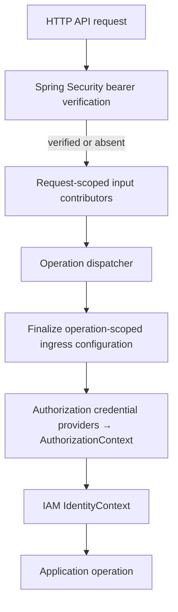

# Verified credentials and operation identity

ShareWise separates **credential authenticity**, **application identity**, and **resource authorization**. Trusted inbound processing verifies credentials, application services resolve an immutable operation-scoped snapshot of their claims when needed, and semantic contexts interpret that evidence for application services. A verified assertion is evidence from a trusted authority; it is not by itself permission to perform a business operation.

The implemented foundation supports primary IAM bearer credentials and explicit anonymous operations. Shared JWT primitives can also verify subordinate credentials against a valid primary identity and session. No production domain-attestation provider, Group permission policy, login flow, or authoritative account/session eligibility check is connected to this foundation. The corresponding trust and business designs remain in the [security design](../stack/security.md) and [claims-context proposal](../stack/claims-context-proposal.md).

## Trust and responsibility boundaries

The shared security capability verifies credential provenance and technical binding. It owns issuer/profile expectations, signing and signature verification, expiry and claim validation, and the immutable representation of accepted evidence. IAM owns the meaning of a primary identity: it selects one verified primary credential and exposes the operation's caller through `IdentityContext`. Resource-owning contexts remain responsible for permission and business-rule decisions; a successful JWT verification does not check live membership, account eligibility, or resource state.

Spring Modulith exposes the generic evidence API as `shared::claims`, the JWT/JOSE primitives as `shared::security`, and operation lifetime/input composition as `shared::di`. `identity.IdentityContext` is IAM's published semantic API. Shared infrastructure does not depend on IAM, and ordinary business consumers do not depend on servlet requests, JOSE types, or Spring's thread-local security context.

## Credential evidence model

An **authorization credential** represents assertions accepted from one verified credential source. Its immutable `ClaimOrigin` records the issuer, credential profile, audiences, and applicable subject, token identifier, and validity metadata. Each `Claim` contains its type and value *and its origin*, retaining provenance when queried or passed separately. An `AuthorizationCredential` groups ordered claims with a matching origin and rejects claims whose origins differ.

`AuthorizationContext` is the operation-scoped, read-only view of accepted credentials. It exposes the complete credential groups for correlating assertions from the same credential, as well as claim searches and origin-qualified credential lookups. A credential identifier is optional and is not globally unique: lookup qualifies it by issuer and profile and rejects ambiguous results. Equal origin values do not prove that two separately supplied credentials are the same credential; policies requiring same-credential correlation operate on a single credential's claims.

The context is assembled from Spring-managed, operation-scoped `AuthorizationCredentialProvider` components. Each provider owns the trust checks for its source and either returns accepted credentials, explicitly contributes none, or fails. The context takes one immutable snapshot when resolved within an operation. If any provider fails, that snapshot is not published; searches never trigger another verification or merge claims from different credentials into global roles. Merely constructing `Claim`, `ClaimOrigin`, or `AuthorizationCredential` values does not authenticate them. Trust comes from the source-specific provider path that publishes them.

## Credential verification

A `JwtCredentialCodec` binds one trusted issuer/profile policy to an explicitly configured signature service. The signature strategy owns protected-header checks, allowed signing algorithm, trusted verification keys, and signing-key selection. The credential layer checks issuer, exact audience, protected token type, temporal bounds, required typed claims, and identity/session rules before returning verified evidence. Profiles come from application configuration, never from unverified token contents.

The implemented signature strategy uses **ES256 with locally configured P-256 keys** through Spring Security/Nimbus. Rotation permits overlapping verification keys and removal of old keys; the codec does not fetch verification keys from token-supplied locations. Validation accepts a narrowly bounded configured clock skew. Signature and credential failures expose a generic credential error without including the supplied token or key material.

A primary IAM credential must provide a canonical UUID subject and a non-empty session binding (`sid`). The subordinate verification capability additionally requires a still-valid verified primary credential from an explicitly trusted primary issuer, with matching subject, primary issuer and session binding. This binds subordinate evidence to the verified primary principal and session; it does not authorize any domain role, scope, or operation. Issuance and verification are reusable primitives, not a connected login or domain-attestation flow.

## Ingress and operation identity

The HTTP path and the operation's DI scope have distinct lifetimes. Spring Security's filter chain processes `/api/*` bearer ingress before an application controller. It requires trusted IAM verification configuration even for a request without a bearer; absent credentials are represented as *no primary evidence*, while malformed, expired, wrong-profile, or otherwise rejected credentials terminate the request before dispatch. The system health endpoint is excluded from this bearer stage.

The outer, request-scoped `OperationIngressDispatcher` collects `OperationInputContributor` components through caller-side DI. Its contributors register typed verified evidence before the core dispatcher creates the inner operation scope. The initializer for IAM's operation-scoped security configuration receives the optional verified primary credential, preserving explicit absence as an anonymous operation. After the configuration is finalized, the IAM credential provider contributes its primary evidence to `AuthorizationContext`. `IdentityContext` resolves the configured primary issuer/profile from that snapshot, rejects ambiguous primary credentials, and exposes an optional stable IAM user ID. It never receives a separately initialized identity value.

The same core operation dispatcher can be used by non-HTTP callers with explicitly supplied trusted evidence or with no primary credential; these callers do not inherit HTTP or thread-local authentication state. The generic caller-side input mechanism and its isolation/failure rules are described in [operation-scoped dependency injection](dependency-injection.md). An operation's identity remains stable across its sequential [transaction segments](transactions.md), because neither evidence nor identity is tied to a physical database transaction.

## Rejection and authorization boundaries

An absent primary credential yields an anonymous `IdentityContext`; an application operation that requires a caller uses `requireUserId()` and fails as unauthenticated. An invalid supplied bearer is never silently downgraded to anonymous. HTTP credential failures return `401` and a Bearer challenge; missing trusted IAM wiring rejects API ingress with `503`. A required identity missing from an otherwise valid anonymous operation maps to `401`. Business-level permission failures remain the responsibility of the relevant resource-owning service.

The HTTP filter establishes verification and the identity bridge, **not universal route authorization**. The current security chain does not implement login, refresh, CSRF handling, session persistence, or authorization rules for every endpoint. In particular, signature and session-binding checks do not prove that a user or session is presently eligible against authoritative IAM database state. The scope bridge is transport-independent. Credential sources compose through operation-scoped providers, with source-specific verification required before their credentials become application-visible evidence. Each resolved authorization context is isolated to its operation; verification or provider failure cannot publish a partially accepted snapshot.
