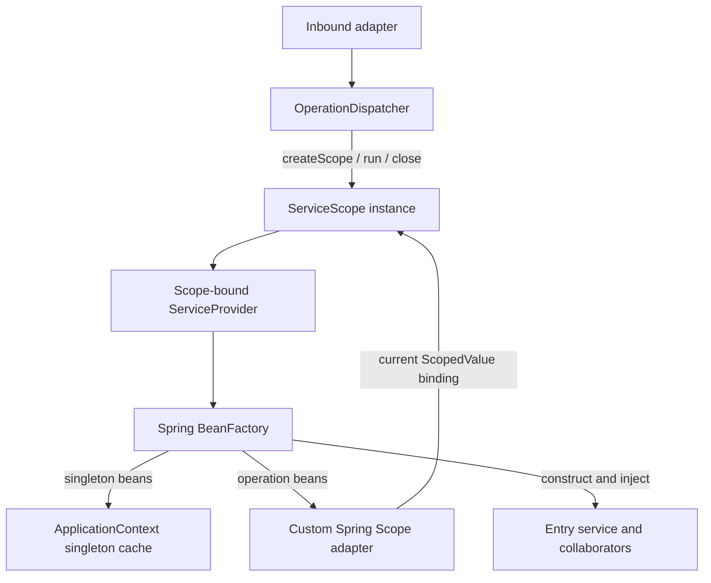

# Operation-scoped dependency injection

**Status:** Implemented in the Spring backend; P1.3a final acceptance is pending. This document describes the running DI infrastructure, not the planned transaction adapters or business modules. The [application architecture](../architecture.md) defines module ownership; the [DI decision record](../stack/dependency-injection-alternatives.md) explains the selection of this model.

## Operation lifetime and ownership

An **application operation** is one entry-service invocation initiated through `OperationDispatcher`, independently of whether its caller is an HTTP adapter, event listener, scheduled job or test. The operation owns an explicit **DI lifetime**. Its Spring-managed collaborators can share operation-local state without relying on an HTTP request, an ambient database transaction or the identity of a worker thread.

Spring remains the **sole dependency-injection container**. The application's `ApplicationContext` owns bean definitions, candidate selection, constructor and factory-method injection, singletons, initialization and destruction behavior. The custom Spring scope named `operation` supplies only the additional bean lifetime. The root container is not recreated for each operation, and no separate reflection-based resolver is involved.

The public contracts live in `de.hsh.favs.sharewise.shared.infra.di`:

| Contract | Responsibility |
| --- | --- |
| `ServiceScopeFactory` | Spring singleton per application context; creates independent, caller-owned scopes. |
| `ServiceScope` | Owns one cache of operation-scoped beans and their registered destruction callbacks; activates one callback and closes deterministically. |
| `ServiceProvider` | Scope-bound view of the owning context's Spring bean factory, available only during its scope's activation. |
| `OperationDispatcher` | Singleton production entry point; opens a fresh scope, invokes a requested entry service and closes the scope. |

Spring-specific configuration, the custom `Scope` adapter, and the caching and dispatch implementations reside in `shared.infra.di.internal`. They are not part of the public DI contract. When P1.1 installs Spring Modulith, `shared.infra.di` is intended to become the named `shared::di` interface; module-boundary enforcement is not installed yet.

## Resolution and dispatch

`OperationDispatcher.dispatch(Class<S>, Function<S, R>)` creates a scope through the `ServiceScopeFactory`, activates it, resolves the requested entry service through the scope's provider, executes the supplied operation, and always closes the scope. **Dispatch never begins a physical database transaction.** Business services make their own transaction decisions when that infrastructure is introduced.

For a manually owned scope, `ServiceScope.run(Function<ServiceProvider, T>)` supplies a temporary provider. `ServiceProvider.getRequiredService(Class<T>)` delegates directly to Spring's `BeanFactory.getBean(...)`. Spring recursively constructs the dependency graph, selecting the appropriate bean definitions and applying qualifiers, configuration methods and lifecycle processors as usual.

An operation-scoped bean is declared with Spring's `@Scope("operation")`. The registered Spring scope adapter stores it by **bean name** in the active `ServiceScope`'s cache. Multiple constructor-injected consumers of that bean receive the same instance inside one scope; another scope gets a different instance. Application-context singletons remain shared, and Spring prototypes retain their normal non-cached semantics. A prototype is **not** automatically disposed by the operation scope.

The `ServiceScopeFactory` owns an instance-specific Java 25 `ScopedValue` key. `ServiceScope.run(...)` binds the current scope instance to that key for the callback. Recursive Spring resolutions read the same lexical binding through the registered `Scope` adapter; no per-bean context restoration or separate bean factory is needed. Each Spring application context owns its own factory and binding key, so scopes and singleton graphs from independent contexts are isolated.

## Scope activation and lifetime

A `ServiceScope` is independently created and owns its lifetime until the caller invokes `close()`. It can be activated **once**, on the thread that created it; it remains open after `run(...)` returns but cannot be activated again. The lexical binding unwinds automatically on both normal and exceptional callback completion. Closure is separate from binding restoration and is the responsibility of the scope owner.

Scopes created through `ServiceScopeFactory` are independent, even when their activations are nested. A child activation temporarily shadows the outer binding, uses its own bean cache, and restores the parent binding on return. It does not inherit parent-scoped beans, establish a parent-child relationship between containers, or imply transaction propagation. The provider belonging to an outer scope cannot be used while the inner scope is current. Likewise, existing parent-created objects do not acquire new injected dependencies simply because an inner binding is active.

Nested **DI scopes** are supported at the infrastructure level. Nested **business dispatch** is not: `OperationDispatcher` rejects a second dispatch while another operation scope is active in its context or while an earlier dispatch is still cleaning up. Participating application services instead call their already-injected collaborators within the original operation.

The scope and provider validate owner-thread access, activation state and current binding. An inherited `ScopedValue` binding does not permit a structured child thread to use another thread's scoped beans. Independent operations can run concurrently on different platform or virtual threads, each with an isolated scope.

## Cleanup and failure behavior

The scope owns Spring's **registered destruction callbacks**, not an independent `AutoCloseable` sweep over every cached object. Spring supplies callbacks for applicable bean lifecycle mechanisms, such as `@PreDestroy`, `DisposableBean` and configured `@Bean` destroy methods. At terminal closure, the scope clears its cache and registrations and attempts all callbacks in **reverse registration order**, even if one fails. A scope can also be closed without ever having been activated, and repeated closure on the owner thread is harmless.

No bean may be resolved through a provider after its scope is no longer current or after it has closed. An active scope cannot be closed from within its callback. When bean creation fails, the failed bean is not retained in the scope cache; successfully created dependencies remain subject to normal scope closure. Spring's `Scope.remove(...)` operation removes an individual cached bean and its destruction registration **without invoking that callback**; the caller is responsible for individual removal semantics.

Failure during a business callback does not skip cleanup. Java try-with-resources preserves that exception as primary and suppresses any exception thrown by scope closure. If only cleanup fails, that failure is propagated; multiple callback failures are aggregated rather than stopping cleanup. Spring may internally log or handle some bean-destruction failures without propagating them to the scope, so not every failure in a Spring destroy method necessarily reaches the dispatcher.

Lifetime correctness is guaranteed for the DI infrastructure's **own resolution, caching and cleanup paths**. Neither Spring nor this layer invalidates arbitrary Java references that a caller retains after closure. Application code must not capture operation-scoped beans in singletons or retain scoped providers after their lifetime; these are review-enforced ownership rules rather than automatic capture analysis.

## Integration boundaries and verification

Production services use constructor injection and ordinarily enter through `OperationDispatcher`. Test code can use the **same** `ServiceScopeFactory` and `ServiceScope.run(...)` callback to resolve and inspect multiple collaborators before teardown; no test-specific DI container is required. This mechanism is exercised by Spring integration tests covering identity, qualifiers, initialization and destruction, nested bindings, context isolation, failure cleanup, concurrency and thread ownership.

The DI scope does not authorize cross-module access or own physical transaction resources. The operation-scoped `Transactions` port, sequential physical segments and transaction-specific data access remain **planned** under [P1.3b](../internal/tasks/p1.3-transactions/specification.md); rollback/real-commit test fixtures remain **planned** under [P1.3c](../internal/tasks/p1.3c-integration-tests/specification.md). The current backend has no financial application services or production transaction manager built on these abstractions.

For usage and test commands, see the [developer guide](../development.md#operation-scope-usage). The [P1.3a specification](../internal/tasks/p1.3a-di-scope/specification.md) and [implementation plan](../internal/tasks/p1.3a-di-scope/plan.md) retain the formal requirements and phased acceptance evidence.
