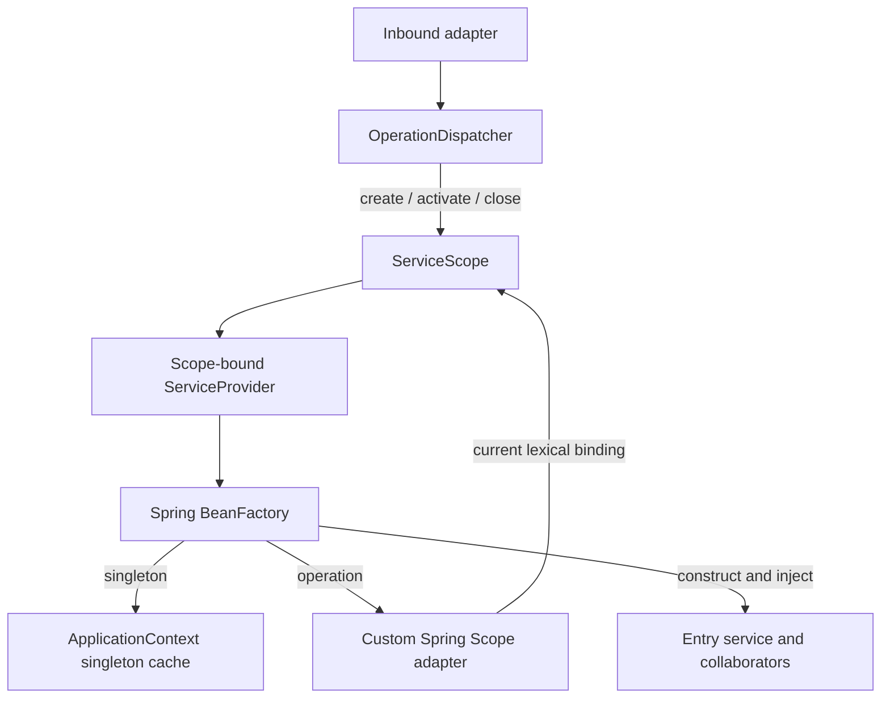

# Operation-scoped dependency injection

ShareWise uses one Spring `ApplicationContext` as its dependency-injection container and an explicit **operation scope** for the lifetime of each application operation. An application operation is one entry-service invocation initiated through `OperationDispatcher`, whether its caller is an HTTP adapter, event listener or scheduled job. All services resolved within that operation share the same operation-scoped dependencies without coupling their lifetime to an HTTP request, database transaction or worker-thread identity.

A DI scope owns bean instances and their lifetime. It does not own business state transitions or physical transaction boundaries. Spring remains responsible for selecting, constructing and wiring beans; the operation scope determines which instances of beans declared with `@Scope("operation")` are reused during an invocation.

## Ownership and service lifetimes

The `ApplicationContext` owns bean definitions, singleton instances, constructor and factory-method injection, bean post-processing and the Spring bean lifecycle. The operation-scoping layer adds a cache and destruction boundary for beans with the custom `operation` scope. It does not create a child `ApplicationContext` or implement a second dependency resolver.

The public contracts reside in `de.hsh.favs.sharewise.shared.infra.di`:

| Contract | Responsibility |
| --- | --- |
| `ServiceScopeFactory` | Per-application-context singleton that creates independent, caller-owned scopes. |
| `ServiceScope` | Owns one operation-scoped bean cache and its registered destruction callbacks; provides lexical activation and terminal closure. |
| `ServiceProvider` | Scope-bound view over the owning context's Spring bean factory. |
| `OperationDispatcher` | Production entry point that resolves and invokes one application entry service inside a fresh scope. |

Spring-specific configuration and the custom Spring `Scope` adapter live under `shared.infra.di.internal`. These are implementation details rather than application-facing DI contracts.

The resulting lifetimes are independent of one another:

- **Singleton beans** belong to the Spring application context and are shared between operations in that context.
- **Operation-scoped beans** are cached by Spring bean name in one `ServiceScope` instance. Multiple consumers resolving the same bean within one operation receive the same instance; other scopes receive independent instances.
- **Prototype beans** retain Spring's prototype semantics. Creating one during an operation does not make it an operation-owned bean or enroll it in the scope's destruction callbacks.

## Resolution and dispatch

`OperationDispatcher.dispatch(Class<S>, Function<S, R>)` creates a scope, activates it, resolves the requested entry service, executes the operation callback and closes the scope. The dispatcher does not create or finalize physical transactions. Ordinary calls between already-injected application services remain inside the same operation.

A scope's `ServiceProvider.getRequiredService(Class<T>)` delegates to Spring's `BeanFactory.getBean(...)`. Spring resolves the bean definition and recursively constructs its dependency graph, including configured qualifiers, factory methods and post-processors. When Spring encounters an operation-scoped bean, its registered custom `Scope` adapter delegates cache lookup and creation to the **currently bound** `ServiceScope` instance.

Each `ServiceScopeFactory` owns a distinct Java 25 `ScopedValue` key. `ServiceScope.run(...)` lexically binds the scope instance to that key for the duration of its callback. All Spring resolutions in the call tree observe the same binding, without passing a scope identifier through constructors or creating another bean factory. Independent Spring application contexts have independent factories, keys, scope caches and singleton graphs.

## Scope lifecycle and nesting

A `ServiceScope` is created independently of its activation and remains owned by the caller until `close()`. Its lifetime follows these rules:

1. `createScope()` allocates a fresh scope with an empty bean cache.
2. `run(...)` binds that scope to the current execution, makes its provider available to the callback, then restores the previous binding on return or failure.
3. The scope remains open after the callback returns, but it cannot be activated a second time. Its owner calls `close()` to release scoped beans and registered callbacks.
4. Closure is terminal. A closed scope cannot be reactivated or used for further bean resolution; repeated closure by the owner thread is harmless. A scope can be closed without having been activated.

Activation and closure belong to the scope's creating thread. The scope and provider reject resolution outside their active lexical binding, use from another thread, and reentrant activation of the same scope. Inheritance of a `ScopedValue` binding by a structured child thread does not transfer ownership of the scoped bean graph. Separate operations can execute concurrently on platform or virtual threads with isolated caches.

The scope factory does not build a scope hierarchy. A new scope created and activated during another scope's callback has its own cache; its binding temporarily shadows the outer binding and restores it on exit. It does not inherit parent-scoped beans or imply any transaction nesting. An outer provider cannot be used while the inner scope is current, and existing outer bean references keep their originally injected collaborators.

**Nested DI scope activation** is supported as an infrastructure operation. **Nested business dispatch** is not: `OperationDispatcher` rejects recursive dispatch both during the active operation and while its scope is being destroyed. Application services compose by invoking their already-injected collaborators, not by dispatching another application operation.

## Destruction and failure semantics

The scope owns **Spring-registered destruction callbacks**, not an independent `AutoCloseable` sweep over its cached objects. Spring supplies callbacks for applicable lifecycle mechanisms, including `@PreDestroy`, `DisposableBean` and configured `@Bean` destroy methods. The scope executes registered callbacks in reverse registration order and attempts all of them even if one fails. Its cache and callback registrations are cleared at terminal closure.

Destruction happens after the operation callback's lexical binding has unwound. No new bean resolution is permitted through the closing scope. `Spring Scope.remove(...)` removes an individual cached bean and its destruction registration without executing that callback; Spring's caller owns any destruction required for explicit removal.

An exception from entry-service construction or operation execution does not skip cleanup. The original failure remains primary, with failures thrown by scope closure suppressed under Java try-with-resources semantics. When only closure fails, the closure failure propagates; multiple callback failures do not stop subsequent callbacks. Spring may handle and log some bean-destruction failures internally, so not every bean destroy-method exception propagates out of the scope.

Failed bean construction leaves no partially constructed bean in the scope cache. Dependencies created successfully before the failure remain subject to ordinary scope cleanup. No subsequent scope can retrieve beans from a closed scope's cache.

## Architectural boundaries

DI scope identity governs object lifetime, not database atomicity, transaction participation or permission to cross application-module boundaries. Opening a scope does not begin, commit or roll back a physical database transaction. Those responsibilities remain separate from dependency injection.

The infrastructure guarantees lifetime correctness along its own resolution, caching and destruction paths. It does not invalidate arbitrary Java references after a scope closes. Application components therefore do not retain operation-scoped beans in longer-lived services, retain scoped providers after activation, or let asynchronous work outlive the scope that owns its dependencies.

The public contracts `OperationDispatcher`, `ServiceScopeFactory`, `ServiceScope` and `ServiceProvider` form the `shared` module's named interface `shared::di`. Modules that use them declare `"shared :: di"` in their `allowedDependencies`; the Spring implementations in `shared.infra.di.internal` are not published, and [module verification](../architecture.md#architecture-checks) rejects any access to them from another module.

For integration tests, the same `ServiceScopeFactory` and `ServiceScope.run(...)` contract allows a callback to resolve and inspect multiple collaborators before teardown. Tests use the normal Spring bean factory and lifecycle rather than a second DI container. Production entry points use `OperationDispatcher` as their composition boundary.

For concrete usage examples and build commands, see the [developer guide](../development.md#operation-scope-usage).
