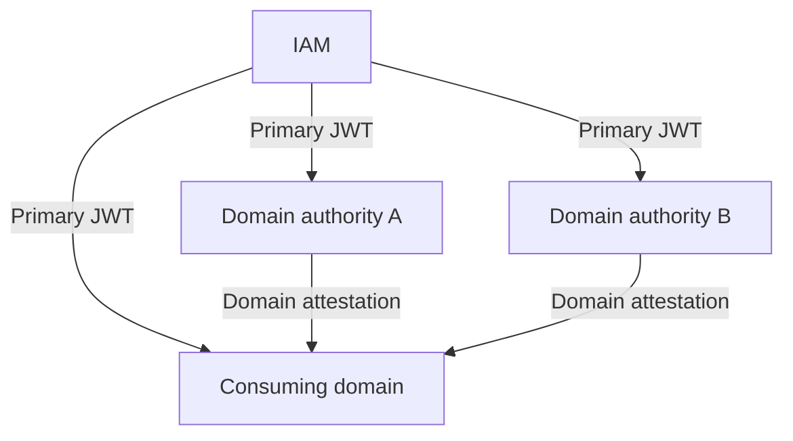
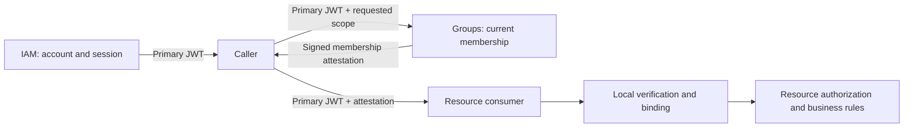
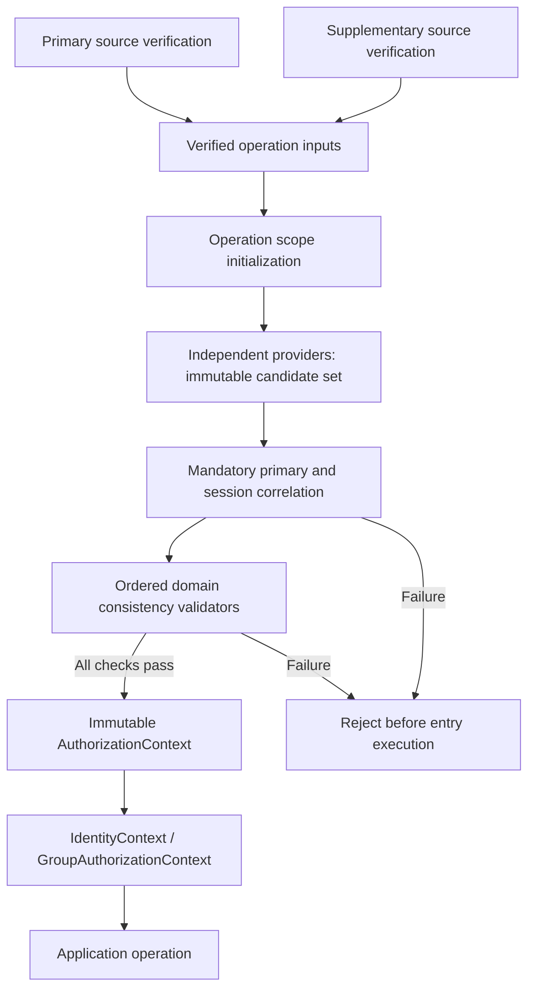
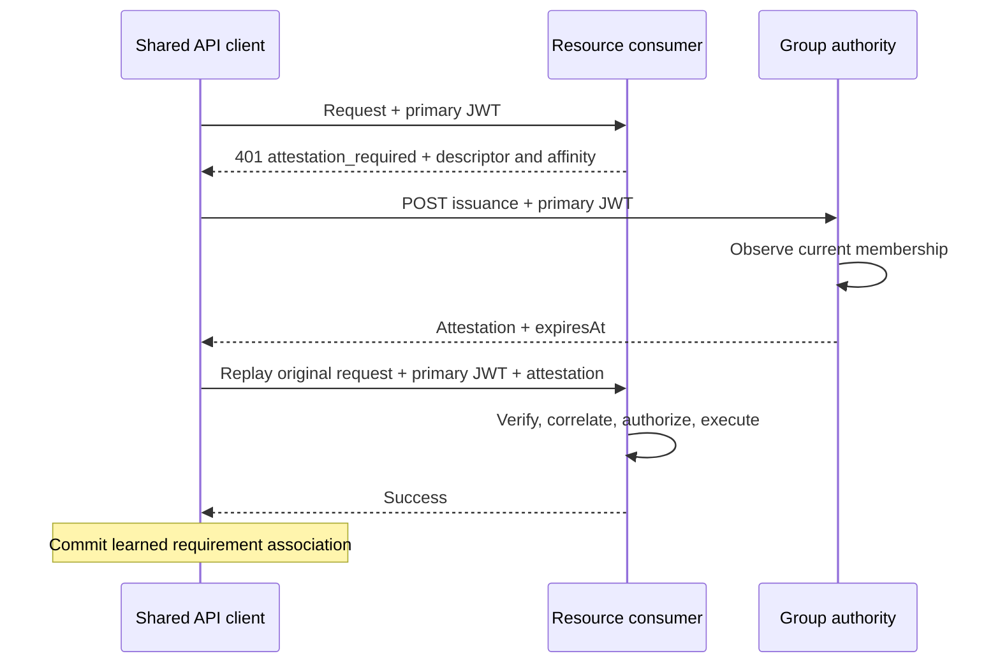
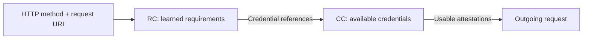
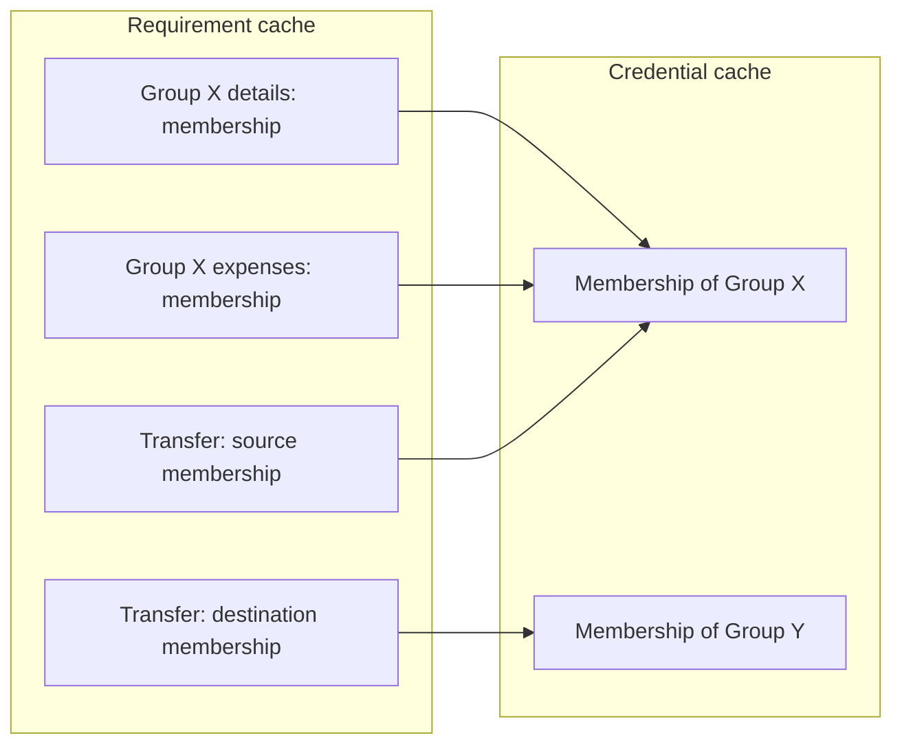
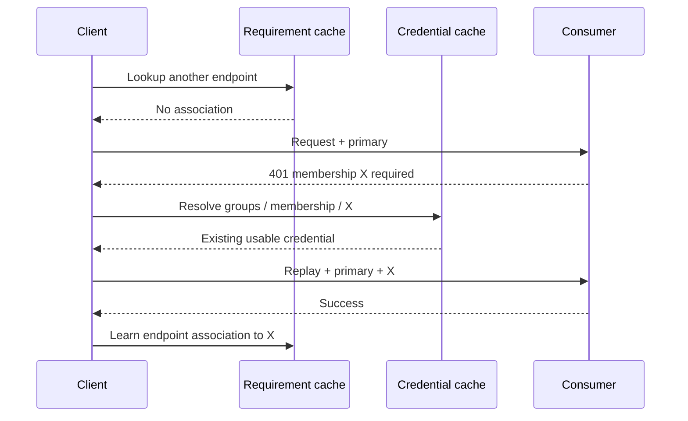

# Challenge-driven distributed authorization

Authenticating a ShareWise user establishes their identity, but it does not establish which resources they may access. IAM owns the account and login session; domain authorities own facts such as group membership; the application service that owns a resource decides whether those facts satisfy its business rules. Putting every domain permission into the IAM access token would couple IAM to business state, while consulting the owning authority for every operation would introduce synchronous dependencies between contexts.

ShareWise instead uses short-lived, signed domain attestations as supplementary evidence in form of additional, secondary JWTs. An authority attests to facts within its own domain, and consumers independently verify that evidence alongside the caller's primary JWT. This allows authorization decisions to remain local to the consuming context without transferring ownership of the underlying facts. A shared challenge protocol lets the browser dynamically learn the authorization requirements an operation needs, acquire appropriate attestations from the responsible authority, and reuse them across requests without duplicating domain policy in the frontend.



The mechanism operates across the bounded contexts of the modular monolith. Group Management supplies a concrete example of a domain authority throughout this chapter. The [verified credentials architecture](verified-credentials.md) describes the shared evidence model and operation scope; the [identity design](../stack/security.md) covers IAM sessions and refresh.

## Authority and trust

The consumer needs to establish both who is acting and which domain facts apply to that caller. A **primary credential** is an IAM access JWT that establishes the user and login session. A **domain attestation** is a subordinate JWT asserting a fact about that same principal, such as membership of a particular group. It supplements the primary credential: it cannot authenticate a caller on its own or authorize issuance of another attestation. This is a logical trust hierarchy, not a chain of derived signing keys. Each authority independently controls its signing material and owns the facts it signs.

The caller carries both forms of evidence between authorities and consumers. The arrows below represent credential exchange, rather than a synchronous dependency from the resource consumer to the issuing authority.



Independent signing authorities require explicit trust configuration at each verification boundary. The consumer accepts credentials according to issuer-qualified profiles that constrain their purpose, audience, lifetime and signing keys. A subordinate profile also identifies the primary profiles to which its assertions can be bound. A token cannot introduce its own trust anchor or choose a more permissive profile. The [JWT verification model](verified-credentials.md#jwt-verification-and-credential-binding) describes the profile and signature contracts in detail.

The primary contains `iss`, `sub` and `sid`; the attestation contains its own `iss`, the same `sub`, and `principal_iss` and `principal_sid` referring to the primary. Admission requires matching subject, primary issuer and stable session as well as an explicitly accepted primary profile. Both credentials must independently satisfy their own signature, audience, type and validity rules at external admission. Attestations bind to the session, not to the primary JWT's `jti` or issuance time, so rotating an access JWT within that session does not invalidate an attestation. An attestation may outlive the access JWT used to obtain it, but consumption still requires a valid matching primary.

Audiences delimit where evidence can be consumed. The shared API realm is `sw-api-v1`; the naming convention `sw-api-v<version>[-<domain>[-<subdomain>...]]` also expresses narrower realms, but matching always uses the exact configured audience set. The hierarchy in the name does not imply trust in a parent or child audience. For example, the `groups-membership` profile accepts the configured IAM issuer's `iam-access` primary profile; its own issuer and keys are independent of IAM. A valid Group signature therefore cannot stand in for IAM identity. See the [deployment key runbook](../../deploy/README.md#group-attestation-signing-keys) for provisioning.

These are logical authority boundaries within one trusted application process. They prevent credentials from being substituted for one another under normal admission, rather than isolating modules against arbitrary code execution in the monolith. Both credentials are bearers: session binding restricts which credentials can be combined, but is not proof of possession or single-use replay protection.

## Evidence admission and semantic authorization

Verifying a signature establishes the source of a credential, but independent signatures alone do not establish that several credentials refer to the same caller or express consistent facts. The backend separates verification of each credential from admission of the complete set, so a consuming service only sees evidence after those relationships have been checked.

The HTTP boundary accepts the primary in `Authorization: Bearer <JWT>` and supplementary JWTs in `ShareWise-Attestation`, a comma-separated list of compact JWS values. The shared supplementary ingress normalizes the header, rejects malformed or duplicate values, and enforces credential count and size limits (four credentials, 2,048 characters each and 8,192 characters in aggregate). Tokens do not travel in URLs. Cookie-backed IAM entry and attestation issuance do not accept supplementary credentials.

The IAM ingress selects its configured primary verifier directly. Supplementary ingress uses unverified `iss` and protected `typ` only as routing hints into a registry of explicitly configured verifiers. Unknown routes are rejected; ambiguous registrations fail configuration. The selected verifier still validates the entire token against its trusted profile. Source verification yields a restricted-construction `VerifiedJwtCredentialCandidate`, carrying the trusted profile, binding information and claims. A candidate is proof of successful source verification, not yet admitted evidence.



The dispatcher initializes the [operation scope](dependency-injection.md) and runs admission before resolving the entry service. Providers independently contribute candidates without depending on provider order for security. The correlation coordinator requires at most one primary, binds every subordinate to it, and runs the DI-managed validation handlers over an immutable view of all candidates. Domain validators enforce the structure and consistency of their own assertions through typed validation outcomes. Correlation owns the internal rejection signal; only the mandatory pre-entry admission boundary certifies it for HTTP recovery. For example, two membership attestations asserting conflicting roles for the same group reject the set rather than merging privileges. Missing optional evidence is allowed; supplied invalid evidence is not ignored. Only a fully admitted collection is published as the operation-scoped `AuthorizationContext`.

`AuthorizationContext` preserves each credential's claim grouping and issuer/profile provenance. It is not a global role bag. A semantic context interprets the claims that belong together in one trusted credential: an administrator assertion for Group A cannot authorize administration of Group B merely because a different token contains B's identifier. The immutable snapshot stays stable for the operation, including across its transaction segments. A separate external admission verifies tokens again; the frontend caches neither verification decisions nor server authorization grants.

Semantic contexts translate this admitted evidence into domain concepts that consuming application services can use without depending on token structure or repeating claim interpretation. They are distinct from synchronous authority ports, which inspect current domain state. The published contracts illustrate that separation:

| Contract | Meaning |
| --- | --- |
| `IdentityContext` | User and session established by the admitted primary. |
| `GroupAuthorizationContext` | Group-specific role, membership or administrator evidence from admitted attestations. |
| `IdentityPort` | Synchronous check of current IAM account/session eligibility. |
| `GroupAuthorizationPort` | Synchronous check of the admitted caller's current Group membership and role. |

For example, `GroupAuthorizationContext` exposes checks such as `requireMember(groupId)` and distinguishes unauthenticated callers, missing applicable evidence and an insufficient role through a typed result. Missing evidence carries a `CredentialRequirement`, which identifies the assertion that would satisfy the missing-evidence check. Absence of an admitted membership assertion does not prove that the caller is not a member. The consuming service still determines which membership or role is necessary and whether its own resource state permits the operation.

## Issuance and freshness

An attestation conveys a fact observed by its owning authority, not a permission requested by the caller. A caller requests a credential by logical authority, kind and scope, never by desired role or arbitrary subject. The standardized issuance route is `POST /api/{authority}/v1/domain-principal/attestations`. Group's endpoint accepts a primary bearer and a JSON body such as:

```json
{"kind":"membership","scope":"01900000-0000-7000-8000-000000000001"}
```

The authority derives the user and session from admitted primary evidence and observes its own authoritative state. Group membership issuance, for example, follows a successfully completed authority lookup transaction. It relies on the admitted primary rather than synchronously rechecking IAM eligibility. A successful response is `200 OK` with `attestation` (the compact JWT) and `expiresAt` (UTC instant); the response is non-cacheable. Denied acquisition follows the owning authority's failure semantics. Attestations are stateless and reacquired through the same endpoint rather than renewed through a separate refresh credential.

This decoupling trades immediate knowledge of authority-state changes for local verification. **A valid attestation is time-bounded evidence, not a live authority query.** For example, removing a group member prevents fresh issuance of membership evidence, but an existing membership attestation may remain valid until its expiry plus the configured verification skew. Its lifetime is measured from the authoritative observation, so delays before signing cannot extend that bound. The same distinction applies to IAM: revoking a session prevents primary refresh but does not instantly invalidate already issued access JWTs. Both credentials still need independent verification and session correlation.

The risk of the consuming operation determines whether this bounded staleness is acceptable. For operations that need fresher evidence, the consumer can use synchronous authority ports such as `IdentityPort.verifyCurrent()` or `GroupAuthorizationPort.verifyCurrent(groupId)`. These obtain current authority-owned facts without requiring an existing supplementary attestation for the Group lookup. They do not establish atomicity across domains; checks take place outside an active consumer transaction and mutable local preconditions are revalidated inside the consuming write. A subsequent authority change can still race the consumer. See [transaction boundaries](transactions.md#architectural-boundaries).

## Challenge-driven acquisition

The resource consumer is the only component that knows which evidence an operation needs. Encoding its requirements separately in each frontend adapter would duplicate policy and allow the two representations to drift. Instead, a domain operation declares its actual authorization requirements as part of business admission, and the consumer communicates missing evidence through a standardized challenge. When evidence is missing, the application service returns a typed failure before effects; the HTTP adapter identifies the consumer-local requirement and chooses an affinity policy based on the request contract. The client does not infer a requirement from a URL pattern or duplicate the domain policy.

A recoverable missing-attestation response is `401` with a ProblemDetail code `attestation_required`, a human-readable `detail`, and a structured `authorization` extension. For example, an illustrative consumer reading the group selected by `target` could return:

```json
{
  "status": 401,
  "title": "Attestation Required",
  "code": "attestation_required",
  "detail": "Group membership is required for this operation.",
  "authorization": {
    "requirementId": "target-membership",
    "credential": {
      "authority": "groups",
      "kind": "membership",
      "scope": "01900000-0000-7000-8000-000000000001"
    },
    "cache": {"policy": "query_affine", "parameters": ["target"]}
  }
}
```

The `requirementId` identifies one logical requirement within the consumer's method/path bucket, not one resource instance or JWT. A transfer might require source and destination memberships with different scopes and different affinity policies. Giving each requirement a stable distinct ID allows the client to replace an outdated association without removing an independent one. The application service knows what evidence it needs; the HTTP adapter knows whether that requirement follows a path, query, or request body. These responsibilities do not belong in the domain authority or the generic HTTP client. For example, an adapter mapping a missing-membership failure can construct the following challenge using the shared HTTP contract:

```java
case GroupAuthorizationFailure.AttestationRequired missing ->
    AttestationProblems.required(
        new AttestationChallenge("target-membership", missing.requirement(),
            AttestationAffinityPolicy.queryAffine("target")),
        "Group membership is required for this operation.");
```

The consuming service identifies which requirement failed when an operation has more than one. The adapter can choose a different affinity for each identifier, without interpreting the Group role itself. An ordinary frontend endpoint adapter calls its injected `ApiClient` in the same way as an operation without supplementary requirements.



Because the client repeats the original request after acquisition, a recoverable challenge guarantees that the consumer has not performed business effects. The consumer establishes all replayable authorization prerequisites before those effects, across the entire HTTP request (including any earlier dispatched operations). A denied role returns a terminal permission failure, not another acquisition request. Invalid supplementary evidence returns `401 invalid_attestation`; when one supplied credential can be identified unambiguously, `authorization.rejectedIndex` refers to its zero-based position in the normalized transmitted list. Aggregate or ambiguous failures omit the index and are terminal. Neither response echoes token material.

## Frontend recovery and session lifetime

Acquisition is a transport concern shared by all domain APIs. Centralizing it alongside primary authentication keeps application code independent of credential lifetimes and prevents individual adapters from inventing different replay rules. The root identity runtime owns the authenticated API client and composes ordered handlers. The IAM handler manages the primary bearer and refresh; one generic supplementary handler implements the common attestation protocol for all authorities. The transport owns replay and the logical request's budget. Domain adapters use the ordinary session-scoped client and do not request, store or renew JWTs themselves. The acquisition target is constructed from a validated authority identifier in the configured same-origin API namespace, never from a challenge-supplied URL.

One logical request can perform at most one primary recovery and three supplementary recovery actions, with a total of four. Each cache-hit challenge still consumes a recovery action. The transport tracks recovery keys and refuses repeated attempts that cannot make progress. Issuance detours share the budget, may recover primary authentication, and cannot recursively acquire attestations. Several challenges can be satisfied sequentially, accumulating and deduplicating the required evidence before replay. Only classified pre-effect failures allow replay of a repeatable original request; cancellation, session replacement, uncertain mutation outcomes and unrecognized failures stop recovery. A request with an explicit caller-supplied `Authorization` header bypasses the managed handlers. Session-scoped facades reject explicit bearer headers, and managed requests reject caller-supplied attestation headers independently of supplementary handler activation, including issuance. The transport dispatches the validated absolute API URL in same-origin mode; document base URLs and caller options cannot redirect credential-bearing requests. See [browser API boundary](frontend.md#browser-api-boundary) for IAM-specific terminal behavior.

## Credential cache and requirement cache

Challenges tell the client what evidence a particular operation requires. If the client discarded that information after every successful request, even a repeated read would need an extra round trip to rediscover its requirements. Attestations themselves are also reusable: two operations on the same group may need exactly the same membership evidence. Remembering only which JWT was issued for each endpoint would acquire and store duplicate credentials, while sending every available credential to every endpoint would disclose unrelated evidence.

The supplementary handler therefore separates two questions:

| Question | Cache | Stored association |
| --- | --- | --- |
| Which evidence is this request likely to need? | Requirement cache (RC) | Request context to credential reference |
| Do we already hold that evidence? | Credential cache (CC) | Credential key to signed JWT, expiry and generation |

A credential reference identifies an acquisition descriptor: the authority, kind and scope from the challenge. The CC key is derived from exactly that descriptor, with the authenticated lifetime implicit in cache ownership. The RC learns references from successful challenge recovery, rather than deriving membership or another domain fact from a URL. An ordinary warm request resolves its learned requirements, retrieves the available credentials and attaches each credential once. The request URI selects references, not token contents.



Keeping those mappings independent allows several request contexts to refer to one credential. Consider two illustrative endpoints for reading group details and expenses, both requiring evidence of membership in Group X. The first challenge leads to acquisition of that evidence; the second needs to discover its own requirement, but can reuse the existing JWT without contacting the authority. An operation involving both Group X and Group Y can instead learn two independent references. The example below shows the resulting associations, not the flow of an individual request.



Both caches belong to the same authenticated lifetime, rather than to individual pages or endpoint adapters. They are shared by all session-scoped facades in the tab, across client-side navigation and primary JWT rotation. Logout or replacement of that lifetime closes both caches and cancels outstanding acquisitions. A full document reload creates fresh caches, and separate tabs have independent in-memory state; attestations are not persisted to browser storage or shared across tabs.

### Learning request affinity

The same HTTP endpoint can require different evidence depending on its parameters. A full URI is sometimes unnecessarily specific (a timestamp changes without changing the required membership), whereas a path alone can be too broad (a query parameter selects a different group). The consumer's challenge supplies an affinity policy that identifies which parts of the request target distinguish a particular requirement. The client can then learn the relationship without understanding the domain meaning of those parameters. Affinity is a prediction about credential selection, not a declaration of authorization.

The RC groups entries by origin, HTTP method and exact pathname. This common prefix identifies the request bucket; the affinity policy determines how the remaining URI participates in lookup. Within each bucket, every requirement ID owns its own projection policy and mapping from projected request keys to credential references. A lookup considers all independent requirements, so a query-affine destination requirement does not hide a path-affine source requirement. The controller chooses the narrowest suitable stable relationship to the actual request. Request bodies and headers are not inspected for affinity.

| Policy | Projection within method/path bucket |
| --- | --- |
| `path_affine` | No query distinction; the exact path is sufficient. |
| `request_affine` | Complete dispatched query string. |
| `query_affine` | Explicitly named query parameters, preserving missing, empty, valueless, repeated and ordered values and their raw encodings. Unselected parameters do not affect the key. |
| `never` | No predicted credential association; suitable for body-dependent or otherwise unstable requirements. |

Missing or malformed policy metadata defaults to `never`; ambiguous query encodings do not produce a query-affine key. For example, a request to `/do-something?target=X&timestamp=1000` with `query_affine` selecting only `target` can reuse the association when the timestamp changes, but a different target requires its own association. A body-dependent target uses `never`, yet can reuse the actual credential once the server identifies the requirement.

The second endpoint in the earlier example has no learned association, but once challenged can resolve the existing credential directly.



| Cache state (one requirement) | Successful request path | HTTP requests |
| --- | --- | ---: |
| Warm RC and CC | Two local lookups, attach and dispatch | 1 |
| Cold RC, warm CC | Challenge, CC reuse, replay | 2 |
| Cold RC and CC | Challenge, issuance, replay | 3 |
| RC hit, expired or evicted CC | Dispatch without prediction, challenge, fresh issuance, replay | 3 |

### Cache validity and lifecycle

The client learns a new association only after a successful protected response using the challenged credential. A changed challenge invalidates an obsolete association even if replay is impossible; it does not evict an otherwise usable credential referenced elsewhere. A changed projection policy replaces the old projection set for that requirement. Late responses cannot overwrite newer requirement observations, including after bucket eviction. A `never` policy does not create a reusable association. Predictions may be stale or unnecessary; they confer no authorization. Overbroad policies can disclose evidence to consumers that do not need it, so the HTTP adapter uses `never` when it cannot identify a stable, sufficiently narrow projection.

CC expiry is advisory and lazy: the server remains the authority on token validity. The client does not acquire predicted credentials proactively. A rejected generation is evicted only if the rejection identifies the actual transmitted credential, and cannot evict a newer replacement. Concurrent acquisition for one descriptor is single-flight; canceling one waiter does not cancel others, and an abandoned flight cannot publish to a replacement lifetime. Required evidence takes precedence over optional predictions under header pressure. If required evidence cannot fit, recovery terminates rather than silently dropping it.

Both caches and the number of simultaneous acquisition flights are bounded. CC uses least-recently-used eviction, and RC bounds its learned state by insertion/update order. Evicting a credential does not require discarding its learned requirements. Either cache can be disabled independently without changing authorization semantics; the logical request retains the evidence required for its own recovery. These are client resource policies, not server permission rules.

## Failure and operational evidence

When issuance denies access (`403` or concealed `404`), the client surfaces the original consumer's explanatory detail with the authority failure and does not replay the protected operation. Availability, IAM, transport and cancellation failures retain their own meanings. A terminal challenge cannot create a successful affinity association. A network failure after a mutation is submitted does not establish that the operation was effect-free, so the client never blindly repeats it.

The [test architecture](tests.md) distinguishes local policy tests from PostgreSQL authority-ordering tests and deployed HTTPS interoperability. The [disposable deployment acceptance](../../deploy/README.md#disposable-end-to-end-acceptance) runs the actual frontend client against IAM, Groups and a test-only consumer, including counted effects, multiple requirements, expiry, refresh, session replacement and concurrency. The optional browser fixture uses the same runtime and exposes read-only, token-free diagnostic snapshots; [frontend development](../development/frontend.md#authorization-diagnostics) explains how to inspect them. Production artifacts do not expose the fixture or diagnostic global. The Node deployed suite does not establish browser-specific cookie or Web Lock behavior; those require browser acceptance.
