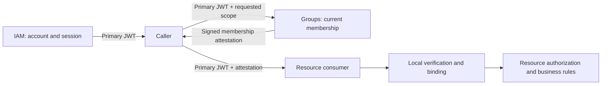
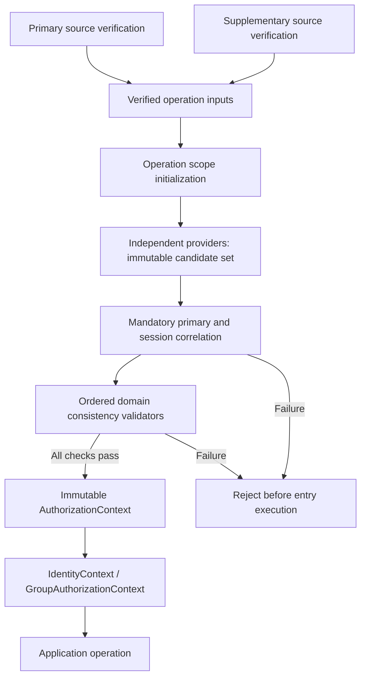
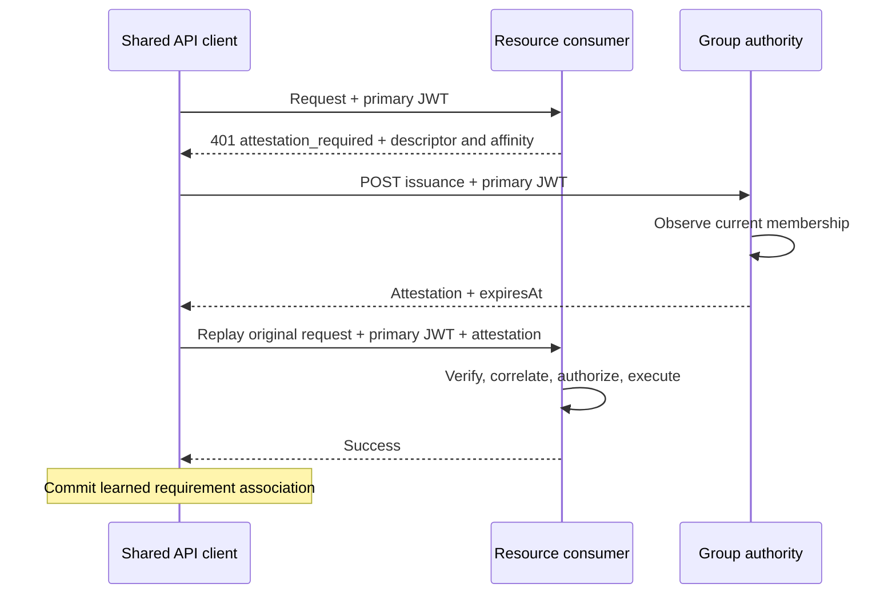
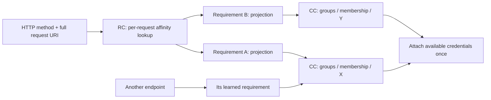
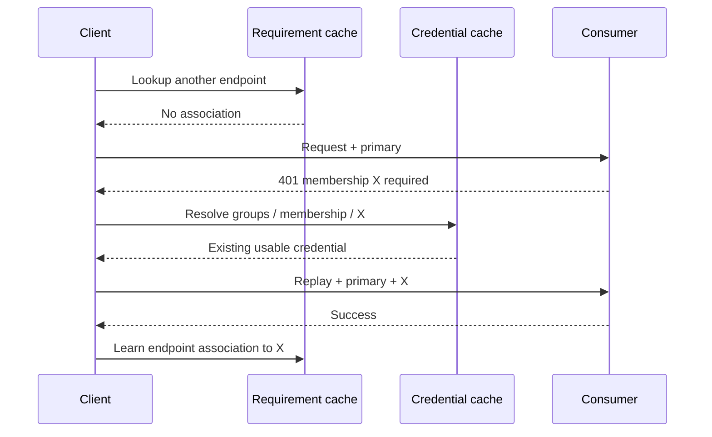

# Distributed authorization

ShareWise separates authentication of a caller from authorization to act on a resource. IAM establishes who the caller is and which login session they use; domain authorities establish facts about that caller within their own domains. A resource-owning application service combines those facts with its own business rules to decide whether an operation is permitted. Short-lived, signed domain attestations let consumers make that decision locally without a synchronous authority call for every request.

This mechanism operates within the modular monolith and is designed to preserve those ownership boundaries when contexts are extracted into services. Group Management implements membership attestation issuance, verification and semantic access. The shared frontend implements challenge-driven acquisition and reuse. The deployed authorization smoke fixture exercises downstream consumption; production Finance operations are a separate integration task (P4.5). The [verified credentials architecture](authorization.md) describes the underlying claims model and operation scope, while the [identity design](../stack/security.md) covers IAM sessions, refresh and invitation credentials.

## Authority and trust

There are two levels of credential. A primary IAM access JWT authenticates a user and their login session. A subordinate domain JWT, called an **attestation**, asserts a fact about that same principal, such as membership of one group with a particular role. It supplements the primary credential and cannot authenticate a caller on its own or authorize issuance of another attestation. This is a logical trust hierarchy, not a chain of derived signing keys: each authority independently controls its signing material and owns the facts it signs.



A consumer trusts configured issuer-qualified profiles, not arbitrary token claims or keys. Each profile specifies issuer, protected JOSE type, exact audience set, primary or subordinate kind, maximum lifetime and clock skew; its configured signature service supplies the accepted keys. A subordinate profile also identifies which primary profiles it trusts. The shared ES256 implementation uses P-256 keys; verifiers can retain overlapping public keys during rotation. A token-supplied key or URL cannot introduce another trust anchor. The profile name is a local configuration identity, not a field carried by the JWT.

The primary contains `iss`, `sub` and `sid`; the attestation contains its own `iss`, the same `sub`, and `principal_iss` and `principal_sid` referring to the primary. Admission requires matching subject, primary issuer and stable session as well as an explicitly accepted primary profile. Both credentials must independently satisfy their own signature, audience, type and validity rules at external admission. Attestations bind to the session, not to the primary JWT's `jti` or issuance time, so rotating an access JWT within that session does not invalidate an attestation. An attestation may outlive the access JWT used to obtain it, but consumption still requires a valid matching primary.

The default audience is `sw-api-v1`. Audience names can express a narrower API realm using `sw-api-v<version>[-<domain>[-<subdomain>...]]`; matching is exact, with no prefix, hierarchy or wildcard interpretation. The primary profile is `iam-access` with protected type `sw-iam-access+jwt`. The Group profile is `groups-membership`, its protected type is `sw-groups-membership+jwt`, and it accepts the configured IAM issuer's `iam-access` primary profile. Group issuer and keys are configured independently of IAM. A trusted Group signature cannot stand in for IAM identity. These are logical authority boundaries inside one trusted application process, not isolation against arbitrary code execution in the monolith. Both credentials are bearers, so session binding is not proof of possession or single-use replay protection. See the [deployment key runbook](../../deploy/README.md#group-attestation-signing-keys) for provisioning.

## Evidence admission and semantic authorization

The HTTP boundary accepts the primary in `Authorization: Bearer <JWT>` and supplementary JWTs in `ShareWise-Attestation`, a comma-separated list of compact JWS values. The shared supplementary ingress normalizes the header, rejects malformed or duplicate values, and bounds it to four credentials of at most 2,048 characters each and an aggregate 8,192 characters. Tokens do not travel in URLs. Cookie-backed IAM entry and attestation issuance do not accept supplementary credentials.

The IAM ingress selects its configured primary verifier directly. Supplementary ingress uses unverified `iss` and protected `typ` only as routing hints into a registry of explicitly configured verifiers. Unknown routes are rejected; ambiguous registrations fail configuration. The selected verifier still validates the entire token against its trusted profile. Source verification yields a restricted-construction `VerifiedJwtCredentialCandidate`, carrying the trusted profile, binding information and claims. A candidate is proof of successful source verification, not yet admitted evidence.



The dispatcher initializes the [operation scope](dependency-injection.md) and runs admission before resolving the entry service. Providers independently contribute candidates without depending on provider order for security. The correlation coordinator requires at most one primary, binds every subordinate to it, and runs the DI-managed validation handlers over an immutable view of all candidates. Group validation requires actual scalar `group_id` and `role` claims, a canonical group UUID and a supported role; conflicting roles asserted for one group reject the set rather than merging privileges. Missing optional evidence is allowed; supplied invalid evidence is not ignored. Only a fully admitted collection is published as the operation-scoped `AuthorizationContext`.

`AuthorizationContext` preserves each credential's claim grouping and issuer/profile provenance. It is not a global role bag. A semantic context interprets the claims that belong together in one trusted credential: an administrator assertion for Group A cannot authorize administration of Group B merely because a different token contains B's identifier. The immutable snapshot stays stable for the operation, including across its transaction segments. A separate external admission verifies tokens again; the frontend caches neither verification decisions nor server authorization grants.

Application services normally use published semantic contracts, not raw JWTs or generic claim searches:

| Contract | Meaning |
| --- | --- |
| `IdentityContext` | User and session established by the admitted primary. |
| `GroupAuthorizationContext` | Group-specific role, membership or administrator evidence from admitted attestations. |
| `IdentityPort` | Synchronous check of current IAM account/session eligibility. |
| `GroupAuthorizationPort` | Synchronous check of the admitted caller's current Group membership and role. |

`GroupAuthorizationContext.role(groupId)` returns an optional `GroupRole`; absence means no applicable evidence, not proof of nonmembership. `isMember` accepts either `MEMBER` or `ADMIN`, while `isAdministrator` requires `ADMIN`. `requireMember` and `requireAdministrator` return a typed `Result<GroupRole, GroupAuthorizationFailure>` distinguishing unauthenticated callers, missing evidence (with a `CredentialRequirement`), and insufficient role. A consuming context still decides whether that role is sufficient for its specific action and whether its resource state permits it. In Finance, for example, actor existence/activity and financial lifecycle are separate from membership evidence.

## Issuance and freshness

A caller requests a credential by logical authority, kind and scope, never by desired role or arbitrary subject. The standardized issuance route is `POST /api/{authority}/v1/domain-principal/attestations`. Group's endpoint accepts a primary bearer and a JSON body such as:

```json
{"kind":"membership","scope":"01900000-0000-7000-8000-000000000001"}
```

Group derives the user and session from admitted IAM evidence and observes current Group-owned membership under the Group root lock. The shared authoritative lookup orders the observation against membership mutations and completes its own transaction before signing. It does not synchronously recheck IAM session eligibility. Unknown local users and inaccessible groups retain Group's normal failure semantics, including concealment of nonmember resources. The response is `200 OK` with `attestation` (the compact JWT) and `expiresAt` (UTC instant); the response is non-cacheable. Besides the principal binding and standard `iss`, `aud`, `jti`, `iat`, `nbf` and `exp` metadata, the Group JWT carries scalar `group_id` and `role` (`MEMBER` or `ADMIN`). Its 120-second lifetime starts at the authoritative observation, not the later signing instant; the default verifier skew is 15 seconds. There is no separate attestation store or refresh token.

**A valid attestation is time-bounded evidence, not a live membership query.** Removing or downgrading a member prevents fresh issuance of the old role, but previously issued evidence may remain valid until expiry plus bounded skew. Revoking IAM's session prevents primary refresh but does not instantly invalidate already issued primary JWTs. Both JWTs still require independent local verification and matching session binding. For an operation whose risk requires fresher evidence, the consumer can use `IdentityPort.verifyCurrent()` and/or `GroupAuthorizationPort.verifyCurrent(groupId)`. These perform independent authority-state checks, without requiring an existing attestation for the Group lookup. They do not establish atomicity across domains; checks take place outside an active consumer transaction and mutable local preconditions are revalidated inside the consuming write. A subsequent authority change can still race the consumer. See [transaction boundaries](transactions.md#architectural-boundaries).

A future private network adapter could expose equivalent verification or introspection under the domain-principal endpoint family (for example `/verify` or `/introspect`). No remote service-authentication, introspection or event-driven early revocation protocol is implemented by this mechanism.

## Challenge-driven acquisition

A domain operation declares its actual authorization requirements as part of business admission. When evidence is missing, the application service returns a typed failure before effects; the HTTP adapter identifies the consumer-local requirement and chooses an affinity policy based on the request contract. The client does not infer a requirement from a URL pattern or duplicate the domain policy.

A recoverable missing-attestation response is `401` with a ProblemDetail code `attestation_required`, a human-readable `detail`, and a structured `authorization` extension. For example, an illustrative consumer reading the group selected by `target` could return:

```json
{
  "status": 401,
  "title": "Attestation Required",
  "code": "attestation_required",
  "detail": "Group membership is required for this operation.",
  "authorization": {
    "requirementId": "target-membership",
    "credential": {
      "authority": "groups",
      "kind": "membership",
      "scope": "01900000-0000-7000-8000-000000000001"
    },
    "cache": {"policy": "query_affine", "parameters": ["target"]}
  }
}
```

The `requirementId` identifies one logical requirement within the consumer's method/path bucket, not one resource instance or JWT. A transfer might require source and destination memberships with different scopes and different affinity policies. Giving each requirement a stable distinct ID allows the client to replace an outdated association without removing an independent one. The application service knows what evidence it needs; the HTTP adapter knows whether that requirement follows a path, query, or request body. These responsibilities do not belong in the domain authority or the generic HTTP client. For example, an adapter mapping a missing-membership failure can construct the following challenge using the shared HTTP contract:

```java
case GroupAuthorizationFailure.AttestationRequired missing ->
    AttestationProblems.required(
        new AttestationChallenge("target-membership", missing.requirement(),
            AttestationAffinityPolicy.queryAffine("target")),
        "Group membership is required for this operation.");
```

The consuming service identifies which requirement failed when an operation has more than one. The adapter can choose a different affinity for each identifier, without interpreting the Group role itself. An ordinary frontend endpoint adapter calls its injected `ApiClient` in the same way as an operation without supplementary requirements.



The response contract is an effect-free recovery signal, not a general retry mechanism. A consumer must perform all replayable admission checks before business effects (including under a lock if needed). A denied role returns a terminal permission failure, not another acquisition request. Invalid supplementary evidence returns `401 invalid_attestation`; when one supplied credential can be identified unambiguously, `authorization.rejectedIndex` refers to its zero-based position in the normalized transmitted list. Aggregate or ambiguous failures omit the index and are terminal. Neither response echoes token material.

## Frontend recovery and session lifetime

The root identity runtime owns the authenticated API client and composes ordered handlers. The IAM handler manages the primary bearer and refresh; one generic supplementary handler implements the common attestation protocol for all authorities. The transport owns replay and the logical request's budget. Domain adapters use the ordinary session-scoped client and do not request, store or renew JWTs themselves. The acquisition target is constructed from a validated authority identifier in the configured same-origin API namespace, never from a challenge-supplied URL.

One logical request can perform at most one primary recovery and three supplementary recovery actions, with a total of four. Each cache-hit challenge still consumes a recovery action. The transport tracks recovery keys and refuses repeated attempts that cannot make progress. Issuance detours share the budget, may recover primary authentication, and cannot recursively acquire attestations. Several challenges can be satisfied sequentially, accumulating and deduplicating the required evidence before replay. Only classified pre-effect failures allow replay of a repeatable original request; cancellation, session replacement, uncertain mutation outcomes and unrecognized failures stop recovery. A request with an explicit caller-supplied `Authorization` header bypasses the managed handlers. Session-scoped facades reject explicit bearer headers, and managed supplementary preparation rejects caller-supplied attestation headers. See [browser API boundary](frontend.md#browser-api-boundary) for IAM-specific terminal behavior.

## Credential cache and requirement cache

The supplementary handler owns two independent, bounded caches for one authenticated lifetime. They are shared by all session-scoped facades in the tab, across client-side navigation and primary JWT rotation. Logout or replacement of that lifetime closes both caches and cancels outstanding acquisitions; full document reloads and separate tabs have independent in-memory state. No attestation is persisted to browser storage or shared across tabs.

The **credential cache (CC)** answers whether a credential is already available. Its opaque key is derived from the exact acquisition descriptor `(authority, kind, scope)`; the authenticated lifetime is implicit in its ownership. The value holds the signed JWT, advisory expiry and generation. The **requirement cache (RC)** answers which credentials are likely to be needed by a request. It holds references to CC keys and their acquisition descriptors, not JWTs. Several endpoints can reference the same CC entry, and one endpoint can reference several distinct credentials.



The RC groups entries by origin, HTTP method and exact pathname. Within each bucket, every requirement ID owns its own projection policy and a mapping from projected request keys to credential references. A lookup considers all independent requirements, not only the most specific match. The controller chooses the narrowest suitable stable relationship to the actual request. Request bodies and headers are not inspected for affinity.

| Policy | Projection within method/path bucket |
| --- | --- |
| `path_affine` | No query distinction; the exact path is sufficient. |
| `request_affine` | Complete dispatched query string. |
| `query_affine` | Explicitly named query parameters, preserving missing, empty, valueless, repeated and ordered values and their raw encodings. Unselected parameters do not affect the key. |
| `never` | No predicted credential association; suitable for body-dependent or otherwise unstable requirements. |

Missing or malformed policy metadata defaults to `never`; ambiguous query encodings do not produce a query-affine key. For example, a request to `/do-something?target=X&timestamp=1000` with `query_affine` selecting only `target` can reuse the association when the timestamp changes, but a different target requires its own association. A body-dependent target uses `never`, yet can reuse the actual credential once the server identifies the requirement.



| Cache state (one requirement) | Successful request path | HTTP requests |
| --- | --- | ---: |
| Warm RC and CC | Two local lookups, attach and dispatch | 1 |
| Cold RC, warm CC | Challenge, CC reuse, replay | 2 |
| Cold RC and CC | Challenge, issuance, replay | 3 |
| RC hit, expired or evicted CC | Dispatch without prediction, challenge, fresh issuance, replay | 3 |

The client learns a new association only after a successful protected response using the challenged credential. A changed challenge invalidates an obsolete association even if replay is impossible; it does not evict an otherwise usable credential referenced elsewhere. A changed projection policy replaces the old projection set for that requirement. Sequence checks prevent older requests from overwriting newer learning, including after bucket eviction. `never` can retain a bounded version marker but no reusable association. Predictions may be stale or unnecessary; they confer no authorization. Overbroad policies can disclose evidence to consumers that do not need it, so the HTTP adapter uses `never` when it cannot identify a stable, sufficiently narrow projection.

CC expiry is advisory and lazy: the server remains the authority on token validity. The client does not acquire predicted credentials proactively. A rejected generation is evicted only if the rejection identifies the actual transmitted credential, and cannot evict a newer replacement. Concurrent acquisition for one descriptor is single-flight; canceling one waiter does not cancel others, and an abandoned flight cannot publish to a replacement lifetime. Required evidence takes precedence over optional predictions under header pressure. If required evidence cannot fit, recovery terminates rather than silently dropping it.

The default CC holds 128 credentials and up to 32 simultaneous acquisition flights; the RC holds 32 buckets with up to eight requirements per bucket and eight projections per requirement. CC uses LRU eviction and RC bounds its learned state by insertion/update order. Either cache can be disabled independently without changing authorization semantics; the logical request retains the evidence required for its own recovery. These bounds are client resource policies, not server permission rules.

## Failure and operational evidence

When issuance denies access (`403` or concealed `404`), the client surfaces the original consumer's explanatory detail with the authority failure and does not replay the protected operation. Availability, IAM, transport and cancellation failures retain their own meanings. A terminal challenge cannot create a successful affinity association. A network failure after a mutation is submitted does not establish that the operation was effect-free, so the client never blindly repeats it.

The [test architecture](tests.md) distinguishes local policy tests from PostgreSQL authority-ordering tests and deployed HTTPS interoperability. The [disposable deployment acceptance](../../deploy/README.md#disposable-end-to-end-acceptance) runs the actual frontend client against IAM, Groups and a test-only consumer, including counted effects, multiple requirements, expiry, refresh, session replacement and concurrency. The optional browser fixture uses the same runtime and exposes read-only, token-free diagnostic snapshots; [frontend development](../development/frontend.md#authorization-diagnostics) explains how to inspect them. Production artifacts do not expose the fixture or diagnostic global. The Node deployed suite does not establish browser-specific cookie or Web Lock behavior; those require browser acceptance.
