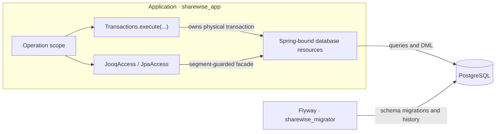
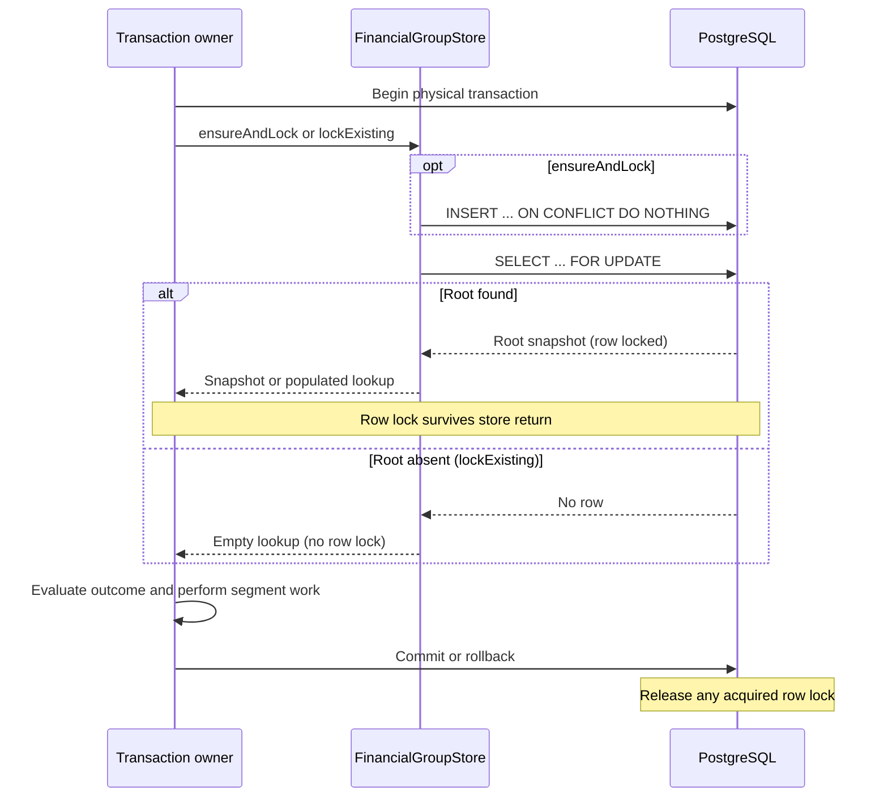

# Persistence foundation

ShareWise uses PostgreSQL as its relational database and Flyway migrations as the authority for the physical schema. Spring Boot configures an application `DataSource` and a separate Flyway migration connection with schema-changing privileges. jOOQ and JPA/Hibernate are integrated with Spring's explicit transaction segments through operation-scoped persistence accessors.

The shared persistence infrastructure supplies transaction-bound database access to independently owned business schemas. IAM uses it for accounts, optional profiles, sessions and refresh tokens; Group Management for its registry of locally known IAM users, groups and memberships; Finance for group-root provisioning and locking. The [application architecture](../architecture.md) explains module ownership, and [transaction management](transactions.md) defines transaction decisions, completion and failure semantics.

## Database topology and ownership

A single PostgreSQL database contains the following schemas:

| Schema | Current responsibility |
| --- | --- |
| `identity` | IAM accounts, optional profiles, sessions and refresh tokens. |
| `groups` | Group Management's registry of locally known IAM user IDs, groups and memberships. |
| `finance` | Finance group roots and retained actor identities. |
| `files`, `notifications` | Reserved bounded-context namespaces. |
| `flyway` | Flyway's migration history, separate from the context namespaces. |

Schema boundaries make ownership visible in the physical layout, but do not provide database-enforced isolation between contexts: the single runtime database role has privileges across all five context schemas. The backend's [Spring Modulith boundaries](../architecture.md#module-structure-and-published-apis) govern dependencies between application modules; schema separation does not authorize cross-context data access.

## Schema lifecycle and database authority

Flyway runs against PostgreSQL during application startup using the migration role. Versioned SQL migrations define the database objects and are tracked in Flyway's history schema. Hibernate's `ddl-auto=validate` setting validates mapped objects against the database without generating or updating tables; it is not a substitute for reviewing or testing database constraints and indexes.

Database initialization separates two credentials and responsibilities:

| Role | Granted access |
| --- | --- |
| `sharewise_migrator` | Connect and create at database level; owns schemas and objects created by Flyway and performs schema evolution. |
| `sharewise_app` | Connect and use the context schemas; read and modify tables and sequences granted through migration-owned default privileges. It cannot create objects in those schemas or read the Flyway history. |

Development and test provisioning scripts establish their roles using disposable credentials. The [production Compose startup](../development/production-compose.md) instead reads required role passwords from protected files and creates the roles only when initializing an empty PostgreSQL data volume. On a populated volume, rotation and recovery are explicit administrative operations. Flyway's baseline migration creates the five context schemas, grants `USAGE` to the runtime role, and configures default table and sequence privileges for objects created by the migration role. Those default privileges depend on the **object-creating role**; creating an object under a different role does not automatically grant the application access.

Application requests use the runtime connection; they do not inherit the migrator's DDL authority. IAM and Finance revoke default `PUBLIC` usage on their domain types and explicitly grant it to the runtime role; Group Management does the same for its role enum, and Finance does the same for its lifecycle enum. Configuration and bootstrap commands are documented in [Backend development](../development.md#database).

### Database-first SQL metadata

IAM, Group Management and Finance use jOOQ metadata generated from their Flyway-migrated PostgreSQL schemas. Each context keeps its generated tables, records and types internal to its persistence adapters; its ports expose application-owned values instead. The generated Java sources are committed alongside migrations so ordinary builds compile against the same metadata without accessing a database or invoking the generator.

One opt-in `jooq-codegen` Maven profile generates every context's metadata. It has one execution per context schema; shared generator settings are declared once, and each execution names only its schema and its owning module's private target package, so a context that introduces tables adds an execution rather than a second mechanism. The profile fails on jOOQ metadata problems, so generating against a database that lacks a context schema aborts instead of replacing that context's committed sources with an empty package. The dedicated CI generation gate runs this actual Maven profile against a freshly Flyway-migrated database and compares the regenerated tree with committed sources. Generator and migration-tool plugin dependencies are confined to the opt-in profile; ordinary compilation and tests use only the checked-in metadata. The [development guide](../development.md#database) describes regeneration.

## Transaction-bound persistence access

`JooqAccess` and `JpaAccess` are access contracts backed by operation-scoped Spring components. An application operation may retain an accessor across sequential transaction segments, but an accessor supplies a database facade only while a compatible segment is active. Acquiring an accessor does not start a transaction.

The runtime and migration connections serve the same database through separate authorities. At runtime, the operation scope and physical transaction also have distinct responsibilities:

`Transactions.execute(...)` establishes a Spring-managed physical transaction and provides a segment identity. Each accessor captures that identity when it returns a facade:

- `JooqAccess.dsl()` derives a jOOQ `DSLContext` from Spring Boot's transaction-aware configuration. Its guards check the active segment during connection acquisition and SQL execution; jOOQ's own transaction entry points are rejected.
- `JpaAccess.entityManager()` requires a Spring-bound JPA persistence context and returns a segment-guarded `EntityManager`. A JDBC transaction without the corresponding JPA context is insufficient.

The returned facades belong to their originating segment and owning operation/thread. They expire when the segment callback exits, even if the operation scope continues and opens another segment. A retained facade or its derived executable query cannot silently acquire the later segment's resources. The guards cover the supported jOOQ/JPA execution paths, not arbitrary JDBC access or references escaped outside them.

jOOQ statements execute against the active transaction, while Hibernate may buffer entity changes until flush and retain managed state in its first-level cache. The two access models can participate in the same Spring transaction, but their caches and write timing do not automatically synchronize. See [transaction management](transactions.md#persistence-participation-and-lifetimes) for segment lifecycle and completion behavior.

## Group metadata persistence

Group Management's domain values own Unicode-aware normalization and business validation of names and descriptions. The database enforces structural integrity, character-length limits, nonnegative metadata versions and inexpensive storage sanity checks: names must be nonempty, trimmed of ordinary spaces and free of ASCII control characters; descriptions are nullable or nonempty, trimmed of ordinary spaces and line breaks, and may contain LF or CRLF but no other ASCII control characters. These backstops do not reproduce the domain's Unicode whitespace and control-character classification. Adapters persist validated domain values and reconstruct those values on reads rather than silently repairing invalid stored metadata.

## Finance persistence

Finance owns its group lifecycle and financial revision independently of organizational group membership. Its physical consistency boundary is the row in `finance.groups` identified by the upstream group UUID. `finance.actors` retains group-local participant identities using the composite primary key `(group_id, user_id)`. The actor's `group_id` references the Finance root without cascading deletion; both upstream identifiers remain opaque, with no foreign keys into Group Management or IAM. A root may have zero actors.

The two tables track different kinds of state. The root contains the Finance-owned `group_state` (`provisioning`, `open`, `closed`, `archived`), its nonnegative `current_revision` and creation timestamp. An actor records explicit membership deletion state, a strictly positive `upstream_revision` and creation/update timestamps. Finance-local PostgreSQL domains `bignatural0` and `bignatural1` enforce the respective revision ranges, with non-nullability enforced on the columns. The root defaults to `provisioning` and revision zero; the actor's deletion state and source revision have no defaults. A row-level update trigger sets the actor's `updated_at` to `now()`, the transaction-start timestamp. Timestamps are diagnostic metadata, not a substitute for source revision ordering.

### Group-root provisioning and locking

The internal `FinancialGroupStore` separates creating a missing root from acquiring an existing root's lock. `ensureAndLock` is reserved for trusted Group-originated facts: it inserts a root with database defaults if none exists, then obtains its row lock. The caller establishes trust; this port neither authenticates the fact nor activates the root, creates an actor or advances a revision. `lockExisting` acquires the same lock without inserting a row. Its `FinancialGroupLookup` contains an optional immutable snapshot of the identity, lifecycle and financial revision; absence identifies a missing Finance root, not absence from Group Management, and carries no row lock. `ensureAndLock` returns the snapshot directly because it guarantees a root exists on success.

The lookup's `requireReady()` method provides a common initialization precondition independent of the lookup's locking strategy. It returns a typed `NOT_READY` failure for an absent or provisioning root and a successful snapshot for an open, closed or archived root, regardless of revision. Readiness is neither authorization nor writability nor actor eligibility. The caller must establish scoped authorization before exposing a readiness outcome and enforce operation-specific lifecycle and eligibility policy separately. Technical callers can inspect the optional snapshot without applying this business precondition. The guard is pure: it neither reads the database nor controls transaction completion.

The operation-scoped jOOQ adapter uses `INSERT ... ON CONFLICT (id) DO NOTHING` followed by a separate `SELECT ... FOR UPDATE` for provisioning. Under PostgreSQL's `READ COMMITTED` isolation, the separate select can observe the committed winner of a concurrent first insert. The conflict path does not update an existing root merely to acquire its lock, preserving its state, revision, creation timestamp and tuple version. Existing-root locking executes only the select.

The caller owns the physical transaction across the store invocation and its subsequent work:

Both methods require a non-null group ID and an active caller-owned transaction segment within an operation scope, enforced through `JooqAccess` for database access. Returning the snapshot does not release the database lock; physical transaction completion does. Concurrent lock holders for the same root serialize, whereas distinct roots do not share a group-level lock. Rollback undoes an inserted root and releases the lock. Unexpected persistence errors, including lock failures, propagate to the transaction owner rather than being treated as absence or lifecycle rejection. Stronger isolation levels can require whole-transaction retry; the adapter does not retry or commit independently.

## Verification boundary

The backend's [test architecture](tests.md) separates database-free Unit tests, PostgreSQL Integration tests with rollback-only physical transactions, and E2E tests using independently provisioned databases for real commits. PostgreSQL tests exercise the migration/role setup, guarded jOOQ/JPA access, transaction visibility and failure behavior. Rollback-isolated tests cannot establish durable commit behavior; E2E tests cover that boundary.

Group Management's Integration tests cover its schema constraints, registry and read projections; E2E tests exercise concurrent metadata replacement and the lock ordering of a replacement against a concurrent role change. Finance schema tests exercise the required column, type, key, trigger and privilege contracts without constraining unrelated additive schema changes. Unit tests establish the readiness rule; Finance store Integration tests cover the port and readiness outcomes within an active segment; real-commit E2E tests exercise concurrent first inserts, root locking, rollback, independent groups and lock failure propagation. The [persistence stack design](../stack/persistence.md) describes the wider feature contracts.
