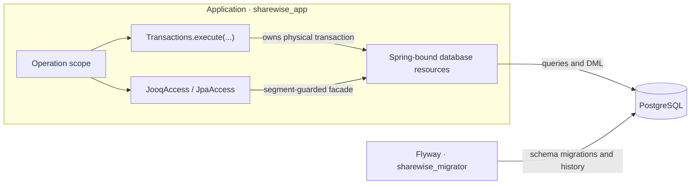

# Persistence foundation

ShareWise uses PostgreSQL as its relational database and Flyway migrations as the authority for the physical schema. Spring Boot configures an application `DataSource` and a separate Flyway migration connection with schema-changing privileges. jOOQ and JPA/Hibernate are integrated with Spring's explicit transaction segments through operation-scoped persistence accessors.

The implemented persistence layer provides the shared infrastructure foundation and IAM-owned authentication tables and jOOQ adapters. Other contexts have schema namespaces but do not yet own business tables. The [application architecture](../architecture.md) describes the intended module interaction model; [transaction management](transactions.md) defines transaction decisions, completion and failure semantics.

## Database topology and ownership

A single PostgreSQL database contains the following schemas:

| Schema | Current responsibility |
| --- | --- |
| `identity`, `groups`, `finance`, `files`, `notifications` | Bounded-context schemas. `identity` contains the IAM account, session and refresh-token tables; the remaining context schemas do not yet contain business tables. |
| `flyway` | Flyway's migration history, separate from the context namespaces. |

Schema boundaries make ownership visible in the physical layout, but do not provide database-enforced isolation between contexts: the single runtime database role has privileges across all five context schemas. The backend's [Spring Modulith boundaries](../architecture.md#module-structure-and-published-apis) govern dependencies between application modules; schema separation does not authorize cross-context data access.

## Schema lifecycle and database authority

Flyway runs against PostgreSQL during application startup using the migration role. Versioned SQL migrations define the database objects and are tracked in Flyway's history schema. Hibernate's `ddl-auto=validate` setting validates mapped objects against the database without generating or updating tables; it is not a substitute for reviewing or testing database constraints and indexes.

Database initialization separates two credentials and responsibilities:

| Role | Granted access |
| --- | --- |
| `sharewise_migrator` | Connect and create at database level; owns schemas and objects created by Flyway and performs schema evolution. |
| `sharewise_app` | Connect and use the context schemas; read and modify tables and sequences granted through migration-owned default privileges. It cannot create objects in those schemas or read the Flyway history. |

Development and test provisioning scripts establish their roles using disposable credentials. The [production Compose startup](../development/production-compose.md) instead reads required role passwords from protected files and creates the roles only when initializing an empty PostgreSQL data volume. On a populated volume, rotation and recovery are explicit administrative operations. Flyway's baseline migration creates the five context schemas, grants `USAGE` to the runtime role, and configures default table and sequence privileges for objects created by the migration role. Those default privileges depend on the **object-creating role**; creating an object under a different role does not automatically grant the application access.

Application requests use the runtime connection; they do not inherit the migrator's DDL authority. Configuration and bootstrap commands are documented in [Backend development](../development.md#database).

## Transaction-bound persistence access

`JooqAccess` and `JpaAccess` are access contracts backed by operation-scoped Spring components. An application operation may retain an accessor across sequential transaction segments, but an accessor supplies a database facade only while a compatible segment is active. Acquiring an accessor does not start a transaction.

The runtime and migration connections serve the same database through separate authorities. At runtime, the operation scope and physical transaction also have distinct responsibilities:

`Transactions.execute(...)` establishes a Spring-managed physical transaction and provides a segment identity. Each accessor captures that identity when it returns a facade:

- `JooqAccess.dsl()` derives a jOOQ `DSLContext` from Spring Boot's transaction-aware configuration. Its guards check the active segment during connection acquisition and SQL execution; jOOQ's own transaction entry points are rejected.
- `JpaAccess.entityManager()` requires a Spring-bound JPA persistence context and returns a segment-guarded `EntityManager`. A JDBC transaction without the corresponding JPA context is insufficient.

The returned facades belong to their originating segment and owning operation/thread. They expire when the segment callback exits, even if the operation scope continues and opens another segment. A retained facade or its derived executable query cannot silently acquire the later segment's resources. The guards cover the supported jOOQ/JPA execution paths, not arbitrary JDBC access or references escaped outside them.

jOOQ statements execute against the active transaction, while Hibernate may buffer entity changes until flush and retain managed state in its first-level cache. The two access models can participate in the same Spring transaction, but their caches and write timing do not automatically synchronize. See [transaction management](transactions.md#persistence-participation-and-lifetimes) for segment lifecycle and completion behavior.

## Verification boundary

The backend's [test architecture](tests.md) separates database-free Unit tests, PostgreSQL Integration tests with rollback-only physical transactions, and E2E tests using independently provisioned databases for real commits. PostgreSQL tests exercise the migration/role setup, guarded jOOQ/JPA access, transaction visibility and failure behavior. Rollback-isolated tests cannot establish durable commit behavior; E2E tests cover that boundary.

The shared foundation owns schema provisioning, role separation and transaction-bound persistence access. IAM owns its authentication schema, data mapping and generated jOOQ metadata; further context-owned persistence work is described in the [persistence stack plan](../stack/persistence.md).
