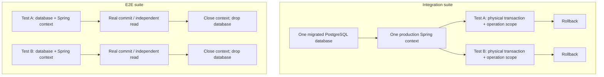

# Backend test architecture

ShareWise separates backend tests by the **boundary whose behavior they establish**. The three executable suites are Unit, Integration and E2E. They use the same production application code but differ in infrastructure ownership, transaction finalization and the guarantees their assertions can establish. A fourth category, Smoke / system-level E2E, is reserved for deployed and cross-context behavior.

The distinction matters most for persistence: a transaction that requests `COMMIT` is not proof of a **physical commit** when the test harness deliberately owns the outer transaction. Tests that need durable visibility or recovery therefore use a different fixture lifetime from tests that inspect pending changes.

## Execution boundaries

| Suite | Execution environment | Isolation and evidence |
| --- | --- | --- |
| **Unit** | In-process JUnit with fakes/mocks; optionally a lightweight Spring context or MockMvc | No external database, container runtime or network dependency. Tests application decisions, validation, scoped wiring and architectural constraints. |
| **Integration** | Real PostgreSQL and production Spring services, with explicitly selected rollback-test components | One migrated database and application context shared by the test suite; each test execution owns a fresh physical transaction and operation DI scope. All physical writes roll back. Tests database adapter behavior and SQL-visible pending state. |
| **E2E** | Real PostgreSQL, production Spring configuration and application services | One independently migrated, disposable database and application context **per test**. Physical commits and independent-connection observations establish durable and multi-segment behavior. |
| **Smoke / system-level E2E** | A deployed system and its infrastructure | The disposable production Compose probe establishes HTTPS ingress, IAM, representative Group workflows and deployment behavior; automated cross-context messaging and replication scenarios remain deferred. |

E2E here denotes an application scenario with a real database and commit boundaries. It need not use a browser or a deployed system. HTTP-level scenarios within one context can belong to E2E; cross-process delivery and system recovery belong to the smoke category. The [deployment guide](../../deploy/README.md#disposable-end-to-end-acceptance) describes the local Compose probe; it is separate from Maven and the three backend CI suites.

The three active suites are independently selectable Maven test executions and separate GitLab CI gates. They share neither a database fixture nor an active transaction across CI jobs. There is no second application module or separate test DI container.

## Fixture and transaction ownership

The fixture model separates **database and application-context lifetime** from **operation and physical-transaction lifetime**. A test database is disposable infrastructure with an exclusive owner; Spring's application context supplies production wiring, while the production operation-scope mechanism controls scoped service instances.

### Integration: a physical transaction owned by the test

The Integration suite provisions its shared database, applies Flyway migrations and any immutable committed seed, then starts a Spring application context. A JUnit root-scoped owner closes that context and drops the database at suite termination. Sharing this fixture avoids repeating database creation and migration for every test.

Each Integration invocation begins a **new Spring-managed physical transaction before activating the operation DI scope**. Services run within that scope, using the same production jOOQ/JPA access guards but a test-only transaction adapter. The adapter records one logical `Transactions.execute(...)` segment and its requested `COMMIT`, `ROLLBACK` or `ABSTAIN` disposition. It **never finalizes the physical transaction**. The harness unconditionally rolls the physical transaction back, including on a failed assertion or callback.

A completed logical segment invalidates its application persistence leases. Before physical rollback, the test can inspect **already flushed SQL** through a restricted JDBC inspector bound to the original transaction. The inspector cannot open or commit transactions, leak a connection or flush JPA state implicitly. An independent connection cannot observe those uncommitted writes. A PostgreSQL error can also leave the transaction aborted, in which case further SQL inspection may be impossible; the recorded outcome and eventual rollback remain testable.

The rollback adapter permits **one logical segment per operation**. It models the application's decision and lease lifetime, not several independently committed segments. A request to commit in this mode never establishes committed-state visibility, after-commit delivery or durable publication. Sequential physical transactions and recovery behavior are E2E concerns.

### E2E: durable application behavior

Each E2E test provisions and migrates its own database, starts an uncached production Spring context wired to that database and executes application work through normal operation scopes and production transaction management. Physical commits and rollbacks follow production semantics. Tests can use an independent application-role connection to establish which changes persisted or became visible after a segment completed.

Database preparation and committed seeds belong to the fixture setup, before the application scenario. The owner closes the application context, releasing its datasource and workers, **before** dropping its database. Failure paths still attempt teardown, retaining cleanup errors without obscuring the initiating failure. Databases are never reused between E2E tests, even when methods run in parallel.

The database abstraction exposes the operations application-facing tests need; PostgreSQL-specific provisioning, cluster roles and migration remain infrastructure details. Both suites consume the same PostgreSQL endpoint and P1.2 migration/bootstrap implementation. Neither requires a Docker API: the endpoint can be supplied by a local service or by a GitLab runner's PostgreSQL service.

## Isolation, concurrency and external effects

Component tests that share a cached Spring context also share its mutable singleton fixtures. Such fixtures require independent state or a common JUnit resource lock covering setup, test execution and cleanup; locking individual fixture methods cannot protect a whole scenario. Group component suites use a fixture-lifecycle lock while unrelated tests remain parallel.

The shared Integration fixture is safe for parallel execution **under explicit constraints**, not simply because its transactions roll back. Tests own independent transaction bindings, operation scopes and connections; the suite's committed seed is immutable after initialization. Concurrent tests use disjoint write keys and avoid conflicting row locks, global schema or role mutations, and assumptions that PostgreSQL sequences roll back. The shared context may still contain singletons, so tests cannot mutate shared singleton state without independent synchronization or isolation.

An Integration test cannot allow unrelated asynchronous consumers, external API calls or side effects to escape its rollback-owned operation. Those effects cannot be undone by the database rollback and may be triggered on another thread or after a physical commit that never occurs here. A test needing real event publication, cross-transaction visibility or external effects belongs in E2E or, when multiple deployed contexts are involved, in system-level smoke coverage.

E2E isolation is a database ownership guarantee, not a guarantee that arbitrary cluster-global or external effects are isolated. Its scenarios must still avoid changing shared server roles and other cluster-wide state unless the test explicitly owns and restores it.

## Discovery and extension boundaries

Production services follow the application's normal Spring Boot component discovery. Test-local beans are marked with Spring Boot's `@TestConfiguration` or `@TestComponent` and are **explicitly selected** by the tests that need them. Lightweight Spring contexts have constrained infrastructure scans and never acquire other test classes' fixtures through package-wide scanning. Architecture checks enforce these conventions.

The testing infrastructure owns test database creation, test context lifetime, callback failure reporting, physical rollback and pending-state inspection. It does not redefine the production `ServiceScope`, `OperationDispatcher`, `Transactions`, `TransactionOutcome`, `JooqAccess` or `JpaAccess` contracts. Production DI, transaction and persistence semantics remain defined by [operation-scoped dependency injection](dependency-injection.md), [transactions](transactions.md) and [persistence](persistence.md).

Database-backed suites must fail when the configured PostgreSQL server is missing or misconfigured; H2 and in-memory substitutes cannot establish PostgreSQL correctness. The optional local container runtime is a means of supplying a server, not part of the fixture's contract.

## Verification limits

The suites establish only the behavior they execute. Unit tests cannot establish SQL dialect or database isolation rules. Integration tests cannot establish physical commit, after-commit delivery, multi-segment persistence or crash recovery. Database-isolated E2E tests cannot establish behavior spanning separately deployed processes.

The [P1.5 PostgreSQL transaction acceptance record](../internal/tasks/p1.5-postgresql-transaction-gate/plan.md#tx-03-through-tx-11-evidence-matrix) covers the real-commit and database-specific production transaction scenarios. Future messaging, replication and domain-concurrency invariants require their own feature tests; reusable E2E fixtures alone do not establish them.

For suite selection, fixture APIs, credentials, local execution and CI troubleshooting, see [Backend testing](../development/tests.md).
