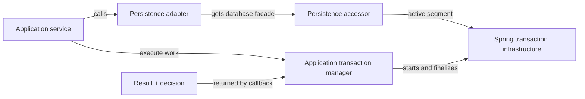
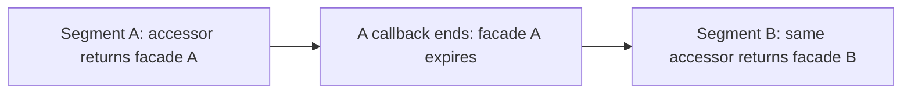

# Application transaction management

ShareWise separates an **application operation** from the database transactions it performs. An operation owns one [dependency-injection scope](dependency-injection.md) and may execute zero or more **sequential transaction segments** within its lifetime. The scope outlives any segment it contains, so its services remain available while each database transaction independently commits or rolls back.

Application services decide which work belongs in a transaction and whether its changes should persist. Persistence adapters participate without receiving transaction or connection parameters in their business-facing methods. Spring owns physical database transactions and resources; ShareWise coordinates their use without implementing a second transaction engine.

## Model and responsibilities

| Concept | Responsibility | Java API / type |
| --- | --- | --- |
| **Application operation** | One entry-service invocation and its collaborators within a shared DI scope; may contain multiple sequential transaction segments. | `OperationDispatcher`, `ServiceScope` |
| **Transaction segment** | One explicitly started physical database transaction within an operation; commits or rolls back before another segment begins. | `Transactions` (execution), `TransactionSegmentAccess.SegmentLease` (lifetime) |
| **Application transaction manager** | Operation-scoped coordinator that starts segments, applies requested outcomes and verifies their completion. | `Transactions` |
| **Transaction outcome** | Immutable declaration of a segment's *requested* disposition and associated application result; the manager implements the decision during finalization. | `TransactionOutcome<T>`, `TransactionDecision` |
| **Persistence accessor** | Operation-scoped dependency through which a repository gets database access for the active segment; follows later segments without being recreated. | `JooqAccess`, `JpaAccess` |
| **Database facade** | A jOOQ `DSLContext` or JPA `EntityManager` obtained for a particular segment; cannot be used after that segment ends. | `DSLContext`, `EntityManager` |
| **Spring transaction infrastructure** | Manages physical transactions, transaction-bound database connections and persistence contexts, and commit/rollback execution. | `PlatformTransactionManager` |

The components cooperate through a small set of boundaries:



The manager is exposed as `Transactions`. Its `execute(...)` operation opens one segment for an application callback and returns the application's result **after** Spring completes that segment. The callback returns a `TransactionOutcome<T>`, which carries both the result and the requested disposition. Resolving a service or obtaining a database accessor does not itself start a transaction.

## Segment execution and decisions

An entry service chooses the transaction boundary around work that must be atomic. For example, an illustrative application operation can turn a repository's business result into the final transaction decision:

```java
return transactions.execute(() -> {
    ChangeResult result = thingAdapter.renameIfVersion(id, version, name);
    return result.applied()
        ? TransactionOutcome.commit(result)
        : TransactionOutcome.rollback(result);
});
```

A collaborator's typed result does not automatically decide the transaction's fate. Only the outcome **returned from the enclosing callback** is authoritative, even if the entry service delegates its construction to a collaborator. The returned result is distinct from the decision to persist changes.

| Decision | Physical disposition |
| --- | --- |
| `COMMIT` | Persist the segment's changes if the transaction is healthy; return the application result after successful completion. |
| `ROLLBACK` | Discard the segment's changes and return the supplied result after successful rollback. |
| `ABSTAIN` | Also roll back; express that no changes have been made and no persistence is requested, rather than an explicit rejection. |

An expected business error, such as not-found or a stale revision, does not by itself make a database transaction unusable. An application can even deliberately commit a typed unsuccessful result when it also needs to persist an intended side effect. Conversely, a participant can mark the current segment **rollback-only** when its database state is unsafe. That veto is irreversible within the segment: a subsequent `COMMIT` fails and rolls back, while `ROLLBACK` or `ABSTAIN` can still return the application result after successful rollback.

Segments are independent, not collectively atomic. Once segment A commits, a failure in segment B cannot undo A. Related changes that must succeed or fail together belong in **one segment**. Nested segment execution is rejected, as is execution inside an unrelated ambient Spring transaction that would defer or obscure physical completion. If a collaborating Spring service suspends the segment with another propagation mode, the application transaction manager and guarded persistence adapters reject database access until the original segment is resumed.

## Persistence participation and lifetimes

Repositories inject stable, operation-scoped persistence accessors. `JooqAccess.dsl()` returns a jOOQ `DSLContext`, while `JpaAccess.entityManager()` returns a JPA `EntityManager`. Both refer to the currently active transaction segment, and neither starts a transaction. The jOOQ facade also rejects jOOQ-managed transaction entry; the application transaction manager is the only supported owner of transaction boundaries. This keeps repository methods local and free of transaction parameters (illustrative domain and table types; mapping implementation omitted):

```java
@Service
@Scope("operation")
final class PostgresThingStore implements ThingStore {
    private final JooqAccess database;

    PostgresThingStore(JooqAccess database) {
        this.database = database;
    }

    @Override
    public Optional<Thing> getThingById(UUID id) {
        DSLContext db = database.dsl();
        return db.selectFrom(THING)
            .where(THING.ID.eq(id))
            .fetchOptional(this::mapThing);
    }
}
```

The **accessor** automatically follows sequential segments, but a **facade already returned** by that accessor (such as a jOOQ `DSLContext` or JPA `EntityManager`) never does. Each acquired facade is bound to the identity and lifetime of its originating segment:



A facade or derived executable query from A cannot silently execute using B's connection. The adapter enforces segment identity and scope/thread validity at supported execution points, in addition to Spring's normal transaction-resource association. jOOQ and JPA share that lifetime rule, even though their resource-management APIs differ. JPA additionally requires a compatible transaction-bound persistence context; an ordinary JDBC transaction alone is not sufficient.

A repository uses a returned facade **within the current method call**, executes queries synchronously and returns materialized domain values or projections. It does not retain the facade, derived queries, cursors, JDBC resources or managed JPA entities across methods or segments. Guarded facades cannot make arbitrary escaped objects revocable, and unguarded provider-specific access is not part of their contract. Where jOOQ and JPA access the same data, Hibernate's pending writes and first-level cache require explicit flush/refresh coordination to keep their views consistent.

## Completion and failure behavior

A manager permits only one active segment at a time. Before execution, it checks its owning operation scope, thread, idle state and absence of incompatible ambient transactions. Spring then establishes a new physical transaction. The manager makes segment-bound database access available during the application callback, invalidates it **when that callback exits**, and asks Spring to finalize the transaction according to its returned outcome. The application result becomes available only after the manager has verified physical completion.

Callback failures and physical finalization failures have different consequences:

- **Application callback failure:** The segment rolls back. If that rollback is confirmed, the original failure propagates and the manager can execute a later segment.
- **Unconfirmed completion:** Failure to start, or an unconfirmed or inconsistent physical outcome, makes the manager unusable for subsequent segments; no successful result is returned.
- **Failed commit attempt:** A later rollback attempt does not prove that the commit never reached the database. The outcome may be uncertain, so blindly retrying a non-idempotent write is unsafe.
- **Failure after commit:** A Spring `afterCommit` callback can throw after a durable commit. The failure propagates without reversing the committed changes. Because completion notifications precede resource cleanup, an exception during this stage also prevents the manager from starting another segment.

A manager and its active resources belong to the owning operation scope and thread. They cannot be used from a different operation, after the scope closes, or from unrelated asynchronous work. Separate operation scopes may run concurrently with independent managers and physical transactions.

## Architectural boundaries

Transactions guarantee **local database atomicity** subject to the backing database and Spring configuration. They do not establish DI lifetime, domain authorization, distributed commits, nested savepoint semantics, automatic retries or compensation for earlier committed segments. Application modules retain their data ownership boundaries even when they share a database deployment.

Durable event-publication intent must participate in the same database transaction as the business change when atomic publication is required. An external action performed after commit is not part of that transaction.

Participating JDBC, jOOQ and JPA adapters must use compatible Spring transaction infrastructure. The guards apply to ShareWise's persistence accessors, not arbitrary direct use of Spring transaction APIs or unguarded connections; application services must not bypass the supported access path. Database-specific isolation, locking, constraint and commit-failure semantics depend on the configured database engine; the abstraction does not supply guarantees that the physical infrastructure does not provide.
