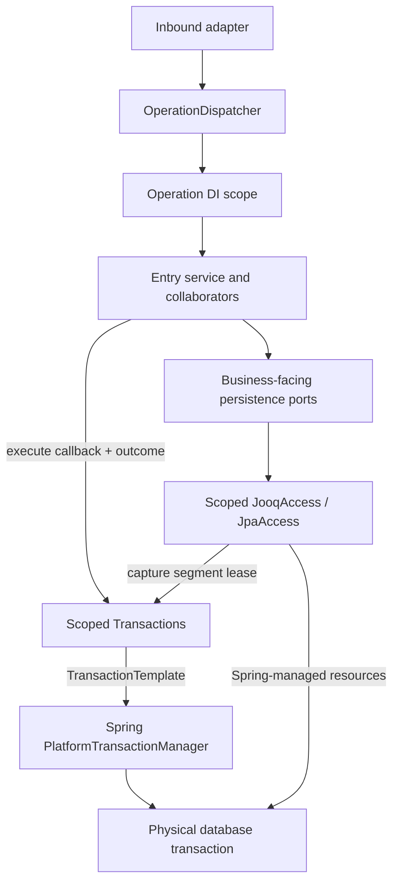

# Application transaction management

ShareWise separates an **application operation** from the database transactions it performs. An operation has one explicitly owned [dependency-injection scope](dependency-injection.md) and can execute zero or more **sequential physical transaction segments**. Each segment has its own completion decision and database resources; its lifetime does not determine the lifetime of the operation's services.

An application entry service decides when persistence must be atomic and whether to commit it. Collaborating application services and persistence adapters participate without receiving connection or transaction parameters in their business-facing methods. Spring remains the physical transaction authority: ShareWise does not maintain a second transaction coordinator or manage JDBC connections directly.

## Ownership and execution flow

`OperationDispatcher` creates and closes the DI scope, but never starts or commits a database transaction. Spring constructs one `Transactions` manager for that scope, shared by the entry service and its injected collaborators. Calling `Transactions.execute(...)` opens a segment through Spring's `TransactionTemplate`; resolving a scoped bean or a persistence accessor does not.

The public application contract lives in `shared.infra.transactions`. `Transactions` exposes `execute(...)`, `markRollbackOnly()` and `isRollbackOnly()`. An immutable `TransactionOutcome<T>` carries an application result and a `TransactionDecision`; it is neither a live transaction nor a command that takes effect when constructed. Only the outcome **returned from the enclosing execution callback** selects the segment's disposition. An orchestrator may return a collaborator's outcome explicitly, but collaborator results and unused outcomes do not cast independent votes.

## Segment decisions and composition

An entry service wraps the work requiring atomic persistence in `Transactions.execute(...)`. Each call owns exactly one physical segment and returns its application result only after Spring has completed the requested disposition. Ordinary collaborators return domain-oriented values or typed expected errors; the entry service chooses how those results affect commit or rollback.

| Returned decision | Segment behavior |
| --- | --- |
| `COMMIT` | Commits the segment if it is healthy; returns the result after successful physical completion. |
| `ROLLBACK` | Rolls back the segment and returns the supplied result after successful rollback. |
| `ABSTAIN` | Also rolls back; expresses that no persistence is requested, rather than an explicit rejected operation. |

The application result and transaction decision are independent. A not-found or validation result does not automatically poison the transaction. A service can deliberately commit a typed unsuccessful result when it has also persisted an intended side effect, such as a failed-attempt counter. Conversely, a successful domain result does not authorize committing a rollback-only transaction.

Participating services do not begin nested physical transactions. They may call `markRollbackOnly()` to **irreversibly veto commit for the current segment**, including when they translate a database error into a typed result. A later `COMMIT` request against that segment fails and rolls back; an explicit `ROLLBACK` or `ABSTAIN` may still return its typed result after successful rollback. The rollback-only state is local to the segment, not a permanent vote across the enclosing operation.

A completed segment can be followed by another segment in the same operation scope. These transactions are **not collectively atomic**: once A commits, B's failure cannot undo A. Work requiring one atomic change belongs inside one `execute(...)` callback. Nested `execute(...)` calls are rejected, as are unrelated ambient Spring transactions or synchronization contexts that would cause ShareWise's execution to join work it does not physically finalize.

## Persistence participation and resource lifetimes

Persistence adapters receive stable, operation-scoped infrastructure accessors by constructor injection. `JooqAccess.dsl()` supplies a jOOQ `DSLContext`; `JpaAccess.entityManager()` supplies a JPA `EntityManager`. Both methods require an active application-owned segment and **do not start one**. Adapters use these facades locally within a method, execute queries synchronously, and expose materialized values or business-facing projections rather than persistence resources.

The accessors can survive multiple sequential segments and automatically follow the segment active at each call. **A facade obtained from an accessor does not follow later segments.** `TransactionSegmentAccess` captures an immutable identity-bound lease when the facade is acquired. The lease checks operation-scope identity, owner thread, active segment and segment identity. A stale facade from A must not become valid merely because B is now active.

The technology-specific adapters enforce that invariant using Spring's normal resource infrastructure:

- **jOOQ:** A derived `DSLContext` preserves Spring Boot's transaction-aware connection provider and execution listeners, adding lease checks at connection acquisition and query execution. Executable queries retained from a completed segment cannot silently execute against the next segment.
- **JPA:** A guarded `EntityManager` uses Spring's transaction-bound persistence context. A compatible Spring-managed JPA context must already be bound; an unrelated JDBC-only transaction is insufficient. Guards also cover derived JPA queries and fluent query methods. Provider-specific unwrapping, direct transaction control and streaming query results are not exposed through this facade.

These checks protect the supported facade/query entry points; they do not turn arbitrary escaped Java objects into revocable references. A repository must not cache a returned `DSLContext`, `EntityManager`, executable query, cursor, configuration, JDBC resource or managed JPA entity across method or segment boundaries. A detached immutable result or DTO can outlive its originating segment. Spring's JPA first-level cache also means mixed jOOQ/JPA operations require explicit flush and refresh when their views must agree: jOOQ SQL does not automatically flush pending entity changes or refresh managed entities.

## Lifecycle and failure semantics

A transaction manager starts idle and permits one segment at a time. The execution boundary proceeds in this order:

1. Validate the active owner DI scope, thread, idle manager state and absence of incompatible ambient Spring transactions.
2. Ask Spring to start a new, synchronized physical transaction; activate a unique segment identity for the application callback.
3. Run the callback, accept exactly one returned outcome and apply its decision or rollback-only veto.
4. Invalidate segment-specific access **as the callback exits**, before physical finalization, and let Spring commit or roll back.
5. Observe completion, verify that it matches the requested disposition and either return to idle or refuse further segments if completion is not trustworthy.

An exception or invalid outcome from the callback requests rollback rather than inferring commit. If Spring definitively completes that rollback, the original failure propagates and the manager can serve another segment. If starting or physically completing a transaction fails, or completion is unconfirmed or inconsistent with the requested disposition, the manager enters a failed state and cannot run another segment within the scope.

A failed commit attempt is especially important: Spring may attempt rollback afterward, but that fallback does **not** prove the commit never reached the database. An infrastructure failure can leave the physical outcome uncertain. The caller receives a failure, not apparent success, and must not blindly retry a non-idempotent write. A Spring `afterCommit` callback may also throw **after the database has durably committed**; such a failure propagates without reversing the commit. Physical completion and callback success are separate observations.

All public transaction operations require the manager's owning DI scope to be **currently active on its owner thread**. They reject use after scope closure, under another operation scope, from another thread or outside an active segment where applicable. The manager does not propagate an active transaction into arbitrary asynchronous work. Independent operation scopes can execute concurrently, each with its own scoped manager and Spring-managed transaction resources.

## Architectural boundaries

Transactions control **local database atomicity**, not DI lifetime, authorization, distributed state or arbitrary external effects. The abstraction does not provide savepoints, nested propagation, cross-service/distributed commits, automatic retries or compensation for already committed segments. Application modules retain their own data ownership boundaries even when they eventually share one database server. Durable event-publication intent must join the producer's database transaction when atomic publication is required; emitting an external effect after commit is not equivalent.

Spring's transaction manager, datasource and persistence context must be configured compatibly for participating jOOQ/JPA/JDBC adapters. Framework-level behavior can be exercised with an embedded database, but database-specific isolation, locking, constraint and commit-failure guarantees require verification against the deployed database engine. The transaction abstraction makes those boundaries explicit; it does not confer guarantees the backing infrastructure has not established.
