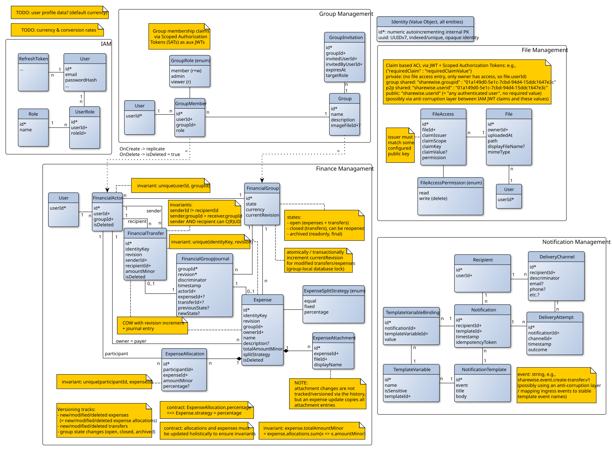

# ShareWise data model: design rationale and handoff

**Status:** Working design for team review, not an approved implementation specification  
**Updated:** 2026-10-17  
**Purpose:** Explain the intent behind the accompanying ER-style diagrams, the decisions already made, and the requirements or implementation details that remain open.

## 1. Reading the accompanying diagrams

- [Overall context/data model](./assets/data-model-versioned.svg): the five current bounded contexts and their principal entities, including copy-on-write (COW) revisions and the financial group journal:



The diagrams intentionally mix relational notation (primary/foreign keys, cardinalities) with business rules and architectural annotations. They were developed *data-first as an exploration tool*; they are **not** intended to imply that every drawn table becomes a DDD entity or aggregate, or that every annotation is a database constraint.

For the remainder of this document:

- **Decided / current model** means a working agreement already reflected in the diagrams.
- **Proposed invariant** means a rule the model is intended to preserve, but whose precise enforcement may need refinement.
- **Open** means team input is still needed; don't silently treat it as settled.
- **Implementation detail** means deliberately postponed schema, ORM, indexing, infrastructure, or transport work.

`*` and `+` in the diagrams denote the author's key/reference notation, not requirements for public API field names. References crossing bounded contexts are **logical identifiers**, not cross-context SQL foreign keys.

## 2. Design intent in one page

ShareWise is a collaborative bookkeeping tool for shared expenses **between friends**. Actual payments always happen outside the application; ShareWise records reported transactions and calculates balances. We are not implementing payment processing, bank reconciliation, or enforceable settlement obligations.

We selected the **dynamic, unified Financial Management model (Model 4)**:

1. An **expense** records a cost paid by one member and split among participants.
2. A **financial transfer** records externally exchanged money between two participants, without requiring an existing expense or debt to justify it.
3. Both affect **derived group net balances**, but retain different business meanings and separate normalized data structures.
4. Financial data is owned by **one bounded context**, enabling consistent reads and transactionally enforced lifecycle rules. This does **not** imply that the entire group is a single DDD aggregate.
5. Expenses and transfers are editable subject to the group's state, and historical financial values must remain reviewable.
6. We maintain a **group-local ordered financial history** to support the glossary's *Revision*, *Change History*, and *Historical Balance* concepts.

With a consistent sign convention, a participant's balance is:

```text
balance = expenses paid - allocated expense shares
        + transfers sent - transfers received
```

A **positive** balance means the participant is owed money; a **negative** balance means they owe money. All changes within a group should conserve value so the group's balances sum to zero. Suggested transfers are recommendations, not authoritative bilateral debts. A transfer can overpay or occur without a prior expense, causing balances to change sign.

These are recorded **financial positions**, not proof that the real-world events occurred.

## 3. Bounded contexts and authoritative ownership

| Bounded context | Owns | Does *not* own |
| --- | --- | --- |
| **IAM** | Authentication, user identities, credentials, sessions/refresh tokens, optional global roles | Group membership or group-scoped roles |
| **Group Management** | Group identity/metadata, memberships and roles, invitations | Financial lifecycle, expenses, transfers, balances |
| **Financial Management** | Financial group state, accounting currency, financial participants, expenses, allocations, transfers, financial history, expense attachment associations | Group metadata/membership authority, binary file content |
| **File Management** | Uploaded file content, metadata, storage access rules | Expense/group business semantics or membership authority |
| **Notification Management** | Notification instances, templates, bindings, delivery channels and attempts | Business transactions that produce the notifications |

There is not presently an independent Settlement Management context. **Expenses and transfers are separate concepts within Financial Management** because both contribute to the same financial balance model and benefit from one local consistency boundary.

An application-specific **User Profile** model (name, avatar, default currency, locale/preferences) is still under discussion. It could be an internal module or a separate bounded context; neither the present IAM schema nor the replicated `User` reference rows settle that decision.

### Integration boundaries

- Other contexts refer to IAM identities through a stable user identifier, not by sharing IAM's user database.
- Group Management is authoritative for group existence and current group membership. Finance receives the group reference and a **minimal group-member/actor projection**. The projection is not a second source of membership truth.
- Finance's `FinancialGroup.state` and `currency` are **locally authoritative**. A composite UI group view might combine Group Management metadata with Finance state and therefore be briefly inconsistent; financial write eligibility is always determined by Finance.
- `ExpenseAttachment.fileId` and `Group.imageFileId` are **logical references** to files stored by File Management. No cross-context foreign key or cascade is implied.
- Notification Management is a consumer of business integration events. Delivery failures do not roll back the originating business operation.
- Context mapping remains useful in the initial **modular monolith**; module APIs and internal events are appropriate. REST/messaging are optional implementation choices for future extraction, not requirements between in-process modules.

## 4. Financial Management: core entities and relationships

| Concept | Meaning in this model | Important qualification |
| --- | --- | --- |
| `FinancialGroup` | Finance-owned group reference, financial state, accounting currency and latest group revision | Group identity/metadata still belong to Group Management |
| `User` | Local identity reference | Not a complete user profile or duplicated IAM account |
| `FinancialActor` | Group-specific financial participant, identified by `(userId, groupId)` | Kept for historical references after leaving the group; `isDeleted` currently represents deactivation of the local membership projection |
| `Expense` | Cost paid by an owner/payer and distributed among participants | Current diagram uses `owner = payer`; recording actor may be distinct |
| `ExpenseAllocation` | A participant's computed monetary share of a **specific physical expense revision** | Allocation data changes holistically with its expense |
| `FinancialTransfer` | Reported external transfer from one financial actor to another | Not linked to a particular expense or outstanding debt |
| `ExpenseAttachment` | Association of a receipt/document file with a physical expense revision | File bytes and storage ACLs belong to File Management |
| `FinancialGroupJournal` | Group-local ordered index of financial revisions and lifecycle changes | Primarily a mechanism supporting domain-visible history, not necessarily an aggregate root |

### Financial actors versus active members

A person may stop being an active group member yet remain the payer, participant, sender or recipient in historical financial records. **Membership removal must not cascade-delete financial records.** If the user rejoins, the same `(groupId, userId)` financial identity can be reactivated. The `isDeleted` column is therefore a membership-projection flag, not a declaration that historical data has been erased.

Authorization to *perform* an operation and eligibility to be *referenced by* an operation are separate questions. Finance needs membership/participant information for its own domain validation even if caller permissions eventually use signed scoped authorization tokens. The precise policy for transfers involving former members is still open.

### Expenses and allocation splitting

The expense owns one `ExpenseSplitStrategy`: `equal`, `fixed`, or `percentage`. Each allocation stores its **materialized** `amountMinor` and, for percentage splitting, its percentage input. Balance calculation uses the computed amounts and never needs to replay the original split algorithm.

Current proposed invariants:

- `Expense.totalAmountMinor > 0`; amounts are exact (the `Minor` suffix means minor currency units, such as cents for EUR).
- Each `(expenseId, participantId)` occurs at most once.
- An allocation's participant belongs to the same financial group as the expense.
- `ExpenseAllocation.percentage` is populated **iff** `Expense.splitStrategy = percentage`; percentage inputs total 100% when that strategy is used.
- `sum(ExpenseAllocation.amountMinor) = Expense.totalAmountMinor` after deterministic rounding.
- Split changes, total changes, and allocation changes are validated and written **atomically** as one expense modification.

Storing derived `amountMinor` values is intentional denormalization/materialization for predictable, inexpensive balance reads. The write path establishes the invariant; reads need not recalculate strategies.

### Transfers

A transfer records `senderId`, `recipientId`, and `amountMinor`. Proposed invariants:

- Sender and recipient differ and belong to the same financial group.
- Amount is positive; sender/recipient determine the direction of the balance effect.
- The group's financial lifecycle permits the operation.

The diagram notes that the sender and recipient may perform certain CRUD operations. **Exactly which actor may create, edit, confirm, or delete a transfer on another person's behalf is not yet a finalized policy.** The journal's `actorId` records *who made the change*, which may differ from the sender/recipient.

## 5. Financial lifecycle

| State | Expense writes | Transfer writes | Historical reads |
| --- | --- | --- | --- |
| **OPEN** | Allowed for authorized operations | Allowed | Allowed |
| **CLOSED** | Rejected | Allowed | Allowed |
| **ARCHIVED** | Rejected | Rejected | Allowed |

`OPEN -> CLOSED` freezes expenses, **not** the current group balance; transfers may still change that balance. `CLOSED -> OPEN` (reopen) is allowed in the current working model. `ARCHIVED` is final and read-only. There is no required vote, zero-balance precondition, or link from each transfer to a debt in this design.

The transitions and all financial writes must be checked against **Finance's authoritative state** within the relevant database transaction. An asynchronous state projection maintained by Group Management cannot authorize financial writes.

Physical cold-storage export or eventual deletion is a separate infrastructure decision. **Business archival currently means immutable/read-only financial records**, not immediate deletion from the live database.

## 6. Revisioning and historical balances

### What the business model promises

The accompanying glossary introduces:

- **Revision:** An immutable version of an expense or transfer after a change.
- **Change History:** Who changed what and when, ordered within a group.
- **Historical Balance:** Group balances as they were at an earlier financial revision.

This is **financial history only**. It does not promise a globally ordered timeline across Group Management, File Management, IAM, and Notification Management. Nor does it promise reconstruction of those contexts' historical state.

### Why the diagram has several identities/revisions

| Field | Interpretation |
| --- | --- |
| `Expense.id` / `FinancialTransfer.id` | Physical primary key of one immutable COW revision row |
| `Expense.identityKey` / `FinancialTransfer.identityKey` | Stable logical identity of one expense/transfer across its revisions |
| `Expense.revision` / `FinancialTransfer.revision` | Version number **within that logical record** |
| `FinancialGroup.currentRevision` | Latest group-wide **financial** revision |
| `FinancialGroupJournal.(groupId, revision)` | Unique position in the committed, group-local financial change sequence |

`UNIQUE(identityKey, revision)` is proposed for each revisioned entity type. Public expense/transfer APIs should identify a **logical record**, not rely on the physical row ID of its latest revision. Children such as allocations and attachment associations refer to the **physical revision ID**, preserving each expense revision's coherent structure.

An expense/transfer creation creates revision 1; updating creates a new row with the same logical identity and an incremented entity revision; deleting creates an immutable `isDeleted = true` **tombstone revision**. Prior rows remain unchanged. Tombstones remove records from current balance calculations while preserving their history.

### The journal

`FinancialGroupJournal` records `groupId`, group `revision`, `discriminator`, `timestamp`, `actorId`, and either the physical `expenseId`, physical `transferId`, or lifecycle `previousState`/`newState`. Its discriminator distinguishes the type of change, and the applicable columns must be populated consistently.

Required journal behavior:

1. Exactly **one applicable payload type** per row (expense revision, transfer revision, or lifecycle transition); unused columns must be null.
2. The referenced revision belongs to the journal's group. Transfer group consistency may be established via its two actor references, or through an explicit group reference in the eventual schema.
3. Each successful financial mutation and corresponding history entry are **atomic**. Every persisted expense/transfer revision has the corresponding journal entry.
4. Revision and journal rows are immutable. Deletions are modeled by tombstones and new entries, not removal of history.
5. Journal `timestamp` records when ShareWise registered a change, **not** necessarily when an external payment happened.

### Write transaction and ordering

A group-local database lock protects `FinancialGroup.currentRevision` and the lifecycle state while a financial mutation commits:

```text
BEGIN
  Lock FinancialGroup row
  Validate group state and operation-specific invariants
  Check the expected logical entity revision (optimistic concurrency)
  Increment FinancialGroup.currentRevision
  Insert the immutable expense/transfer revision and its owned child snapshots
       OR apply an allowed financial lifecycle transition
  Insert the corresponding FinancialGroupJournal entry
COMMIT
```

This applies to **creations, modifications, deletions and financial state transitions**. Per-group serialization means independently committed changes have an unambiguous local order; writes in different groups remain independent. A standalone auto-incrementing journal ID would *not* provide the same commit-order guarantee.

### Worked history example

| Group revision | Recorded change | Current logical financial state after commit |
| --- | --- | --- |
| 1 | Create Expense A (v1) | A v1 |
| 2 | Create Expense B (v1) | A v1, B v1 |
| 3 | Update Expense A (v2) | A v2, B v1 |
| 4 | Record Transfer T (v1) | A v2, B v1, T v1 |
| 5 | Delete Expense B (v2 tombstone) | A v2, T v1 |
| 6 | Close financial group | A v2, T v1; expense writes forbidden |

To reconstruct balances at **group revision 4**, select the latest journal-referenced revision of each logical expense and transfer with group revision `<= 4`, exclude tombstones, and sum the stored allocation/transfer effects. Historical reads should see a **consistent database snapshot**, not a mixture of different committed query moments.

**Current-state lookup/indexing optimization** (e.g., a materialized latest-revision pointer table) is deferred to physical schema design. It does not belong in the DDD conceptual diagram.

### Deliberate attachment-history exception: confirm with the team

The detailed diagram currently says **attachment-only changes do not produce their own financial revision/journal entry**. When an expense is otherwise revised, its attachment associations are copied into the new expense revision. This preserves attachments attached to *earlier expense revisions*, but does **not** guarantee an exact attachment list for every group-wide revision if attachments are changed independently between financial revisions.

That is a narrower promise than fully reconstructing every aspect of an expense at every point in time. If exact attachment history is required, attachment modifications must also trigger an expense revision or be separately journaled. **This is an explicit open business decision, not something to silently resolve in implementation.** Likewise, referenced file bytes must be retained by File Management if historical receipt content is expected to remain readable.

## 7. Notification and file subsystems

These are distinct contexts in the overall diagram. Their implementation details should not be forced into the Financial Management aggregate model.

### Notification Management

- `Recipient` is a local user reference; `Notification` is one logical user-facing message.
- `NotificationTemplate` and `TemplateVariable` describe supported content; `TemplateVariableBinding` supplies values for a particular notification.
- `DeliveryChannel` describes a destination; `DeliveryAttempt` records attempts independently from the notification. One notification can have multiple attempts, including retries and multiple channels.
- `Notification.idempotencyToken` is intended to help deduplicate event-driven creation; exact uniqueness scope and source event identity require definition.
- Delivery-channel ownership must match the notification recipient. Historical attempts must not be accidentally rewritten by changes to a recipient's email/phone configuration.
- Templates may be static or managed records; content versioning, redaction and `isSensitive` handling are additional design choices.

Notification events should use **published integration contracts** rather than import domain entities or a globally owned cross-context event enum. The final diagram's event identifier is an illustrative stable string, potentially translated from a publisher event through an anti-corruption layer.

### File Management

- `File` owns opaque file data and metadata; `FileAccess` owns generic access rules.
- The proposed generic ACL checks verified claims against an issuer, claim scope/key, optional required value, and permission. An absent required value may have presence-check semantics; the exact matching grammar and policy-combination rules must be specified.
- A claimed group ID is **not itself proof of group membership**. Issuer trust, subject binding, expiration, audience and applicable resource scope must be validated before ACL matching.
- The **Scoped Authorization Token (SAT)** idea is a **separate proposal for later review**, not an accepted prerequisite of this data model. Initial modular-monolith authorization may use published module APIs instead.
- Finance/Group Management own the business association between a financial record/group and a file. File Management should not need to replicate group membership simply to understand receipt ACLs.

## 8. Domain model versus persistence model

The diagrams are a starting point for tactical DDD modeling. In that transformation:

- `Expense`, `FinancialTransfer`, and `FinancialGroup` are **candidate aggregate roots**, not one enormous aggregate containing all group data.
- `ExpenseAllocation` and expense attachment associations are children of an expense version and typically governed by its aggregate operations.
- `Money`/minor amount, percentage, split strategy, and identity types can enforce **value-object-local invariants** on construction.
- Expense-level allocation totals and split consistency are **aggregate-level invariants**.
- Lifecycle checks, actor eligibility, consistent financial version allocation, and any multi-aggregate write coordination require **application-level transactional orchestration**, not necessarily one giant aggregate root.
- The journal, COW physical row IDs, index choices, ORM inheritance mappings, and any current-revision lookup optimization are largely **persistence mechanisms** supporting domain-observable versioning and history.

The DDD diagrams should therefore prioritize **identity, behavior, ownership, aggregate boundaries and invariants**. They need not replicate this ER-style database schema or imply a direct table-to-domain-class mapping.

## 9. Open decisions and explicit exclusions

| Topic | Current position / question |
| --- | --- |
| **User Profile** | **Open:** Where should ShareWise-specific profile information, display names, avatar references and default currency preferences live? |
| **Multicurrency and FX** | **Open:** `FinancialGroup.currency` represents one accounting currency. Whether expenses/transfers can originate in other currencies, and how conversion rates are recorded, is undecided. No exchange-rate microservice is assumed. |
| **Financial actor access** | **Open:** Must actor references be currently active for every operation? How are repayments involving former members recorded? |
| **Who may edit transfers?** | **Open:** Can sender/recipient, any authorized group member, or both parties create/change/delete or confirm a transfer? The diagram's `C(R)UD` note is not a complete policy. |
| **Expense authorship** | **Working model:** `owner = payer`; the journal records the modification actor independently. Whether a different member may create an expense on behalf of the payer remains to be agreed. |
| **Attachment history** | **Open:** Attachment-only changes are currently excluded from financial journal revisions. Is the resulting weaker historical attachment view acceptable? |
| **Revocation consistency** | **Open:** Decide acceptable authorization delay for replicated memberships or future scoped JWT attestations. Finance must still validate referenced participants independently. |
| **Invitations** | **Working model:** Group Management owns invitation records, target user/role, expiry. Acceptance, cancellation and duplicate invitation rules may need more detail. |
| **Notification semantics** | **Open:** Template lifecycle, sensitive variable retention, channel availability, and deduplication policy. |
| **Archival storage** | **Not yet designed:** Business archival is terminal read-only state. Moving old records to another service or hard-deleting primary data is only a future infrastructure optimization. |
| **Global timeline** | **Explicitly not promised:** There is no globally transactional or totally ordered history across all bounded contexts. The ordered journal covers **Finance** only. |

## 10. Next steps for the team

1. **Review the domain promises**, especially financial history scope, attachment behavior, former-member participation and who may record transfers on behalf of others. Confirm which constraints are actual business requirements rather than convenient implementation choices.
2. **Convert the ER-style view into tactical DDD diagrams**: define aggregate roots, child entities/value objects, domain operations, and which layer owns each invariant. Keep storage-specific COW fields out of the business-facing class diagrams unless they express public behavior.
3. **Define module-facing contracts** for creating/modifying expenses and transfers, querying current/historical balances, checking membership, and referencing files. Share DTO contracts rather than private ORM entities.
4. **Derive the persistence schema** from the approved behavior: local foreign keys and unique constraints, COW revision references, group lock/revision protocol, typed journal payload checks, indexes and migrations.
5. **Plan integration failure handling** when Group Management's membership projection is delayed or when notifications/file storage are unavailable. No cross-context database transaction is assumed.

### Design principles to retain

**One financial model, separate business record types. One authoritative owner per concept. Immutable local financial history. Business-visible guarantees first; ORM/database optimizations later.**
