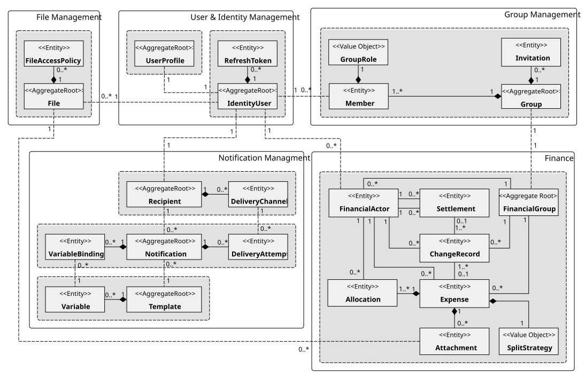

# ShareWise domain model and financial history

**Status:** Agreed conceptual model and business contracts. The IAM account, session and optional display-name profile subset, Group Management's group creation, metadata replacement, membership administration and invitations, and the Finance group/actor persistence foundation with its operations for applying Group creation and membership facts, which Group events deliver durably, are implemented. The [persistence architecture](architecture/persistence.md#finance-persistence) describes the physical Finance contract and projection operations; the wider business model below defines the target behavior. The [P4.0 design handoff](internal/integration/phase-4-foundation.md) proposes the MVP refinements described below; they require human approval before implementation. Specific policies in [open decisions](#open-decisions) remain unresolved.

## Domain scope and diagrams

ShareWise records group expenses and **settlements** (reports of money transferred externally), derives balances, and lets members review historical financial states. ShareWise neither processes payments nor verifies that external transfers took place. A settlement need not correspond to a particular expense or outstanding obligation.

The [tactical domain overview](assets/domain-model-overview.svg) illustrates bounded contexts, aggregate ownership, logical identities, and value objects. The [versioned relational sketch](assets/data-model-versioned.svg) documents the earlier physical copy-on-write (COW) model. The latter retains some exploratory names such as `FinancialTransfer` and diagrams physical revision-row identifiers; where the drawings differ, this document's **logical domain terminology and boundaries** take precedence. The `docs/assets/src/` files are editable diagram sources.



The diagram is a conceptual guide, not a mandate for ORM graph loading, one class per root, or one Java class per drawn relationship. UML aggregate envelopes describe **business consistency and ownership**, not necessarily the runtime shape of application-service or persistence objects.

## Bounded contexts and ownership

| Bounded context | Owns | External references |
| --- | --- | --- |
| **User & Identity Management** | Generic IAM identity, credentials/refresh tokens and optional, separately stored UserProfile; broader preferences remain conceptual | Other contexts retain stable user IDs, not shared IAM entities |
| **Group Management** | Group metadata, membership, roles, invitations, organizational existence | User IDs and optional File IDs |
| **Financial Management** | FinancialGroup lifecycle/accounting denomination, FinancialActors, expenses, settlements, allocations, financial change history | Logical group ID from Group Management; File IDs for attachments |
| **File Management** | Uploaded file bytes/metadata and generic access policies | External authorities may prove resource access, but File does not model groups/expenses |
| **Notification Management** | Recipient channels, Notification instances/attempts, templates/variables | User identity and external event IDs |

Subdomain classification and bounded contexts are not one-to-one: User & Identity Management encompasses generic identity/access and supporting user profiles. No independent Settlement context is required. Bounded-context references are opaque logical identifiers, **not physical cross-context foreign keys or cascades**. Group Management is authoritative for membership; Finance has a minimal, eventually synchronized representation for its own operations.

### Organizational versus financial membership

A Group retains at least one member and at least one administrator. Administrators can promote or demote other members and remove other memberships; members can leave voluntarily. The final member cannot leave, and the final administrator must promote another member before leaving. Administrators cannot change their own role. Group administrators can create and revoke shareable invitation links with optional expiration and positive usage limits, including single-use links. A valid link permits an authenticated, locally admitted caller to preview the group name and explicitly join as a regular member; it is not proof of current membership. Pending links must be invalidated when their group is deleted. Group deletion and retention remain separate lifecycle concerns.

Within a surviving FinancialGroup, `FinancialActor` records are **retained when organizational membership ends**. Departing deactivates the financial actor locally; rejoining reactivates the *same* `(groupId, userId)` identity. Existing expenses/settlements and their audit history remain associated with that actor. A FinancialGroup can temporarily contain zero actors during asynchronous replication, including immediately after activation; retained actors need not be currently active. Temporary cross-context replication lag must be tolerated. Caller authorization is a separate question from eligibility of referenced participants. Versioned, idempotent propagation and recovery are defined by the [messaging architecture](stack/messaging.md).

## Finance consistency boundary

The **FinancialGroup is the sole aggregate root for the group's finance domain model**. Its conceptual consistency boundary encompasses FinancialActor, Expense, Settlement, ChangeRecord, and Expense's owned Allocation and Attachment entities. It is one aggregate **per financial group**, not an application-wide global aggregate. Group lifecycle, revision ordering, balances, and journal atomicity motivate this broader-than-usual aggregate boundary.

This model does **not** require constructing an enormous in-memory FinancialGroup object graph or mutating objects through one facade. Focused Expense, Settlement, Lifecycle and History application services can collaborate inside the same **group-scoped transaction protocol**, with targeted database projections and direct SQL. Their published entry points must preserve the aggregate's business invariants. The [Finance persistence architecture](architecture/persistence.md#finance-persistence) describes the group-root schema and locking primitive on which this protocol builds.

### Expenses and allocations

An Expense has a stable **logical ID**, a version identified by the group financial revision, payer (`owner` in the earlier sketch), group, name, optional description, total, split strategy, allocations and deletion status. The journal captures the actor who performed the mutation. For the MVP only the active payer may create, correct or remove the expense; the payer remains unchanged across versions. `SplitStrategy` supports `equal` and `fixed` for the MVP. Percentage splitting and attachments are deferred. `Money` and strategy values have value semantics, not independently managed entity identities.

An Allocation represents one participant's **materialized share** of an expense revision. Invariants include:

- Total expense amount is positive, exactly represented in the group's accounting currency (for instance integer minor units, not floating-point money).
- Every allocation belongs to a FinancialActor in the same group; at most one allocation for a given participant per expense revision.
- New expenses reference active participants; corrections may retain former participants. The treatment of newly introduced former participants during correction is a P4.0 review decision. All referenced actors must exist in the same group.
- The **sum of stored allocation amounts equals the expense total**, including after deterministic rounding.
- Changing the amount, strategy or participant set produces a valid **new expense revision**; the old committed revision is immutable.

Persisting computed allocation amounts is intentional; balance queries must not rerun historical split algorithms. A payer may also receive an allocation for their own expense; do not introduce an exclusion invariant without a real business requirement.

### Settlements

A Settlement records money exchanged *outside* ShareWise from a sending FinancialActor to a receiving FinancialActor. Its sender and recipient must be different and belong to the same financial group; amount must be positive. It does not consume or match individual expenses/debts. Corrections and removals produce immutable revisions. The journal's modifying actor can differ from the sender/recipient.

### Current balances

A group's financial positions are derived from the **latest non-deleted logical revisions** of expenses and settlements:

```text
balance = paid expense totals - assigned expense shares
        + settlements sent - settlements received
```

A positive balance indicates a member is owed money; a negative balance indicates they owe money. Group balances sum to zero. A settlement can overpay or reverse a balance; suggested future settlements are recommendations only, not authoritative debts. An archived group remains readable.

## Financial lifecycle

| FinancialGroup state | Expense modifications | Settlement modifications | Historical reads |
| --- | --- | --- | --- |
| **PROVISIONING** | Forbidden (not ready) | Forbidden (not ready) | API-specific initialization policy |
| **OPEN** | Allowed subject to authorization/invariants | Allowed | Allowed |
| **CLOSED** | Frozen | Allowed | Allowed |
| **ARCHIVED** | Forbidden | Forbidden | Allowed |

`PROVISIONING` is a technical initialization state, not an activated financial business state; all group-scoped business operations require an activated root as defined by the [P3 readiness contract](internal/integration/phase-3-foundation.md#lifecycle-versus-replication-readiness). `OPEN → CLOSED`, `CLOSED → OPEN` and transitions to terminal `ARCHIVED` are business operations. Closing is not equivalent to settling all balances. Business archival is final and read-only; physical offloading, retention and hard deletion are separate decisions. Finance alone authorizes financial writes against its own state within its transaction; group metadata and membership remain owned by Group Management.

## Financial revisions and history

**Revision**, **Change History**, and **Historical Balance** are explicit business capabilities. Each committed financial mutation has exactly one ChangeRecord. A ChangeRecord declares its subject independently of its operation kind and references the exact immutable version **when it changes an Expense or Settlement**, and neither when it changes the FinancialGroup lifecycle:

- **Expense creation, correction or removal:** exactly one Expense reference; no Settlement reference.
- **Settlement creation, correction or removal:** exactly one Settlement reference; no Expense reference.
- **FinancialGroup lifecycle transition:** neither entity reference; the record carries the resulting state. The previous state is derived from the preceding lifecycle change or the initial `open` baseline after provisioning.

These are conditional, mutually exclusive invariants: a change must never reference both entities or omit the required entity for its declared subject. The persistence adapter enforces payload and operation compatibility with database `CHECK` constraints and typed subject/operation values. Each logical Expense/Settlement is referenced by `1..*` change records. Each change has exactly one relevant operation kind and actor/timestamp metadata. The ledger is ordered **within one FinancialGroup**, not globally across all bounded contexts.

An Expense or Settlement version uses the allocated **group financial revision** as its revision token; `FinancialGroup.currentRevision` is the latest position in that same sequence. Each logical entity retains a stable ID across revisions, and its version tokens increase strictly but need not be consecutive. Optimistic concurrency compares the expected token with the latest version of the affected logical record, not the current group revision. The earlier ER sketch's physical row ID + `identityKey` pair is historical design provenance; the [P4 handoff](internal/integration/phase-4-foundation.md) defines the proposed physical composite identity.

A correction has immutable **domain semantics**: it creates a valid new record state while preserving the preceding committed state. The MVP uses complete COW versions including allocations, even for display-only changes and removal tombstones. Unchanged allocations are copied without recalculation; metadata changes are journaled. Domain contracts must not expose those physical artifacts as public identity.

### Atomicity and ordering

Every committed financial mutation obeys one group-local transaction protocol:

1. Serialize financial writes for the group through the [Finance root lock](architecture/persistence.md#group-root-provisioning-and-locking); verify the authoritative lifecycle state, authorization, and expected individual revision.
2. Check domain invariants, using database-side predicates/targeted projections where efficient.
3. Allocate the next group financial revision, persist a complete immutable revised expense/settlement state (or valid lifecycle transition), and append the corresponding ChangeRecord.
4. Commit atomically, together with any required durable integration-event publication record. On failure, none of these changes becomes visible.

A standalone auto-increment ID doesn't establish business commit ordering. Historical queries select the **latest version of each logical record at or before a selected group revision**, omit tombstones and aggregate the stored amounts. Reads must use one consistent committed snapshot.

| Group revision | Change | Logical state after commit |
| --- | --- | --- |
| 1 | Expense A created (v1) | A v1 |
| 2 | Expense B created (v2) | A v1, B v2 |
| 3 | Expense A corrected (v3) | A v3, B v2 |
| 4 | Settlement S recorded (v4) | A v3, B v2, S v4 |
| 5 | Expense B removed (v5 tombstone) | A v3, S v4 |
| 6 | Group closed | A v3, S v4; expenses frozen |

A point-in-time view at group revision 4 shows A v3, B v2, settlement S v4, and the balances derived from that snapshot. History is a **group-internal audit aid**, not evidence that an external payment was genuine. Authorized Group members may inspect the entire retained financial history, including pre-join revisions; retained actor identity alone does not confer access. The [P4 read contract](internal/integration/phase-4-foundation.md#read-and-accounting-contracts) distinguishes effective financial state from exact journal version references.

### Attachments and historical scope

ExpenseAttachment associates an expense with an opaque File ID; File Management owns content and file access. Earlier ER sketches allowed attachment-only changes without their own financial journal entries, so not every historical attachment set would be reconstructable. **Whether attachment-only operations create an Expense revision remains open**. Point-in-time attachment reconstruction therefore has no established guarantee. Historical file access may additionally depend on file retention and ACL lifecycle. A file may be referenced by multiple historical attachment revisions, so its references are not limited to one physical attachment association.

## Notification and File models

Notification has separate `Recipient`, `Notification`, and `Template` aggregate roots. Recipient owns DeliveryChannels, Notification owns VariableBindings and DeliveryAttempts, and Template owns Variables. A VariableBinding references the template's variable ID; a delivery attempt references a channel owned by the notification recipient. Event-driven notifications follow the [messaging architecture](stack/messaging.md) for idempotent processing. Changes to templates and channels preserve recorded delivery history. Published event names are versioned integration contracts owned by their producers.

File Management owns File and FileAccessPolicy. In the modulith it can use published Group/Finance authorization capabilities for immediate resource-access decisions. The [security architecture](stack/security.md) defines short-lived domain attestations as a common authorization mechanism; a [generic claim-based file ACL](file-management-acl-proposal.md) remains optional. Group/Finance association with files does not confer access merely because a caller supplies a file or group ID.

## Open decisions

These points remain intentionally unresolved and require business clarification before features rely on them:

| Topic | Decision still needed |
| --- | --- |
| **Currency conversion** | The MVP has one implicit fixed denomination; per-group currency management and any foreign-origin exchange-rate policy are deferred. |
| **Inactive FinancialActors** | Newly introduced former participants during expense correction (P4.0); former-member eligibility for settlements (P5). |
| **Settlement authority** | Who may record, change or confirm a settlement on behalf of another participant. |
| **Expense authorship (post-MVP)** | Whether to permit recording or changing an expense on behalf of another payer beyond the MVP payer-only rule. |
| **Attachment history** | Whether attachment-only edits must be revisioned/journaled for exact point-in-time reconstruction. |
| **Deletion and retention** | Hard group deletion behavior versus read-only business archival and history retention. |
| **Notification delivery** | Channel snapshots, template/version retention, idempotency scope and privacy rules. |
| **Distributed authorization** | Whether any operations need stricter freshness than short-lived attestations provide, or additional file-specific grants beyond the common trust model. |

These questions remain open until their owning domain contracts are established; physical-schema convenience does not define business rules. Detailed infrastructure structure is in [architecture](architecture.md), and the actual installed toolchains are in [development](development.md).
