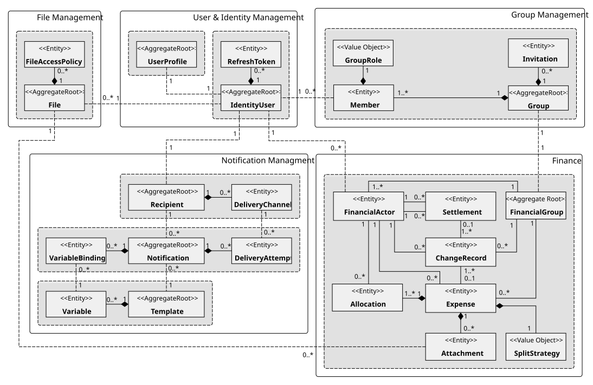

# ShareWise domain model and financial history

**Status:** Agreed conceptual model and business contracts for implementation. The repository currently contains
starter code; the model is not yet fully implemented. Specific policies in [open decisions](#open-decisions)
remain unresolved.

## Domain scope and diagrams

ShareWise records group expenses and **settlements** (reports of money transferred externally), derives
balances, and lets members review historical financial states. ShareWise neither processes payments nor verifies
that external transfers took place. A settlement need not correspond to a particular expense or outstanding
obligation.

The [tactical domain overview](assets/domain-model-overview.svg) illustrates bounded contexts, aggregate
ownership, logical identities, and value objects. The [versioned relational
sketch](assets/data-model-versioned.svg) documents the earlier physical copy-on-write (COW) model. The latter
retains some exploratory names such as `FinancialTransfer` and diagrams physical revision-row identifiers; where
the drawings differ, this document's **logical domain terminology and boundaries** take precedence. The
`docs/assets/src/` files are editable diagram sources.



The diagram is a conceptual guide, not a mandate for ORM graph loading, one class per root, or one Java class
per drawn relationship. UML aggregate envelopes describe **business consistency and ownership**, not necessarily
the runtime shape of application-service or persistence objects.

## Bounded contexts and ownership

| Bounded context | Owns | External references |
| --- | --- | --- |
| **User & Identity Management** | Generic IAM identity, credentials/refresh tokens, application-specific UserProfile and preferences as **separate aggregates** | Other contexts retain stable user IDs, not shared IAM entities |
| **Group Management** | Group metadata, membership, roles, invitations, organizational existence | User IDs and optional File IDs |
| **Financial Management** | FinancialGroup lifecycle/accounting currency, FinancialActors, expenses, settlements, allocations, financial change history | Logical group ID from Group Management; File IDs for attachments |
| **File Management** | Uploaded file bytes/metadata and generic access policies | External authorities may prove resource access, but File does not model groups/expenses |
| **Notification Management** | Recipient channels, Notification instances/attempts, templates/variables | User identity and external event IDs |

Subdomain classification and bounded contexts are not one-to-one: User & Identity Management encompasses generic
identity/access and supporting user profiles. No independent Settlement context is required. Bounded-context
references are opaque logical identifiers, **not physical cross-context foreign keys or cascades**. Group
Management is authoritative for membership; Finance has a minimal, eventually synchronized representation for
its own operations.

### Organizational versus financial membership

A Group retains at least one member and at least one administrator. The final member cannot leave except through
group deletion, and an administrator must transfer administration before leaving if they are the last one.
Pending invitations are removed when their group is deleted. The deletion/retention implementation is a separate
lifecycle concern.

Within a surviving FinancialGroup, `FinancialActor` records are **retained when organizational membership
ends**. Departing deactivates the financial actor locally; rejoining reactivates the *same* `(groupId, userId)`
identity. Existing expenses/settlements and their audit history remain associated with that actor. A
FinancialGroup contains `1..*` actors; this does **not** imply every actor is currently active. Temporary
cross-context replication lag must be tolerated. Caller authorization is a separate question from eligibility of
referenced participants.

## Finance consistency boundary

The **FinancialGroup is the sole aggregate root for the group's finance domain model**. Its conceptual
consistency boundary encompasses FinancialActor, Expense, Settlement, ChangeRecord, and Expense's owned
Allocation and Attachment entities. It is one aggregate **per financial group**, not an application-wide global
aggregate. Group lifecycle, revision ordering, balances, and journal atomicity motivate this broader-than-usual
aggregate boundary.

This model does **not** require constructing an enormous in-memory FinancialGroup object graph or mutating
objects through one facade. Focused Expense, Settlement, Lifecycle and History application services can
collaborate inside the same **group-scoped transaction protocol**, with targeted database projections and direct
SQL. Their published entry points must preserve the aggregate's business invariants.
[Architecture](architecture.md) describes the intended application-port-adapter realization.

### Expenses and allocations

An Expense has a stable **logical ID**, an individual version/revision, payer (`owner` in the current diagram),
group, total, split strategy, allocations, attachments and deletion status. The actor who recorded/corrected the
expense can differ from its payer and is captured in history. Its `SplitStrategy` is one of `equal`, `fixed`, or
`percentage`. `Money`, `Percentage` and strategy values have value semantics, not independently managed entity
identities.

An Allocation represents one participant's **materialized share** of an expense revision. Invariants include:

- Total expense amount is positive, exactly represented in the group's accounting currency (for instance integer
  minor units, not floating-point money).
- Every allocation belongs to a FinancialActor in the same group; at most one allocation for a given participant
  per expense revision.
- Percentage input is present for percentage splits and sums to 100% in that strategy; absent for other strategies.
- The **sum of stored allocation amounts equals the expense total**, including after deterministic rounding.
- Changing the amount, strategy or participant set produces a valid **new expense revision**; the old committed
  revision is immutable.

Persisting computed allocation amounts is intentional; balance queries must not rerun historical split
algorithms. A payer may also receive an allocation for their own expense; do not introduce an exclusion
invariant without a real business requirement.

### Settlements

A Settlement records money exchanged *outside* ShareWise from a sending FinancialActor to a receiving
FinancialActor. Its sender and recipient must be different and belong to the same financial group; amount must
be positive. It does not consume or match individual expenses/debts. Corrections and removals produce immutable
revisions. The journal's modifying actor can differ from the sender/recipient.

### Current balances

A group's financial positions are derived from the **latest non-deleted logical revisions** of expenses and
settlements:

```text
balance = paid expense totals - assigned expense shares
        + settlements sent - settlements received
```

A positive balance indicates a member is owed money; a negative balance indicates they owe money. Group balances
sum to zero. A settlement can overpay or reverse a balance; suggested future settlements are recommendations
only, not authoritative debts. An archived group remains readable.

## Financial lifecycle

| FinancialGroup state | Expense modifications | Settlement modifications | Historical reads |
| --- | --- | --- | --- |
| **OPEN** | Allowed subject to authorization/invariants | Allowed | Allowed |
| **CLOSED** | Frozen | Allowed | Allowed |
| **ARCHIVED** | Forbidden | Forbidden | Allowed |

`OPEN → CLOSED`, `CLOSED → OPEN` and transitions to terminal `ARCHIVED` are business operations. Closing is not
equivalent to settling all balances. Business archival is final and read-only; physical offloading, retention
and hard deletion are separate decisions. Finance alone authorizes financial writes against its own state within
its transaction; group metadata and membership remain owned by Group Management.

## Financial revisions and history

**Revision**, **Change History**, and **Historical Balance** are explicit business capabilities. A successful
expense/settlement creation has at least one ChangeRecord; each later correction or tombstone adds another. A
ChangeRecord references **zero or one Expense** and **zero or one Settlement**, because lifecycle changes
reference neither. Each logical Expense/Settlement is referenced by `1..*` change records. Each change has
exactly one relevant operation kind and actor/timestamp metadata. The ledger is ordered **within one
FinancialGroup**, not globally across all bounded contexts.

An individual Expense or Settlement revision identifies a historical state of **that logical record**. A
separate `FinancialGroup.currentRevision` identifies a position in the group's **total financial change
sequence**. A logical entity's ID remains stable across revisions. The ER sketch's physical row ID +
`identityKey` pair is a possible SQL representation, not part of that logical identity model.

A correction has immutable **domain semantics**: it creates a valid new record state while preserving the
preceding committed state. COW insertion, copying child rows, physical IDs, current-row indexes and ORM mappings
are persistence choices. Domain contracts must not expose those physical artifacts as public identity.

### Atomicity and ordering

Every committed financial mutation obeys one group-local transaction protocol:

1. Serialize financial writes for the group (for example a `FinancialGroup` row lock); verify the authoritative
   lifecycle state, authorization, and expected individual revision.
2. Check domain invariants, using database-side predicates/targeted projections where efficient.
3. Allocate the next group financial revision, persist a complete immutable revised expense/settlement state (or
   valid lifecycle transition), and append the corresponding ChangeRecord.
4. Commit atomically, together with any required durable integration-event publication record. On failure, none
   of these changes becomes visible.

A standalone auto-increment ID doesn't establish business commit ordering. Historical queries select the
**latest version of each logical record at or before a selected group revision**, omit tombstones and aggregate
the stored amounts. Reads must use one consistent committed snapshot.

| Group revision | Change | Logical state after commit |
| --- | --- | --- |
| 1 | Expense A created (v1) | A v1 |
| 2 | Expense B created (v1) | A v1, B v1 |
| 3 | Expense A corrected (v2) | A v2, B v1 |
| 4 | Settlement S recorded (v1) | A v2, B v1, S v1 |
| 5 | Expense B removed (v2 tombstone) | A v2, S v1 |
| 6 | Group closed | A v2, S v1; expenses frozen |

A point-in-time view at group revision 4 shows A v2, B v1, settlement S v1, and the balances derived from that
snapshot. History is a **group-internal audit aid**, not evidence that an external payment was genuine.

### Attachments and historical scope

ExpenseAttachment associates an expense with an opaque File ID; File Management owns content and file access.
Earlier ER sketches allowed attachment-only changes without their own financial journal entries, so not every
historical attachment set would be reconstructable. **Whether attachment-only operations must create an Expense
revision remains open**; do not claim point-in-time attachment reconstruction until that contract is decided.
Historical file access may additionally depend on file retention and ACL lifecycle. A file can be referenced by
multiple historical attachment revisions; do not constrain File-to-Attachment references to one physical
association.

## Notification and File models

Notification has separate `Recipient`, `Notification`, and `Template` aggregate roots. Recipient owns
DeliveryChannels, Notification owns VariableBindings and DeliveryAttempts, and Template owns Variables. A
VariableBinding references the template's variable ID; a delivery attempt references a channel owned by the
notification recipient. Every event-driven notification needs an idempotency policy; changing templates/channels
must not silently rewrite recorded delivery history. Published event names should be versionable integration
contracts rather than a global enum shared between contexts.

File Management owns File and FileAccessPolicy. Generic ACLs are a possible way to avoid embedding group
semantics in the file service. For the initial modulith, use an authorized published Group/Finance capability
where needed. Additional short-lived scoped attestations are an **unadopted design alternative**, documented in
[Scoped Authorization Attestations](scoped-authorization-attestations-proposal.md). Group/Finance association
with files does not confer access by merely supplying a file or group ID.

## Open decisions

These points remain intentionally unresolved and require business clarification before features rely on them:

| Topic | Decision still needed |
| --- | --- |
| **Currency conversion** | One accounting currency per group is established; whether to accept and fix historical exchange rates for foreign-origin entries is not. |
| **Inactive FinancialActors** | Which new operations may reference former members, particularly settlements. |
| **Settlement authority** | Who may record, change or confirm a settlement on behalf of another participant. |
| **Expense authorship** | Whether a member can register an expense paid by another member. |
| **Attachment history** | Whether attachment-only edits must be revisioned/journaled for exact point-in-time reconstruction. |
| **Deletion and retention** | Hard group deletion behavior versus read-only business archival and history retention. |
| **Notification delivery** | Channel snapshots, template/version retention, idempotency scope and privacy rules. |
| **Distributed authorization** | Revocation/staleness guarantees and whether extra scoped attestations are worth the cost. |

Keep these open questions visible; don't turn a convenient physical schema assumption into a business rule.
Detailed infrastructure structure is in [architecture](architecture.md), and the actual installed toolchains are
in [development](development.md).
