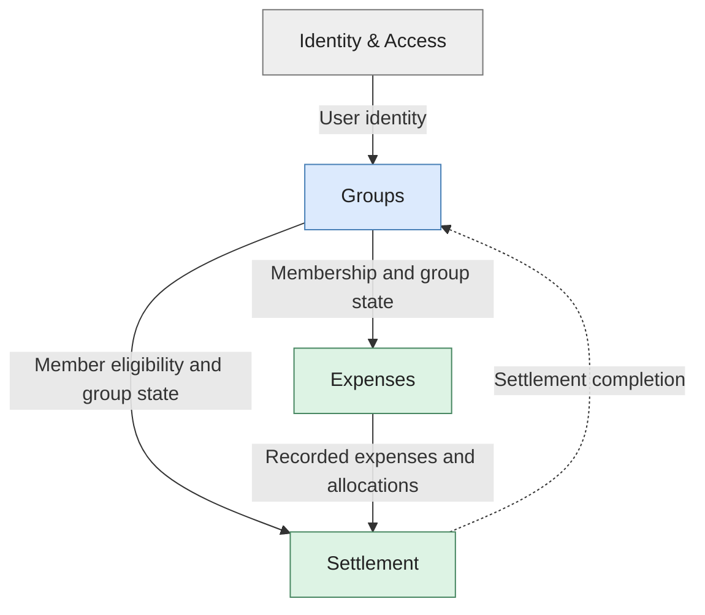

# ShareWise: Strategic Domain Design

> **Status:** Proposed design for discussion. The ShareWise case study establishes the user journey, but not every business rule or context boundary. Proposed choices and unresolved questions are identified below.

ShareWise helps groups record shared expenses, allocate costs among participants, understand outstanding balances, record settlement payments, and close and archive groups. The *Mallorca 2027* journey covers these activities from account registration through archiving.

This document defines the **business subdomains**, **bounded contexts**, **relationships between contexts**, and **ubiquitous language**. It deliberately does not prescribe aggregates, database schemas, API endpoints, deployment units, or implementation frameworks. In particular, a bounded context is a modeling boundary, not necessarily a microservice.

## 1. Subdomains

Subdomains describe **what the business does** (problem space). They are identified through domain analysis and categorized according to their contribution to ShareWise's value proposition, not their technical complexity.

| Subdomain | Type | Business responsibility |
| --- | --- | --- |
| **Expense Sharing** | **Core** | Record and correct expenses; identify who paid; allocate an expense among participating group members. |
| **Balance & Settlement** | **Core** | Determine members' net positions and outstanding obligations; record payments that settle them. |
| **Group & Membership Management** | Supporting | Create groups; invite and admit members; manage membership and group-specific authorization. |
| **Group Lifecycle** | Supporting | Control transitions from an active group to settlement and archival, including their business restrictions. |
| **Identity & Authentication** | Generic | Register and authenticate accounts; maintain stable user identities and credentials. |

**Rationale.** Expense allocation and financial reconciliation are ShareWise's distinguishing capabilities and require precise financial semantics. Groups and their lifecycle enable those capabilities but are not the central differentiator. Authentication is a commodity concern with established solutions. “Generic” does not mean unimportant or inherently simple.

Group Lifecycle remains a recognizable **subdomain**, but it need not become a separate bounded context: its rules are closely tied to group ownership and membership. Similarly, the two core subdomains could be combined into one context if their models prove inseparable; this proposal keeps them distinct to make ownership and integration explicit.

## 2. Bounded Contexts

A bounded context defines where **one domain model and its vocabulary are consistent** (solution space). Contexts are designed, unlike subdomains, which are discovered. The proposed boundaries prioritize cohesive business responsibilities over the number of modules or services.

| Bounded context | Owns and decides | Consumes but does not own |
| --- | --- | --- |
| **Identity & Access** | Account identity, authentication, credentials. | No expense, membership, or balance data. |
| **Groups** | Group identity, invitations, membership, roles, lifecycle state, and authority to close/archive. | User identities; settlement completion information. |
| **Expenses** | Recorded expenses, their payer and participants, allocations, and expense corrections. | Group existence, current membership, and whether the group permits expense changes. |
| **Settlement** | Balances, financial obligations derived from allocations, and recorded settlement payments. | Expense facts and group/member identities and eligibility. |

### Boundary rationale

**Identity is not membership.** The same person is a *User* in Identity & Access, a *Member* in Groups, a *Payer* or *Participant* for a particular expense, and potentially a *Debtor* or *Creditor* in Settlement. Each context represents only the aspects it needs; shared user IDs do not imply a single shared domain object.

**Group membership is not expense ownership.** Groups determines whether a member may participate. Expenses owns the expense and allocation decisions. Recording an expense must respect the current membership and lifecycle rules, without transferring ownership of those rules to Expenses.

**An expense is not a balance.** Expenses records what happened and how the cost was allocated. Settlement derives the financial consequences across expenses and payments. Correcting an expense can therefore change balances, but Settlement must not edit the source expense.

**Lifecycle remains with Groups.** Groups controls closing and archival, but may need confirmation from Settlement before archiving. This dependency must be explicit rather than treating a cached balance as authoritative.

These are **logical boundaries**. They can initially coexist within a modular monolith and should remain meaningful if deployment boundaries change later.

## 3. Context Map

The map shows **business information supplied by one context to another**. An arrow points from the *upstream supplier* of information to its *downstream consumer*; it does **not** necessarily depict a synchronous call. The dashed arrow represents a return dependency relevant to the group lifecycle.

### Relationships and integration strategy

| Supplier → Consumer | Proposed relationship | Meaning |
| --- | --- | --- |
| Identity & Access → Groups | **Conformist** | Groups accepts the identity provider's stable user identity rather than imposing its own account model. |
| Groups → Expenses | **Open Host Service / Published Language** | Groups exposes a stable, consumer-facing representation of membership and lifecycle eligibility; Expenses retains its own expense model. |
| Groups → Settlement | **Open Host Service / Published Language** | Settlement obtains only the group/member information required to validate settlements. |
| Expenses → Settlement | **Published Language + Anti-Corruption Layer** | Expense facts are expressed in an explicit integration vocabulary; Settlement translates them into its financial model instead of importing Expenses' internal entities. |
| Settlement → Groups | **Published status or query contract** | Groups can establish whether its archival preconditions are satisfied, without calculating balances itself. |

These patterns express **model relationships**, not mandatory technology choices. For example, an Open Host Service can be an in-process published interface. An anti-corruption layer may simply be a translation boundary; it does not imply a separate service. The last relationship is shown as a business dependency, not assigned an independent DDD relationship pattern.

### Cross-context scenario: recording an expense

In *Mallorca 2027*, Alice records a **€900 hotel expense** paid by her and shared equally by Alice, Bob, Carol, and David.

1. **Groups** establishes that Alice and all four participants are eligible members and that the group currently permits expense recording.
2. **Expenses** accepts the expense and four **€225 Expense Shares**. It owns the resulting expense record and guarantees that the allocated amounts total €900.
3. **Settlement** interprets the recorded allocation: Alice has a **+€675** net contribution from this expense, while Bob, Carol, and David each have **−€225**, before considering other expenses or payments.

This example highlights two coordination requirements. An expense must not be accepted against membership or group status that became invalid during recording. Conversely, finalization and archival must not proceed on stale settlement information. **How** these requirements are enforced belongs to later tactical and consistency design; their business significance belongs here.

## 4. Ubiquitous Language

Terms are defined **within their context**, used consistently by domain experts and developers, and reflected in requirements and code. Avoid using *User*, *Member*, *Participant*, *Payer*, and *Debtor* interchangeably.

| Term | Context | Meaning |
| --- | --- | --- |
| **User** | Identity & Access | A person with a registered account and stable identity. |
| **Group** | Groups | A named collection of people managing shared expenses and settlements. |
| **Member** | Groups | A user admitted to a particular group, with a group-specific role or permissions. |
| **Invitation** | Groups | A pending offer to become a member of a group. |
| **Expense** | Expenses | A recorded expenditure with a total amount, payer, and allocation among participants. |
| **Payer** | Expenses | The group member who originally paid for the expense. |
| **Participant** | Expenses | A group member assigned part of the cost of a particular expense; may also be the payer. |
| **Expense Share** | Expenses | The amount allocated to one participant for a specific expense. |
| **Balance** | Settlement | A member's net financial position in a group, after accounting for recorded expenses and settlement payments. Positive means owed money; negative means owes money. |
| **Debtor / Creditor** | Settlement | A member with a negative / positive net balance, respectively, for the specified group and point in time. |
| **Debt / Obligation** | Settlement | An amount owed; identifying *who pays whom* requires an allocation of obligations, not merely a list of net balances. |
| **Settlement Payment** | Settlement | A recorded transfer of money between members that reduces outstanding obligations. Recording a payment does not mean ShareWise processes a bank transfer. |
| **Closed for Settlement** | Groups | A lifecycle state following active expense tracking, in which settlement can continue under rules yet to be agreed. |
| **Archived** | Groups | A completed group's retained, non-active state; conditions for entry remain to be agreed. |

### Business language and key rules

State rules in domain terms, not persistence or interface terms. For instance: “The sum of **Expense Shares** equals the **Expense** amount” is more precise than “The share rows match the amount column.” Similarly, “An authorized **Member** closes a **Group** for settlement” describes a business action rather than a generic status update.

The lecture suggests several candidate invariants and the case study raises additional questions. Their statuses differ:

| Rule or constraint | Status |
| --- | --- |
| An Expense has a payer and an allocation among participants. | Established by the ShareWise scenario. |
| The sum of Expense Shares equals the total Expense amount. | Proposed invariant illustrated in the DDD lecture; adopt for this design. |
| The payer and participants must belong to the expense's Group. | Proposed invariant illustrated in the DDD lecture; adopt for this design. |
| The sum of all member Balances within a group is zero when all recorded expenses/payments are accounted for. | Proposed accounting invariant; follows from closed, balanced allocations and internal settlements. |
| Expense amounts are positive. | Proposed invariant illustrated in the DDD lecture; adopt for this design. |
| Closing prevents new expenses; settlement payments remain allowed. | **Open business decision.** |
| Archiving requires all balances to be zero. | **Open business decision.** |

## Decisions to resolve with domain experts

The domain model is coherent enough to discuss, but these questions affect its contracts and must not be silently treated as requirements:

1. **Expense allocation:** Are equal splits sufficient, or must ShareWise support custom amounts, percentages, and rounding rules? Are multiple currencies in scope?
2. **Corrections and history:** Can expenses be corrected or removed after settlement payments have been recorded? What must remain auditable?
3. **Membership changes:** Can a member leave with outstanding obligations? How are past expense shares and settled payments preserved?
4. **Group closure:** Who may close a group, can closure be reversed, and what operations remain allowed afterward?
5. **Archival:** Must balances be zero, and how should the system handle outstanding obligations that participants choose not to settle?
6. **Context granularity:** Do Expenses and Settlement benefit from independent models enough to justify the additional integration contract, or should they form one financial bounded context?

These are **business-model decisions**. Once settled, they should be incorporated into the relevant context's responsibilities and ubiquitous language rather than retained indefinitely as a separate list of caveats.

## Sources

- *01.Intro.pdf*, slides 31–33: ShareWise scope and *Mallorca 2027* scenario.
- *02.DDD.pdf*, slides 5–7: ShareWise user journey and open closure questions; slides 20–26: subdomains; slides 29–36: ubiquitous language; slides 39–56: bounded contexts and context mapping; slides 69–70: expense modeling and candidate invariants.
- [Technical Documentation skill](https://github.com/frederik-hoeft/custom-skills/blob/main/dev/technical-documentation.skill): adapted for a **proposed** domain architecture. Specifically, this document emphasizes a coherent conceptual model, explicit responsibilities, meaningful contracts, restrained implementation detail, and distinguishable decisions versus open questions.
