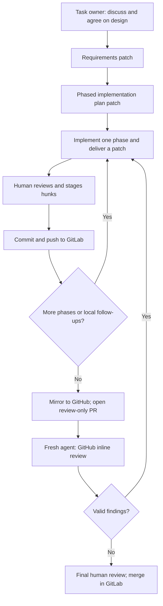

# AI-assisted development workflow

This guide describes how we develop ShareWise with coding agents while keeping **architecture decisions, source
control, and final acceptance in human hands**. We work from explicit repository snapshots, make design decisions
with a task-focused agent, exchange reviewable Git patches, and use a separate agent for pull-request review.
The approach works for implementation, refactoring, and documentation tasks; the review and validation depth
should match the risk of the change.

**Starting point:** Your [development container](../development.md) is already running, you can build the
repository locally, and you can push your work to our **internal university GitLab** repository. The public
[ShareWise GitHub repository](https://github.com/frederik-hoeft/min-favs-sharewise) is a **read-only push mirror**
used to share source snapshots and enable ChatGPT's GitHub connector for review. **GitLab remains the source of
truth for commits and merging**; a review-only PR on GitHub is not the authoritative merge request.

## How the pieces fit together

We distinguish three workspaces that must not be confused:

| Workspace | Responsibility |
| --- | --- |
| **Your devcontainer and Git checkout** | Authoritative working copy; run the application, inspect/stage patch hunks, commit, push to GitLab, and merge approved changes. |
| **The task agent's isolated workspace (CaaS)** | Temporary checkout reconstructed from a supplied repository ZIP; a private baseline branch and one task branch; offline builds, implementation, and Git patch generation. It is **not** your devcontainer. |
| **GitHub mirror and review agent** | Mirror branches provide downloadable clean snapshots and a review-only PR. A fresh agent reads the PR using the connected GitHub plugin and posts actionable inline review comments. |

The two agents have different jobs. The **task owner** accumulates the architectural context and implements the
agreed design. The **reviewer** starts with a fresh conversation so it can challenge that design and its
implementation independently. You decide which findings are real, which changes to accept, and when to merge.



## 1. Prepare the source snapshot and a fresh conversation

**Use a fresh conversation for a new task.** Let one agent become an expert on that task, rather than carrying
stale assumptions across unrelated feature work. Keep the same conversation for design refinements and strictly
incremental patches within that task. Start another conversation for an independent PR review.

Give the task agent a **ZIP of the exact branch/commit it should build on**. An easy source is the public GitHub
mirror: select the branch, choose **Code → Local → Download ZIP**, and attach the archive to the new task chat.
Wait until the GitLab-to-GitHub mirror has replicated the relevant commits before downloading. A GitLab source
archive works as well. A repository ZIP contains version-controlled source, not your local Git history or
Git-ignored caches, SDKs, `node_modules`, `target/`, `.next/`, or secrets. Supply any genuinely required
non-source input separately, never by slipping local binary artifacts into the repository.


The agent initializes a local Git repository if necessary, records the supplied ZIP as an **unchanged baseline**,
then creates a feature branch for its work. Its patch must be relative to **that baseline**, not to a guessed
remote branch or an older task's working tree. Ask it to report the baseline identity (branch/commit or archive)
and verify that the patch applies cleanly. If you change branches, merge other work, or push commits that affect
the task, provide a **fresh ZIP** and rebase the discussion on the new baseline. Reusing the snapshot is safe
only while subsequent work is strictly incremental from the exact same baseline/accepted task state.

> **Important:** Chat conversations do not share a persistent source checkout. A ZIP or patch shown in another
> conversation does not automatically synchronize an agent's filesystem. Avoid assuming that a task agent and
> a review agent see the same sources unless each was explicitly given the appropriate snapshot or PR.

## 2. Make the offline toolchain available to the agent

ChatGPT's container execution environment (CaaS) is **network-isolated** for development purposes. It cannot
reliably download Maven artifacts, npm packages, JDK distributions, or source repositories from the public
internet. The GitHub connector can read and comment on GitHub separately, but it **does not grant network
access to shell commands running inside CaaS**. Your already-running devcontainer can use its configured
network to prepare the offline handoff.

The project provides [`scripts/create-offline-handoff.sh`](../../scripts/create-offline-handoff.sh) to package
reusable dependencies for **Linux x86-64**. The handoff has **four payloads plus one checksum file**:

| File | Purpose |
| --- | --- |
| `OpenJDK25U-jdk_x64_linux_hotspot_*.tar.gz` | Full Java 25 JDK, including `javac` |
| `apache-maven-3.10.0-bin.zip` | Maven executable, independent of the wrapper's bootstrap download |
| `node-v24.*-linux-x64.tar.xz` | Node.js 24 and npm |
| `sharewise-offline-deps-linux-x64.tar.gz` | Maven local-repository and npm download caches, dependency manifests and offline verifier |
| `sharewise-offline-deps-linux-x64.tar.gz.sha256` | Integrity check for the dependency archive |

Put these five files in **ChatGPT Project → Sources**, so future conversations in the project can be given the
same environment without repeatedly uploading it. Keep the source ZIP **separate** and replace it for each
changed baseline. Depending on the chat and file availability, you may also need to attach the required files
to the current conversation; ask the agent to confirm it can actually open each archive.


### Prepare and verify a handoff

On a network-connected **Linux x64 devcontainer/host**, in a checkout whose dependencies match the source you
intend to send to CaaS:

```sh
scripts/create-offline-handoff.sh pack
```

The generator downloads checksum-verified vendor archives (or accepts `--jdk`, `--node` and `--maven` to use
provided archives), resolves Maven/npm dependencies, checks connected builds, then rehearses clean **strictly
offline** builds. By default it writes the dependency archive and `.sha256` beneath Git-ignored
`.offline-handoff-cache/`, with the three original vendor archives in its `toolchains/` directory. The SDKs are
**not** nested in the dependency archive, and neither the repository nor build outputs are included.

The receiving agent must validate the checksum and archive manifests, extract the SDKs and caches into
**separate locations outside the source tree**, and run the handoff's verifier against its own repository ZIP.
For example, with all original vendor archives in `toolchains/` next to the dependency archive:

```sh
sha256sum -c sharewise-offline-deps-linux-x64.tar.gz.sha256
mkdir -p deps
tar -xzf sharewise-offline-deps-linux-x64.tar.gz -C deps
./deps/verify-offline.sh verify deps --source /path/to/extracted-repository
```

`verify-offline.sh` expects the original vendor files in `toolchains/` by default; use
`--toolchains /path/to/archives` when they live elsewhere. The agent should use **the supplied** Java, Maven,
Node and npm, plus the supplied caches, rather than silently falling back to machine-wide installations or
online registries. See [Development environment](../development.md#portable-offline-dependency-handoff) for
the full packaging contract and the [offline setup skill](https://github.com/frederik-hoeft/custom-skills/blob/main/dev/java-nextjs-offline.skill)
for the generic extraction, validation and build process.

### Reuse versus replace

**Reuse the existing handoff** across tasks and source-only patches while the toolchain, target platform and
**dependency descriptors** are unchanged. A fresh repository ZIP alone does **not** imply a new dependency
bundle is necessary.

**Regenerate and replace it** when Maven/plugin dependencies or npm packages change (including
`pom.xml`, Maven wrapper properties, `package.json`, or `package-lock.json`), when a toolchain version or
platform changes, or whenever verification shows the cache is incomplete. For a toolchain migration, first
update the generator's version selections and/or supply matching vendor archives, then regenerate against the
new source checkout.

1. In the devcontainer, run `pack` with the updated source and toolchain; ensure it completes its own offline
   rehearsal. Inspect errors instead of patching the source to fit an obsolete cache.
2. In ChatGPT **Project → Sources**, **delete the previous five handoff files** (only those files; keep unrelated
   project documents), then upload the regenerated dependency archive, checksum, and three vendor archives.
3. Start a **fresh task conversation** with the corresponding fresh repository ZIP. Tell the agent to rebuild
   its extracted toolchain and working caches from the new files, not overlay them on old directories.
4. Have the agent verify the hashes and dependency descriptors before building. A failed checksum, incomplete
   archive, unavailable input file or missing dependency means setup is **not** validated.

Avoid uploading `node_modules`, `.m2`, SDK binaries or generated artifacts to Git or to each source ZIP. They
are machine-specific, large, and unnecessary when the reproducible handoff is current. Container images and
external services are separate prerequisites, not part of this bundle.

## 3. Start the task agent with a repeatable prompt

Use the public, copy-pastable skill files for baseline management and offline Java/Next.js development.
The following **preamble** is reusable; replace only the task-specific paragraphs that follow it:

```text
Use https://github.com/frederik-hoeft/custom-skills/blob/main/dev/local-development.skill and https://github.com/frederik-hoeft/custom-skills/blob/main/dev/java-nextjs-offline.skill to set up your local development workspace for the provided repo archive, ensure the project builds, and onboard yourself with the repository using the documentation in /docs. It is crucial that you understand the overall project architecture, goals, dependencies, and data flow.

[Describe the task, constraints, and desired deliverables here.]
```

The agent should also read `AGENTS.md`, relevant repository-local skills in `.agents/skills/`, and the relevant
`docs/` design documents before editing. The public
[`local-development.skill`](https://github.com/frederik-hoeft/custom-skills/blob/main/dev/local-development.skill)
describes the **approval-gated baseline → feature branch → patch → review → merge** lifecycle. The
[`java-nextjs-offline.skill`](https://github.com/frederik-hoeft/custom-skills/blob/main/dev/java-nextjs-offline.skill)
describes integrity checks and isolated Maven/npm builds. Neither replaces the repository's architecture,
contributor rules, or your own judgment.

Request the **unchanged baseline build** first where practical. Then separate environment failures (missing
cache, broken archive, unavailable external database, network-only asset) from real code or test failures.
Do not accept an unverified claim that a project builds: look for exact commands and their outcomes.

## 4. Work planning-first, one reviewable phase at a time

The task owner stays in the same conversation through the following cycle. **Architecture is a peer discussion,
not a one-shot delegation**: challenge assumptions, bring your own design constraints, compare tradeoffs, and
settle open questions before requesting implementation.

0. **Start a task-specific conversation.** Attach a fresh source snapshot; let the agent inspect the source,
   intended domain contracts and offline environment. The agent's working branch starts from that snapshot.
1. **Discuss the design over several turns.** Agree on boundaries, data/control flow, invariants, API shapes,
   failure semantics, tests and alternatives. Do not send a generic "figure it out and implement it" request.
2. **Record requirements.** Ask the agent to create `docs/tasks/<task-name>/requirements.md`, distinguishing
   scope, acceptance criteria, constraints and decisions from unresolved questions. Review its **Git patch**,
   request refinements, and only then apply and push the accepted document.
3. **Create an executable plan.** Ask the agent to translate the agreed requirements into a phased implementation
   plan in the same task directory (for example `plan.md`). Each phase should be independently reviewable, name
   relevant validation, and use Markdown checkboxes so completed work can be marked. Review and push this patch.
4. **Implement, patch, review, push, discuss.** For each phase, the agent changes only the agreed slice on a
   task branch, tests it, updates plan checkboxes and applicable documentation, and returns a patch against the
   known baseline or previously accepted state. You inspect/stage the hunks, request corrections if necessary,
   commit, and push to GitLab. Reconcile the agent's baseline with any changes you make locally before the next
   phase. Repeat until behavior, tests, and **steady-state** documentation are complete.
5. **Open a mirror PR for independent review.** After the latest GitLab commits reach the public GitHub mirror,
   open a **review-only PR** from the mirrored feature branch. Start a **fresh conversation** with a different
   agent; ask it to inspect the complete change set and submit actionable **inline GitHub review comments**.
6. **Route findings to the task owner.** Give the original agent the PR URL and specific unresolved threads.
   Have it independently verify each concern against the current code and design, implement true positives,
   and return **incremental** patches. Keep human staging/review in the loop.
7. **Repeat the review loop.** Push fixes to GitLab, wait for mirror replication, ask the reviewer to re-review,
   and repeat until meaningful comments are addressed or explicitly explained. Do not resolve threads merely
   because a patch exists; validate the behavior first.
8. **Finish and merge.** Give the final diff and CI checks a human once-over, ensure tasks/checklists and
   documentation match the merged behavior, and merge the authoritative **GitLab** change. The GitHub PR exists
   to support review; close it as appropriate rather than treating it as a separate source-of-truth merge.

A sample phase in `plan.md` is:

```md
### Phase 2: Persist expense corrections

- [ ] Implement operation-specific correction ports and transaction semantics
- [ ] Add conflict/invariant and rollback tests
- [ ] Run the backend verification suite and update steady-state docs
```

A plan is a coordination tool, not a reason to implement later phases early. When the agreed design changes,
revise the requirements/plan deliberately, then continue with a new patch.

## 5. Review every patch locally before committing

The agent returns a downloadable `.patch` against a named baseline; **it does not directly edit your devcontainer
or decide what gets merged**. Save it outside the checkout, verify you're on the intended branch, and check
applicability before applying:

```sh
git status --short
git apply --check /path/to/agent-change.patch
git apply /path/to/agent-change.patch
git diff --check
# Inspect the entire change, including newly added files.
git diff --stat
git diff -- src/ docs/
# Interactively stage only approved hunks.
git add -p
git diff --cached --check
git diff --cached
# Commit and push only after you approve the staged diff.
```

You can use a GUI Git client for the same process: inspect the **unstaged** diff, move accepted files/hunks into
**staged**, inspect the staged diff again, and commit. The screenshot below illustrates this deliberate
review-before-commit boundary. `git add -p` does not always stage newly created files or binaries; add those
explicitly after reviewing their contents. Run relevant tests/builds in the devcontainer as well, especially
when the agent's environment lacked an integration service or platform-specific dependency.


If the patch fails `git apply --check`, **stop**. The branch or snapshot may have moved; don't force-apply
unrelated hunks. Send a new source ZIP (or an exact, deterministic sequence of approved patches) to the task
agent and request a patch relative to that state. If you modify the proposed changes while staging, explain
those differences in the next discussion: the agent must not silently build on an obsolete approximation of
what was committed. The local skill's feature branches remain unmerged until human approval.

## 6. Ask a fresh agent for GitHub PR review

Use **Settings → Plugins → GitHub** to connect GitHub if it is not already connected. The reviewer can use
that connector to read the public mirrored branch, PR diff, existing threads and repository documentation, and
to leave **inline comments**. A generic URL alone is less useful than explicitly requesting connector-backed
review. Choose the **latest available model and maximum available thinking effort** for demanding reviews;
labels and available modes may differ by account or over time.


Example review prompt for the fresh conversation:

```text
Carefully review https://github.com/frederik-hoeft/min-favs-sharewise/pull/<number>
using the GitHub connector. Read the relevant architecture and task documentation,
inspect the complete diff and affected call paths, and look for correctness,
security, concurrency, integration, maintainability and test-coverage defects.
Leave precise, actionable inline review comments on the PR for warranted findings.
Distinguish proven defects from speculative enhancements. Do not implement or merge.
```

The reviewer should be skeptical without being a rubber stamp or proposing unrelated scope expansion. Treat
its comments as **hypotheses to verify**, not commands. Return the PR link to the original task agent, which
knows the previously agreed design; that agent evaluates and fixes true positives. For later review rounds,
make sure the reviewer examines the **latest mirrored commit** and checks whether earlier concerns have actually
been addressed. Keep GitLab commits and the GitHub mirror synchronized before each round.

## 7. Completion and common failure modes

A task is ready to merge when its accepted requirements are met, every completed plan phase is checked off,
relevant tests and builds pass (or precisely documented environmental gaps have been accepted), source and
steady-state documentation agree, the full staged diff has passed human review, and no unresolved material PR
findings remain. Preserve patches/commits as the review trail instead of treating a long chat as the sole record
of architectural decisions.

Watch particularly for these mistakes:

- **Stale baseline:** an agent applies incremental work on an old ZIP while the GitLab branch has advanced.
- **Stale handoff:** dependency versions change but old Project Sources remain attached, or caches from
  different handoffs are overlaid.
- **False offline success:** npm/Maven cache restore succeeds but build scripts still fetch external assets, or
  a test requiring PostgreSQL/browser infrastructure was never executed.
- **Confusing mirrors:** a review-only GitHub PR is mistaken for the authoritative GitLab merge request.
- **Unchecked patch:** a passing agent test replaces, rather than supplements, human staging/review.
- **Review drift:** an agent fixes comments on a different commit from the PR's latest state, or broadens a
  scoped task into unrelated cleanup.

The objective is **reproducible collaboration**, not unattended code generation: agree on the design, keep each
change small enough to review, validate it, and only promote it after explicit human acceptance.
