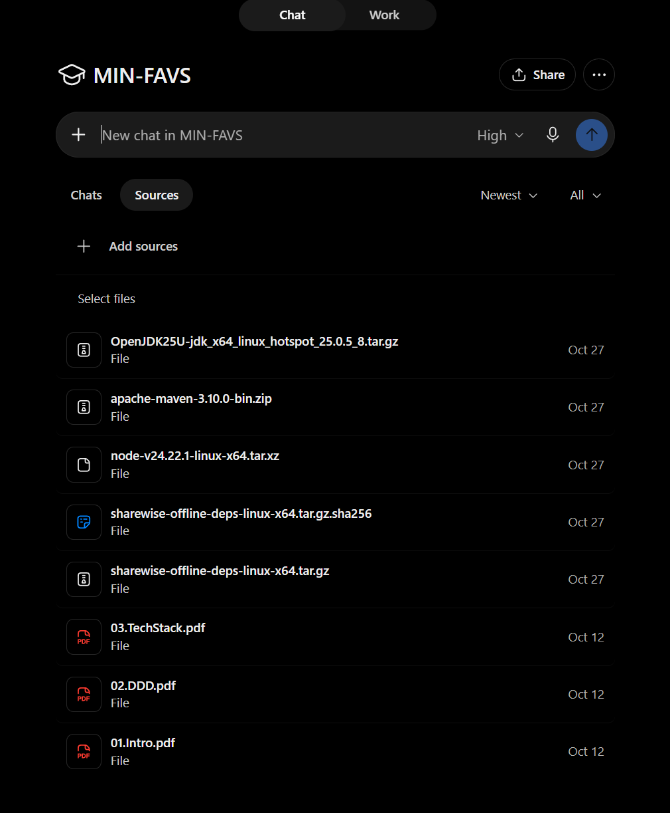
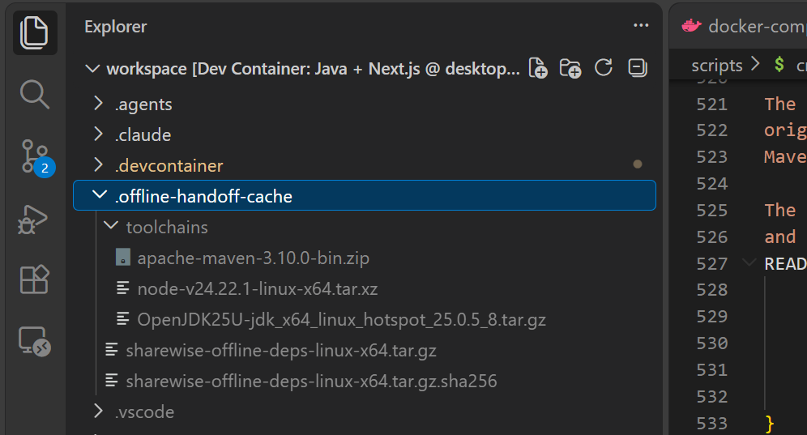
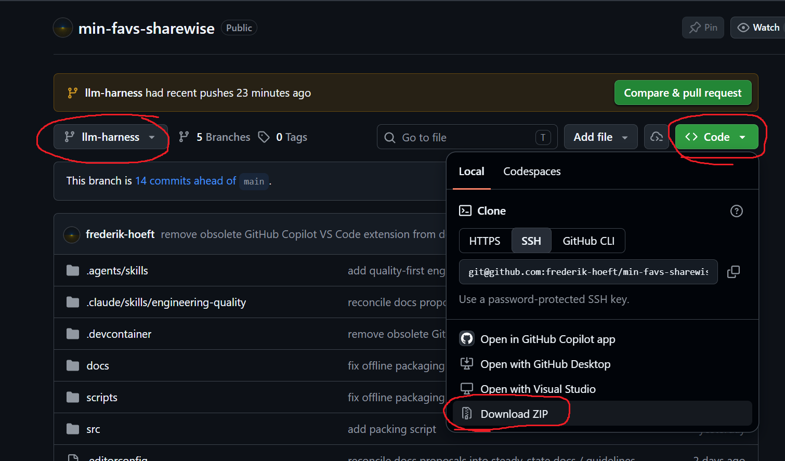
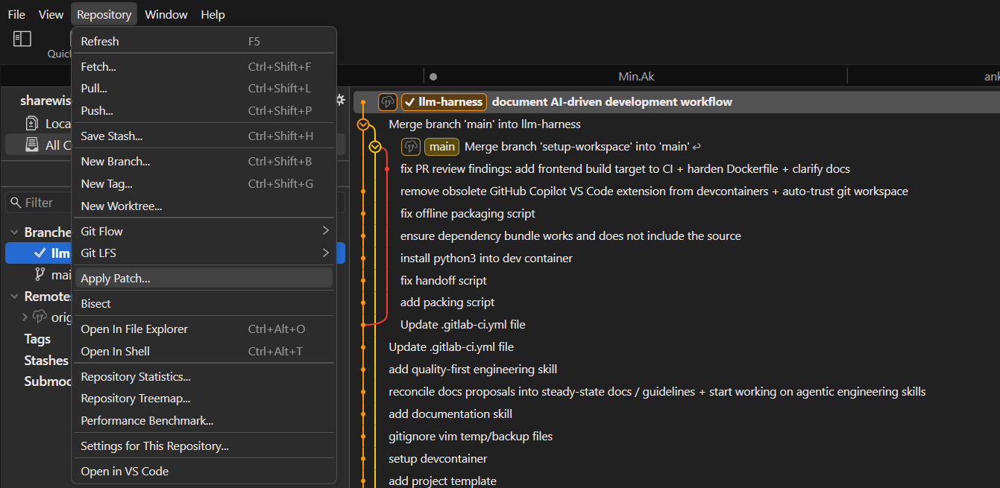
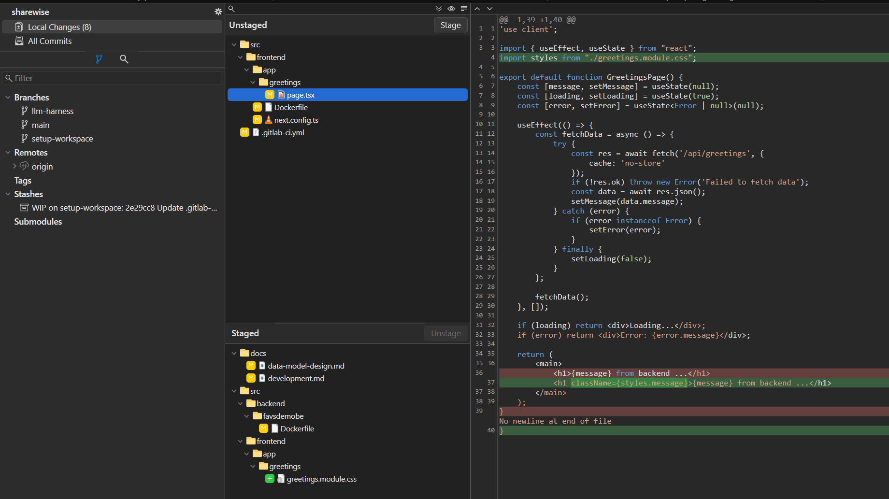
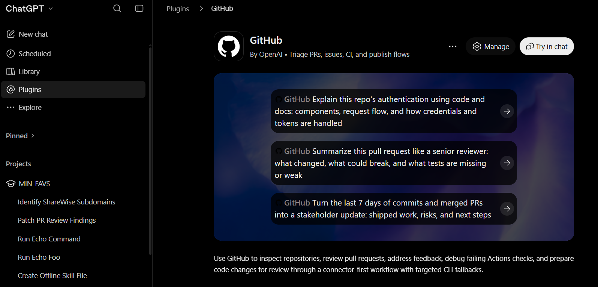

# AI-assisted development workflow

This is our **suggested, planning-first workflow** for developing ShareWise with a coding agent. We discuss architecture together, ask the agent to implement one reviewable change at a time, and **inspect every Git patch ourselves before committing**. A different agent then reviews the completed branch. Human efforts are not replaced by the agent; they are redirected toward higher-level responsibilities: project management, planning, architecture, and quality assurance instead of coding and implementation.

**Prerequisite:** You already have the [ShareWise devcontainer](../development.md) running, can build the project locally, and can commit and push to the university's internal GitLab repository. This workflow uses ChatGPT on the web interface rather than a local agent within the IDE.

We currently use **ordinary ChatGPT conversations**, even though supplying a reproducible workspace takes some effort. They are included with a ChatGPT Plus subscription rather than charged per API token, which makes them more cost-effective for our use case. Codex, Claude, and other local agents are viable alternatives.

## 1. Create a ChatGPT Project

In ChatGPT, create a **Project** (for example, `MIN-FAVS`) from the sidebar. Open the project and use its **Sources** tab to upload files shared across its task conversations. Project files give future conversations access to the same reference material through essentially a shared read-only filesystem; they do **not** represent a writable development environment for the agent.

We will add a reusable **offline toolchain handoff** in the next step. Keep one-off **repository ZIPs** in their respective task conversations instead: a new task or changed branch may need a different source baseline.



## 2. Prepare the offline toolchain once, then upload it

When an agent runs shell commands in ChatGPT, it uses a **Container-as-a-Service (CaaS) environment hosted by OpenAI**. That sandbox is an **ephemeral** workspace: its files, installed tools and Git branches may disappear between sessions or after a reset. Do not treat it as durable storage. Important files and deliverables must be exposed as download links by the agent to become persistent across container resets.

The available CaaS environment is also **network-isolated**. Its shell cannot be used to fetch JDKs, Maven plugins, npm dependencies or source archives from the internet. A GitHub plugin can inspect GitHub through a separate integration, but that does **not** make the agent's shell network-connected. To avoid manually resolving thousands of individual files through a connector, we provide **a clean source ZIP and prepackaged build dependencies**. The agent can then work from a complete local tree, run offline builds and produce patches much faster and with less ambiguity.

The repository provides [`scripts/create-offline-handoff.sh`](../../scripts/create-offline-handoff.sh). On your network-connected Linux x86-64 devcontainer, from the checkout whose dependencies you want to package, run:

```sh
scripts/create-offline-handoff.sh pack
```

The script prepares the supplied Java/Maven/Node toolchains and Maven/npm dependencies, then tests whether an offline build works. It writes the following **five files** into the Git-ignored `.offline-handoff-cache/` directory:

```text
.offline-handoff-cache/
├── sharewise-offline-deps-linux-x64.tar.gz
├── sharewise-offline-deps-linux-x64.tar.gz.sha256
└── toolchains/
    ├── OpenJDK25U-jdk_x64_linux_hotspot_*.tar.gz
    ├── apache-maven-3.10.0-bin.zip
    └── node-v24.*-linux-x64.tar.xz
```



**Upload all five files to your ChatGPT Project's Sources.** The dependency archive contains Maven and npm caches, the checksum verifies that archive, and the three separate archives provide the actual JDK, Maven, and Node.js tools. They are **not** source archives. The agent's offline setup skill handles extraction, integrity checks, isolated caches and build verification.

### When to regenerate the handoff

**Reuse** these five files for source-only work, even when you download a newer repository ZIP, provided Java/Maven/Node versions, platform and dependency descriptors have not changed.

**Regenerate and replace** the handoff after a toolchain migration, added/updated Maven or npm dependencies, changes to `pom.xml`, `package.json`, `package-lock.json` or relevant wrapper configuration, or when offline verification reports missing artifacts:

1. Update the checkout and any version selections required by the handoff script; run `scripts/create-offline-handoff.sh pack` again and confirm its offline validation succeeds.
2. In **ChatGPT Project → Sources**, **delete the old five files** and upload the five newly generated files. Do not mix archives or caches from different generations.
3. Give the next agent the corresponding **fresh repository ZIP**. Instruct it to discard its old extracted toolchain and working caches and verify the replacement, rather than overlaying old and new files.

The details of checksum manifests, vendor archive acquisition, and verifier command-line options belong in [Development environment: portable offline handoff](../development.md#portable-offline-dependency-handoff) and the [offline setup skill](https://github.com/frederik-hoeft/custom-skills/blob/main/dev/java-nextjs-offline.skill). There is no need to upload `node_modules`, extracted SDKs, or other Git-ignored binaries with the source ZIP.

## 3. Download the exact repository baseline

Our **internal university GitLab** is the authoritative repository for commits and merges. The public [ShareWise GitHub repository](https://github.com/frederik-hoeft/min-favs-sharewise) is a **read-only push mirror**: it makes source downloads and ChatGPT GitHub-plugin PR reviews convenient, but is not where we merge accepted work.

On GitHub, select the intended branch, open **Code → Local → Download ZIP**, and attach the downloaded ZIP to the task conversation. Wait for mirror replication after a GitLab push before downloading or opening a review PR. A GitLab source archive works as well.



A source ZIP contains tracked repository files, **not** `.git` history or your local Git-ignored caches, build outputs and secrets. Tell the agent which branch/commit the ZIP represents. It should initialize a fresh local Git baseline from that **exact archive** and develop on a separate task branch, never mixing in files from an older unrelated task.

**Refresh the ZIP** if you switch branches, change the intended base, or new commits affect the task. The agent may reuse its local tree for **strictly incremental work on the same accepted baseline**. Do not assume that a GitHub link alone updates its source tree.

## 4. Start one conversation per task and load the skills

Use a **fresh conversation for each distinct task**. Let the agent learn the relevant architecture, domain invariants and code paths in that conversation. Keep using that same agent for design follow-ups and patches on the *same* task; start a separate conversation later for independent code review.

Use this **copy-pastable preamble** (the second paragraph onward is task-dependent):

```text
Use https://github.com/frederik-hoeft/custom-skills/blob/main/dev/local-development.skill and https://github.com/frederik-hoeft/custom-skills/blob/main/dev/java-nextjs-offline.skill to set up your local development workspace for the provided repo archive, ensure the project builds, and onboard yourself with the repository using the documentation in /docs. It is crucial that you understand the overall project architecture, goals, dependencies, and data flow.

[Describe the task, constraints, and desired deliverables here.]
```

Attach the fresh source ZIP and ensure the conversation is part of the ChatGPT project, so it has access to the preconfigured toolchains and dependencies. The public [`local-development.skill`](https://github.com/frederik-hoeft/custom-skills/blob/main/dev/local-development.skill) defines the **baseline → task branch → git patch → approval** workflow to ensure the agent follows a sane development process and git practices. The [`java-nextjs-offline.skill`](https://github.com/frederik-hoeft/custom-skills/blob/main/dev/java-nextjs-offline.skill) covers the offline build setup. Repository-local `AGENTS.md`, `.agents/skills/` and the relevant `docs/` remain authoritative for the project's own conventions.

Before changing code, have the agent read the documentation and **build/test the unchanged baseline** using the supplied toolchain. It should report exact commands and outcomes, distinguishing source failures from incomplete caches, tool problems, or unavailable external services.

## 5. Design first, then implement in reviewable phases

This is a **technical peer discussion**, not a prompt asking the agent to make all architecture decisions on its own. Challenge its suggestions, supply constraints, compare tradeoffs, and resolve open questions **before** requesting code. You are the software architect and product owner for every task, the agent is just your development team generating code and patches under your guidance. A productive task proceeds in these stages:

1. **Discuss architecture over several turns.** Establish scope, boundaries, data and control flow, APIs, invariants, failure semantics, alternatives and tests. Hold off on implementation until the design is clear.
2. **Record requirements.** Ask the task agent to summarize the results of your design discussion in `docs/tasks/<task-name>/requirements.md`. Review its Git patch, discuss corrections, then accept, commit and push it.
3. **Create a phased plan.** Translate the agreed requirements into a concrete implementation plan in the same task directory (for example `plan.md`), with reviewable phases, quality/review gates (X, Y, and Z must work before moving to the next phase), validation criteria and Markdown checkboxes. Review, commit and push that patch as well.
4. **Implement one phase at a time.** The task agent edits and tests its local branch, updates plan checkboxes and returns a downloadable Git patch after each development phase/turn (usually 5 to 30-ish minutes). **You review it before committing** (next section), push accepted changes to GitLab, and discuss/request any incremental follow-ups before giving your LGTM to move on.
5. **Finish the task implementation.** Repeat until all phases and tests are complete, no local follow-ups remain, and the permanent **steady-state documentation** reflects the actual implementation. Task-specific requirements and plans supplement, rather than replace, the architecture and developer documentation.
6. **Update documentation.** Once the implementation is complete, ensure that all relevant documentation, including architecture, usage, and developer guides, is updated to reflect the changes accurately.
7. **Perform a local acceptance check.** You are the product owner: build the project locally, and ensure all functional requirements are met (test the UI and user workflow manually), ensure all tests are green, and verify that the steady-state documentation accurately reflects the implemented solution.

A phase checklist might look like (from a refactoring task of an unrelated project)

```md
### Definition of done for the Kaizen blitz

The blitz is complete when all of the following invariants are satisfied:

-[ ] one authoritative snapshot/result abstraction;
-[ ] one shared UFW process-execution/diagnostic abstraction;
-[ ] one insertion-placement implementation;
-[ ] one signed-mutation safety/nonce/gate choreography;
-[ ] operation-specific state machines that are shorter and visibly encode only their unique semantics;
-[ ] explicit startup-only vs runtime-reload configuration semantics;
-[ ] durable stores with consistent failure semantics and testable persistence boundaries;
-[ ] no dormant hardcoded TCP transport or dead configuration switches;
-[ ] no resource leaks on named-pipe accept/setup or request-logging failure paths;
-[ ] parser cleanup preserves conservative handling of unknown UFW output.
```

If the design changes, revise the requirements and plan deliberately. Do not let an agent implement later phases early simply because it anticipates them.

## 6. Apply, stage and inspect every agent patch

The agent returns a **downloadable git `.patch` file** relative to the agreed baseline or previous accepted task state. Applying a patch is not approval. The **human-in-the-loop review happens while examining and staging those changes**, before the commit and push.

Note: [**Fork**](https://git-fork.com/) is a convenient graphical Git client that makes this process much easier than using the git CLI or the VS Code Git integration. Its free evaluation period is essentially infinite and patch application, diff inspection and selective staging is straightforward. In Fork, switch to the intended branch and choose **Repository → Apply Patch…**.



Review the **unstaged** diff statically, selectively stage section by section as you approve/review them, run relevant tests, and only then commit and push to GitLab. The following screenshot shows unstaged changes above staged changes and the line-by-line review pane.



The equivalent command-line workflow is:

```sh
git status --short
git apply --check /path/to/agent-change.patch
git apply /path/to/agent-change.patch
git diff --check
git diff                 # Review all modified files
git add -p               # Select approved changes (add new files explicitly)
git diff --cached --check
git diff --cached        # Final review of what the commit will contain
# Run relevant tests, then commit and push only when satisfied.
```

If the patch does not apply cleanly, **do not force it**. Check the actual branch/baseline and ask for a revised patch. Tell the agent about any hunks you changed or rejected while staging, so its next iteration matches what you really committed. Worst case, ensure that your working state is clean and up to date with the remote, and give the agent the fresh baseline again (and ask it to rebase its changes onto it for a clean patch).

### Recovering after CaaS resets

The task agent's CaaS container can disappear, but its source baseline and downloadable patches make the work **reconstructable**. Keep those patch files, or at least the accepted changes/commits in your GitLab branch. To resume, provide the original baseline ZIP plus the approved patches **in order**, or a fresh ZIP of the current approved branch state; tell the agent to recreate the baseline and task branch. For the latter, subsequent patches must target the **new** baseline. It can usually repeat the offline toolchain setup with the existing Project handoff, without regenerating dependencies or restarting architectural discovery.

## 7. Have a fresh agent review the finished branch

When implementation and local review are complete, wait for GitLab pushes to replicate to the public GitHub mirror. Open a **review-only pull request** there, targeting the appropriate mirrored base, and connect the [GitHub plugin in ChatGPT](https://chatgpt.com/) through **Settings → Plugins** if necessary.



Start a **new conversation** with a **fresh reviewer agent**. Use the latest available model and highest available thinking effort for a demanding review. Explicitly ask it to use the GitHub connector to inspect the whole diff, follow affected code paths, and leave **precise inline PR comments**:

```text
Carefully review https://github.com/frederik-hoeft/min-favs-sharewise/pull/<number>
using the GitHub connector. Read the relevant architecture and task documentation,
inspect the complete diff and affected call paths, and look for correctness,
security, concurrency, integration, maintainability and test-coverage defects.
Leave precise, actionable inline review comments on the PR for warranted findings.
Distinguish proven defects from speculative enhancements. Do not implement or merge.
```

Return the PR link to the **original task agent**. Together, assess each comment instead of accepting it uncritically. Have the task agent address valid findings with **incremental patches**, review/stage/commit them locally, push to GitLab, and request another review once the mirror updates. Repeat until substantive findings are fixed or explained. The reviewer and task agent should always refer to the latest mirrored commit, not a stale PR revision.

Finally, give the full diff, test results, checklist and documentation a human once-over. Merge through the **authoritative GitLab repository**. The GitHub PR is a review vehicle, not a second merge target.
