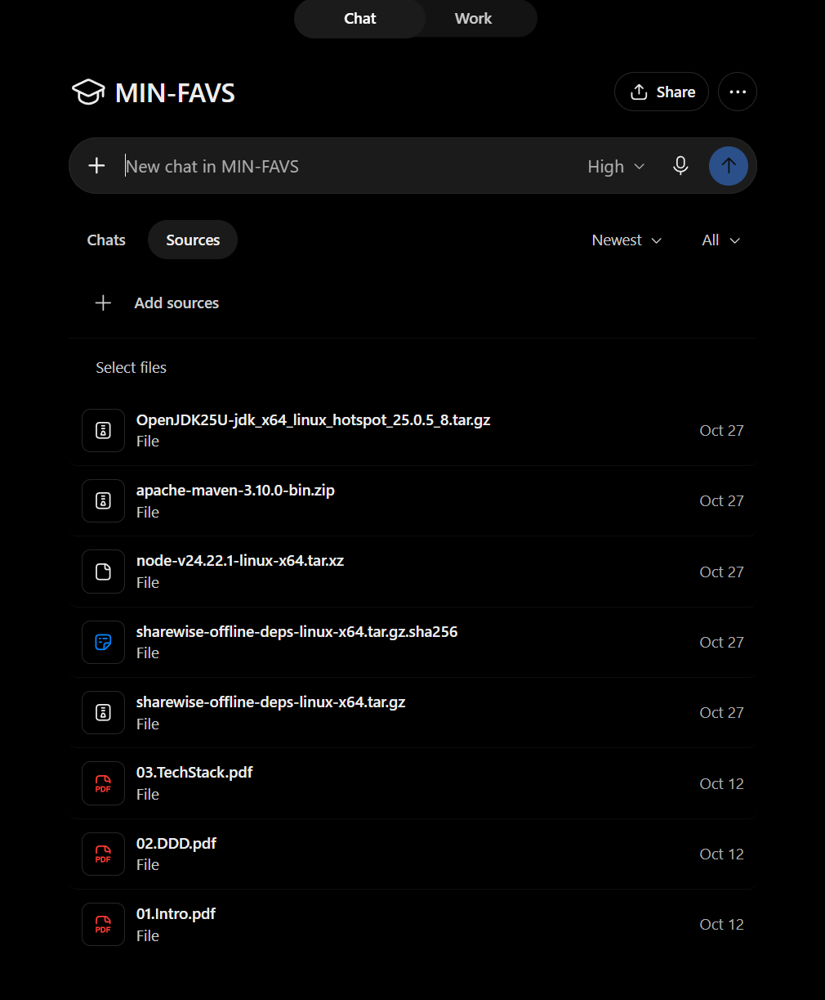
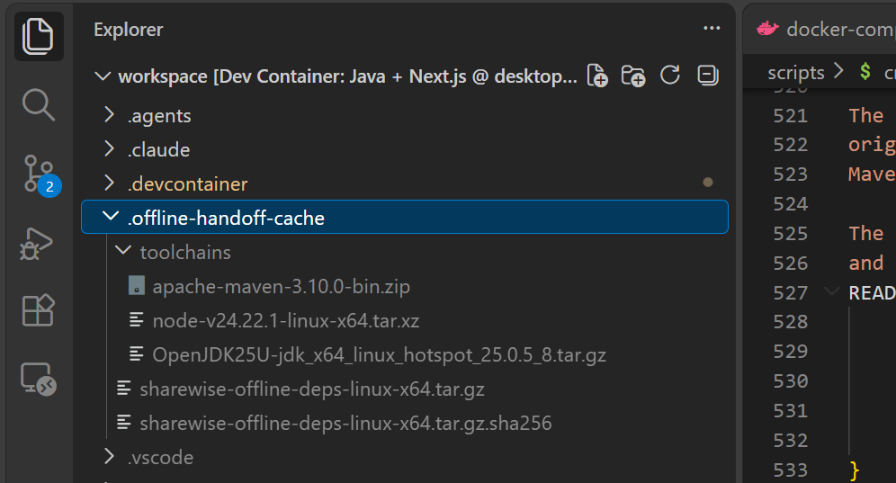
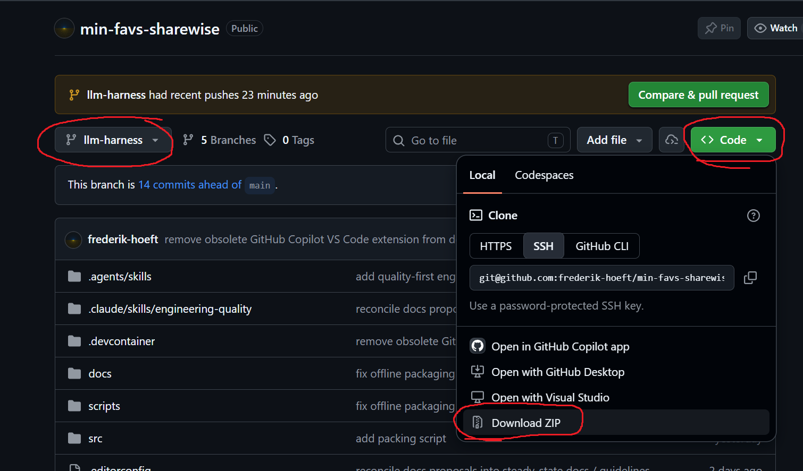
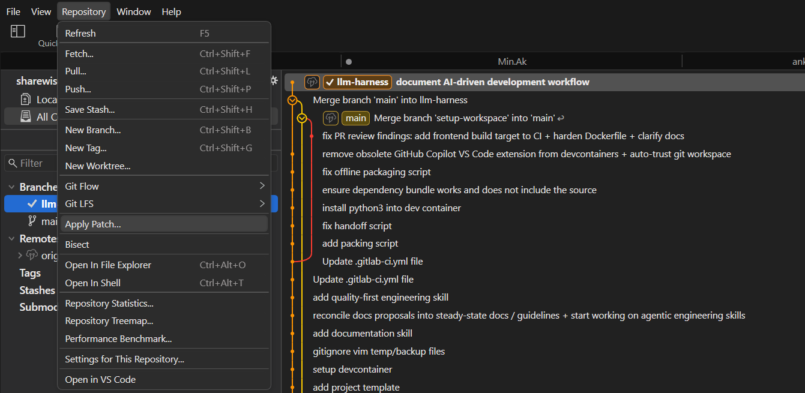
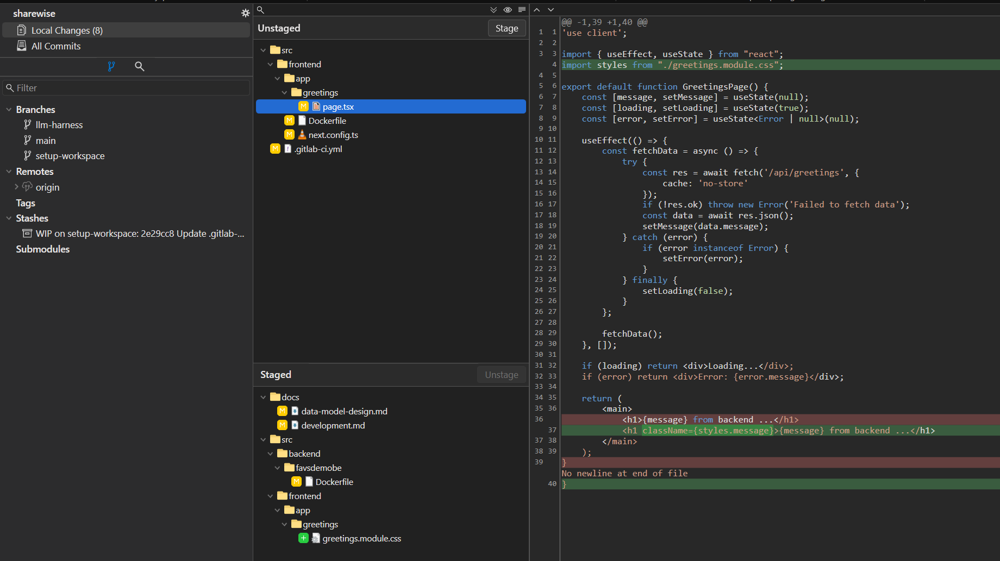
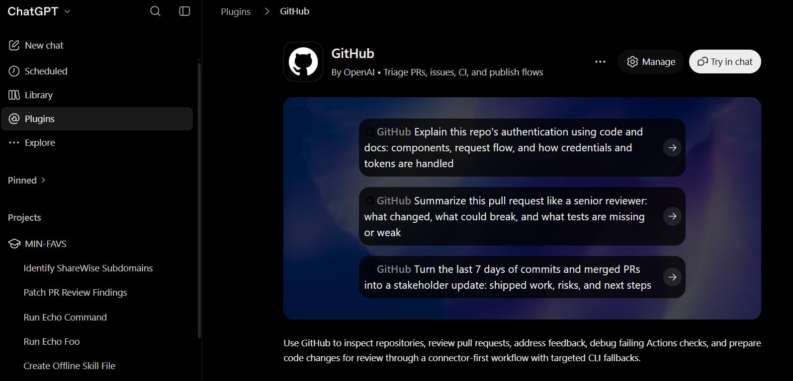

# ChatGPT development workspace and review workflow

This guide explains how ShareWise's [AI-assisted development and QA process](ai-development-workflow.md) is carried out with **ChatGPT's web interface** and the project's GitHub review mirror. It covers the practical workspace handoff, Git patch exchange and connector-based review. Task requirements, test-case design, implementation gates and human acceptance are defined in the vendor-independent workflow.

**Prerequisite:** The [ShareWise development environment](../development.md) is working locally, and you can commit and push to the authoritative university GitLab repository. ChatGPT's hosted container is a separate, temporary development environment.

## 1. Prepare the ChatGPT Project

Create a **ChatGPT Project** (for example, `MIN-FAVS`) and add the reusable build-toolchain files to its **Sources**. Project files provide shared reference material across task conversations; they are not a writable Git checkout. Keep task-specific repository archives in their respective conversations, where the intended baseline is unambiguous.



## 2. Supply the offline toolchain

ChatGPT's hosted container is ephemeral, and the available shell environment is network-isolated. Tools, workspace files and Git history may disappear between sessions. Connector access to GitHub does not provide shell access to Maven/npm downloads. A source archive plus the **offline toolchain handoff** supplies a reproducible workspace.

On a connected Linux x86-64 development environment, run:

```sh
scripts/create-offline-handoff.sh pack
```

The repository script prepares and verifies the Java/Maven/Node toolchains and dependency caches. It produces five files:

```text
.offline-handoff-cache/
├── sharewise-offline-deps-linux-x64.tar.gz
├── sharewise-offline-deps-linux-x64.tar.gz.sha256
└── toolchains/
    ├── OpenJDK25U-jdk_x64_linux_hotspot_*.tar.gz
    ├── apache-maven-3.10.0-bin.zip
    └── node-v24.*-linux-x64.tar.xz
```



Upload all five files to the Project's Sources. Reuse the set for code changes that leave the dependency descriptors and toolchain versions unchanged. If `pom.xml`, `package.json`, `package-lock.json`, wrapper configuration or toolchain selection changes, regenerate the entire set, replace the old files together and verify against a fresh source baseline. Mixed handoff generations are not supported.

See the [offline handoff instructions](../development.md#portable-offline-dependency-handoff) and [offline environment skill](https://github.com/frederik-hoeft/custom-skills/blob/main/dev/java-nextjs-offline.skill) for archive validation and recovery details. The project source ZIP does not include these dependencies.

## 3. Supply an exact source baseline

The **university GitLab** is authoritative for commits and merges. The public [GitHub repository](https://github.com/frederik-hoeft/min-favs-sharewise) is a push mirror used for convenient source downloads and review pull requests. Allow time for mirror replication after pushing to GitLab.

On the intended mirrored branch, choose **Code → Local → Download ZIP** and attach that source ZIP to the task conversation. A GitLab source archive is also suitable.



State the branch and commit that the archive represents. ZIP files contain the tracked source, but no `.git` history, build caches or secrets. The agent reconstructs a clean local Git baseline and creates a separate task branch. For follow-up work, supply accepted patches **in order** or a fresh archive of the current approved branch; do not combine incompatible baselines.

## 4. Start and run a task conversation

Use a fresh ChatGPT conversation for each independent implementation task. Reuse its conversation for design feedback and subsequent patches to the same task. For independent merge-request review, start a separate conversation with a fresh reviewer agent.

An initial task instruction can be:

```text
Use https://github.com/frederik-hoeft/custom-skills/blob/main/dev/local-development.skill
and https://github.com/frederik-hoeft/custom-skills/blob/main/dev/java-nextjs-offline.skill
to prepare an offline local workspace for the attached source archive.
Read the repository's AGENTS.md, documentation and development guidelines,
then validate the unchanged baseline before making changes.
Follow docs/development/ai-development-workflow.md for architectural specification,
test design, phased implementation and human review gates.

[Describe this task, constraints and requested deliverables.]
```

The [local-development skill](https://github.com/frederik-hoeft/custom-skills/blob/main/dev/local-development.skill) covers baseline reconstruction, task branches and incremental patches. The offline skill handles toolchain extraction, cached dependency resolution and build verification. The agent reports the baseline build/test results before changing the source.

The [general development workflow](ai-development-workflow.md) governs task discussion, `specification.md`, `plan.md`, implementation and acceptance. ChatGPT conversations are the discussion and delivery medium; the Git branch and approved documentation remain the durable task record.

## 5. Apply and review ChatGPT patches

The task agent exports a downloadable `.patch` file against the agreed baseline or the last accepted state. Download the patch and review its contents while staging the changes, before committing. [Fork](https://git-fork.com/) supports **Repository → Apply Patch…**, diff review and selective staging.





The equivalent CLI sequence is:

```sh
git status --short
git apply --check /path/to/change.patch
git apply /path/to/change.patch
git diff --check
git diff
git add -p
git diff --cached --check
git diff --cached
# Run relevant tests, then commit and push accepted changes.
```

New files require explicit staging. If a patch fails to apply cleanly, verify the baseline and request a corrected patch; do not force incompatible hunks. Tell the task agent about locally adjusted or rejected changes so subsequent patches match the actual accepted state.

If ChatGPT's container resets, reconstruct it from the saved source ZIP and accepted patches, or provide a new archive of the current branch. Downloadable artifacts and committed Git changes are the durable handoff.

## 6. Review through the GitHub connector

Once the branch has passed local review and mirrored to GitHub, open a **review-only pull request** against the appropriate mirrored base. Connect GitHub to ChatGPT, then use a fresh reviewer conversation to examine the whole change.



For example:

```text
Review https://github.com/frederik-hoeft/min-favs-sharewise/pull/<number>
using the GitHub connector. Read the task requirements, architecture and complete
diff, follow the affected call paths, and review correctness, authorization,
concurrency, failure handling, maintainability and test coverage.
Leave specific, actionable inline comments for warranted findings, distinguishing
confirmed defects from optional improvements. Do not implement or merge.
```

Bring findings back to the original task conversation, assess them with the task agent and apply accepted fixes as incremental patches. Push each accepted revision to GitLab, wait for the GitHub mirror, and have the reviewer recheck the current commit. The **human acceptance gate** in the [general workflow](ai-development-workflow.md) determines when the branch can be merged through GitLab.
