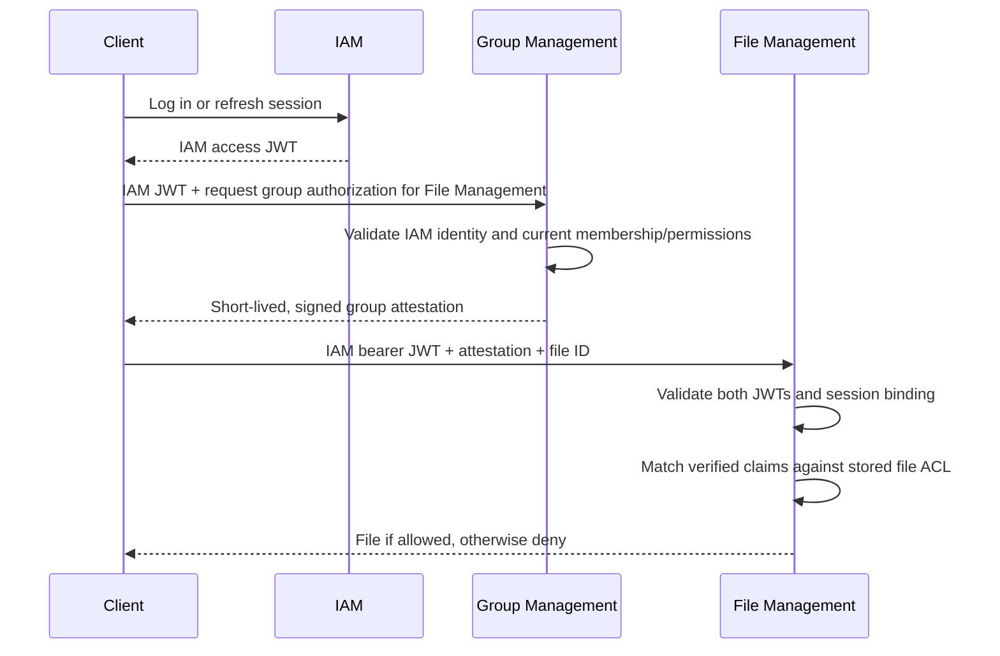

# Generic file access control with scoped attestations

**Status:** Optional File Management authorization design; not adopted. The two-level identity/attestation trust model is defined in the [security architecture](stack/security.md). This document evaluates generic file ACLs and file-specific authorization on top of that model.

## Problem and motivation

File Management stores uploaded documents, such as expense receipts. Access to a file may depend on membership or permissions owned by Group Management, or on the visibility of an expense owned by Finance. File Management's authorization boundary evaluates access using verified authority claims; it does not import domain entity graphs, replicate authorization tables or trust a client-supplied `groupId` as membership proof.

The proposed solution is a **generic file ACL** evaluated against verified, issuer-qualified claims. A domain authority checks its own current rules and issues a short-lived attestation; File Management validates the attestation under the common [security trust model](stack/security.md) and matches its claims to a file's stored access rules. The domain authority decides *who qualifies*; File Management decides *which files a qualifying claim can access*.

## File access request



**Illustrative HTTP request (not a finalized wire protocol):**

```http
GET /files/file-789
Authorization: Bearer <iam-access-jwt>
ShareWise-Attestation: <group-sat-jwt>
```

The additional header is illustrative; the common [security architecture](stack/security.md#api-boundaries-and-client-behavior) owns token-transport and validation conventions.

### Example attestation

A Group Management attestation for a file-sharing group could contain:

```json
{
  "iss": "https://groups.sharewise.example",
  "sub": "user-123",
  "principal_iss": "https://iam.sharewise.example",
  "principal_sid": "session-abc",
  "aud": "sharewise-files",
  "group_id": "group-456",
  "permissions": ["group:files:read"],
  "iat": 1792240000,
  "nbf": 1792240000,
  "exp": 1792240060,
  "jti": "unique-attestation-id"
}
```

These are example claims, not a finalized token profile. Signature, token type, audience, issuer authority and session-binding validation are defined by the [common security contract](stack/security.md#issuing-and-using-domain-attestations).

## File authorization rules

Each file has zero or more access rules. A rule grants a specific operation only when a **verified claim from an explicitly trusted source** satisfies the stored condition. File Management does not need to know the business meaning of a `group_id` claim.

**Illustrative logical ACL rule (not a prescribed SQL schema):**

```text
FileAccessRule
  fileId
  operation                 // READ, WRITE
  claimSource               // PRIMARY_IAM or DOMAIN_ATTESTATION
  trustedIssuer             // exact approved issuer / authority (e.g., "group-management")
  claimName                 // e.g., "group_id"
  expectedValue?            // optional (if not present, only the existence of the claim is checked), e.g, "group-456"
```

In this proposal, **any matching rule grants the operation (OR)**. Otherwise access is denied, apart from a separately validated file-owner grant.

**Example: file `file-789`, attached to an expense in `group-456`:**

| Allowed operation | Source | claimName | claimValue | Meaning to File Management |
|---|---|---|---|---|
| WRITE | IAM | `sub` | `user-123` | File shared with user-123, may be deleted by them. |
| READ | Group Management | `group_id` | `group-456` | Any member of group-456 can read the file. |
| READ | IAM | `sub` | NULL | Any authenticated user can read the file (public access, e.g., for profile pictures). |
| READ | Financial Management | `file_id` | `file-789` | Any user with a valid attestation by Financial Management for this specific file can read it (could easily be extended to share links) |

Each file has an explicit owner, and ACL administration requires an authorized operation. Ownership does not allow a caller to assign arbitrary group or expense relationships.

The ACL stores the **trusted issuer and exact expected value**. A JWT carrying `group_id=some-other-group` must not match. Nor should the mere existence of *any* `group_id` claim authorize access to *every* group file.

### Alternative: file-specific attestations

Not every expense attachment must be readable by every group member. If visibility depends on the specific expense, **Financial Management** could issue a short-lived attestation containing `file_id=file-789` and a `file:read` permission after checking expense access. File Management would still perform the same generic claim-matching algorithm. The issuer and matching claim change; **the ACL engine does not**.

A group-scoped attestation fits group-wide sharing; file-scoped attestations can express more restrictive expense or attachment visibility.

The authority creating or updating an ACL validates the underlying resource association. Otherwise, an uploader could make a private file group-readable just by supplying a chosen `groupId`. Files may therefore start uploader-only, then gain a broader ACL through an authorized Group/Finance operation. Removing an attachment, deleting an expense, or archiving a group needs an explicit retention and access policy.

## Authorization and trust boundaries

Token validation, issuer-scoped claims, session binding and revocation follow the [security architecture](stack/security.md). File Management additionally enforces three resource-specific rules:

1. **Match the actual file:** Read the requested file's stored ACL and match the verified authority, claim kind and expected value. A client-supplied group ID is not evidence of membership or file association.
2. **Protect ACL changes:** Only authorized flows may create, broaden or revoke file access rules. A receipt upload must not grant the uploader permission to mark it as belonging to another group or expense.
3. **Define file lifecycle:** Detaching a receipt, changing expense visibility or archiving a group must have an explicit effect on access rights, retention and cleanup.

The File Management authorization port expresses the decision (*may this authenticated principal perform operation X on file Y?*) independently of the JWT header or transport. A synchronous published Java authorization capability remains a valid alternative inside the modulith. The generic claim-based ACL is useful only if it reduces domain coupling enough to justify its own schema and administration rules.

## Trade-offs

| Benefit or cost | Consequence |
| --- | --- |
| Domain independence | File Management matches verified, source-qualified claims without understanding Group Management or Finance entity graphs. |
| Flexible grants | Group-wide sharing and file-specific access use the same ACL evaluation rules. |
| ACL ownership and lifecycle | Linking files to resources, controlling grants, handling revocation and cleaning up detached files require explicit policies. |
| Operational complexity | An ACL schema, trust-aware claim matching and additional client attestation requests must justify themselves relative to a narrow authorization capability. |

A narrower synchronous authorization capability avoids generic ACL storage but creates a runtime dependency after service extraction. Duplicating membership data in File Management reduces that dependency at the cost of replication and stale-permission handling. Opaque file capabilities or signed download URLs may be simpler for file-specific downloads, but they require their own grant and revocation rules.

## Open design questions

1. **Visibility:** Are group-wide access and uploader ownership sufficient, or must an expense attachment have its own visibility rules?
2. **ACL control:** Which context may create, broaden and revoke grants? How is an uploaded file linked to a group or expense without an authorization gap?
3. **Revocation:** Do any downloads require an authoritative online permission check, or is the common short-lived attestation window sufficient?
4. **Lifecycle:** What happens to ACLs and storage when attachments are detached, expense visibility changes or groups are archived?
5. **Scope:** Does a generic claim-matching ACL justify its cost, or is a narrow File Management authorization capability sufficient?

The [security architecture](stack/security.md) owns the common IAM, attestation issuance and token-validation rules. Adopting those rules does **not** commit File Management to generic ACL storage or file-scoped attestations.
