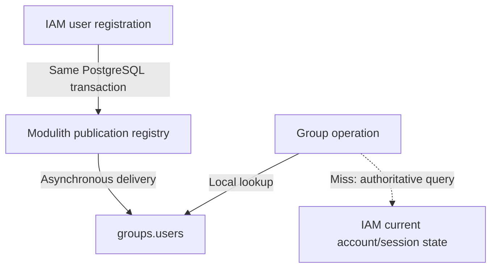

# Phase 2 implementation foundation: IAM and Group Management

**Status:** Phase 2 design handoff, based on the reviewed [technical ER diagram](../../assets/er-data-model.pdf). This describes intended Phase 2 business tables and integration contracts, **not deployed DDL or completed IAM/Group features**. The PostgreSQL namespaces and transaction infrastructure exist; feature-owned migrations, durable event delivery, and production account/session authentication flows remain subsequent work; the primary bearer verification and operation identity foundation is implemented.

**Audience:** Teams implementing IAM (P2.1), Group Management (P2.2), and their first durable integration (P2.4a). The purpose is to let each team choose its own internal adapters and vertical slices without independently redefining identity, schema ownership, or the integration lifecycle.

The [domain model](../../data-model-design.md) owns business invariants, the [security design](../../stack/security.md) owns the trust model, and the [messaging design](../../stack/messaging.md) owns delivery guarantees. The [implemented verified-credential architecture](../../architecture/authorization.md) explains the operation identity and evidence foundation; the [domain-context proposal](../../stack/claims-context-proposal.md) covers later Group attestation policies. This handoff fixes the *shared assumptions between those designs* and provides a column-level reference for the P2.0c ER artifact; feature specifications still own final DDL and behavior.

## Boundaries and the first usable application operation

IAM is authoritative for whether an account exists, its credentials and sessions, and the identity of an authenticated caller. Group Management is authoritative for groups, membership, roles, and invitation links. An IAM user ID is a stable opaque `UUID`, used consistently on both sides, but never joined or foreign-keyed across bounded-context schemas. The local `groups.users` table is a Group-owned projection of that identity, not an account or another authentication authority.

The **only P2.0a runtime contract needed by Group Management** is `de.hsh.favs.sharewise.identity.IdentityContext`, published by IAM:

```java
public interface IdentityContext {
    Optional<UUID> userId();

    default UUID requireUserId() {
        return userId().orElseThrow(UnauthenticatedCallerException::new);
    }

    default boolean isAuthenticated() {
        return userId().isPresent();
    }
}
```

Constructor-injected consumers call `requireUserId()` for authenticated operations. The result is stable for the application operation and names the authenticated IAM user. It does **not** mean that the account is still enabled, that a membership exists, or that the caller may administer the requested group. An anonymous operation yields `Optional.empty()`; an invalid credential or provider failure must not be turned into anonymous access. The exception is not an HTTP response; ingress decides its transport mapping (normally `401` rather than a Group authorization `403`).

The interface, closed IAM module declaration, and focused architectural verification are implemented in P2.0a phases A–C. A deterministic test-only Spring configuration installs an operation-scoped implementation. For example, tests can bind a fixture identity lexically around an actual `OperationDispatcher` invocation:

```java
UUID actual = IdentityTestFixture.withUser(userId, () ->
    dispatcher.dispatch(GroupOperation.class, GroupOperation::run));
```

The fixture is in test sources and must be explicitly imported; production has **no fallback identity provider**. Production IAM wiring derives this same interface from verified primary credentials within the operation scope; login/session state remains future work. The test fixture supplies **identity**, not a real `groups.users` row: P2.2 separately seeds its closed-world local users and tests membership/role policies against its own repository.

Group creation and invitation redemption use the **authenticated caller ID**, never an arbitrary `user_id` supplied in a request body. Group membership mutations check current Group-owned data, including last-member and last-administrator constraints. A previously issued Group attestation is not authoritative for mutations in Group Management. Future downstream consumers may use short-lived attestations as specified in the [security architecture](../../stack/security.md#issuing-and-using-domain-attestations), but **P2.2a–c do not need to issue or consume them**.

## Independent development and eventual integration

The initial local projection is deliberately minimal: `groups.users(id uuid PRIMARY KEY)` with **no generated default**. Group Management can be built and tested against explicitly provisioned, IAM-shaped fixture UUIDs before account registration exists. A local FK from `groups.group_members.user_id` proves the *local* reference exists; it does not establish remote IAM existence by itself.

After both sides have persistence, IAM user registration is the first real durable integration (P2.4a + P2.2d). IAM commits the account creation and Spring Modulith publication obligation in one local PostgreSQL transaction; the Group listener applies the event in a **separate** Group-owned transaction. At-least-once delivery means duplicates, lag and retries are normal. The `groups.users` PK can make simple registration insertion idempotent. A general-purpose Group inbox is not mandated unless the consumer performs effects that cannot be protected by such a business invariant.

The two integration paths have different timing and guarantees:



Event delivery keeps the projection up to date; the published IAM query is a later fallback for users who have not yet appeared locally. The fallback does not run for already-known users.

During the **event-only** stage, a legitimate recently registered user may be absent from the Group projection and receive a temporary denial (`403`, without automatic JWT refresh retry). P2.1d later provides a narrow **authoritative IAM current-account/session eligibility query** through a published Java capability; P2.2e calls it **only on a local user miss**. An eligible result permits local provisioning followed by the Group operation; deleted, disabled or invalid-session identities are rejected, and infrastructure failures fail closed. This is not merely offline JWT signature validation. Already-known local users retain the [security design's bounded token and event staleness](../../stack/security.md#revocation-distributed-services-and-verification) unless a stronger policy is separately approved.

Account deletion is **not** a simple `DELETE` cascade from IAM into Group Management. Before a deletion event becomes active, the owning feature must decide how the final member/administrator invariants survive, whether members or history remain, and how out-of-order `UserRegistered`/`UserDeleted` deliveries cannot resurrect an identity. No `groups.users.deleted_at`, inbox or cascade is mandated by the current ER. This is an explicit P2.1e/P2.2d/P2.4a review gate, not a license to accept unsafe ordering.

The publication registry is shared **delivery infrastructure** (the diagram intentionally shows only `event_publication ...`). Flyway will install the exact schema required by the selected Spring Modulith version under P2.4a. It is not an IAM or Group business table or a historical event journal. PostgreSQL **schemas** share one database and transaction manager in the modulith, so a producer can write its context table and the registry in the same physical transaction, while runtime code still cannot write another context's business tables. A future extracted service must carry its local publication intent with its authoritative store. See [messaging](../../stack/messaging.md) for listener identity, completion, recovery and consumer idempotency.

## Reading the technical ER

The [ER PDF](../../assets/er-data-model.pdf) and [SVG](../../assets/er-data-model.svg) are the P2.0c design artifacts. Their notation uses `*` for PK, `+` for FK, `?` for nullable, `[idx]` for an index, `[unq]` for uniqueness, and `= ...` for a default. Untagged columns are intended as non-null. The diagram's `natural0` and `natural1` mean signed PostgreSQL `int4` constrained to `>= 0` and `> 0`, respectively; whether they become physical PostgreSQL domains or column-local `CHECK`s is an adapter/migration decision. The `group_role` type has `member` and `admin` values. Every `timestamptz` denotes an absolute instant, not a persisted local time-zone identifier.

**Provenance labels:** **ER** means an exact column/default/limit or check chosen in the P2.0c diagram; **Domain** is a business requirement from [data-model-design.md](../../data-model-design.md); **Security** comes from [security.md](../../stack/security.md); **Messaging** comes from [messaging.md](../../stack/messaging.md); **Backlog** is the concrete Phase 2 delivery contract in [backlog.md](../tasks/backlog.md); **P1.2** is the [implemented persistence foundation](../../architecture/persistence.md). A column can be **ER-selected** even when no earlier document mandates that exact name, length or representation. Teams should not turn that implementation choice into a newly invented product rule.

P1.2 has created the PostgreSQL 18 `identity` and `groups` namespaces, plus other context namespaces and Flyway history, with a migration role and restricted application role. **No IAM/Group business tables or framework publication registry are yet implemented.** The reference below is therefore the expected migration design, not a claim about deployed tables.

### IAM: `identity.users`

This is the authoritative account/credential row. Email is normalized in the backend and stored separately for uniqueness; the exact normalization algorithm and any resulting validation policy belong to P2.1. The diagram spells the credential column `passwordHash`; final SQL must choose a deliberate identifier (`password_hash` would follow ordinary PostgreSQL naming conventions), because unquoted mixed-case SQL identifiers fold to lower case.

| Column in ER | PostgreSQL type / default | Why it exists; provenance |
| --- | --- | --- |
| `id` (PK) | `uuid DEFAULT uuidv7()` | Stable IAM account ID used by JWT `sub` and other contexts (**Domain, Security**); UUIDv7 is the **P1.2/ER** physical choice. |
| `email` | `varchar(256)` | User-facing email supplied for registration/login (**Backlog P2.1a, Security**); 256-character limit is **ER-selected**. |
| `normalized_email` (unique) | `varchar(256)` | Canonical email lookup and duplicate-account prevention (**ER** implementation of registration uniqueness); the backend must apply one consistent normalization policy. Its unique constraint already creates an index. |
| `passwordHash` | `text` | Encoded password verifier required by credential authentication (**Security, Backlog P2.1a**); **ER** spelling retained verbatim for migration review, without committing to a Java naming convention. Spring `PasswordEncoder` owns encoding. |
| `disabled_at` | `timestamptz NULL` | Global disablement state preventing new sessions/renewals (**Security**); nullable timestamp is the **ER** representation. |
| `failed_login_attempts` | `natural0 DEFAULT 0` | Persisted lockout counter; failed-login state may commit even when authentication is denied (**Security, Backlog P2.1a**). |
| `locked_until` | `timestamptz NULL` | Temporary lockout deadline for account protection (**Backlog P2.1a**); **ER** representation. |
| `created_at` | `timestamptz DEFAULT now()` | Account creation/operational metadata (**ER**); no separate business-history guarantee follows from this column. |

### IAM: `identity.user_profiles`

Profile data is separated from credentials. An IAM user may have **zero or one** profile physically, using the shared ID as both PK and FK; ensuring immediate profile creation during registration is an application behavior, not guaranteed by the FK alone.

| Column in ER | PostgreSQL type / default | Why it exists; provenance |
| --- | --- | --- |
| `user_id` (PK, FK → `identity.users.id`) | `uuid` | One-to-zero/one user profile relationship (**Domain, ER**); same-schema FK permits physical integrity. |
| `display_name` | `text NULL` | Optional user-facing profile name (**ER** proposal aligned with **Backlog P2.1c** profile management); not yet an independently mandated registration field. |

### IAM: `identity.sessions`

Each user has zero or more login sessions. The session PK is also the protocol `sid` carried in signed IAM access tokens and used for attestation binding. The **ER's UUIDv7-as-`sid` decision** should be reconciled with the security document's description of the binding as “random”: `sid` is a unique, non-secret reference, not the bearer credential. A new login creates a new session ID; rotating a refresh token retains it.

| Column in ER | PostgreSQL type / default | Why it exists; provenance |
| --- | --- | --- |
| `id` (PK) | `uuid DEFAULT uuidv7()` | Durable login/session identity and attestation binding (**Security**); single-column `sid` representation from **ER**. |
| `user_id` (FK → `identity.users.id`, indexed) | `uuid` | Session owner, efficient enumeration and revocation of a user's sessions (**Security, ER**). PostgreSQL does not automatically index referencing FKs. |
| `created_at` | `timestamptz DEFAULT now()` | Fixed lifetime baseline (**Security**); timestamp/default selected by **ER**. |
| `idle_expires_at` | `timestamptz` | Independently enforced idle expiry, extended only on successful refresh (**Security**). |
| `absolute_expires_at` | `timestamptz` | Fixed upper limit that refresh cannot advance (**Security**). |
| `revoked_at` | `timestamptz NULL` | Session invalidation/logout/revocation state (**Security**); nullable timestamp representation from **ER**. |

The ER includes `CHECK (absolute_expires_at > created_at)` and `CHECK (idle_expires_at <= absolute_expires_at)`. These checks do not themselves validate a session against the current clock or enforce immutable absolute expiry on update; P2.1's transaction logic and tests own those behaviors.

### IAM: `identity.refresh_tokens`

Each session has zero or more **historical** refresh-token records and at most one **unconsumed** token. The selected cookie format is `<token-id>.<base64url(secret)>`; its UUID selects the row and a high-entropy secret proves possession. The secret is never stored in plaintext. This is an **ER/Phase 2 implementation choice** supporting the [security specification's rotating opaque credential](../../stack/security.md#credentials-sessions-and-refresh).

| Column in ER | PostgreSQL type / default | Why it exists; provenance |
| --- | --- | --- |
| `id` (PK) | `uuid DEFAULT uuidv7()` | Token-record selector exposed in the cookie; PK provides efficient lookup (**ER**). |
| `session_id` (FK → `identity.sessions.id`, indexed) | `uuid` | Token-family ownership and rotation/revocation boundary (**Security, ER**). |
| `verifier_hash` | `bytea` | Stored verifier of the secret, not the bearer secret (**Security**); SHA-256/32-byte representation chosen in **ER**. |
| `issued_at` | `timestamptz DEFAULT now()` | Generation history and operational/retention ordering (**ER**, supporting **Security** replay handling). |
| `consumed_at` | `timestamptz NULL` | Marks a generation consumed without losing reuse-detection history (**Security, ER**). |

The ER specifies `CHECK (octet_length(verifier_hash) = 32)`, `UNIQUE(session_id) WHERE consumed_at IS NULL`, and `INDEX(session_id, issued_at)`. The composite B-tree index already supports session-only lookups through its leftmost column; a migration need not duplicate it with a separate `session_id` index unless a measured query pattern warrants one. A token with a correct ID and **wrong secret** is invalid, **not** authenticated replay; verify the secret before applying any reuse-based family revocation. Atomic rotation, retention and session deadline checks are transactional policies, not table checks.

### Group Management: `groups.users`

| Column in ER | PostgreSQL type / default | Why it exists; provenance |
| --- | --- | --- |
| `id` (PK; logical IAM reference) | `uuid` **without default** | Group-owned registry of IAM user IDs (**Domain, Backlog P2.0c/P2.2**). The local ID is supplied by fixtures initially and by trusted synchronization/lookup later; it must never be generated independently by Group Management. |

There is **no FK** to `identity.users`, no copied credentials, and no tombstone in this initial design. Event ordering and account-deletion effects are deliberately deferred to the reviewed lifecycle integration.

### Group Management: `groups.groups`

| Column in ER | PostgreSQL type / default | Why it exists; provenance |
| --- | --- | --- |
| `id` (PK) | `uuid DEFAULT uuidv7()` | Group identity and aggregate root (**Domain, P1.2, ER**). |
| `name` | `varchar(64)` | Editable group metadata (**Backlog P2.2a, Domain**); size selected by **ER**. |
| `description` | `varchar(512) NULL` | Optional group description (**ER** metadata choice); length/optionality not mandated by the domain spec. |
| `created_at` | `timestamptz DEFAULT now()` | Creation/sorting metadata (**ER**), not a membership-history journal. |

The ER requires `CHECK (length(btrim(name)) > 0)`. Group name is not globally unique. Creating a surviving group and its first administrator must be atomic; the database's single-row checks cannot prove that every group always has a member and administrator.

### Group Management: `groups.group_members`

| Column in ER | PostgreSQL type / default | Why it exists; provenance |
| --- | --- | --- |
| `id` (PK) | `uuid DEFAULT uuidv7()` | Group-owned membership entity identity (**Domain, ER/P1.2**). |
| `group_id` (FK → `groups.groups.id`) | `uuid` | Membership belongs to exactly one group (**Domain, ER**). |
| `user_id` (FK → `groups.users.id`, indexed) | `uuid` | Local membership subject, only for a locally known IAM identity (**Domain, Backlog P2.2, ER**). |
| `role` | `group_role` (`member`, `admin`) | Organizational authorization and administrator-transfer rules (**Domain, Backlog P2.2b**); enum representation and values are **ER-selected**. |
| `joined_at` | `timestamptz DEFAULT now()` | Membership join metadata (**ER**), not a requirement to retain former memberships. |

`UNIQUE(group_id, user_id)` prevents duplicate membership and supplies the leading-column group lookup index. The separate `user_id` index supports user-centric queries. At least one member and one administrator must remain in a surviving group; last-member removal, concurrent administrator transfer, and group deletion require a **group-scoped transactional protocol**. An IAM account deletion must not casually cascade through these rows and break those invariants.

### Group Management: `groups.invitations`

Invitation links are **shareable bearer capabilities**, not messages addressed to specific accounts. Administrators create/revoke links; an authenticated caller redeems one to create a **regular `member`**. Redeeming a link never promotes an existing member or grants `admin`. Revocation is modeled as **hard deletion**; there is no `revoked_at` or `assigned_role` column. Links may expire or be limited to a number of successful new memberships (**Domain, Backlog P2.2c, ER**).

| Column in ER | PostgreSQL type / default | Why it exists; provenance |
| --- | --- | --- |
| `id` (PK) | `uuid DEFAULT uuidv7()` | Link-record selector; token format `<id>.<base64url(secret)>` (**ER**). |
| `group_id` (FK → `groups.groups.id`, indexed) | `uuid` | Invitation is owned by one Group; listing and group deletion invalidation (**Domain, ER**). |
| `verifier_hash` | `bytea` | SHA-256 verifier of 32 CSPRNG secret bytes; link secret may only be returned on creation and must not be stored or logged (**ER** security choice supporting **Backlog P2.2c** forged-link rejection). |
| `created_at` | `timestamptz DEFAULT now()` | Link creation and expiration baseline (**ER**). |
| `expires_at` | `timestamptz NULL` | Optional link expiration (**Domain, Backlog P2.2c**). |
| `max_uses` | `natural1 NULL` | Optional positive redemption limit; `NULL` means unlimited (**Domain, ER**). |
| `use_count` | `natural0 DEFAULT 0` | Count successful *new* memberships to enforce finite/single-use links (**Backlog P2.2c, ER**). |

The ER enforces `octet_length(verifier_hash) = 32`, `max_uses IS NULL OR use_count <= max_uses`, and `expires_at IS NULL OR expires_at > created_at`. The `natural1`/`natural0` value constraints supply positivity and non-negativity. Revocation/removal races must serialize with redemption; verification, membership creation and usage increment must commit together. Existing members do not consume a use. Group deletion invalidates its links; the physical FK delete action remains subject to the group lifecycle decision.

### Delivery infrastructure: Spring Modulith registry

The ER intentionally references the [official PostgreSQL schema](https://docs.spring.io/spring-modulith/reference/appendix.html#schemas.postgresql) as `event_publication ...` **without choosing its columns or indexes**. P2.4a will select the exact framework version, schema namespace, Flyway SQL migration, privileges, recovery settings and `DELETE` completion mode. Its record represents a pending delivery **per listener**, distinct from a stable **business event ID** inside the published event contract. Consumer idempotency belongs to `groups.users`/its consumer operation or an explicitly justified Group inbox, not the producer's registry.

## What the schema cannot guarantee by itself

The ER fixes useful local keys and checks, but does not substitute for business operations or security policy. The following are the key acceptance boundaries for owning teams:

| Invariant or flow | Owner and verification |
| --- | --- |
| Login session deadlines, refresh rotation, hashed verifier validation and reuse revocation | **IAM (P2.1):** physical PostgreSQL concurrency/commit tests and HTTP/session tests; a verifier mismatch cannot revoke another session. |
| Valid Group membership and final-administrator preservation | **Group (P2.2):** authoritative Group row/role checks in one transaction; test concurrent departures/transfers and group creation. |
| Single-use invitation redemption and concurrent revocation | **Group (P2.2c):** serialize invitation operations; no count increment on failed/already-member join. |
| IAM user projection: duplicate/reordered registration and eventual deletion | **P2.4a/P2.2d/P2.1e:** persistent publisher, idempotent consumer, recovery/bootstrap, lifecycle/order policy before deletion activation. |
| Local-miss identity validation | **P2.1d/P2.2e:** explicit current IAM account/session query, distinguish ineligible from unavailable, guard local provisioning and event races. |
| Group attestation issuance and consumption | **P2.5:** issuer/subject/session correlation and scoped authorization; no additional attestation table is required by the current short-lived JWT model. |

The first IAM/Group implementation migrations should follow this reference and their accepted task specifications. Tables, enum/domain DDL, FK delete actions and any account-deletion lifecycle additions receive review **before** independent feature branches rely on them. Finance's own replica and historical financial tables are deliberately outside this Phase 2 handoff; their correctness and retention contracts live with the [Finance domain model](../../data-model-design.md#finance-consistency-boundary) and later feature tasks.
