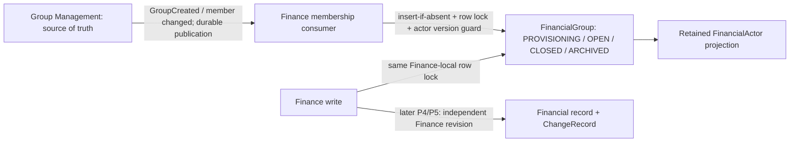
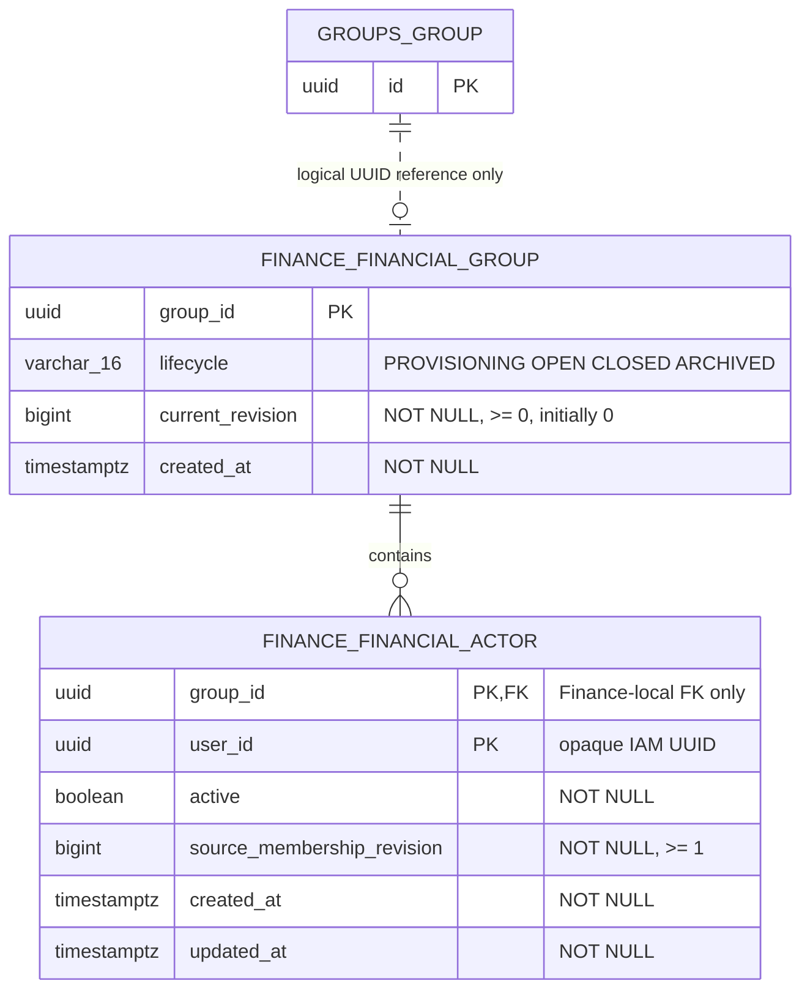

# Phase 3 design handoff: Finance foundations

**Status:** Proposed P3.0 architecture and technical ER for human review. No Finance business tables, Group membership source revisions or event consumers are implemented by this document. The [domain model](../../data-model-design.md), [application architecture](../../architecture.md), [persistence foundation](../../architecture/persistence.md) and [messaging design](../../stack/messaging.md) remain authoritative; this handoff specifies the narrower **MVP realization** without presenting it as implemented behavior.

**Audience:** Independent owners of FinancialGroup persistence/provisioning (P3.1), actor projection/event consumption (P3.2), pure accounting (P3.3), group-local financial revisions (P3.4), and Group Management membership-event publication (P2.4b).

## Ownership, lifecycle and data flow

Group Management owns organizational group existence, authoritative membership, roles and permissions. Finance owns one `FinancialGroup` aggregate per observed Group, its retained `FinancialActor` projection, its financial lifecycle, and its **independent financial change sequence**. Cross-context Group/user references are opaque UUIDs, not database foreign keys. Finance-owned actors **do** have a local FK to `financial_groups`; no separate orphan-capable projection root or queue is needed.

1. **Provisioning:** The first trusted Group Management event concerning a Group (including an out-of-order join/leave) idempotently creates its FinancialGroup in `PROVISIONING` and persists the relevant membership state in the same Finance transaction. Every handler follows an insert-if-absent/lock/apply/commit protocol on that group's row. A `GroupCreatedV1` event includes the atomically created initial owner membership at Group membership revision `1`. When that event is processed, Finance applies the owner state using the same version guard and transitions `PROVISIONING → OPEN` in that transaction. A late creation event never overwrites a newer actor state or reopens `CLOSED`/`ARCHIVED` Finance groups.
2. **Membership propagation:** Group Management transactionally publishes versioned membership facts through the existing Spring Modulith registry. Finance consumes them in a separate transaction with a per-actor source-version guard. Unknown departures create **inactive actor tombstones**, and leave/rejoin retains the same actor identity. An event for a Finance group not yet present creates the root instead of being discarded or parked. The registry may redeliver after consumer failure; completion follows the Finance commit.
3. **Financial mutation:** A Finance operation uses the **same FinancialGroup row lock** to check lifecycle and serialize financial writes, allocating the next *Finance* revision only for Finance business changes. Membership replication never allocates a financial revision or fabricates ChangeRecords.

### Lifecycle and readiness are different concepts

`PROVISIONING` is an expected, potentially visible pre-activation state, not a corrupt or incomplete SQL row. It forbids expenses, settlements and financial-history mutations. Once a valid `GroupCreatedV1` establishes the initial owner, Finance automatically enters `OPEN` (subject to the same transaction); no user-selected currency or synchronous Group callback is required. Group-authorized callers may see an *initializing* state and receive a typed not-ready outcome for financial writes; the eventual HTTP/UI presentation belongs to the consuming vertical. Reads or mutations must not leak Group existence to unauthorized callers.

**Initial membership evidence is not full synchronization freshness.** Seeing `GroupCreatedV1` proves that the initial owner was projected; it does *not* prove all subsequently committed membership events have arrived. `OPEN` never means "caught up through the latest Group revision." Later membership lag is tolerated as described in the [domain model](../../data-model-design.md), while per-actor version guards prevent regression. Consumer operations must not infer current caller authorization from `FinancialActor.active`; they use the approved Group authority/attestation contract. If a referenced member has not yet replicated, a financial mutation must fail predictably rather than create an unverified actor.

`OPEN → CLOSED`, `CLOSED → OPEN` and terminal `ARCHIVED` remain P5.3 operations. Group deletion and any terminal cleanup/suppression of late events need an explicit future policy; an old event must not recreate a deliberately retired Finance root.

### Proposed Phase 3 technical ER

This ER describes **only Phase 3 Finance-owned tables**. Expenses, Allocations, Settlements, ChangeRecords and a generic event inbox are not introduced here. The dotted Group link is logical, **not a database FK**; candidate column names are not deployed DDL.

| Element | Proposed invariant | Owner |
| --- | --- | --- |
| `financial_groups.group_id` | Unique, immutable opaque Group ID; the root can precede the GroupCreated event, but is created **only** from a trusted Group event | P3.1a/b |
| `lifecycle` | `NOT NULL DEFAULT 'PROVISIONING'`, constrained to `PROVISIONING`, `OPEN`, `CLOSED`, `ARCHIVED`; only GroupCreated processing activates a new root; financial writes require the applicable post-provisioning state | P3.1a/b, P3.2a; P5.3 later |
| `current_revision` | `bigint NOT NULL DEFAULT 0 CHECK >= 0`; incremented by serialized Finance business changes, **never** membership replication or provisioning | P3.1a, P3.4 |
| `(financial_actors.group_id, user_id)` | Composite PK and Finance-local group FK; retained for leave/rejoin and referenced by later historical finance records | P3.1a, P3.2a |
| `active` / `source_membership_revision` | Resulting member state and per-actor maximum **committed Group membership revision**; an unknown leave inserts `active=false` with its revision | P3.2a |
| Timestamps | Diagnostics, not ordering/idempotency authority; root `created_at` means Finance first observed the group, **not** the Group creation timestamp | P3.1a/P3.2a |

The `0..*` actor cardinality accommodates an empty `PROVISIONING` persistence root within a transaction. After `GroupCreatedV1` is committed in Finance, the initial owner actor exists (though a later authoritative leave may already have deactivated it). No cross-context FK, cascade, runtime table join or shared Group entity is permitted.

### MVP monetary representation

**No currency column or currency-selection workflow in Phase 3.** MVP amounts use one **application-wide, fixed accounting denomination** with a documented fixed scale (initially two decimal places); their database representation is exact (for example integer minor units). The frontend displays one fixed currency symbol consistently. The precise displayed currency/code must be fixed **before the first money-writing feature ships**; changing a symbol later must not silently reinterpret existing persisted amounts. No multi-currency input, conversion, per-group override or variable-scale arithmetic is supported in the MVP.

The conceptual domain model's per-group accounting-currency contract remains the intended future capability. Introducing currencies is a separate later vertical: a coordinated **Flyway** migration assigns the then-established default currency to all existing amounts/groups **without conversion**, adds the required explicit metadata and adjusts Money validation/UI. This is safe only while the single-denomination assumption was enforced for all earlier writes.

## Group source ordering and idempotency

**P2.4b producer contract:** Creating a Group and its owner membership is one authoritative transaction, establishing `membershipRevision=1` and one stable `GroupCreatedV1(eventId, groupId, initialOwnerUserId, sourceMembershipRevision=1)` fact. Each later committed membership transition (join, leave, remove, rejoin) advances a **group-scoped counter**, serially and transactionally, and publishes a stable event with `eventId`, `groupId`, `userId`, committed `sourceMembershipRevision`, and **resulting** `active` state. A retransmission keeps the original ID and revision. Role-only changes do not advance this membership counter or grant Finance authorization. Deleted/recreated membership UUIDv7 IDs or timestamps are not substitutes for committed order.

**P3.2 consumer contract:** In one Finance transaction, ensure the root exists, lock its row, and apply an event only when its source revision is strictly greater than that of its `(groupId,userId)` actor (or when no actor exists). A newer inactive event creates a tombstone when the actor is missing. Exact duplicates and older events are no-ops; contradictory payloads at the **same actor and revision** are diagnosed and fail rather than being silently treated as legitimate replays. Other users' events need not be delivered in group-revision order. In particular, processing revision 3 for B must not suppress revision 2 for A. The group-level source counter is **not** `FinancialGroup.current_revision`, which stays at zero throughout membership-only changes.

A `GroupCreatedV1` event must initialize the owner *through* this guard and conditionally activate only a `PROVISIONING` root. Applying a delayed revision-1 owner fact cannot undo a newer leave/rejoin. Source event processing and root creation share a Finance-local transaction and lock, but do **not** require a Group lock, synchronous Group callback, or a separate Finance queue. Registry consumption is acknowledged only on successful consumer transaction completion. Group-created publication delayed behind later membership events is therefore safe without assuming FIFO delivery.

## Recovery, rollout and deferred synchronization

For the MVP, the **first Finance consumer is registered before new Group data needing replication is created**. There is no automatic import of groups created before that subscription: the controlled release either **resets/disposes disposable MVP data** or includes a separately verified, writes-suspended **Flyway backfill**. These are explicit deployment alternatives, not a runtime reconciliation feature. P3.2 does not implement a snapshot API, periodic drift repair or a background retry scheduler. Spring Modulith's existing durable publication and failure/redelivery behavior (P2.4a/P2.4c) remains required; failures are not acknowledged as success.

A persistent delivery failure can leave an otherwise valid Group's Finance root in `PROVISIONING`, or leave `OPEN` actor state temporarily stale. It must remain observable and recoverable through the existing publication registry's supported operator/recovery mechanisms. There is **no autonomous convergence guarantee after an event is permanently lost or was never published**. Once operational evidence justifies it, a later hardening task may add snapshot/backfill protocols, durable drift detection and scheduled reconciliation/retry jobs; these are not Phase 3 prerequisites.

## Parallel-work boundary

P3.1a alone defines the two Finance tables and their constraints. P3.1b owns idempotent root provisioning and the shared row-lock primitive needed before a Finance root exists. P3.2a owns event-state transitions, actor tombstones and automatic activation on GroupCreated, independently of listener wiring; P3.2b owns integration with P2.4a/P2.4b and joint P2.4c acceptance. P3.3 implements fixed-scale pure money/split calculations without Finance DDL or events. P3.4 owns transactional **financial** revision allocation using the same row, independent of P3.2. Future migrations/backfill, recurrent reconciliation and currency management are not separate required Phase 3 lanes.
