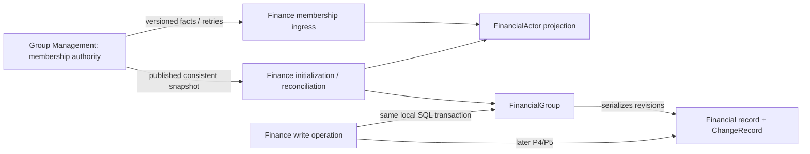
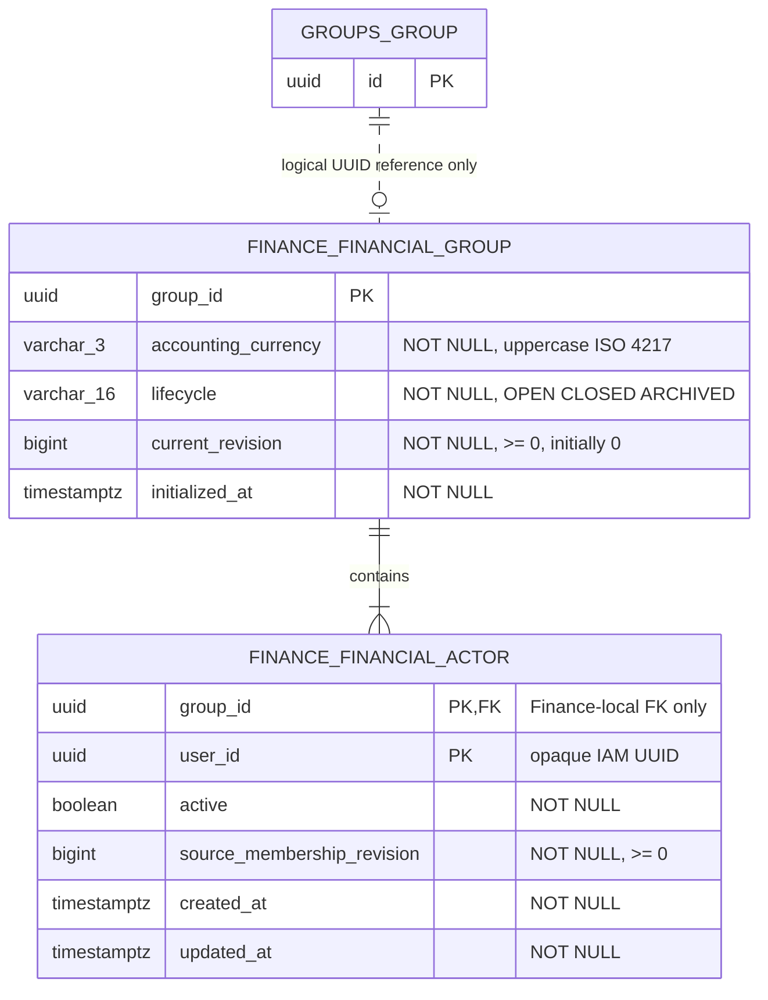

# Phase 3 design handoff: Finance foundations

**Status:** Proposed P3.0 architecture and technical ER for human review. No Finance business tables, projection consumer, membership source revision or financial write coordinator are implemented by this document. The [domain model](../../data-model-design.md), [application architecture](../../architecture.md), [persistence foundation](../../architecture/persistence.md) and [messaging design](../../stack/messaging.md) remain authoritative; this handoff makes their Phase 3 integration choices explicit without extending the approved domain policy by implication.

**Audience:** Independent owners of FinancialGroup initialization (P3.1), membership projection/synchronization (P3.2), pure accounting calculations (P3.3), and financial revision serialization (P3.4), plus the Group Management membership-event producer (P2.4b).

## Ownership and data flow

Group Management owns authoritative organizational membership, group existence and permissions. Finance owns the lifecycle and accounting currency of an initialized FinancialGroup, the retained FinancialActor projection, and **one financial change-sequence counter per group**. A Finance group ID is the opaque Group Management UUID, not a foreign key to `groups.groups`; Finance actor user IDs are opaque IAM identities, not foreign keys to `identity.users` or `groups.users`. Within Finance, however, local referential integrity is required.

The proposed initial interaction has three distinct paths:

1. **Initialization:** An authorized application operation selects the accounting currency and establishes an initialized Finance group for an existing Group. A consistent *published Group membership snapshot* supplies the initial active actors. The Group-owned lookup is an application capability, not an SQL join. The Finance initialization transaction atomically installs its row and actor snapshot. Existing data may instead be bootstrapped in a **coordinated, writes-suspended Flyway migration** as described below.
2. **Propagation:** Group Management commits a membership change with a stable event ID, a monotonic Group-owned membership revision, and recoverable publication intent. An independent Finance operation applies the event with a **source-version guard** and commits separately. Registry completion can fail after that commit; redelivery must be harmless. Role changes do not themselves grant Finance authorization.
3. **Financial mutation:** A Finance application service locks its FinancialGroup, checks lifecycle and operation-specific authorization/preconditions, persists the business change and later its ChangeRecord at the next **finance revision**, and commits together. Membership projections do **not** advance the financial revision or fabricate financial history entries.

### Proposed Phase 3 technical ER

This ER **only designs the Phase 3 Finance-owned tables**. Expense, Allocation, Settlement, ChangeRecord and any event inbox are *not* introduced here. A dotted link denotes a logical cross-context reference, **not a database foreign key**. Column names and SQL representations below are candidates for P3.0 approval, not deployed DDL.

| Object / column | Proposed constraint and rationale | Owner |
| --- | --- | --- |
| `finance.financial_groups.group_id` | PK (`uuid`), identical to the Group's logical ID, without FK to `groups.groups`; at most one initialized finance group per organizational group | P3.1a |
| `accounting_currency` | `varchar(3) NOT NULL`, validated as an actual supported ISO 4217 currency in the application, stored uppercase; no implicit EUR/default currency | P3.1a/b |
| `lifecycle` | `varchar(16) NOT NULL DEFAULT 'OPEN'`, `CHECK` limited to `OPEN`, `CLOSED`, `ARCHIVED`; only P5.3 implements transitions and their journal entries | P3.1a; P5.3 behavior |
| `current_revision` | `bigint NOT NULL DEFAULT 0`, `CHECK >= 0`; changed only by serialized *financial* operations, not actor synchronization | P3.1a schema; P3.4 operation |
| `finance.financial_actors.(group_id, user_id)` | Composite PK; `group_id` FK to Finance's own `financial_groups` row; stable on leave/rejoin; no Group/IAM FK and no actor deletion on leave | P3.1a schema; P3.2 operations |
| `active` | `boolean NOT NULL`: Finance's eventually synchronized eligibility fact, **not** caller authorization | P3.2a |
| `source_membership_revision` | `bigint NOT NULL CHECK >= 0`; high-water mark for the source group's committed membership sequence, applied *per actor*. Seeded from a consistent authoritative snapshot; never replaced with arrival time or registry publication ID | P3.2a/b |
| Timestamps | `timestamptz NOT NULL` for initialization, actor creation and last projection update. Diagnostics only; never ordering/idempotency authority | P3.1a/P3.2a |

The diagram's `1..*` actors is a *business postcondition of initialized Finance groups*. A temporarily empty row is not a successful initialized group. P3.1a may test low-level persistence against fixtures; the user-facing initialization workflow must create its group and snapshot atomically. No cross-context foreign key, cascade, business-table join, direct SQL read, or reused Group entity is permitted in runtime adapters.

### Source ordering and synchronization contract

**Proposed requirement for P2.4b:** Group Management assigns a monotonic, transactionally committed **membership revision per group** to every membership-changing operation, including joining, leaving, rejoining and removal. A Group-created first membership is covered. Its published current-state snapshot contains `groupId`, a revision watermark and the active `(groupId, userId)` set read consistently at that watermark. `MemberJoinedV1` and `MemberLeftV1` (or a semantically equivalent versioned full-state event) carry a stable `eventId`, `groupId`, `userId`, `sourceMembershipRevision`, and the *resulting* active state. Distinct membership changes have distinct revisions; a retry retains the original version and ID. Mere event timestamps, Kafka offsets or registry IDs are insufficient.

A full-state per-member event with a later revision can supersede an earlier event **for that same actor**; events concerning other actors need not arrive in order. Finance applies `sourceMembershipRevision > stored` atomically (upsert/conditional update in the same transaction), ignores an exact replay or stale version, and **rejects/diagnoses conflicting outcomes for the same actor and version**. It may use the version guard instead of a separate inbox only while actor-state projection is its sole persistent effect. A missing event concerning an entirely new member is repaired through a published authoritative snapshot. A snapshot at watermark `R` inserts currently active actors, deactivates retained actors absent from the snapshot, and may update only rows whose source revision is no newer than `R`; concurrent event `R+1` must survive. The snapshot must not erase historical actors. Finance remains responsible for periodic/operator-triggered reconciliation and lag diagnostics once delivery exists.

The Group-owned source revision is **not** `finance.financial_groups.current_revision`: they are independent clocks. The current P2.0c design of `groups.group_members` has no durable membership-version column or historical membership row. P2.4b must specify and implement an authoritative version/watermark mechanism (for example a group-level counter advanced under Group's own serialization) and a consistent published snapshot. Do not assume source event order can be derived from a deleted/recreated membership row.

### Initialization and migration boundary

**Proposed default:** A Finance group is *initialized on demand* by an authorized Group administrator/member workflow with an explicitly chosen accounting currency. This keeps accounting currency Finance-owned and avoids changing P2.2's Group metadata or inventing a default currency. Existing Groups are legitimate before their Finance group exists. **An event delivered before Finance initialization must not be acknowledged and discarded merely because its group has no Finance row.** A versioned snapshot alone is insufficient: a membership event could commit after the snapshot, be delivered while no Finance row is visible, and be acknowledged just before initialization commits. P3.1b/P3.2c must use a proven shared per-group synchronization handshake for the absence check and creation/snapshot commit (for example a carefully scoped PostgreSQL transaction advisory lock), or keep a durable pending event/watermark until a snapshot at or beyond its version has been applied. The required interleaving tests are part of the review gate; no unguarded ignore-and-ack path is allowed. Finance group initialization must be idempotent for an identical currency and reject a conflicting concurrent choice. Currency changes and FX are outside Phase 3, not implicit updates to this row.

**Decision gate:** The pre-initialization delivery/handshake mechanism above also requires approval; choosing on-demand initialization alone does not resolve it. Alternatively, every organizational Group can automatically acquire a Finance group when Group creation commits, but then the initial currency and a durable creation/initial-membership bootstrap contract must be specified before implementation. Neither an unversioned creation event nor a hard-coded currency is acceptable. The on-demand approach above is proposed, **not an approved product decision**; P3.0 approval must choose one lifecycle before P3.1b/P3.2b implement it.

For a populated deployment, if Finance business data does not yet exist, a coordinated Flyway data migration may read authoritative `groups` tables **while Group writes are suspended** to seed approved Finance groups and actor states. This is a controlled migration exception, not runtime permission to query Group tables. It still requires an approved currency for each seeded Finance group and a source revision watermark matching the snapshot. If writes cannot be suspended, use an authoritative snapshot plus a gap-free replay/reconciliation handshake; do not treat the publication registry as a complete historical event log.

### Financial-write revision protocol

P3.4 owns a reusable **Finance-local** operation/port that takes the FinancialGroup row lock (`SELECT ... FOR UPDATE` or equivalent), validates lifecycle and request preconditions inside the same physical transaction, then updates its `current_revision` as part of a successful financial write. The next revision must be obtained transactionally, not through a PostgreSQL sequence or independent monotonic ID. A failed/rejected mutation rolls back any revision update. Concurrent group writes serialize; different groups need no global lock. Later P4/P5 operations append exactly one correctly typed, uniquely constrained ChangeRecord for each committed financial revision and preserve immutable record versions. P3.4 must not introduce fictitious journal entries before the journal feature exists.

### Pure accounting boundary

P3.3 can proceed without migrations, events, Group permissions or P3.4. `Money` uses exact currency-aware minor units (with checked overflow/precision), `Percentage` uses an exact representation, and `equal`, `fixed` and `percentage` allocation strategies produce immutable shares totaling the input amount. Remainder assignment must be deterministic under reordered input, with a specified stable participant-ID tie break. Only P3.3's reviewed specification fixes percentage granularity, supported currency metadata and the final algorithm; no financial entity/table stores a floating-point monetary amount.

## Shared acceptance contracts and limits

A Phase 3 implementation must prove: one Finance group per initialized Group; stable actor identity through leave/rejoin; absence of cross-context FKs/SQL reads at runtime; snapshot-at-watermark and event replay convergence; no successful double application or stale-state overwrite under concurrent duplicate delivery; exact split conservation and consistent rounding; atomic, group-local financial revision allocation with rollback; and module isolation via the existing Modulith verification.

Use offline Unit tests for pure math/application rules, PostgreSQL Integration for DB constraints and atomic version guards, and PostgreSQL E2E for durable commits, snapshot/event races and registry recovery. [Backend testing](../../development/tests.md) defines these gates. No PostgreSQL integration or actual messaging path is validated by the documentation-only P3.0 patch.

**Explicitly deferred:** P4/P5 financial-record COW tables and journal DDL, inactive-actor eligibility for new settlement/expense operations, expense authorship, settlement authority, attachment-history policy, physical group deletion/retention, FX conversion, distributed-service authority freshness and production event registry implementation. Their owners and business decisions remain in the [domain model](../../data-model-design.md#open-decisions) and owning future phases.
