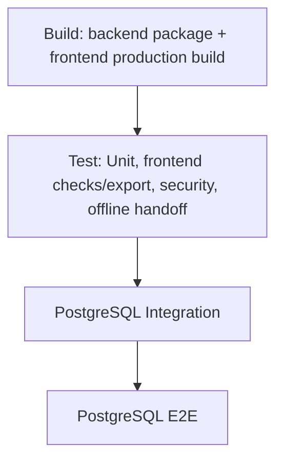

# P1.5 - PostgreSQL transaction acceptance and CI execution model

**Status:** Specification approved; implementation acceptance pending. **Backlog:** [P1.5](../backlog.md#phase-1---modular-application-and-persistence-foundation). **Implementation plan:** [P1.5 plan](plan.md). This task completes the remaining Phase 1 transaction acceptance gate and restructures the existing GitLab CI pipeline; it does not introduce a new production transaction model.

## Goal and baseline

The [production transaction architecture](../../../architecture/transactions.md) and [P1.3b contract](../p1.3-transactions/specification.md) define application-owned transaction segments, result-driven finalization, rollback-only semantics, and guarded jOOQ/JPA participation. P1.2 supplies the [PostgreSQL persistence foundation](../../../architecture/persistence.md). P1.3c supplies the [test architecture](../../../architecture/tests.md) and [real-commit E2E fixtures](../../../development/tests.md). P1.5 must **prove the existing production contracts on the actual PostgreSQL 18 configuration**, using evidence independent of the rollback-only Integration test substitute.

The November 19, 2026 main baseline already contains real-commit tests in `RelationalTransactionE2E`, `JooqAccessE2E`, and `JpaAccessE2E`, plus a three-suite Maven/CI split. These are the starting evidence, not a reason to rewrite the tests wholesale or to mark untested failure cases complete. The same baseline has a single frontend CI job running lint, application and test typechecks, Vitest, production build, and a separate-build static-export probe. P1.5 also establishes a clearer CI job graph for those existing checks.

## Architectural boundaries

### Production transaction acceptance

The tests invoke `OperationDispatcher` and the production `Transactions` implementation under an operation DI scope. The Spring `PlatformTransactionManager`, runtime datasource, jOOQ configuration and Hibernate/JPA persistence context are those configured by the application, with an independently migrated database per E2E test. No test-owned outer transaction may delay or mask a physical commit.

Tests may create fixture tables and inject *test-side* JDBC observations or controlled failures, but must not replace `SpringTransactions` with `RollbackTransactions`, replace the physical manager with a fake, or depend on cross-test committed state. Each scenario proves the effect of its requested transaction decision from an independent application-role connection after finalization. Within a running segment, a second connection confirms that uncommitted changes are not visible under PostgreSQL's configured isolation level.

Mixed-adapter checks cover Spring-bound JDBC (`JdbcTemplate` or the corresponding transaction-aware connection), jOOQ and JPA in the **same physical segment**. JPA's explicit `flush()` makes its pending SQL visible to same-transaction JDBC/jOOQ; `refresh()` is required to observe direct SQL updates to an entity already cached by Hibernate. Direct JDBC is used as a test probe or within an infrastructure adapter, not promoted into a business-facing port.

A single operation can execute sequential physical segments. A successful `COMMIT` makes that segment durable; a later `ROLLBACK`, `ABSTAIN` or failure cannot undo it. Stale facades and derived executable queries remain bound to their original segment. Nested execution, unrelated ambient transactions, wrong-scope/thread access and use after scope closure are rejected. Independent concurrent dispatches own distinct transactions and scopes.

### Completion and failure semantics

The following outcomes remain distinguishable and must be established with concrete evidence:

| Situation | Required observed behavior |
| --- | --- |
| Successful `COMMIT` | Returns only after confirmed physical commit; data visible on a new connection. |
| `ROLLBACK` or `ABSTAIN` | Returns the selected result after successful physical rollback; no segment writes remain. |
| Rollback-only veto followed by `COMMIT` | Commit request fails and the segment rolls back. An aborted PostgreSQL transaction cannot be made committable by translating a database error to a typed result. |
| Callback or known commit-time constraint failure | Failure propagates; no normal commit result. Definitive rollback evidence and manager reuse are assessed from actual completion state, not inferred from the exception type. |
| `afterCommit()` callback failure | Application call fails even though the physical commit is already durable. Reuse is rejected when cleanup/finalization has not been confirmed. |
| Ambiguous commit response | Caller is informed of failure, never success or a claimed definite rollback. The manager is unusable for further segments; retries and recovery belong to the application use case. |

A **real deferred PostgreSQL constraint** must reject at physical commit, rather than only at statement execution or explicit JPA flush. A separate, narrowly scoped fault-injection test must represent failure at the actual commit boundary and distinguish (a) commit not issued, and (b) PostgreSQL has committed but the caller observes an error. The second case proves that an application-level exception alone cannot establish rollback. The injector must pass through to the **real PostgreSQL transaction manager/connection**; faking `PlatformTransactionManager.commit()` without physical participation does not meet the gate. The implementation phase must first verify which commit path Spring/JPA actually uses before choosing a connection/delegate interception mechanism. The injected failure is test-local and must never enter production wiring.

### CI execution model

CI uses **stage barriers as quality gates**, with separate artifact handling for jobs that consume no prior outputs. Maven still owns the three test selectors and developer commands; GitLab controls when each gate runs. The existing security-scanning templates and offline-handoff validation remain mandatory. The design targets the current GitLab shared Docker runner, Java 25, Node 24, and a runner-managed PostgreSQL 18 service reachable over TCP; no Docker socket or Docker-in-Docker is introduced.

Both **backend packaging** and **frontend production build** must succeed in the `build` stage before test jobs begin. The shared `test` stage runs backend Unit, frontend lint, application/test typechecks, Vitest, isolated static-export verification, SAST, secret detection and offline-handoff checks in parallel. PostgreSQL **Integration** and **E2E** each occupy a subsequent stage, so Integration starts only after all earlier tests have passed and E2E only after Integration has passed. No project-defined `needs` bypasses these barriers. This deliberately makes a failed frontend or security/offline gate block later PostgreSQL tests, favoring clear fail-closed sequencing over maximum parallelism. Scanner failure behavior remains governed by GitLab's included security templates.

Frontend checks are individually identifiable rather than chained within `build-frontend`: ESLint, application TypeScript validation, test TypeScript validation, Vitest/component-accessibility tests, and static-export validation. The static-export probe **builds an isolated copy using installed dependencies**; it is not a passive inspection of the ordinary `next build` artifact. It runs after the successful production build, concurrently with the other checks in the test stage, and must still perform its own export and HTTP/asset assertions.

The pipeline must not silently skip a required gate or report an overall green pipeline while a mandatory job failed. Pipeline-source rules, if introduced, must prevent duplicate branch/MR pipelines **without dropping manual, default-branch, security or required review checks**. Security templates must remain compatible with the `test` stage.

Dependencies are cached as **disposable caches**, not passed as build artifacts: Maven's local repository and npm's package-download cache keyed appropriately to the manifests/lockfile. Do not transfer `node_modules` as an implicit inter-job contract or assume a GitLab runner cache is durable. Test jobs recompile/reinstall their own dependencies, with `dependencies: []` to avoid downloading unrelated build artifacts. Only outputs actually required downstream are transferred as artifacts; tests publish independently attributed JUnit reports even on failure. Cancellation/`interruptible`, timeouts, cache sharing and job fan-out should be reviewed for safe behavior on the university runners rather than enabled indiscriminately. A failed PostgreSQL service or migration must fail its suite without H2 fallback. Consult GitLab's [stage execution](https://docs.gitlab.com/ci/pipelines/), [cache/artifact distinctions](https://docs.gitlab.com/ci/caching/) and [pipeline rules guidance](https://docs.gitlab.com/ci/jobs/job_rules/) when implementing the pipeline; the project instance's CI Lint and actual runner remain the final authority.

## Requirements

| ID | Requirement |
| --- | --- |
| **PG-01** | Real-commit tests use production transaction/DI wiring, migrated PostgreSQL and per-test disposable database ownership; no enclosing test transaction. |
| **PG-02** | Verify atomic JDBC/jOOQ/JPA participation, independent-connection visibility, explicit flush/refresh, and all three transaction decisions. |
| **PG-03** | Verify rollback-only poisoning, typed-result independence, PostgreSQL-aborted transactions, sequential segments, and invalid/stale resource access. |
| **PG-04** | Verify deferred-constraint failure at actual commit, post-commit callback failure, and separate controlled uncertain-commit scenarios with correct failure/reuse behavior. |
| **PG-05** | Verify concurrent production operation scopes without shared segment/connection state; use deterministic coordination and disjoint test keys. |
| **PG-06** | Record executed evidence against P1.3b TX-03 through TX-11, identifying previous coverage, new tests and remaining limitations. |
| **CI-01** | Run backend Unit in the shared `test` stage, followed by distinct PostgreSQL Integration and E2E stages, with independent JUnit results and fail-closed prerequisites. |
| **CI-02** | Split frontend lint, typechecks, tests, build and isolated static-export acceptance into diagnostically distinct jobs, preserving all existing commands and assertions. |
| **CI-03** | Gate test execution on both successful builds, then PostgreSQL Integration on the shared test stage and E2E on Integration. Avoid `needs` that bypass mandatory earlier gates; do not download build artifacts into jobs that rebuild independently. |
| **CI-04** | Preserve SAST, secret detection, offline-handoff tests and secure runner constraints; validate merged YAML/template behavior through the actual GitLab pipeline. |
| **CI-05** | Make dependency caches, pipeline-source rules, cancellation and artifact lifetimes deliberate, without sacrificing reliable reruns or adding a new build system. |

## Acceptance scenarios

| ID | Setup and action | Required evidence | Primary gate |
| --- | --- | --- | --- |
| **P15-T01** | In a production-dispatched segment, insert via JPA (flush), jOOQ and Spring JDBC; inspect from a separate connection before and after `COMMIT`. | Before: none visible. After: all visible; one Spring-managed transaction. | E2E (TX-03, TX-11) |
| **P15-T02** | Execute mixed-adapter writes with `ROLLBACK` and `ABSTAIN`, returning typed values. | No writes persist; typed results and decisions preserved. | E2E (TX-04, TX-11) |
| **P15-T03** | Modify a JPA-managed row with jOOQ and refresh it, including a flushed JPA insert read through JDBC/jOOQ. | Demonstrable first-level cache staleness and explicit refresh visibility in one physical transaction. | E2E (TX-11) |
| **P15-T04** | Return an intentional typed failure with `COMMIT`; separately poison a segment and translate an actual PostgreSQL constraint error. | Intended side effect commits; vetoed and aborted transactions cannot report commit success or leave writes. | E2E (TX-05, TX-06) |
| **P15-T05** | Within one dispatch, commit A, roll back B, then try a segment-A resource or deferred query in B. | A remains, B does not; stale accesses fail before SQL execution. | E2E (TX-09, TX-10) |
| **P15-T06** | Exercise nested/ambient transactions, suspension, other thread/scope and post-close use; run concurrent independent dispatches. | Invalid access fails; concurrent valid operations are isolated without leaked connections or scope state. | E2E plus existing Unit (TX-08, TX-10) |
| **P15-T07** | Insert a row violating a `DEFERRABLE INITIALLY DEFERRED` PostgreSQL constraint; return `COMMIT`. | Commit raises a database failure; no ordinary success, no violating rows and no unsafe reuse. | E2E (TX-07) |
| **P15-T08** | Register a throwing Spring `afterCommit` callback after writing a row. | Operation fails; a fresh connection proves the row persisted; existing manager cannot be reused if completion cleanup was interrupted. | E2E (TX-07) |
| **P15-T09** | Inject a fault before issuing physical commit, then a separate fault after physical PostgreSQL commit but before acknowledging it to the caller. | Caller sees failures and cannot reuse the manager; independent reads distinguish absent vs durable rows. The caller does not infer definite rollback from a failed commit response. | E2E, test-only fault seam (TX-07) |
| **P15-T10** | Run GitLab's complete backend and frontend pipelines on the revised graph, including a rerun and representative failing job. | Both builds succeed before any test starts; a failed build/test prevents later stages; all required security/offline jobs are present, with JUnit and artifact behavior correct and no H2 fallback or missing tests. | GitLab CI (CI-01 through CI-05) |

The [P1.3b specification](../p1.3-transactions/specification.md#acceptance-criteria) remains authoritative for TX-03 through TX-11. These scenarios close database-specific gaps, not replace that contract or the existing regression suite. Each claimed criterion must link to a named executed test and corresponding CI evidence. A green Unit suite alone is insufficient.

## Exclusions and follow-up ownership

P1.5 does not implement new business persistence adapters, migration/schema code generation, event-publication registries, replay/idempotency or broker delivery (P2.4), Finance revision/locking rules (P3/P4), business retries, distributed transactions, savepoints or deployed smoke tests. P2.6 owns production image publishing and deployment pipelines; this CI refactor must preserve a clean extension point for those jobs without implementing them now. No production transaction contract is revised unless the tests reveal a genuine defect and the resulting change is separately reviewed against [transaction architecture](../../../architecture/transactions.md).

**Acceptance:** Phase 1 can close only after the human accepts PostgreSQL TX-03 through TX-11 evidence **and** the revised CI graph passes its complete real-run gates. Proposed code and offline compilation do not satisfy either gate.
