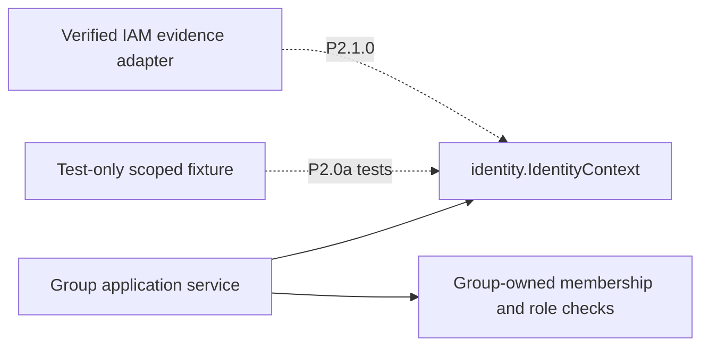

# P2.0a - Minimal published identity and module contracts

**Status:** Phases A–C are implemented and approved for the local review baseline; Phase D documentation handoff remains under review. This task does not provide production authentication.

## Goal and scope

Allow the Group Management verticals (P2.2a–c) to implement and test their application services **in parallel with IAM**. A Group application operation needs one semantic input from authentication: the stable IAM user ID of its verified current caller, or an explicit unauthenticated failure. It does not need JWTs, a claims registry, token metadata or Group-issued attestations.

P2.0a defines that consumer-facing contract, introduces it at the published IAM module boundary, and supplies a **test-only, deterministic** implementation. It also specifies, but does not implement, the later authoritative IAM status lookup needed for the Group user-projection miss fallback (P2.1d/P2.2e).

This task does **not** implement registration, account/session persistence, token issuance/verification, middleware, the generic claims/provider/policy model, operation-input seeding, Group operations, event delivery or HTTP adapters. See [the backlog](../backlog.md) and [the security architecture](../../../stack/security.md) for their owners.

## Architectural solution

### Published contract and ownership

The `identity` bounded context owns the semantic *current authenticated IAM caller* contract. Its top-level package is the public Spring Modulith API under the existing [module conventions](../../../architecture.md#module-structure-and-published-apis):

```java
package de.hsh.favs.sharewise.identity;

import java.util.Optional;
import java.util.UUID;

public interface IdentityContext {
    Optional<UUID> userId();

    default UUID requireUserId() {
        return userId().orElseThrow(UnauthenticatedCallerException::new);
    }

    default boolean isAuthenticated() {
        return userId().isPresent();
    }
}
```

`UUID` denotes the stable, opaque IAM user ID. `userId()` is the single primitive operation: it returns the verified caller's ID when present, or `Optional.empty()` for an unauthenticated operation. `requireUserId()` and `isAuthenticated()` are default conveniences derived from `userId()`, so implementations only need to supply one stable result. The name follows the semantic `<Concept>Context` convention (for example, a later `GroupAuthorizationContext`), without requiring a shared parent interface.

The contract is operation-local: all three accessors must agree and return a **stable** identity throughout an operation. `Optional.empty()` means no authenticated caller; malformed/invalid credentials, verification errors and unavailable dependencies must **not** silently become anonymous. `requireUserId()` throws the proposed domain-neutral, unchecked `UnauthenticatedCallerException` when the Optional is empty; it conveys no HTTP status or Spring Security type. The inbound adapter will eventually map it to the appropriate authentication response (normally `401`, under P1.4/P2.1), not a Group membership-denial `403`. `isAuthenticated()` only reports the presence of an authenticated identity; it does not establish current account/session eligibility.

`identity` declares an explicit `@ApplicationModule(allowedDependencies = {...})` whitelist, initially empty if its published contract requires no other application module. When Group Management is created in P2.2, it declares a reviewed dependency on the **published `identity` API**, not an IAM implementation package. `shared` never depends on `identity`. The interface and error type do not depend on Spring, persistence, HTTP, JWT or claims types.

The initial implementation is a **test-only Spring bean** with operation scope. It provides a deterministic, explicitly chosen caller identity using a test fixture; an unbound fixture fails closed. It must not become a component-scanned or profile-enabled production identity. The design does not add placeholder Group APIs merely to fill the module diagram; P2.2 owns actual Group operations and DTOs.

### Operation lifetime and production replacement

The existing [operation-scope DI](../../../architecture/dependency-injection.md) owns lifetime and resolution. Group application services constructor-inject `IdentityContext` and use `requireUserId()` for operations requiring a caller; `userId()` and `isAuthenticated()` support explicit optional-authentication paths. They do not read `HttpServletRequest`, `SecurityContextHolder`, authentication cookies, claims or session IDs directly.

P2.0a does **not** modify `OperationDispatcher`, create another DI container, or add a new operation-input transport. P2.1.0 later supplies a production adapter backed by the verified primary IAM identity through the approved ingress-to-operation-scope bridge. That adapter implements the **same interface**, so Group consumers remain unchanged. No assertion about the caller's *current* IAM account/session state is implied by `requireUserId()`; it represents identity verified for the operation, subject to the [security design's bounded token staleness](../../../stack/security.md#revocation-distributed-services-and-verification).



### Stable identity references and context isolation

- The caller's user ID is **assigned by IAM**, never generated by Group Management or taken from an untrusted request parameter. Test IDs are fixture data, not legitimate production credentials.
- `groups.users.id` is a Group-owned local reference to that stable ID. P2.2 initializes a **closed world** of identities through explicit database fixtures; unknown IDs are rejected locally until event propagation/fallback are integrated.
- `groups.group_members` and Group authorization remain Group-owned. `IdentityContext` establishes who the caller is, **not** whether they may administer a particular group. Current membership and role mutations use Group's authoritative database, never previously issued attestations.
- No cross-context table access, foreign key, entity model, or synchronous IAM lookup is introduced by the initial contract.
- Public command/query DTOs added by future slices are immutable and context-owned; P2.0a does not invent unused interfaces or DTOs for those slices.

### Deferred IAM current-state verification contract (design only)

P2.1d will implement a separate published IAM capability for P2.2e's local-`groups.users`-miss fallback. Its **proposed semantic shape** is a zero-argument, current-caller operation, for example `CurrentCallerEligibility.check()` returning a typed result with these distinct outcomes:

| Outcome | Meaning for Group Management |
| --- | --- |
| `ELIGIBLE` | IAM currently recognizes the verified caller and the required account/session state allows local provisioning. |
| `INELIGIBLE` | The account is disabled, deleted/unknown or the relevant session is invalid; reject, do not provision. |
| `UNAVAILABLE` | Authoritative verification could not complete; fail closed, do not infer that the account is absent. |

The lookup uses an **already verified current caller**, including internally available session evidence when required; it must not accept an arbitrary client-supplied user ID or treat signature verification alone as a current-state lookup. The result is a point-in-time decision, not an atomic guarantee across IAM and Group transactions. The concrete return type, error taxonomy, concurrency/deletion ordering and synchronous cross-context transaction boundary are reviewed with P2.1d/P2.2e. **P2.0a only records the intended contract; it adds no lookup bean or API declaration.**

## Requirements and invariants

| ID | Requirement |
| --- | --- |
| **ID-01** | One published, domain-neutral `IdentityContext` exposes `Optional<UUID> userId()` as the primitive operation, with default `UUID requireUserId()` and `boolean isAuthenticated()` conveniences. It is independent of credential transport and issuer-specific claims representation. |
| **ID-02** | For an unauthenticated operation, `userId()` returns `Optional.empty()`, `isAuthenticated()` is `false`, and `requireUserId()` throws `UnauthenticatedCallerException`. For an authenticated operation, all methods agree on the same user. Never return `null`, a default UUID or a synthetic production principal. Invalid evidence and provider failures must not be converted into absence. |
| **ID-03** | The same operation observes one stable identity through every injected collaborator; independent operations do not inherit identities or mutable fixture state. |
| **ID-04** | The provider participates in the implemented Spring `operation` scope and does not couple service lifetime to a servlet request, thread identity, physical transaction or HTTP endpoint. |
| **ID-05** | Only test sources/configurations supply deterministic identities at this stage; production cannot silently activate a mock identity. Missing production authentication integration must fail closed. |
| **ID-06** | Group consumers depend only on `identity`'s published API; module whitelists and architectural checks reject internal IAM or shared-DI implementation access. |
| **ID-07** | The identity contract neither checks live account state nor grants Group roles; Group authorization and local user existence remain separate responsibilities. |
| **ID-08** | The future current-state lookup distinguishes eligibility, rejection and unavailability; its implementation and runtime integration remain with P2.1d/P2.2e. |
| **ID-09** | P2.0a introduces no new POM dependency, database migration, HTTP contract, token/claim processing or modification to the accepted dispatcher. |

### Failure and concurrency behavior

No persistence or business mutation is performed by P2.0a. Missing test identity is represented as `Optional.empty()`; only `requireUserId()` throws an authentication failure, not a Group `403` authorization outcome; Spring bean/scope construction failure propagates and the existing dispatcher closes the scope. Each dispatch establishes an independent scope; concurrent operations may use different fixture principals without cross-talk. A successful identity resolution does not bypass P2.2's local membership, invitation or final-administrator checks.

## Acceptance tests

All P2.0a tests are **Java/Spring/module-boundary** checks; real database, HTTP and JWT integration tests belong to their later owning tasks. Representative test scenarios:

| ID | Setup and action | Expected outcome / evidence |
| --- | --- | --- |
| **ID-T01** | Resolve `IdentityContext` through `OperationDispatcher` with an explicitly selected test user ID; call all three accessors. | `userId()` holds the fixture UUID, `requireUserId()` returns it, and `isAuthenticated()` is `true`, with no credential or HTTP dependency. |
| **ID-T02** | Resolve the same service through two separately constructor-injected collaborators in one dispatch. | Both observe the same caller and the same operation-scoped service instance; optional, required and boolean accessors agree. |
| **ID-T03** | Dispatch separate operations with different explicit test identities, sequentially and concurrently. | Correct caller per operation; no cross-operation identity leakage. |
| **ID-T04** | Dispatch without an authenticated test identity; exercise all accessors. | `userId()` is empty, `isAuthenticated()` is `false`, and `requireUserId()` throws the explicit unauthenticated failure; no default/synthetic identity or Group authorization attempt. |
| **ID-T05** | Throw during service creation/callback after resolving the test identity; dispatch again. | Failure propagates, scope cleans up, next operation has no retained caller. |
| **ID-T06** | Verify real module graph and a positive test fixture consuming `identity.IdentityContext` from a declared dependency. | Published contract is accessible; whitelist and Modulith checks pass. |
| **ID-T07** | Remove the declared dependency in an isolated fixture or reference an internal IAM implementation. | Architectural verification rejects the violating reference for the expected reason. |
| **ID-T08** | Inspect main-source bean definitions and production artifact/launch configuration. | No test identity implementation or permissive fake/fallback is available in production. |
| **ID-T09** | Compile a small test-only Group-like service that uses `IdentityContext` and a local fake membership policy. | It requires neither IAM business implementations nor JWT/claims/attestation infrastructure; local denial remains distinct from unauthenticated failure. |

The human review/acceptance gate is a focused code/contract inspection plus running the test suite and a demonstrator dispatch with a known caller and with no caller, exercising all three accessors. There is no meaningful browser E2E workflow before the Group and IAM HTTP slices exist.

## Dependencies, handoffs and deferrals

- **Implemented baseline:** [P1.1 module rules](../p1.1-module-structure/specification.md) and [P1.3a operation scope](../p1.3a-di-scope/specification.md). The P1.2 PostgreSQL foundation does not affect this contract-only implementation.
- **P2.2a–c:** consume `IdentityContext`, use their own deterministic `groups.users` database fixtures and authorize from live Group state. No event replication or IAM service startup is required for their initial tests.
- **P2.1.0:** design/implement the generic provenance-aware claims infrastructure, trusted JWT/JOSE verification and production current-identity adapter. Any ingress/scope-input extension is specified and reviewed there, not here.
- **P2.1d/P2.2e:** implement and integrate the separate authoritative current-state lookup only on local Group user misses, after IAM/Group event-only synchronization has been established.
- **P2.4a/P2.2d, P2.1e:** own IAM registration-event replication and the separately reviewed deletion/ordering policy. P2.0a introduces neither an event consumer nor a deletion tombstone.
- **P2.0d/P1.4:** own HTTP endpoint DTOs, `401`/`403` mappings, token transport and integration fixtures when needed.
- **P2.5a/b:** own Group attestations and downstream authorization; none are needed to authorize Group's own state mutations in this task.

## Documentation reconciliation

Phase D provides two explicitly **pre-implementation design references** for independent Phase 2 teams: the [IAM/Group Phase 2 foundation and column-level ER reference](../../integration/phase-2-foundation.md), and the [proposed claims and semantic security contexts](../../../stack/claims-context-proposal.md). These explain ownership, evidence provenance and future integration without presenting unimplemented behavior as steady state. The existing [architecture](../../../architecture.md), [operation-scope architecture](../../../architecture/dependency-injection.md) and [security architecture](../../../stack/security.md) remain the authorities for their respective implemented behavior or planned trust guarantees; full steady-state reconciliation follows the owning feature implementations.
