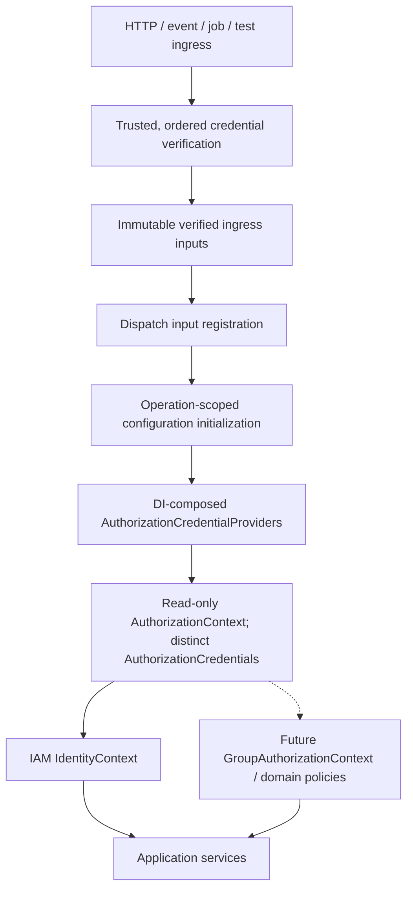

# P2.1.0 - Shared IAM security and claims foundation

**Status:** Draft specification for human review. The architectural direction was agreed in task discussion; the contracts and acceptance tests below still require the specification gate in the [AI development workflow](../../../development/ai-development-workflow.md). **Nothing described here is implemented by this document.**

## Goal and scope

Provide a trusted, operation-local security foundation for IAM and later issuer-qualified domain attestations. An inbound adapter establishes verified credential evidence; a small, reusable extension to the existing Spring operation scope transfers that evidence without enrolling caller-owned objects as beans. Operation-scoped claim providers assemble immutable, provenance-preserving evidence; application services obtain semantic identity and domain authorization from separate context-specific services.

This implements the [P2.1.0 backlog entry](../backlog.md), reconciles the [proposed claims design](../../../stack/claims-context-proposal.md) with the [security trust requirements](../../../stack/security.md), and preserves the [implemented DI lifetime contract](../../../architecture/dependency-injection.md) and [P2.0a published identity API](../p2.0a-identity-contract/specification.md). The [Phase 2 integration handoff](../../integration/phase-2-foundation.md) remains authoritative for IAM versus Group ownership.

P2.1.0 delivers:

- Immutable `Claim`, `ClaimOrigin` and `AuthorizationCredential` representations, provenance-preserving queries, an operation-scoped read-only `AuthorizationContext`, and DI-composed `AuthorizationCredentialProvider`s.
- Shared, source-agnostic signing and verification primitives for explicitly trusted JWT/JWS profiles, including IAM primary identity tokens and future separately issued attestations.
- An explicitly trusted ingress-to-operation-scope data path, using a **generic** input registry and ordered initializers targeted at operation-scoped configuration holders. The first production use is security evidence ingress, **not** arbitrary application-service initialization.
- An IAM-owned, operation-scoped production implementation of the existing published `IdentityContext` whose identity is derived only from valid primary IAM evidence.
- Fail-closed configuration, scope isolation, credential-verification and HTTP/operation-boundary integration tests.

P2.1.0 does **not** deliver login or account registration, credential/password storage, production user/session persistence, token refresh, cookie/CSRF login endpoints, authorization policies for Group or Finance, Group attestation issuance or an authoritative account/session-status query. Those belong to P2.1a/b/d, P2.2 and P2.5a/b as defined in the backlog. In particular, verified JWT validity alone does not establish current account eligibility or Group membership.

## Architectural solution and ownership

### Two-layer evidence and semantic-context model

The foundation distinguishes **source verification and evidence aggregation** from **domain semantics**:

The verification stage may be an HTTP/Spring Security filter chain or an equivalent non-HTTP adapter/pipeline. Credential processing does not depend on the operation having an HTTP request. The **trust boundary** is before a provider publishes evidence into the application-visible claims snapshot, not necessarily at one physical middleware class. Verification is not duplicated merely because both middleware and claim providers participate: providers may consume immutable verified results from an earlier trusted stage, or perform source-specific verification using shared JOSE infrastructure when appropriate.

The generic claims layer **does not evaluate business permissions**. It preserves verified evidence and its provenance. Semantic `<Concept>Context` services consume that evidence and, when applicable, authoritative context-owned state. `IdentityContext` is the first such consumer; `GroupAuthorizationContext` is an illustrative future Group-owned service, not a required interface or an inheritance base. Normal application services depend on semantic contexts, not JWT decoders, servlet request state, `SecurityContextHolder`, or arbitrary claim-name lookups.

### Module and published API boundaries

- `shared` owns reusable operation-input/initializer infrastructure (published through the existing `shared::di` named interface) and business-independent claims/JOSE contracts and implementation (with only intentionally published named interfaces). `shared` never imports IAM or Group classes. Do not make Spring-specific implementation packages public to work around module verification.
- `identity` owns its published `de.hsh.favs.sharewise.identity.IdentityContext`, IAM primary-identity claim interpretation, and the production adapter. Its existing closed-module `allowedDependencies` declaration changes only to whitelist the specific named shared interfaces actually used.
- A credential issuer or future domain authority owns its token profile and the semantics of the assertions it issues. The reusable JOSE layer owns validation mechanics and explicit trust configuration, not accounts, refresh sessions, groups or permissions.
- A future Group provider and binding policy are introduced by P2.5a; Group continues authorizing its own business mutations from its live membership/role state. Downstream consumers can interpret accepted attestations only via their domain-owned policy/context.
- The existing P2.0a test-only `IdentityContext` fixture remains explicitly imported in tests. It must never become an automatic production fallback or accidentally coexist as an ambiguous production bean.

### Operation input registration and initializer infrastructure

`OperationDispatcher` retains its existing `dispatch(Class<S>, Function<S,R>)` API and adds a conceptual overload accepting a pre-dispatch `Consumer<OperationInputRegistry>` plus the usual entry type and action. The precise Java signatures, ordering accessors and SPI names will be chosen during implementation review; the following **behavior** is fixed.

1. The dispatcher rejects nested business dispatch as it does today, then creates a **new input registry per invocation**. The supplied callback registers input instances under explicit `Class<T>` keys (`add(Class<T>, T)` and, where useful, a convenience overload for an implementation registered under an interface). Registration needs no Spring scope and may use the caller's own DI environment. Callbacks cannot access operation beans or control scope activation.
2. A key has **at most one instance** per dispatch; duplicate registrations, null keys and null instances are errors. Exact registered keys determine lookup; no implicit runtime-type search, type-assignability guessing, bean overrides or caller-owned instance lifecycle management. A runtime `Class<?>` registration overload may be provided with equivalent validation. Values are not made Spring beans.
3. The registry becomes read-only before initialization begins. It is private to this dispatch and cannot be accessed by application services as a service locator. An initializer receives the registered dependency as `Optional<D>`; **missing input is normal at the transport level** and is interpreted by that initializer. An explicitly invalid supplied credential must be rejected by its verifier/initializer, not turned into `Optional.empty()`.
4. The dispatcher creates one existing `ServiceScope` and invokes **initializers, configuration finalization and the entry-service action inside the same single-use `ServiceScope.run(...)` activation**. It discovers registered initializers through Spring, orders them by ascending signed integer priority (`Integer.MIN_VALUE` first), and resolves each initializer's declared non-null target service within the operation scope. Equal priorities convey **no dependency ordering**; any reproducible tie-breaking is an implementation detail, not an ordering contract.
5. An initializer targets a **designated operation-scoped configuration holder**, not a general application service. Multiple initializers may contribute to the *same* scoped configuration instance, each receiving its own optional typed input; the configuration rejects conflicting contributions instead of silently allowing last-writer-wins security state. Initializers are ordinary DI-managed Spring components; their service/dependency relationship and mapping rules are encapsulated in the initializer. Do not infer initializer generic arguments through fragile reflection; use explicit type tokens or a reviewed Java-idiomatic equivalent.
6. When all initializers complete, affected configurations validate their mandatory state and become logically **frozen before the entry service is constructed**. Before freezing, protected reads fail rather than return partially populated values; afterward, initialization or mutation is forbidden. No generic dependency-graph scheduler is required. An initializer must not resolve an application service that consumes not-yet-finalized configurations. Configurations that depend on a specific initialization ordering are responsible for the declared priorities; equal-priority initializers must be independent. The first use only needs a small lifecycle contract, not a configuration framework for all services.
7. The action resolves its entry service **after** successful initialization. Failure during registration, initialization, validation, resolution or execution aborts dispatch. When a scope exists, its normal destruction and suppressed-exception behavior applies. Failed registration before scope creation does not leak a scope. External objects remain caller-owned and are never disposed by the operation scope.

The source registry is a transient handoff; it is **not** a hidden mutable global, a child Spring context, an additional DI resolver or a generalized way to inject domain-specific state. Possession of a generic registry does not itself confer authority to fabricate authenticated evidence: production security inputs originate only from trusted verification entry points and their verification results must not be forgeable from untrusted request data or raw decoded claim maps. The trusted ingress bridge maps selected external information into a dedicated operation-scoped security configuration. That configuration must capture or accept an immutable verified snapshot; it cannot retain caller-mutable state that might later change identity or claim provenance. The implementation may copy/normalize accepted input, or require an immutable value contract for supported input types; caller mutation after registration or dispatch cannot change the frozen result. These safeguards apply even when the external caller is trusted to register an input.

Operation-scope ownership, Java 25 `ScopedValue` binding, lexical/thread confinement, concurrent isolation, single activation, destruction order and nested dispatch rejection remain unchanged. Initializers do **not** represent nested business operations or physical transaction segments. No physical transaction is opened by dispatch or by the generic claims context.

### Generic verified-claims model

| Concept | Contract |
| --- | --- |
| `Claim` | Immutable type, value and `ClaimOrigin`; each claim retains provenance even when queried or passed independently. Repeated kinds are permitted; no intrinsic permission evaluation. |
| `ClaimOrigin` | Immutable issuer, verified credential/profile identity and applicable audience, subject/token ID and validity metadata. Its construction does not itself establish trust. |
| `AuthorizationCredential` | Domain-level representation of one verified credential as an origin and immutable ordered claims. Construction rejects claims with mismatched origins (record value equality); repeated kinds and within-credential correlation are preserved. It is evidence, not a business authorization grant. |
| `AuthorizationCredentialProvider` | Spring DI-composed **operation-scoped** source of zero or more verified credentials. Dependencies arrive through ordinary constructor injection of scoped security configuration, verifiers or other provider contracts. Invalid supplied evidence throws; absence of an optional source may yield no sets. |
| `AuthorizationContext` | **Operation-scoped read-only snapshot** of provider outputs, built once per operation; `credentials()` returns distinct verified credentials and `find(...)` returns claims retaining their origin for inspection. No caller mutation, re-verification on access or implicit issuer-independent role union. |

Providers are resolved and invoked after security configuration initialization; each provider contributes once per operation snapshot. Invalid or contradictory primary evidence cannot be masked by another provider returning empty results. Provider ordering is constrained where there is a real trust dependency (primary IAM authentication before any subordinate attestation acceptance), not used to make an untrusted claim set temporarily visible to application consumers.

Queries are for **advanced inspection**. A lookup for issuer and claim type does not establish authorization: domain policies correlate issuer/profile, resource ID, permission and operation **within one qualifying credential**. A matching `Claim` carries its origin even when detached from the collection; domain policies must still correlate facts within a single `AuthorizationCredential`, since two credentials can have equal origin metadata. Claim-source validation and immutable copy semantics prevent a consumer from manufacturing a trusted source through a public registry or arbitrary string labels.

### Credential processing, trust and provider pipeline

Trusted credential handling is a **source-specific pipeline**. A primary IAM stage verifies primary identity credentials first. Future subordinate stages may inspect the prior verified primary identity, including `iss`, `sub` and stable session binding `sid`, and publish their claims **only if** all required cross-credential bindings hold. The pipeline can be composed as ordered HTTP middleware for HTTP ingress and as equivalent explicit verification stages for other ingress; it need not use one specific filter API or create a universal claim-processing framework.

This correlation is part of **source-specific credential validity for the current operation**, not business role authorization. It is permissible for an attestation verifier/provider to examine earlier authenticated identity evidence to enforce `principal_iss`, `sub` and `principal_sid`. Only after such matching is complete may it produce an application-visible `AuthorizationCredential`; a valid signature on an attestation bound to another session is insufficient. An unbound intermediate credential or decoded unverified payload is private to the verifier and **never** available through the public claims facade. A domain context decides later whether the accepted claim set authorizes a particular resource/operation; it does not supply the missing cryptographic/session trust check.

P2.1.0 implements primary IAM verification and reusable primitives/integration seams, **not** a production Group-attestation provider or Group-specific profile. P2.5a must implement and test subordinate binding before publishing Group attestations, using these same trust rules. The public claims facade has no bypass that returns intermediate, unbound data.

A primary credential profile requires, at minimum:

- Verified signature using an explicitly configured trusted authority/key, explicit allowed algorithm and key identity, and issuer/profile-specific verification; no accepting `alg=none`, arbitrary token-supplied key URLs or cross-issuer key substitution.
- Required `iss`, `sub`, `sid`, permitted `aud`, protected `typ`, required expiration and applicable issued/not-before times, and consistent, strictly parsed field types and identifiers. Required/not-required optional fields and skew are profile-configured; acceptance of missing required identity/session material fails closed.
- Time validation against an injectable clock with bounded configured leeway; key rotation allows explicitly trusted old/new verification keys during overlap and rejects removed keys.
- No accidental use of refresh tokens as access credentials or domain attestations as primary identity tokens; validation is tied to a configured **token profile**, not signature validity alone.

JOSE/JWT primitives cover both signing and verification, with configuration and negative tests for profile/key handling. The credential codec delegates JOSE signature handling to a trusted, algorithm-specific strategy, keeping key material and cryptographic configuration separate from credential claim/profile validation. The initial configured strategy uses ES256 with NIST P-256 keys; algorithm/key selection is never delegated to untrusted JWT headers. Use Spring Security OAuth2 Resource Server/JOSE primitives as specified in the [security design](../../../stack/security.md#request-routing-and-framework-integration), rather than custom cryptographic algorithms. Signing is infrastructure only here: IAM's actual login/session issuance workflow and token persistence arrive in P2.1a/b; later authorities own their issuance operations.

The ingress adapter must explicitly distinguish **no credential supplied**, **invalid credential supplied**, **verified primary credential**, and **trusted adapter/provider wiring failure**. An explicitly permitted anonymous operation may provide no primary claims. Invalid, expired, wrong-profile or unverifiable supplied credentials are rejected before a protected entry service executes, never downgraded to anonymous. A missing required verifier/provider or inconsistent trust configuration prevents authenticated operation; it is not interpreted as empty evidence. Optional subordinate evidence absent from an operation may be represented as no corresponding sets. Do not log tokens, signatures, private keys or sensitive credential material.

### Production current-identity adapter

`IdentityContext` remains **exactly the P2.0a published consumer contract**: `Optional<UUID> userId()`, `UUID requireUserId()` and `boolean isAuthenticated()`. The IAM-owned operation-scoped adapter consumes the immutable `AuthorizationContext` and selects exactly one valid primary IAM identity, identified by trusted issuer/profile provenance, not by an arbitrary `sub` claim elsewhere.

- One accepted primary identity yields a stable IAM `UUID` throughout the operation and across sequential physical transaction segments.
- No primary identity in an explicitly anonymous operation yields empty/false and the established `UnauthenticatedCallerException` from `requireUserId()`.
- Multiple incompatible primary identities, invalid identity/session structure, verification failures and missing required trusted wiring fail explicitly. They are not treated as anonymous or resolved by choosing the first claim.
- A valid primary identity is **not** an authoritative status check for a disabled/deleted account or revoked/expired server-side session, nor a Group membership or business authorization decision. P2.1d owns authoritative current state; token expiration bounds normal staleness as documented.

Normal Group consumers need no change to the identity API or a dedicated initializer. Domain authorization contexts in future slices likewise consume `AuthorizationContext` and domain-owned state through standard DI, rather than introducing their own dispatch inputs or mutable initialization APIs.

### HTTP and non-HTTP integration boundary

HTTP uses Spring Security as the enforcement/verification framework. This task establishes the minimal secure primary-bearer verification and dispatch bridge needed to demonstrate verified and rejected ingress, and tests it through an isolated HTTP/component fixture where feasible. It does **not** introduce login/refresh/logout endpoints, cookie/session-authenticated request flows, frontend token persistence, general controller authorization policy, or fully configured CSRF issuance. Those HTTP verticals have their own owning tasks.

A non-HTTP adapter must create a new operation and explicitly select its own verified input or permitted anonymous execution; it does not inherit the servlet security context, a previously dispatched identity or an initiating actor ID carried in an event. The adapter may reuse the same verifier/profile service without impersonating an HTTP request. An event's historical initiating-user field is ordinary event data, not a trusted current caller.

## Requirements and invariants

| ID | Requirement |
| --- | --- |
| **SF-01** | Each dispatch has exactly one independent typed input registry. Duplicate/null registrations fail; missing keys yield `Optional.empty()` to the relevant initializer. External instances never become Spring beans or acquire Spring lifetime ownership. |
| **SF-02** | Initializers are DI-composed and executed in ascending integer priority inside the **same** active operation scope as the action. A non-null operation-scoped configuration target is resolved through Spring, with one target instance reused across its initializers. Equal priority conveys no dependency order. |
| **SF-03** | Configuration state is validated/frozen before resolving the entry service. Early reads, mutation after freezing, wrong-scope targets and initialization faults fail safely. An initializers' missing input handling must not silently downgrade invalid credentials. |
| **SF-04** | Existing dispatch overload, single activation, owner-thread and concurrency rules, nested dispatch rejection, destruction, and exception suppression remain intact. Inputs, configurations, claim snapshots and identities do not leak between operations. |
| **SF-05** | `Claim`, `ClaimOrigin` and `AuthorizationCredential` are immutable. Every claim retains its origin; collection construction enforces matching origins; ordered/repeated claims and independent credentials are supported. |
| **SF-06** | `AuthorizationCredentialProvider`s are DI-managed in the operation scope; `AuthorizationContext` materializes a read-only, provenance-preserving snapshot from accepted sets once per operation, without business authorization or implicit cross-set claim merging. |
| **SF-07** | Source verification checks trusted issuer/keys, algorithm, profile/type, audience, lifetime and required fields. Invalid credentials cannot be accepted solely because a signature verifies or because another credential is valid. Signing and verification work with explicitly configured trusted key material and safe rotation behavior. |
| **SF-08** | Source-specific validation enforces applicable primary identity/session binding **before** subordinate claim sets become application-visible. Unbound, partially verified or malformed evidence is never exposed through `AuthorizationContext`; resource/permission meaning remains domain policy. |
| **SF-09** | Exactly one valid primary IAM principal, or explicit anonymous ingress, maps to the unchanged `IdentityContext` semantics. Wrong-profile, multiple/ambiguous, corrupt or missing-required-provider states fail closed, never become anonymous. |
| **SF-10** | `shared` has no IAM/Group dependency, Spring/security internals do not escape published named interfaces, and domain services need neither JWT/HTTP types nor raw claims inspection for ordinary authorization. |
| **SF-11** | Production identity wiring never falls back to P2.0a's test fixture. Verified identity and claims remain stable across transaction segments; no claims query performs hidden authoritative database lookup. |
| **SF-12** | The task introduces no IAM/Group business persistence, registration/login, cookie rotation, Group issuance or live membership authorization. Missing PostgreSQL/browser acceptance is reported rather than inferred from isolated security/DI tests. |

### Failure, concurrency and trust behavior

Registration input validation fails before scope creation when possible; any failure after creating the scope triggers its existing cleanup. An initializer can reject a missing required input, while another initializer may accept absence for an anonymous operation. Once an invalid credential has been observed, it is a rejection, not an absence. No initializer may publish a partially verified claim set to application code, and failure in a later provider prevents the context snapshot from being successfully exposed. A caller-supplied mutable object cannot alter an operation's established identity or claims after initialization.

JWT verification and token-profile selection are explicitly trust-configured. Issuer and `kid` are lookup selectors constrained to configured authorities/keys, not authorization derived from token input. Any unrecognized/ambiguous keys, unsupported algorithm/type, bad lifetime or missing mandatory principal fields fail verification. Invalid subordinate credentials cannot be silently ignored if they were supplied for a protected operation. An authenticated user may still be denied by a later domain policy, and a signed JWT may have bounded stale privileges; neither condition authorizes bypassing the trust checks.

No database or distributed transaction is established by the claims layer. Real cross-context business mutations, refresh-family races and authoritative IAM/Group status checks are outside this task.

## Acceptance tests and verification

Tests cover **observable architecture-critical behavior** rather than only unit-level method examples. The test naming/profile follows the [backend test guide](../../../development/tests.md); ordinary JUnit/component tests exercise the DI and cryptography foundation. HTTP integration tests use isolated Spring/MockMvc wiring rather than claiming a real login/session flow. Where production database behavior is not involved, PostgreSQL fixtures are unnecessary.

| ID | Setup, action | Required outcome / verification |
| --- | --- | --- |
| **SF-T01** | Dispatch with one typed input; two initializers targeting the same operation-scoped configuration at different priorities, including `Integer.MIN_VALUE`. | They receive the same non-null scoped target, run in ascending priority, and the entry service observes fully finalized state. |
| **SF-T02** | Dispatch without a registered optional input; resolve initializer target, then run the entry action. | The initializer receives `Optional.empty()` and applies its declared policy; service resolution is still mandatory. A required-input initializer rejects absence. |
| **SF-T03** | Attempt duplicate key, `null`, wrong type, late registration, or invalid singleton/prototype initializer target. | Explicit failure; no injected external bean, unresolved partially configured entry service or surviving state in a later dispatch. |
| **SF-T04** | Observe a configuration during initialization, mutate after freeze, or introduce conflicting writes/order-dependent equal-priority initializers. | Premature read/mutation and conflicting contributions rejected; equal-priority contributions succeed only when their relative order is immaterial. |
| **SF-T05** | Run sequential and parallel operations with different inputs; throw during initialization, entry resolution, action and destruction; try nested dispatch. | Independent configurations and identities; no leakage; existing lexical binding, nested-dispatch rejection, cleanup and primary/suppressed failure guarantees preserved. |
| **SF-T06** | Contribute multiple validated claim sets with duplicate claim kinds across issuers/resources and within one set; query by provenance. | The snapshot is immutable; results retain their originating set and cannot synthesize a combined cross-set permission. |
| **SF-T07** | Provide absent optional evidence, invalid provider result or provider exception; attempt snapshot access. | Absent optional source contributes no sets; failed source verification propagates, and no partially accepted snapshot is published. |
| **SF-T08** | Verify and sign representative IAM JWT fixtures with configured keys/profiles; rotate trusted verification keys. | Accepted fixtures preserve issuer/profile, stable UUID subject/session, audience and validity metadata; expected overlap keys verify, revoked/untrusted keys fail. |
| **SF-T09** | Supply bad signature, `alg=none`/disallowed algorithm, unknown key/issuer, unacceptable `typ`/`aud`, expired/too-early token, missing/malformed `sub`/`sid`, and substituted token profiles. | All rejected before becoming authenticated `AuthorizationCredential`s; token-supplied remote key references cannot establish trust. |
| **SF-T10** | Supply primary evidence for one IAM user/session and independently signed subordinate fixture evidence for another issuer/user/session, with and without valid matching bindings. | Contract-level pipeline test publishes matching bound subordinate sets only; mismatches and absence of a required primary principal fail before `AuthorizationContext` exposure. The real Group provider remains P2.5a. |
| **SF-T11** | Dispatch anonymous, authenticated and ambiguous-primary-credential operations; call all three `IdentityContext` accessors through separate constructor-injected consumers. | Anonymous yields empty/false/`UnauthenticatedCallerException`; authenticated yields one stable user; invalid/ambiguous identity fails, never falls back to anonymous or test identity. |
| **SF-T12** | Cross two stubbed transaction-segment boundaries within one operation; optionally repeat with physical PostgreSQL transactions in E2E when available. | Same immutable identity/evidence snapshot without a transaction-bound lookup; separate operations see independent state. Stubbed boundaries do not establish physical transaction guarantees. |
| **SF-T13** | Exercise a protected HTTP/component fixture with valid, missing, malformed, wrong-profile and expired bearer input. | Only verified primary input reaches dispatch as authenticated; invalid supplied credentials fail with the appropriate authentication response, not as an anonymous fallback or Group permission `403`. |
| **SF-T14** | Run Modulith verification and production bean-discovery tests, including negative fixtures for forbidden module internals and missing required trusted providers. | Correct named-interface whitelists; no `shared` to IAM import, insecure production default, test fixture scan or unverified principal source. |
| **SF-T15** | Use a non-HTTP ingress/test adapter that creates explicit anonymous or verified operations without a servlet context. | Same trusted input and identity rules; historical event actor/user values do not impersonate current authentication. |

**Human/operational acceptance:** Review the final public model, DI and issuer trust configuration; invoke a small HTTP/component demo with valid and rejected primary credentials; dispatch parallel anonymous/authenticated operations and confirm isolation. No browser login, real refresh cookie or Group attestation user journey exists yet, so those are **not** claimed as completed P2.1.0 acceptance. Stronger database-backed tests belong to the later IAM/session/group tasks.

## Dependencies, handoffs and deferred decisions

- **Required baselines:** Implemented P1.3a operation scope, P2.0a identity contract, P1.1 module verification, P1.4 HTTP/test foundations, existing Java 25/Spring Boot Maven build and test conventions.
- **Library selection and offline handoff:** The existing Maven-only bundle is sufficient for dependency-independent DI/claims work, but the current POM does not declare the Spring Security Resource Server/JOSE components required for JWT signing/verification. Select compatible managed dependencies, update the POM under a reviewed implementation phase, and **obtain a refreshed verified Maven dependency archive from the networked preparation environment** before claiming an offline JOSE build. Never substitute system caches or weaken dependency versions to hide a missing artifact.
- **P2.1a/b:** Implement actual primary JWT issuance during login, persisted IAM sessions, refresh/rotation, HTTP cookie/CSRF integration and client behavior using this foundation, subject to their own specifications and test gates.
- **P2.1d:** Implement authoritative current account/session eligibility separately; it must not be silently inferred from the signature/profile check performed here.
- **P2.5a/b:** Add real Group provider, attestation binding and domain policy, then actual issuance, independently verifying group/session scope; no attestation is usable without a current primary JWT. Review any earlier proposal language that places binding exclusively in domain policy: **credential-level principal/session binding is required before claims publication**, while business permission remains domain-owned.
- **Later extraction:** Keep ingress and token profile mechanisms transport-independent enough to preserve separate service trust boundaries; no distributed introspection endpoint, key-management service or universal policy engine is required here.

## Documentation reconciliation and review gates

The [implementation plan](plan.md) is derived from this specification but remains **provisional until this specification is explicitly approved**, as required by the AI workflow. After approval, the plan gets a separate human sequencing gate before implementation. Material changes to the trust boundary or DI lifecycle return to the specification gate.

The final implementation phase updates authoritative steady-state descriptions, particularly [operation-scoped DI](../../../architecture/dependency-injection.md), [security](../../../stack/security.md), [proposed claims model](../../../stack/claims-context-proposal.md), developer/testing guidance and the relevant Phase 2 handoff if contracts have changed. Current docs must not claim an unimplemented architecture already works. The task specification/plan remain review artifacts and do not replace steady-state documentation.
