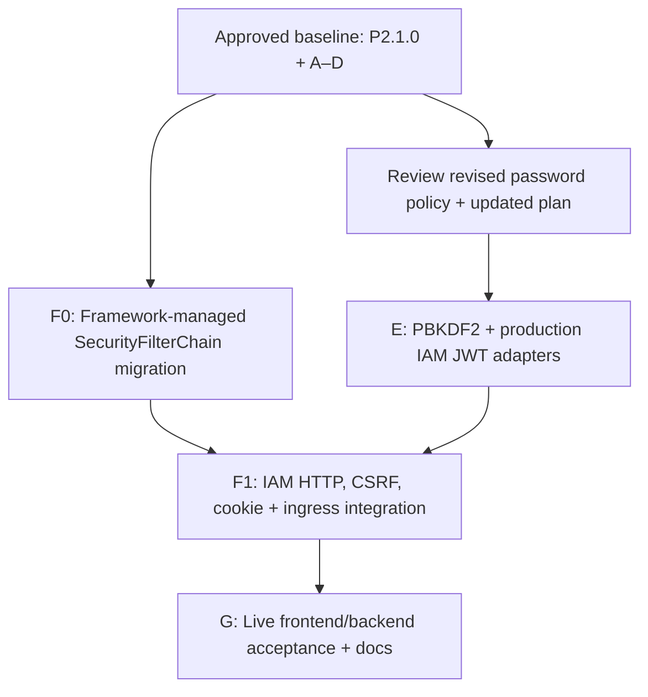

# P2.1a - Registration and initial authentication: implementation plan

**Status:** P2.1.0 and Phases A–D, E and F0 approved; F0 CI passed. Phase F1 HTTP/CSRF/cookie integration is under review, with physical PostgreSQL HTTP acceptance pending CI. Phase G live-browser acceptance remains open.

## Baseline, ownership and available validation

- The November 21, 2026 refreshed baseline includes P2.1.0's published claims, security and DI ingress contracts; the accepted Phase A–D workflows/frontend; Phase E's production PBKDF2 and trusted JWT issuance; and F0's ordered Spring-managed security chains. Phase F1 adds credential-entry HTTP, CSRF, Origin and refresh-cookie integration on top of that baseline.
- The stable offline Maven handoff targets **Spring Boot 4.2.0 / Spring Modulith 2.2.0**, Temurin JDK 25.0.5.1 and Maven 3.10.0. F0 CI is green and the required Spring Security starter is already present. The local F1 Unit/Modulith gate runs offline; physical PostgreSQL and browser acceptance remain separate CI/human gates.
- P2.1a owns account/credential/session state, transactional registration/login, **IAM-specific access-token issuance orchestration**, CSRF/cookie HTTP entry endpoints, and its frontend. P2.1.0 owns reusable shared JOSE/claims, the trusted ingress/operation-input bridge, and the unchanged production `IdentityContext`. P2.1b owns refresh/revocation/logout; P2.1d owns authoritative live identity/session eligibility; P2.4a/P2.2d own registration-event publication/projection. The [Phase 2 schema/integration handoff](../../integration/phase-2-foundation.md) is the IAM DDL reference.
- Follow `AGENTS.md`, repository documentation and engineering-quality skills, [backend test guidance](../../../development/tests.md) and [frontend guidance](../../../development/frontend.md). Keep each increment reviewable. Consume P2.1.0's actual published interfaces and the already-merged IAM Modulith allowlist; do not duplicate its JOSE/claims/ingress foundations or modify `IdentityContext`. Update production security-chain configuration only within the explicitly reviewed F0 increment, with no speculative dependency changes.

## Dependency-aware sequence

Phases A–E, F0 and the P2.1.0 foundation are accepted. F1 follows both reviewed prerequisites: production issuer/encoder beans and the framework-managed security chain. No unreviewed adapter or fake credential path may be exposed through live routes.

## Review and integration gates

- [x] **G0, architectural decisions:** Approve registration and duplicate-email disclosure, validation and password encoding/limits, lockout, access/session TTL, cookie+CSRF/Origin policy, and initial re-login/no-refresh UX. Agree that P2.1a's login/registration Web Lock implementation is extended, not duplicated, by P2.1b.
- [x] **G1, specification:** Approve [the specification](specification.md), IAM-A01–A14 and IAM-AT01–AT17. Material changes to trust or ownership return here.
- [x] **G2, sequence:** Approve this plan **separately after G1**, then commit and push both reviewed artifacts to the authoritative task branch before implementing dependent work. At this point A–D are authorized; **G3 is not a prerequisite for starting them**.
- [x] **G3, approved production integration baseline:** P2.1.0 and A–D are in the supplied source; actual shared published interfaces and IAM allowlist were inspected. Refreshed isolated Maven cache and baseline Unit/Modulith/package gate passed. P2.1.0's trust/profile source is authoritative; no draft SPI is assumed.
- [x] **G4, independent-phase test gates:** The user confirmed green PostgreSQL CI and approval for B/C and accepted Phase D frontend validation. These establish the earlier increments; **live HTTP/browser acceptance for F/G remains open** and cannot be replaced by the current Maven-only cache.
- [x] **G5, revised password policy and sequencing:** Review the [Phase E password policy](specification.md#account-and-credential-policies-revised-phase-e-contract), including 8–256 UTF-16 code units without normalization, PBKDF2-HMAC-SHA256 (600,000 iterations, 16-byte salt, 32-byte subkey), no hashing semaphore/blocklist or hash-upgrade support in the WIP branch, and the separate F0 prerequisite. Approved for the MVP with the revised 8-character minimum and 256-unit maximum; implement E and F0 as independently reviewed increments.

## Phase A - IAM domain policies, value contracts and test seams (independent)

**Scope (approved provisional implementation):** Implement `identity`-private account/session/refresh-token value types, immutable registration/login inputs and typed outcomes, email validation/canonicalization (including the ER's 256-character limits), the initial bcrypt-compatible password-length/byte-limit policy, lockout arithmetic and session idle/absolute deadline calculation. Define only the *narrow meaningful* credential-encoding and primary-access-token issuance boundaries required by IAM orchestration, without importing P2.1.0 claims/JOSE internals or inventing a public IAM authentication facade. Implement production-grade CSPRNG secret generation and SHA-256 verifier preparation using Java's standard cryptographic APIs; do **not** implement password hashing or JWT signing algorithms. Keep test entropy/time injection separate from production values.

- [x] Align typed models with `identity.users`, `sessions` and `refresh_tokens` in the [Phase 2 handoff](../../integration/phase-2-foundation.md); reserve stable UUID user/session IDs and the `<token-id>.<base64url(secret)>` secret format.
- [x] Add pure Unit tests for normalization, malformed/oversized inputs, password policy, deadline caps, lockout boundary and independent refresh secrets/verifier lengths. No Spring Security/JOSE dependency or production authentication bean is necessary.
- [x] Document which interfaces are IAM-internal test/integration seams; fakes must be explicitly test-only, never component-scanned in production.

**Gate A (approved):** Focused Unit and Modulith tests and human review passed. Its provisional password input policy is deliberately superseded by Phase E; all other accepted invariants remain.

## Phase B - IAM schema and persistence adapters (independent)

**Scope:** Add context-owned Flyway migrations for `identity.users`, `identity.sessions` and `identity.refresh_tokens`, including role privileges, FK and unique/check constraints, indexes and default UUIDv7 behavior; use narrow IAM-private SQL adapters. Do not introduce `identity.user_profiles` unless this registration slice actually uses it or a reviewed integration requires it (otherwise P2.1c), and do not install an event publication registry or write `groups.users`. Resolve the ER's `passwordHash` column to a deliberate SQL identifier. Preserve the ER's `natural0` database domain unless generator/driver testing demonstrates a concrete incompatibility. Avoid redundant indexes already covered by composite B-tree keys.

- [x] Implement canonical-email lookup, account insert, credential and account-state snapshot, serialized/conditional failed-login update, initial session and refresh-verifier insert; do not invent cross-context FKs or use generic repositories to bypass operation/transaction lifetime rules. Publish the existing shared jOOQ/transaction package contracts as **narrow Modulith named interfaces** if needed for IAM adapters/services, and declare only those direct dependencies in the IAM module allowlist. Cover the resulting actual dependency graph in module tests.
- [x] Generate the IAM-private jOOQ schema classes **from the fully Flyway-migrated PostgreSQL 18 `identity` schema** using the opt-in `jooq-codegen-identity` Maven profile and Spring Boot-managed jOOQ/plugin/driver versions. Commit the resulting generated Java sources so normal Maven compile/verify remains strictly offline, without a database or generator plugin. Remove the hand-written `AuthTables` descriptors and migrate all IAM adapters to generated `USERS`, `SESSIONS` and `REFRESH_TOKENS` fields. Verify generated Java types for `identity.natural0` before selecting any forced type; do not maintain a parallel manual schema model. The generator is opt-in and generated sources are checked in; ordinary offline builds need neither the generator nor a database. Regenerate from a fresh migrated database and compare source diffs to establish freshness/reproducibility before final acceptance.
- [x] Test real PostgreSQL 18 schema constraints (including `identity.natural0` domain mapping), app-role grants, duplicate-email races, session/token FK linkage, fixed 32-byte verifier check, partial-write rollback, and concurrent login-state writes. Use repository Integration/E2E fixtures, never H2 or unit mocks as proof of SQL or locking semantics.
- [x] Keep DDL and adapters isolated from `shared` claims/JOSE and Group Management; verify actual module dependency constraints.

**Gate B (approved):** Generated-schema adapters, source reproducibility and real PostgreSQL CI tests passed and received human approval.

## Phase C - Transactional registration/login application services (independent)

**Scope:** Compose IAM's operation-scoped registration/login services using the existing `Transactions` API, A's policies and narrow ports, and B's persistence. Use explicitly imported **test-only** password encoder and opaque token-issuer fixtures behind IAM-private seams. Production Spring `PasswordEncoder` and trusted JWT adapters are **not** added yet; no fixture token may be exposed through a production controller. Prepare the claimed session identity/token inside the operation and return releasable credentials only after confirmed transaction commit.

- [x] Registration validates and encodes credentials, inserts one account/session/unconsumed refresh verifier in one segment, and maps unique-key conflict to a typed duplicate outcome with no orphan writes. Preserve the no-event/no-Group-write boundary and pre-existing account reconciliation requirement.
- [x] Login uses a credential snapshot for expensive verification, then revalidates current credential/disabled/lockout state under database serialization before changing counters or creating a session. Failed known-user attempts commit their counter/lockout changes despite an authentication-denied result. Unknown users have comparable dummy-encoder work; no account/session is fabricated.
- [x] Unit tests cover decisions, counter and deadline edges, stale snapshots, fake-signer failure, failed/ambiguous commits, and no credential release before commit. PostgreSQL rollback-based Integration tests cover single-segment registration and adapter collaboration, pending SQL state and requested decisions; E2E proves physical rollback/commit, multi-segment login counters and lockout, concurrent races and stale credential revalidation. Neither test-only credential nor issuer fixture establishes production cryptographic validity.
- [x] Keep production component wiring fail-closed until E/F: do not add permissive Spring Security defaults, a fake `IdentityContext`, a placeholder production signer or a public login route to keep the application startup green.

**Gate C (approved):** Unit, rollback-based Integration and physical PostgreSQL E2E gates passed CI; transactional/concurrency behavior and the service diff received human approval. Production password/JWT adapter acceptance remains E.

## Phase D - Frontend registration/login UI against the agreed wire contract (independent)

**Scope:** Implement public `/auth/register` and `/auth/login` routes, accessible Mantine forms and styles, `core/identity` typed API adapter, CSRF bootstrap handling through the existing `lib/api` transport, and a small **in-memory-only** bearer state boundary. Use mock HTTP responses conforming to the approved `GET /api/iam/v1/auth/csrf` and `POST /api/iam/v1/auth/{register,login}` contracts, not a standalone Next.js login backend. Handle initial no-refresh/reload/expired-token states visibly; no fake refresh, logout or local/session storage bearer. Define initial same-origin exclusive Web Lock and per-tab single-flight coordination for register/login cookie mutations; P2.1b extends the same boundary.

- [x] Reuse the shared theme/design system in a minimal authentication shell, domain-facing `core/identity` and existing API hooks; no parallel fetch client, global styling framework or Next.js route handlers for authentication.
- [x] Cover form validation, `ProblemDetail` mapping, CSRF token acquisition **inside** the lock, duplicate/denied/expired/error states, single-flight/multi-tab or missing Web Locks behavior, no credential logging and proper focus/keyboard/mobile treatment.
- [x] Run lint, application/test typecheck, Vitest, Next.js build/static-export check and accessibility tests using a **supplied verified Node/npm offline handoff**; mock-only results do not establish actual CSRF/cookie, HTTP or browser acceptance.

**Gate D (approved):** Frontend changes, mock-API tests and applicable tooling checks were reviewed and accepted. The provisional bcrypt-specific form validation is replaced in E, before the real HTTP/browser gate G.

## Phase E - Production IAM credential and JWT adapters (requires G5 approval)

**Scope:** Implement the [approved-after-G5 PBKDF2 policy](specification.md#account-and-credential-policies-revised-phase-e-contract) and production `CredentialEncoder` using Spring Security's `PasswordEncoder`, plus an IAM-owned primary access-token issuer backed by **P2.1.0's actual shared JOSE signer and trusted primary profile**. Replace Phase A/D's provisional 12-character/72-byte validation in backend and frontend together. Configure trusted issuer/audience/type/keys and preserve the `sid` link to the committed session. No second decoder, claims pipeline, trusted ingress configuration or `IdentityContext` is created.

- [x] Use the implemented P2.1.0 named interfaces and `identity` allowlist. Use Spring Security PBKDF2 and the JDK provider without adding a password-specific cryptography dependency; rebuild strictly offline; dependency handoff optimization is managed separately.
- [x] Encode new credentials with PBKDF2-HMAC-SHA256, 600,000 iterations, 16-byte random salt and 32-byte subkey; test the fixed hex salt/subkey format, full-input verification without normalization, 8/256-code-unit boundaries, malformed Unicode, no bcrypt 72-byte limit, dummy-hash parity and rejection of incompatible formats. No hash-upgrade-on-login feature is needed for the WIP branch. Update frontend client-side validation and feedback in the same reviewed increment.
- [x] Validate the fixed stored-hash format and benchmark PBKDF2 CPU cost under concurrent load; external rate limiting/capacity planning remain important before public exposure. Do not add an in-process semaphore to the MVP.
- [x] Verify profile-bound production signing, required `iss`, `aud`, protected `typ`, UUID `sub`/`sid`, times and signer/configuration failures. Round-trip IAM-issued JWTs through P2.1.0's verifier and deny wrong-profile/issuer/key/time claims; valid JWT alone does not establish current session eligibility.
- [x] Verify production DI never discovers test fakes and no crypto/provider configuration weakens P2.1.0's trust/fail-closed guarantees.

**Gate E (approved; IAM-A02, A07, A10, A14; IAM-AT03/05/10/17 portions):** Production PBKDF2 encode/verify and fixed-format-validation tests, synchronized backend/frontend input policy, real signed-token round trips and negative trust/configuration tests pass. Review POM, offline cache, provider, module APIs and signing profile; fixtures are not acceptance evidence for production adapters.

## Phase F0 - Framework-managed Spring Security HTTP chains (independently reviewable prerequisite)

**Scope:** Replace P2.1.0's manually assembled `FilterChainProxy` with framework-managed **ordered `SecurityFilterChain` beans**. Add required Spring Security configuration/Boot artifacts in a reviewed POM change and refresh the offline Maven cache. Do not add registration/login/CSRF handlers in this increment.

- [x] Preserve verified bearer admission and fail-closed invalid bearer behavior, including profile, expiry, missing trust and oversized-token failures; missing bearer remains anonymous only where explicitly permitted.
- [x] Confirm exactly one intended Spring Security servlet proxy registration, deterministic filter-chain ordering and no duplicate/competing bearer or servlet filters. Retain existing `/api` routing, operation-input contributors and unchanged `IdentityContext`.
- [x] Add MockMvc/full-context tests for registered filter order, anonymous/protected request behavior, malformed bearer rejection and operation-dispatch identity continuity. Re-run P2.1.0's security regression suite.

**Gate F0 (approved):** The ordered servlet security-chain migration and regression tests passed CI and human review before the F1 credential-entry implementation.

## Phase F1 - IAM HTTP, cookie/CSRF and operation-scope integration (requires E and F0)

**Scope:** Add `GET /api/iam/v1/auth/csrf`, `POST /api/iam/v1/auth/register` and `POST /api/iam/v1/auth/login` controllers/response mapping. Integrate anonymous credential entry through the **actual** P2.1.0 operation dispatch/ingress boundary. Extend its Spring Security HTTP configuration only at reviewed extension points, with CSRF token machinery, Origin checks, protected refresh-cookie issuance, primary bearer checks on other endpoints and RFC 9457 `ProblemDetail` failures. Login/register do not require an `IdentityContext` principal; an **invalid supplied bearer** is never silently downgraded to anonymous. The refresh cookie alone does not authenticate a bearer-only API call.

- [ ] Return `201` registration / `200` login only after confirmed transaction commit, with JSON access token and `__Host-`-prefixed `Secure`, `HttpOnly`, `SameSite=Strict`, host-only/path-`/` refresh cookie; enforce session-deadline Max-Age cap. Denials do not emit tokens/cookies or leak account status; error bodies and CSRF bootstrap are non-cacheable.
- [ ] Validate Spring Security `CookieCsrfTokenRepository`, token/header processing and masked tokens, Origin rejection, anonymous route policy, protected-route bearer versus cookie handling, clock/profile and `IdentityContext` behavior; do not invent a separate request scope or modify P2.1.0's initializer machinery.
- [ ] MockMvc/component tests cover all status/headers/cookie/CSRF cases; real PostgreSQL HTTP E2E verifies no writes on rejected requests, committed success and transaction failures. Re-run the P2.1.0 security/DI regression suite and module verification.

**Gate F1 (open; IAM-A03–A10, A13–A14; IAM-AT01/05/09–13/17 portions):** Human security-boundary review plus passing relevant HTTP/component, Modulith and physical PostgreSQL tests. Negative invalid-input and missing-trust tests are mandatory, not deferred to browser-only acceptance.

## Phase G - Live frontend integration, regression and steady-state documentation

- [ ] Connect D's UI to real F1 endpoints and run keyboard/mobile/light-dark/cross-tab flows; verify CSRF refresh after login, Web Lock failure policy, cookie scope, in-memory access token, reload/expiry re-login, and honest absence of refresh/logout functionality. Human performs the real browser acceptance; jsdom-only tests are insufficient.
- [ ] Run backend Unit, Integration and E2E with PostgreSQL 18; frontend lint/typecheck/Vitest/build/static export; module boundary verification, relative-link checks and `git diff --check`. Trace IAM-A01–A14 and IAM-AT01–AT17 to real evidence rather than assuming a single green suite covers all.
- [ ] Verify no real `UserRegistered` delivery or Group projection is assumed, and record a bootstrap/reconciliation handoff for accounts created before P2.4a/P2.2d listener registration. Confirm P2.1b can consume initial unconsumed refresh-token records and reuse D's browser coordination boundary.
- [ ] Reconcile implemented state into [security](../../../stack/security.md), [Phase 2 integration/schema handoff](../../integration/phase-2-foundation.md), [application architecture](../../../architecture.md), [persistence/transactions](../../../architecture/persistence.md), [frontend architecture](../../../architecture/frontend.md), [frontend development guide](../../../development/frontend.md), [developer/test guidance](../../../development.md), and task references as needed. Never present P2.1b refresh, P2.1d eligibility, or P2.4a event delivery as implemented.
- [ ] Produce the complete final review patch and independent code review; record missing infrastructure gates, human manual acceptance and final merge approval separately. Do not update the backlog checkbox or merge until final authorization.

**Gate G (all requirements/acceptance IDs):** Approved implementation increments, reconciled system docs, verified end-to-end security and database behavior, human browser acceptance and independent review. All outstanding limitations are recorded before merge authorization.

## Baseline and review discipline

- Start each remaining increment from the **current post-P2.1.0, post-Phase-F0 approved baseline**, not from the November 20 pre-foundation snapshot. Preserve accepted Phase A–D behavior except the expressly superseded password policy. Produce incremental patches with commit subjects prefixed `P2.1a:`.
- Never replace published P2.1.0 contracts or move authentication semantics into `shared`. Phase E changes IAM credential/token adapters and synchronized frontend validation; F0 changes the framework-managed chain and dependency descriptor; F1 integrates HTTP/CSRF/cookies. Keep these reviews separable and revalidate their shared entry points.
- Each gate requires the corresponding CI or real infrastructure evidence. Prefer rollback-owned Integration tests for repository composition and use disposable E2E databases only when physical commits, cross-segment state or races are part of the UUT. A revised policy/plan does not authorize implementing later phases before human review.
