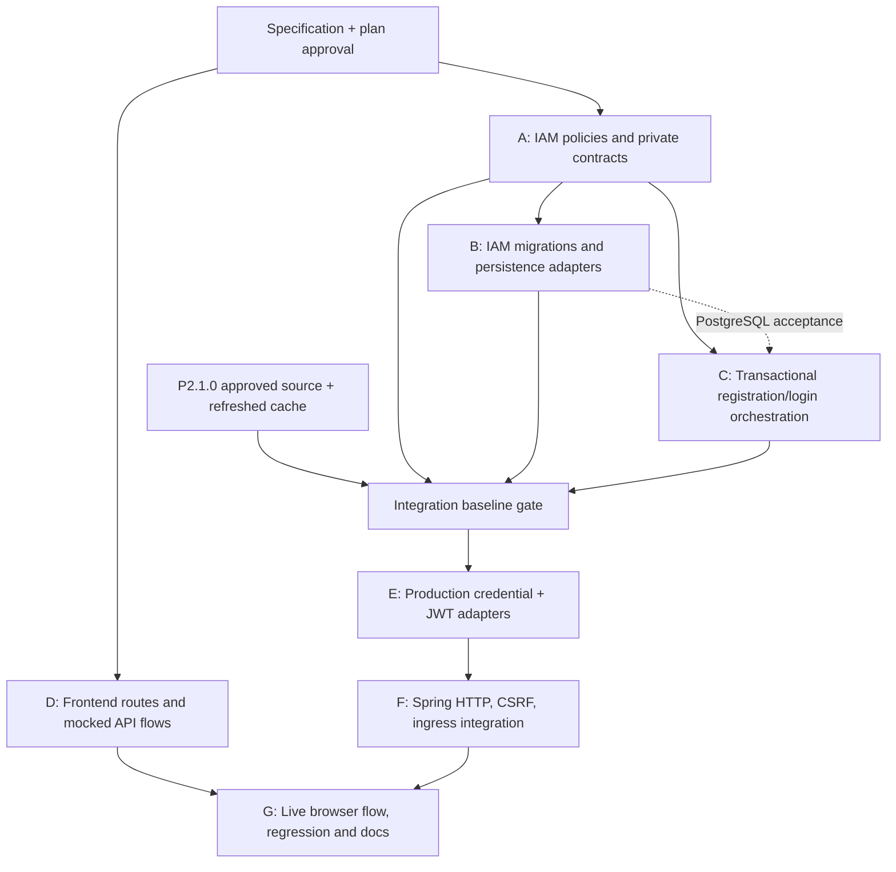

# P2.1a - Registration and initial authentication: implementation plan

**Status:** Approved P2.1a specification and implementation sequence (November 20, 2026); individual implementation increments still require human review. Reconciled against the supplied **draft** P2.1.0 specification/plan. **Phases A–D may start on the November 20 baseline before P2.1.0 finishes**; production security integration is gated separately.

## Baseline, ownership and available validation

- The supplied November 20, 2026 source snapshot contains P2.0a's published `identity.IdentityContext`, `OperationDispatcher`/operation scope, `Transactions`, existing Flyway namespaces, API `ProblemDetail` handling, and Next.js/Mantine/API-client foundations. It contains **no** IAM accounts, sessions, registration/login HTTP routes or production authentication. P2.1.0 is a separate in-progress branch; its draft SPI names and implementation details are not yet authoritative code.
- The available **Maven-only** offline handoff contains Temurin JDK 25.0.5.1, Maven 3.10.0 and the matching backend cache. The unchanged baseline's strict-offline Unit gate previously passed (122 tests, no failures, jar built). Real PostgreSQL Integration/E2E and frontend Node/npm checks **have not** been validated in this environment. P2.1.0 anticipates new Spring Security Resource Server/JOSE dependencies and a refreshed Maven archive; do not silently resolve them online or from host caches.
- P2.1a owns account/credential/session state, transactional registration/login, **IAM-specific access-token issuance orchestration**, CSRF/cookie HTTP entry endpoints, and its frontend. P2.1.0 owns reusable shared JOSE/claims, the trusted ingress/operation-input bridge, and the unchanged production `IdentityContext`. P2.1b owns refresh/revocation/logout; P2.1d owns authoritative live identity/session eligibility; P2.4a/P2.2d own registration-event publication/projection. The [Phase 2 schema/integration handoff](../../integration/phase-2-foundation.md) is the IAM DDL reference.
- Follow `AGENTS.md`, repository documentation and engineering-quality skills, and [backend test guidance](../../../development/tests.md) / [frontend guidance](../../../development/frontend.md). Keep each increment on a reviewable task branch/patch; no approved baseline changes before human acceptance. Avoid speculative changes to `shared::di`, claims/JOSE internals, security filter chains, `IdentityContext` and `pom.xml` until the integration gate. The **one limited shared-contract exception** is that the current baseline's public `Transactions` and `JooqAccess` package APIs lack `@NamedInterface`, and `identity/package-info.java` has no allowed dependencies. B/C may need to publish the existing shared ports (not recreate them) and make a narrow reviewed IAM allowlist change, which must be reconciled with P2.1.0's later whitelist edits.

## Dependency-aware sequence

**A–D are pre-P2.1.0 work.** A is an independent prerequisite for B/C; D can proceed from the approved wire contract without B/C or P2.1.0. C may use isolated persistence doubles while B's PostgreSQL tests are unavailable, but **cannot be accepted as proving durable/concurrent behavior** until the physical database gates pass. Every phase still ends in a human review gate; independent tracks do not waive review of their own increments. Only E–G require P2.1.0. Keep normal build/test green for each applicable increment, without substituting fake security into production wiring.

## Review and integration gates

- [x] **G0, architectural decisions:** Approve registration and duplicate-email disclosure, validation and password encoding/limits, lockout, access/session TTL, cookie+CSRF/Origin policy, and initial re-login/no-refresh UX. Agree that P2.1a's login/registration Web Lock implementation is extended, not duplicated, by P2.1b.
- [x] **G1, specification:** Approve [the specification](specification.md), IAM-A01–A14 and IAM-AT01–AT17. Material changes to trust or ownership return here.
- [x] **G2, sequence:** Approve this plan **separately after G1**, then commit and push both reviewed artifacts to the authoritative task branch before implementing dependent work. At this point A–D are authorized; **G3 is not a prerequisite for starting them**.
- [ ] **G3, production integration baseline (after P2.1.0):** Receive the updated **approved** snapshot and final P2.1.0 code/spec/tests. Replay/rebase the reviewed independent P2.1a increments onto it without absorbing or overwriting in-progress P2.1.0 work. Inspect actual `shared::di`/JOSE/claims exports, IAM's production `IdentityContext`, credential/HTTP boundary, module whitelists and new dependency descriptors. Validate the **unchanged new baseline** with a verified refreshed offline Maven cache before E/F edits. Confirm the selected token profile and fail-closed configuration. If contracts differ materially, revise G1/G2 first.
- [ ] **G4, infrastructure gates:** Obtain a real PostgreSQL 18 test fixture for B/C/F database acceptance and a compatible Node 24/npm cache for D/G frontend acceptance. These are **separate** from G3. If unavailable, report which evidence is outstanding; do not mark those phases fully accepted or substitute mocks for database/browser guarantees.

## Phase A - IAM domain policies, value contracts and test seams (independent)

**Scope:** Implement `identity`-private account/session/refresh-token value types, immutable registration/login inputs and typed outcomes, email validation/canonicalization (including the ER's 256-character limits), password length/byte-limit policy, lockout arithmetic and session idle/absolute deadline calculation. Define only the *narrow meaningful* credential-encoding and primary-access-token issuance boundaries required by IAM orchestration, without importing P2.1.0 claims/JOSE internals or inventing a public IAM authentication facade. Implement production-grade CSPRNG secret generation and SHA-256 verifier preparation using Java's standard cryptographic APIs; do **not** implement password hashing or JWT signing algorithms. Keep test entropy/time injection separate from production values.

- [ ] Align typed models with `identity.users`, `sessions` and `refresh_tokens` in the [Phase 2 handoff](../../integration/phase-2-foundation.md); reserve stable UUID user/session IDs and the `<token-id>.<base64url(secret)>` secret format.
- [ ] Add pure Unit tests for normalization, malformed/oversized inputs, password policy, deadline caps, lockout boundary and independent refresh secrets/verifier lengths. No Spring Security/JOSE dependency or production authentication bean is necessary.
- [ ] Document which interfaces are IAM-internal test/integration seams; fakes must be explicitly test-only, never component-scanned in production.

**Gate A (IAM-A01–A02, A05, A08, A14; IAM-AT03/17 portions):** Focused Unit and baseline Modulith tests pass strictly offline; human reviews policy, type and secret-handling invariants. This increment requires neither P2.1.0 nor PostgreSQL/Node.

## Phase B - IAM schema and persistence adapters (independent)

**Scope:** Add context-owned Flyway migrations for `identity.users`, `identity.sessions` and `identity.refresh_tokens`, including role privileges, FK and unique/check constraints, indexes and default UUIDv7 behavior; use narrow IAM-private SQL adapters. Do not introduce `identity.user_profiles` unless this registration slice actually uses it or a reviewed integration requires it (otherwise P2.1c), and do not install an event publication registry or write `groups.users`. Resolve the ER's `passwordHash` column to a deliberate SQL identifier. Avoid redundant indexes already covered by composite B-tree keys.

- [ ] Implement canonical-email lookup, account insert, credential and account-state snapshot, serialized/conditional failed-login update, initial session and refresh-verifier insert; do not invent cross-context FKs or use generic repositories to bypass operation/transaction lifetime rules. Publish the existing shared jOOQ/transaction package contracts as **narrow Modulith named interfaces** if needed for IAM adapters/services, and declare only those direct dependencies in the IAM module allowlist. Cover the resulting actual dependency graph in module tests.
- [ ] Test real PostgreSQL 18 schema constraints, app-role grants, duplicate-email races, session/token FK linkage, fixed 32-byte verifier check, partial-write rollback, and concurrent login-state writes. Use repository Integration/E2E fixtures, never H2 or unit mocks as proof of SQL or locking semantics.
- [ ] Keep DDL and adapters isolated from `shared` claims/JOSE and Group Management; verify actual module dependency constraints.

**Gate B (IAM-A01, A03–A05, A08, A12; IAM-AT02/07/09/16 portions):** Reviewed schema/adapter diff plus passing real PostgreSQL tests. Without PostgreSQL, the patch can be prepared and reviewed, but **database acceptance stays open**; unrelated independent frontend/domain work may still proceed.

## Phase C - Transactional registration/login application services (independent)

**Scope:** Compose IAM's operation-scoped registration/login services using the existing `Transactions` API, A's policies and narrow ports, and B's persistence. Use explicitly imported **test-only** password encoder and opaque token-issuer fixtures behind IAM-private seams. Production Spring `PasswordEncoder` and trusted JWT adapters are **not** added yet; no fixture token may be exposed through a production controller. Prepare the claimed session identity/token inside the operation and return releasable credentials only after confirmed transaction commit.

- [ ] Registration validates and encodes credentials, inserts one account/session/unconsumed refresh verifier in one segment, and maps unique-key conflict to a typed duplicate outcome with no orphan writes. Preserve the no-event/no-Group-write boundary and pre-existing account reconciliation requirement.
- [ ] Login uses a credential snapshot for expensive verification, then revalidates current credential/disabled/lockout state under database serialization before changing counters or creating a session. Failed known-user attempts commit their counter/lockout changes despite an authentication-denied result. Unknown users have comparable dummy-encoder work; no account/session is fabricated.
- [ ] Unit tests cover decisions, counter and deadline edges, stale snapshots, fake-signer failure, failed/ambiguous commits, and no credential release before commit. PostgreSQL E2E later proves races, counters, lockout and rollback; fake ports only demonstrate orchestration, not persistence or cryptographic validity.
- [ ] Keep production component wiring fail-closed until E/F: do not add permissive Spring Security defaults, a fake `IdentityContext`, a placeholder production signer or a public login route to keep the application startup green.

**Gate C (IAM-A03–A08, A12–A14; IAM-AT01/04–09/17 portions):** Unit tests and architecture checks pass, with a reviewed transactional service diff. Actual concurrency/commit guarantees remain **unaccepted** until B/C's PostgreSQL E2E also passes. P2.1.0 is not required.

## Phase D - Frontend registration/login UI against the agreed wire contract (independent)

**Scope:** Implement public `/register` and `/login` routes, accessible Mantine forms and styles, `core/identity` typed API adapter, CSRF bootstrap handling through the existing `lib/api` transport, and a small **in-memory-only** bearer state boundary. Use mock HTTP responses conforming to the approved `GET /api/iam/v1/csrf` and `POST /api/iam/v1/auth/{register,login}` contracts, not a standalone Next.js login backend. Handle initial no-refresh/reload/expired-token states visibly; no fake refresh, logout or local/session storage bearer. Define initial same-origin exclusive Web Lock and per-tab single-flight coordination for register/login cookie mutations; P2.1b extends the same boundary.

- [ ] Reuse the public AppShell and design system, domain-facing `core/identity` and existing API hooks; no parallel fetch client, global styling framework or Next.js route handlers for authentication.
- [ ] Cover form validation, `ProblemDetail` mapping, CSRF token acquisition **inside** the lock, duplicate/denied/expired/error states, single-flight/multi-tab or missing Web Locks behavior, no credential logging and proper focus/keyboard/mobile treatment.
- [ ] Run lint, application/test typecheck, Vitest, Next.js build/static-export check and accessibility tests using a **supplied verified Node/npm offline handoff**; mock-only results do not establish actual CSRF/cookie, HTTP or browser acceptance.

**Gate D (IAM-A09, A11, A13–A14; IAM-AT14/15/17 portions):** Human reviews frontend diff and independent mock tests; all available frontend checks pass. A missing Node/npm cache is a **toolchain blocker for accepting D**, not a dependency on P2.1.0. This phase can be worked on concurrently with B/C after the approved HTTP contract.

## Phase E - Production IAM credential and JWT adapters (requires G3)

**Scope:** After the completed P2.1.0 baseline, supply the real Spring Security `PasswordEncoder` configuration and IAM-owned primary token issuer backed by **P2.1.0's shared JOSE signer and trusted primary profile**. Select explicit hashing parameters and key/issuer/audience/type/lifetime configuration. The IAM operation creates the claims tied to the persisted `identity.sessions.id` (`sid`), rather than delegating account/session decisions to `shared`. No second decoder, claims pipeline, trusted ingress configuration or `IdentityContext` is created.

- [ ] Reconcile and use actual P2.1.0 published interfaces and module `allowedDependencies`; do not assume pseudocode signatures from its draft. Refresh isolated Maven dependencies as required, and rebuild strictly offline.
- [ ] Verify adaptive encoding and encoded-password compatibility, profile-bound production signing, required `iss`, `aud`, protected `typ`, UUID `sub`/`sid`, times and signer/configuration failures. Round-trip actual IAM-issued JWTs through P2.1.0's trusted verifier; assert wrong-profile/issuer/key/time claims fail and a valid JWT is not mistaken for authoritative session eligibility.
- [ ] Verify no test fake is discovered in the production Spring context and no new crypto/provider configuration weakens P2.1.0's trust/fail-closed guarantees.

**Gate E (IAM-A02, A07, A10, A14; IAM-AT10/17 portions):** Real signing, verification and encoder tests pass using the refreshed offline cache; review POM, module API and key/profile configuration. Production adapters are not accepted using only test fixture tokens.

## Phase F - IAM HTTP, cookie/CSRF and operation-scope integration (requires E)

**Scope:** Add `GET /api/iam/v1/csrf`, `POST /api/iam/v1/auth/register` and `POST /api/iam/v1/auth/login` controllers/response mapping. Integrate anonymous credential entry through the **actual** P2.1.0 operation dispatch/ingress boundary. Extend its Spring Security HTTP configuration only at reviewed extension points, with CSRF token machinery, Origin checks, protected refresh-cookie issuance, primary bearer checks on other endpoints and RFC 9457 `ProblemDetail` failures. Login/register do not require an `IdentityContext` principal; an **invalid supplied bearer** is never silently downgraded to anonymous. The refresh cookie alone does not authenticate a bearer-only API call.

- [ ] Return `201` registration / `200` login only after confirmed transaction commit, with JSON access token and `__Host-`-prefixed `Secure`, `HttpOnly`, `SameSite=Lax`, host-only/path-`/` refresh cookie; enforce session-deadline Max-Age cap. Denials do not emit tokens/cookies or leak account status; error bodies and CSRF bootstrap are non-cacheable.
- [ ] Validate Spring Security `CookieCsrfTokenRepository`, token/header processing and masked tokens, Origin rejection, anonymous route policy, protected-route bearer versus cookie handling, clock/profile and `IdentityContext` behavior; do not invent a separate request scope or modify P2.1.0's initializer machinery.
- [ ] MockMvc/component tests cover all status/headers/cookie/CSRF cases; real PostgreSQL HTTP E2E verifies no writes on rejected requests, committed success and transaction failures. Re-run the P2.1.0 security/DI regression suite and module verification.

**Gate F (IAM-A03–A10, A13–A14; IAM-AT01/05/09–13/17 portions):** Human security-boundary review plus passing relevant HTTP/component, Modulith and physical PostgreSQL tests. Negative invalid-input and missing-trust tests are mandatory, not deferred to browser-only acceptance.

## Phase G - Live frontend integration, regression and steady-state documentation

- [ ] Connect D's UI to real F endpoints and run keyboard/mobile/light-dark/cross-tab flows; verify CSRF refresh after login, Web Lock failure policy, cookie scope, in-memory access token, reload/expiry re-login, and honest absence of refresh/logout functionality. Human performs the real browser acceptance; jsdom-only tests are insufficient.
- [ ] Run backend Unit, Integration and E2E with PostgreSQL 18; frontend lint/typecheck/Vitest/build/static export; module boundary verification, relative-link checks and `git diff --check`. Trace IAM-A01–A14 and IAM-AT01–AT17 to real evidence rather than assuming a single green suite covers all.
- [ ] Verify no real `UserRegistered` delivery or Group projection is assumed, and record a bootstrap/reconciliation handoff for accounts created before P2.4a/P2.2d listener registration. Confirm P2.1b can consume initial unconsumed refresh-token records and reuse D's browser coordination boundary.
- [ ] Reconcile implemented state into [security](../../../stack/security.md), [Phase 2 integration/schema handoff](../../integration/phase-2-foundation.md), [application architecture](../../../architecture.md), [persistence/transactions](../../../architecture/persistence.md), [frontend architecture](../../../architecture/frontend.md), [frontend development guide](../../../development/frontend.md), [developer/test guidance](../../../development.md), and task references as needed. Never present P2.1b refresh, P2.1d eligibility, or P2.4a event delivery as implemented.
- [ ] Produce the complete final review patch and independent code review; record missing infrastructure gates, human manual acceptance and final merge approval separately. Do not update the backlog checkbox or merge until final authorization.

**Gate G (all requirements/acceptance IDs):** Approved implementation increments, reconciled system docs, verified end-to-end security and database behavior, human browser acceptance and independent review. All outstanding limitations are recorded before merge authorization.

## Rebase and conflict discipline

- Keep the existing November 20 **main** snapshot unchanged as the approved local baseline. Prepare each independent increment in an isolated feature branch or a reviewed/stacked series derived from that baseline. Do not merge P2.1.0's WIP branch or rewrite its files. Once the approved P2.1.0 baseline is delivered, carry approved P2.1a commits/patches forward, check their application/conflicts and revalidate the result before production integration.
- **Avoid before G3:** `src/backend/sharewise/pom.xml`, `shared/infra/di/**`, shared JOSE/claims packages, the main `identity/IdentityContext.java`, shared Spring Security/filter-chain configuration and cross-module HTTP wiring. **Permitted reviewed overlap:** narrowly adding `@NamedInterface` for pre-existing shared transaction/jOOQ access ports and adding their actual names to `identity/package-info.java`'s allowlist. P2.1.0 may independently edit the IAM allowlist, so preserve/union both sets during G3; do not overwrite either side. Scope early work primarily to new `identity` feature internals, IAM migrations/adapters and frontend `core/identity` plus public auth routes.
- A conflict in IAM module package configuration, Spring Security or POM must be **resolved against P2.1.0's implemented contract**, not overridden by a guessed P2.1a version. The IAM allowlist union is likely mechanical; changing shared DI/claims or token-profile contracts is not. If an early P2.1a change needs a P2.1.0-owned API, defer that change to E/F or return for review. Frontend and database prerequisites are separate from this merge conflict risk.
- Each checked phase requires its own reviewed diff and appropriate passing evidence. A stalled PostgreSQL/Node acceptance gate cannot be represented as complete, although genuinely independent stages may continue. Material specification changes go back through G1/G2; final code, test and docs review remains distinct from approval of a plan.
