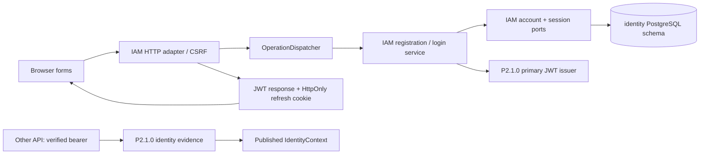

# P2.1a - Registration and initial authentication

**Status:** Draft for architecture and specification review. This document proposes the target state; no P2.1a feature implementation is approved or present in the supplied baseline. Its P2.1.0 integration contracts must be checked against the updated, reviewed security-foundation baseline before implementation.

## Goal and scope

A person can create a ShareWise account, or authenticate with an existing account, through the browser. A successful operation establishes a **durable IAM login session**, issues a short-lived **primary IAM access JWT**, and stores an opaque initial refresh credential in a secure browser cookie. IAM persists account and session state in its own PostgreSQL schema. This slice demonstrates first authentication; it does **not** implement refresh rotation, authoritative session introspection, or logout.

The authoritative constraints are the [security architecture](../../../stack/security.md), [Phase 2 IAM/Group data handoff](../../integration/phase-2-foundation.md), [operation and transaction architectures](../../../architecture.md), [P2.0a identity contract](../p2.0a-identity-contract/specification.md), and [Phase 2 backlog](../backlog.md). [P2.1.0](../backlog.md#p21---iam-vertical-slices) owns verified-token/claim infrastructure and operation-scope ingress; P2.1a consumes it without redefining its shared contracts.

### Included

- IAM-owned registration, password-verifier storage, case-insensitive account lookup, password login, persisted failed-login counters and timed lockout.
- Initial `identity.users`, `identity.sessions` and `identity.refresh_tokens` schema, constraints and IAM-private persistence adapters; session and refresh-token creation during successful registration/login.
- Primary JWT issuance through P2.1.0's trusted signing interface, browser refresh-cookie issuance, Spring Security request policy, anonymous CSRF bootstrap and protected registration/login HTTP entry points.
- Accessible registration and login screens, a small browser-only authentication state boundary, and integration with the existing frontend API client, same-origin `/api/*` routing and visual design.
- Unit, HTTP/component, real-PostgreSQL Integration/E2E and browser acceptance tests for the properties below.

### Excluded

- Refresh endpoint, refresh-family **rotation/reuse handling**, expiry extension, refresh cleanup, server-side logout and cross-tab renewal. These belong to **P2.1b**, which must preserve the records issued here.
- Password changes/recovery, profile editing, account disablement UI, session listings and other credential invalidation (**P2.1c**); authoritative current-state eligibility queries (**P2.1d**); permanent deletion policy (**P2.1e**).
- Actual `UserRegistered` delivery, Spring Modulith publication registry and Group projection integration (**P2.4a/P2.2d**); existing registrations require explicit future initialization/reconciliation. No implicit Group table writes or cross-context foreign keys.
- Group-specific roles/permissions, attestations, shared claims/provider implementation, or replacement of P2.0a's `IdentityContext` (**P2.1.0/P2.5**).
- Email ownership verification, invitation acceptance and password-reset mail delivery. Their product policy requires separate review before public registration is exposed beyond the controlled MVP setting.
- A claim of production-ready abuse protection or deployment. Edge/network-level credential throttling and reverse-proxy trust must be accepted with the deployment path (P2.6); account-level lockout is nevertheless required here.

## Architectural solution

### Context ownership and contracts

`identity` owns account credentials, user IDs, session IDs and refresh-token records. IAM's published `IdentityContext` remains the semantic read interface to an already authenticated caller; registration and password login are *anonymous credential entry* operations and must **not** assume an existing `IdentityContext` principal. IAM application services are DI-managed, operation-scoped entry services with immutable request/result values; HTTP controllers dispatch those services through the existing `OperationDispatcher`.

Authentication services depend on IAM-owned account/session ports, the existing `Transactions` API, Spring Security password-encoding primitives, a time source and P2.1.0's **trusted primary-token issuance** contract. PostgreSQL and Spring Security implementations remain internal adapters. No application/domain API receives servlet requests, cookies, `SecurityContextHolder`, `Jwt` objects or JPA entities. `identity` explicitly lists only its required named `shared` dependencies in `allowedDependencies`. There is no new generic authentication facade if a cohesive service suffices.

P2.1.0 must supply the validated primary token profile (`iss`, `aud`, access-token `typ`, `sub`, stable `sid`, timestamps and key/algorithm trust), verification and HTTP-to-operation-scope binding for protected API requests. P2.1a signs using that **same** profile and sets the authentication HTTP entry policy; it does not implement another JWT encoder, claims aggregation or scope-input bridge. The real `IdentityContext` derives from the verified primary IAM evidence furnished by P2.1.0. Integration with its actual published APIs is a prerequisite, not an invitation to modify its in-progress branch speculatively.

### Account and credential policies (proposed values)

Registration accepts `email` and `password`; no display name is required. Trim surrounding whitespace on the email, retain the trimmed presentation value, and compute `normalized_email` by lowercasing with `Locale.ROOT` (the exact equivalence rule, not unrestricted Unicode case folding). Do not apply provider-specific plus-address/dot rules or silently transform passwords. Reject malformed, whitespace/control-containing or oversized email addresses and enforce the ER's **256-character** limits on both forms. `normalized_email` has a PostgreSQL unique constraint; application-side duplicate checks are only UX hints, never the uniqueness authority.

Credential hashing uses Spring Security's `PasswordEncoder` with an explicitly configured, version-identifiable adaptive encoding (initial proposal: **bcrypt cost 12**). The encoder is the sole source of password verification. The initial policy proposes at least **12 characters** and no more than **72 UTF-8 bytes** when bcrypt is selected, so accepted passwords are never silently truncated. Plaintext passwords and encoded hashes never appear in responses or logs; only the initial access JWT is returned in a successful JSON body and the refresh credential in a successful `Set-Cookie` header. Neither bearer value may enter logs, exceptions or analytics. An implementation change to Argon2 or different input limits requires a reviewed policy decision and a compatible offline dependency handoff.

No email verification is part of this task. A successful registration signs the new account in immediately. A duplicate canonical email is rejected without overwriting or modifying any existing user. The API's `409 email_unavailable` exposes address availability, a product/security trade-off that must be explicitly accepted before the specification gate; login responses themselves are enumeration-resistant.

### Transactions, time and concurrency

An accepted registration commits **one account, one session and one initially unconsumed refresh-token record** in a single physical `Transactions.execute(...)` segment. A unique-email race produces exactly one account and no session/orphan token for rejected attempts. Password hashing and validation can happen before the segment. Generate the refresh secret with a CSPRNG, store only its 32-byte SHA-256 verifier, and follow the ER's `<token-id>.<base64url(secret)>` cookie format. The UUID record ID is a selector, not the bearer proof. Generate and prepare the access JWT before the transaction returns, but expose either credential to HTTP only after `Transactions` confirms commit. An unknown commit outcome is never reported as successful; the UI can recover by attempting a fresh login rather than blindly replaying registration.

A login checks one canonical account and verifies its encoded password through Spring Security. It serializes the decision and state update for that account in PostgreSQL (row lock or equivalently proven conditional-update protocol), rechecking disablement, lockout and credential state under the lock. Password verification should not hold a long-running row lock: when verified against an earlier credential snapshot, the final transaction rejects a changed credential rather than issuing a session based on stale evidence. A correct password creates the session/refresh record and resets failed-attempt state in the **same** committed segment. An incorrect password for a known account commits the increment and possibly `locked_until`, while returning an authentication failure. **Do not roll back the intended failure counters.** Unknown accounts follow the same generic API denial and a comparable dummy-hash verification path without generating a session.

The proposed configurable lockout is **five failed attempts followed by a 15-minute lock**; an elapsed lock starts a new counter window and a successful login clears counters/lockout. Locked, disabled, unknown and incorrect credentials all receive the same generic `401` message and no session or access token. Concurrency tests must show no lost increments, no double session issuance by one rejected request and no successful login during an active lockout. Lockout may intentionally restrict a legitimate user's ability to authenticate; deployment-level throttling is needed to control deliberate lockout abuse.

The proposed lifetimes are **5 minutes** for the access JWT, **7 days** idle expiry and **30 days** fixed absolute expiry for refresh sessions, all configurable with tested invariants. Use one injected clock/instant for each issuance decision. Persist `identity.sessions.id` as the stable `sid` (UUIDv7 per the ER); it is non-secret and survives future refresh rotation. The initial refresh cookie expiration must not exceed the earlier of idle and absolute deadlines. Login and registration do not validate Group membership or write Group state.

### HTTP and browser boundary

All endpoints live under `/api/iam/v1` and produce the established RFC 9457 `ProblemDetail` shape on failure. The proposed contract is:

| Method and path | Input and success | Security and failure semantics |
| --- | --- | --- |
| `GET /csrf` | Non-cacheable JSON `{ "token": "..." }` plus the CSRF cookie | Anonymous, safe, same-origin bootstrap; protected cookie flags are mandatory. |
| `POST /auth/register` | `{ "email", "password" }` → `201` with `{ "accessToken", "tokenType", "expiresAt" }` and refresh cookie | Anonymous but CSRF- and Origin-protected; `400` validation or `409 email_unavailable`, no credentials on failure. |
| `POST /auth/login` | `{ "email", "password" }` → `200` with the same access response and new refresh cookie | Anonymous but CSRF- and Origin-protected; generic `401` for any authentication denial; no credentials on failure. |

The CSRF flow follows [the security design](../../../stack/security.md#credentials-sessions-and-refresh): Spring Security `CookieCsrfTokenRepository` with a host-prefixed, `Secure`, `HttpOnly`, path-`/`, host-only cookie; a non-cacheable token returned in the bootstrap body and submitted in its corresponding header. The Spring CSRF filter and request handler must verify the pair, including actual masked-token behavior. Registration/login are protected even though they are anonymous. Origin validation rejects untrusted cross-origin state-changing requests; a missing/invalid Origin is handled conservatively under an explicit tested policy. No endpoint authenticates the bearer API from the refresh cookie alone. Successful login/registration invalidates previous CSRF state, so the browser bootstraps a fresh token before any later protected request. Disable caching of token and authentication responses and preserve correct `Vary`/cookie behavior behind the local API rewrite and production reverse proxy.

The refresh cookie is `__Host-`-prefixed, `Secure`, `HttpOnly`, `SameSite=Lax`, host-only and `Path=/`, with `Max-Age` capped by the session deadline. The cookie value is never returned in JSON or exposed to JavaScript. A wrong or missing CSRF token never mutates persistent account/session state. An HTTP error or cookie/response write failure after a confirmed commit cannot undo the commit; clients use an ordinary login recovery path. Never log an authentication response body or `Set-Cookie` value.

The frontend adds `/register` and `/login` routes in the public shell, using Mantine and local SCSS Modules, and replaces appropriate public CTA links with real navigation. The browser's domain-specific IAM adapter lives in `core/identity/` and consumes `lib/api/`; one small client-side authentication boundary keeps the access JWT **only in memory**, attaches it to bearer requests and clears it when expired. The existing `createApiClient` hooks are extended/used, not replaced. Until P2.1b implements refresh, a reload/new tab/expired token requires login again; **do not simulate refresh, persist JWTs, or claim a functional logout**. The application shell remains a visual foundation, and all backend-protected operations must enforce their own authorization regardless of client-side route behavior.

Because registration and login both alter the site's shared refresh cookie, their browser workflows acquire the security architecture's exclusive same-origin Web Lock, with per-tab single-flight, and obtain the CSRF token **inside** that lock. Failure or unsupported lock acquisition never triggers an unlocked credential mutation. Form validation, server error announcements, keyboard focus and small-screen layouts must follow the established frontend design and accessibility conventions.

## Requirements and invariants

| ID | Testable requirement |
| --- | --- |
| **IAM-A01** | Canonically equal emails identify one account, enforced by a unique PostgreSQL constraint and the same normalization rule on registration and login. |
| **IAM-A02** | Passwords are accepted only under the reviewed policy, encoded/verified through Spring Security and never stored or logged in plaintext. |
| **IAM-A03** | Successful registration creates an account, session and one valid initial refresh verifier atomically; duplicate/invalid registration leaves no new state. |
| **IAM-A04** | Successful login creates a new durable session, preserves one initial unconsumed refresh record and clears any failed-login state atomically. |
| **IAM-A05** | Incorrect-password updates and threshold lockout survive denied login; concurrency cannot lose updates or bypass an active lock. |
| **IAM-A06** | Anonymous/disabled/unknown/locked/bad credentials never receive access tokens or cookies; login denials are indistinguishable at the HTTP contract level. |
| **IAM-A07** | Issued primary JWTs use P2.1.0's verified `iss`/`aud`/`typ`/`sub`/`sid`/time profile; only committed sessions produce released credentials. |
| **IAM-A08** | Refresh secrets are cryptographically random and stored only as fixed-length verifiers; the cookie is confidential, correctly scoped, and capped by session deadlines. |
| **IAM-A09** | Browser credential mutations require valid CSRF/Origin controls, with no database changes on their failure; bearer APIs ignore refresh cookies as authentication. |
| **IAM-A10** | Current IAM caller resolution remains P2.0a's operation-scoped semantic `IdentityContext`; Group consumers and `shared` never depend on IAM internals. |
| **IAM-A11** | The browser retains access JWTs only in memory and uses the shared API client; no fake refresh/logout lifecycle is presented. |
| **IAM-A12** | No cross-context direct writes, user-projection assumptions or retrospective event publication occur in this slice. |
| **IAM-A13** | All externally visible errors use appropriate HTTP statuses and ShareWise `ProblemDetail` codes without exposing credentials, whether failures are expected or operational. |

## Acceptance tests

The scenarios below specify essential behavior. Implementation additionally provides focused boundary, validation, key/issuer and technical regression tests as needed. PostgreSQL tests must use the real database and the repository's Unit / Integration / E2E conventions.

| ID | Setup and action | Expected result / evidence | Gate |
| --- | --- | --- | --- |
| **IAM-AT01** | Register with a valid new email/password; query persisted state and inspect HTTP response. | One user, one session, one unconsumed token verifier; `201`, valid primary JWT and properly scoped cookie. | PostgreSQL E2E + HTTP |
| **IAM-AT02** | Register concurrently with canonical-equivalent emails, including mixed case/whitespace. | Exactly one committed user and initial session; other attempt rejects, with no orphan records. | PostgreSQL E2E |
| **IAM-AT03** | Register malformed/oversized email and invalid/oversized password; attempt duplicate. | Typed validation/duplicate failure; no unintended writes, no sensitive echo. | Unit + HTTP + PostgreSQL |
| **IAM-AT04** | Login with valid credentials; inspect DB before/after. | Fresh `sid`, corresponding refresh record, password counters reset, correct JWT profile. | PostgreSQL E2E |
| **IAM-AT05** | Login with wrong, unknown, disabled and locked identities. | Same generic `401`; no token/cookie; unknown user gets comparable credential-check work. | Unit + HTTP |
| **IAM-AT06** | Cause repeated failed logins, then attempt correct login before and after lock expiry. | Failed counters commit; active lock denies; after expiry, valid login succeeds and resets lockout. | PostgreSQL E2E with controlled time |
| **IAM-AT07** | Run concurrent wrong-password attempts at the lock threshold and a concurrent valid login. | No lost counter changes or bypass after an active lock is committed; outcomes match a valid serialization order, verified with controlled barriers. | PostgreSQL E2E |
| **IAM-AT08** | Change/disable account between credential snapshot verification and final session transaction. | No session is issued from stale evidence; retry is safe. | PostgreSQL E2E |
| **IAM-AT09** | Trigger account/session/token write failure or rollback before commit. | No successful credential response, partial account/session/token state or leaked secret. | PostgreSQL E2E + HTTP |
| **IAM-AT10** | Verify primary access token with the P2.1.0 verifier; mutate issuer, audience, token type, sid/time or signature in test credentials. | Issued token accepted; corrupted/wrong-profile token denied, without anonymous fallback. | Component/HTTP with security foundation |
| **IAM-AT11** | POST without CSRF pair, with mismatched pair, with invalid Origin and with valid pair; examine database. | Invalid cases denied before mutation; valid same-origin flow works; `/csrf` response non-cacheable. | HTTP + PostgreSQL |
| **IAM-AT12** | Inspect `Set-Cookie`, including initial Max-Age and `sid` correspondence; try using cookie without bearer on a protected endpoint. | Exact security attributes/deadline cap; refresh secret absent from JSON; cookie alone never authenticates. | HTTP + PostgreSQL |
| **IAM-AT13** | Dispatch protected operations with valid/invalid primary JWTs concurrently. | Same verified caller across an operation; no identity leakage between scopes; invalid evidence fails closed. | Component/HTTP + module verification |
| **IAM-AT14** | Use registration/login UI with real HTTP, keyboard only and small/mobile widths; reload and open another tab. | Accessible error/success navigation and initial authenticated flow; token stays in tab memory, reload/new tab demands login until P2.1b. | Frontend tests + human browser acceptance |
| **IAM-AT15** | Trigger simultaneous login/register actions from tabs and force an unavailable Web Locks API. | Cookie-changing actions are serialized; unavailable locking never silently falls back to concurrent mutation. | Frontend/browser |
| **IAM-AT16** | Inspect schema, module graph and registration path for cross-context access or event assumptions. | Only `identity` business tables are written; Group remains untouched; no unimplemented durable publication claim. | PostgreSQL + architecture review |

## Decisions requiring approval and coordination

1. **Registration UX and account enumeration:** This draft chooses immediate sign-in and a duplicate-email `409`. A non-enumerating registration process or required email verification changes both the HTTP contract and registration flow; settle it before implementation.
2. **Credential and lockout policy:** Confirm email canonicalization and proposed bcrypt/length, five-failure/15-minute lock and 5-minute/7-day/30-day lifetimes. These are explicit proposals, not inherited requirements. Password verification must not silently truncate accepted input.
3. **Throttling and deployment exposure:** Durable account lockout is included; source/edge throttling for unknown accounts and deliberate lockout abuse needs a production gate with P2.6. Decide whether an additional server-side per-source limiter is needed in this slice before any external exposure.
4. **P2.1.0 integration:** After its reviewed baseline arrives, reconcile the actual signing/verified-identity and request/CSRF extension contracts, module dependency whitelist and POM. No duplicate claim/security infrastructure is authorized by this draft.
5. **Pre-refresh UX:** The initial cookie is intentionally not usable by a browser renewal operation yet. Approve explicit re-login on page reload/expiry, with no misleading “log out” action before P2.1b.

## Documentation reconciliation

After implementation and review, update the **existing** IAM/security, Phase 2 integration/schema, frontend, developer and test documents to describe the implemented behavior and any accepted limitations. This task document remains a review artifact, not the steady-state architecture authority. Any accepted change to the design above first updates this specification and its dependent implementation plan.
