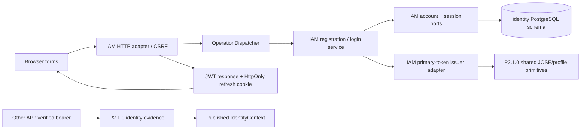

# P2.1a - Registration and initial authentication

**Status:** P2.1.0 and P2.1a Phases A–E, F0 and F1 are approved; the maintainer confirmed green PostgreSQL/real-servlet F1 CI on November 21, 2026. Phase G live HTTPS browser acceptance, frontend checks, documentation reconciliation and final independent review remain open.

## Goal and scope

A person can create a ShareWise account, or authenticate with an existing account, through the browser. A successful operation establishes a **durable IAM login session**, issues a short-lived **primary IAM access JWT**, and stores an opaque initial refresh credential in a secure browser cookie. IAM persists account and session state in its own PostgreSQL schema. This slice demonstrates first authentication; it does **not** implement refresh rotation, authoritative session introspection, or logout.

The authoritative constraints are the [security architecture](../../../stack/security.md), [Phase 2 IAM/Group data handoff](../../integration/phase-2-foundation.md), [operation and transaction architectures](../../../architecture.md), [P2.0a identity contract](../p2.0a-identity-contract/specification.md), and [Phase 2 backlog](../backlog.md). [P2.1.0](../backlog.md#p21---iam-vertical-slices) owns verified-token/claim infrastructure and operation-scope ingress; P2.1a consumes it without redefining its shared contracts.

### Included

- IAM-owned registration, password-verifier storage, case-insensitive account lookup, password login, persisted failed-login counters and timed lockout.
- Initial `identity.users`, `identity.sessions` and `identity.refresh_tokens` schema, constraints and IAM-private persistence adapters; session and refresh-token creation during successful registration/login.
- IAM-owned primary access-token issuance **using** P2.1.0's implemented shared JWT/JWS signing and trusted-profile infrastructure; browser refresh-cookie issuance, Spring Security request policy, anonymous CSRF bootstrap and registration/login HTTP entry points. All production JWTs must be verifiable through the same reviewed primary profile.
- Accessible registration and login screens, a small browser-only authentication state boundary, and integration with the existing frontend API client, same-origin `/api/*` routing and visual design.
- Unit, HTTP/component, real-PostgreSQL Integration/E2E and browser acceptance tests for the properties below.

### Excluded

- Refresh endpoint, refresh-family **rotation/reuse handling**, expiry extension, refresh cleanup, server-side logout and cross-tab renewal. These belong to **P2.1b**, which must preserve the records issued here.
- Password changes/recovery, profile editing, account disablement UI, session listings and other credential invalidation (**P2.1c**); authoritative current-state eligibility queries (**P2.1d**); permanent deletion policy (**P2.1e**).
- Actual `UserRegistered` delivery, Spring Modulith publication registry and Group projection integration (**P2.4a/P2.2d**); existing registrations require explicit future initialization/reconciliation. No implicit Group table writes or cross-context foreign keys.
- Group-specific roles/permissions or attestations, shared claim types/providers/context, security-input registry or initializers, and replacement of P2.0a's `IdentityContext` (**P2.1.0/P2.5**).
- Email ownership verification, invitation acceptance and password-reset mail delivery. Their product policy requires separate review before public registration is exposed beyond the controlled MVP setting.
- A claim of production-ready abuse protection or deployment. Edge/network-level credential throttling and reverse-proxy trust must be accepted with the deployment path (P2.6); account-level lockout is nevertheless required here.

## Architectural solution

### Context ownership and contracts

`identity` owns account credentials, user IDs, session IDs, refresh-token records and the **business operation that issues an initial primary IAM access JWT**. IAM's published `IdentityContext` remains the semantic read interface to an already authenticated caller; registration and password login are *anonymous credential entry* operations and must **not** assume an existing `IdentityContext` principal. IAM application services are DI-managed, operation-scoped entry services with immutable request/result values; HTTP controllers dispatch those services through `OperationDispatcher`. The P2.1.0 ingress bridge explicitly establishes verified evidence or permitted anonymous execution before entry-service resolution. Supplying an invalid credential must never silently turn into anonymous execution.

Authentication services depend on IAM-owned account/session ports, the existing `Transactions` API, an IAM-private credential-encoding boundary, an IAM-private initial-access-token issuance boundary, and a time source. The production adapters use Spring Security `PasswordEncoder` and P2.1.0's **shared, source-agnostic JOSE signing primitives**, respectively. The IAM issuer chooses and signs the primary account/session claims; the shared component is not an IAM login service. The jOOQ adapter uses **generated schema types from the actual Flyway-migrated PostgreSQL 18 database**, in accordance with the database-first persistence plan; no manually maintained `DSL.table`/`DSL.field` schema mirror remains. Generated Java sources are kept in source control for ordinary offline compilation, and a reproducible opt-in generator configuration is reviewed alongside the migration. The ER's `natural0` counter is a PostgreSQL domain in the IAM schema unless a verified mapping problem requires an approved deviation. PostgreSQL and Spring Security/JOSE implementations remain internal adapters. No application/domain API receives servlet requests, cookies, `SecurityContextHolder`, Spring `Jwt` objects or JPA entities. `identity` explicitly lists only the *actually consumed* named `shared` interfaces in `allowedDependencies`. The baseline publishes `shared::transactions`, `shared::jooq`, `shared::claims`, `shared::di`, `shared::security`, `shared::web` and `shared::result` as needed by IAM, with the corresponding explicit `identity` module allowlist. Keep future dependencies limited to those actually consumed. The opt-in IAM jOOQ code-generation profile and committed generated sources are already in place; normal offline builds do not need a database or generator plugin.

P2.1.0 supplies the shared trusted primary-token profile and validation (`iss`, `aud`, protected access-token `typ`, strictly typed UUID `sub` and stable `sid`, validity times, explicit signing/verification keys and permitted algorithms), trusted HTTP-to-operation-scope binding, immutable `AuthorizationContext`, and the IAM-owned **production implementation of the unchanged** `IdentityContext`. P2.1a uses the shared signing/profile facilities to issue corresponding tokens and configures the registration/login/CSRF HTTP entry policy. It does not implement a second JWT codec, claims aggregation, security configuration initializer, or dispatch-input registry. P2.1.0's verified primary evidence alone is **not** a fresh account/session-state query; authoritative eligibility is P2.1d. Group consumers continue using the published semantic identity contract without changes.

P2.1.0's published `JwtCredentialCodec`, `JwtCredentialProfile`, `JwtIssueRequest`, signing service and verified ingress/operation-input bridge are implemented. P2.1a's account/session orchestration, mock-backed frontend and opt-in production `CredentialEncoder`/`AccessTokenIssuer` adapters are implemented, and Phase F1 now adds conditionally enabled registration/login/CSRF HTTP routes. The shared JWT codec, admission and operation-initialization machinery remains authoritative; test-only issuers and encoders cannot be production-discovered fallbacks. Ordered `SecurityFilterChain` beans provide bearer ingress, and F1 adds cookie/CSRF and Origin checks before dispatch. Physical PostgreSQL HTTP verification passed the F1 CI gate; live browser acceptance remains a separate Phase G gate.

### Implementation and remaining integration boundaries

| Boundary | Current state | Remaining P2.1a responsibility |
| --- | --- | --- |
| IAM account/session policy, Flyway migrations, generated jOOQ adapters and transactional workflows | Phases A–C approved; PostgreSQL CI accepted; Phase E credential/JWT adapters reviewed | Wire the approved application services into HTTP without changing transaction and commit semantics |
| Public register/login forms, `core/identity` API adapter, in-memory bearer state and Web Locks | Phase D approved; revised password-length validation implemented in E | Verify the live browser/HTTP flow in G |
| Shared claims, JOSE, verified bearer admission, operation ingress and `IdentityContext` | P2.1.0 completed and approved; IAM signing adapter implemented in E | Provision trusted IAM keys/profile for deployment without introducing another codec or ingress system |
| HTTP security, anonymous CSRF entry and refresh-cookie issuance | Framework-managed API bearer chain and public fallback in F0; no registration/login routes | Finish F0 verification/review, then implement controllers, CSRF/Origin and cookie behavior in F1 |

The IAM encoder/issuer ports remain **private implementation seams**, with test implementations explicitly imported only in tests. Existing successful backend/CI and frontend gates establish the independent phases, not production credential issuance or live browser acceptance. An incomplete production adapter must fail closed rather than fabricate a token or silently activate test credentials.

### Account and credential policies (revised Phase E contract)

Registration accepts `email` and `password`; no display name is required. Trim surrounding whitespace on the email, retain the trimmed presentation value, and compute `normalized_email` by lowercasing with `Locale.ROOT` (the exact equivalence rule, not unrestricted Unicode case folding). Do not apply provider-specific plus-address/dot rules or make undocumented password transformations. Reject malformed, whitespace/control-containing or oversized email addresses and enforce the ER's **256-character** limits on both forms. `normalized_email` has a PostgreSQL unique constraint; application-side duplicate checks are only UX hints, never the uniqueness authority.

Phase E uses **PBKDF2-HMAC-SHA256** through Spring Security's `Pbkdf2PasswordEncoder`, backed by Java's standard cryptographic provider without a separate password-hashing library. Pin **600,000 iterations, a CSPRNG-generated 16-byte (128-bit) salt and a 32-byte (256-bit) derived key**. The Spring encoder stores lowercase hexadecimal `salt || derived key` (96 characters) using a fixed profile; malformed, incompatible and foreign credential formats must be rejected before verification. Use that same work factor for new passwords, real verification and unknown-account dummy verification. This intentionally follows the current OWASP PBKDF2-HMAC-SHA256 recommendation instead of copying ASP.NET Core Identity V3's older 100,000-iteration HMAC-SHA512 profile. This WIP branch requires neither multi-profile verification nor hash-upgrade-on-login support. There are no existing production password hashes to migrate.

The revised **registration** length policy is **8–256 UTF-16 code units**, using Java `String.length()` and JavaScript `string.length` without Unicode normalization or a UTF-8 byte limit. Keep passwords exactly as supplied, including case, whitespace and combining marks; never trim, normalize or truncate them. Pass the exact string to Spring Security's PBKDF2 encoder, which delegates to the JDK password-based key derivation API. Reject unpaired UTF-16 surrogates to prevent lossy encoding; otherwise impose no character-composition restrictions. Login accepts shorter existing passwords, but uses the same maximum and well-formed-input checks. The frontend and backend must enforce the same limits; HTTP applies a separate reasonable request-body limit.

The MVP does **not** implement a common-password blocklist or application-level semaphore/admission limit for hashing. PBKDF2 is CPU-hard, not memory-hard; benchmark the 600,000-iteration profile under expected concurrent login load. Edge request/rate limiting and capacity planning remain deployment concerns before public Internet exposure. Reject unsupported stored-hash representations; the fixed Spring profile has no embedded cost fields or upgrade/rehash mechanism in this WIP branch.

Plaintext passwords and encoded hashes never appear in responses or logs; only the initial access JWT is returned in a successful JSON body and the refresh credential in a successful `Set-Cookie` header. Neither bearer value may enter logs, exceptions or analytics. This **documentation decision** supersedes the approved Phase A/D provisional validation contract; no source implementation is claimed until the reviewed E increment lands.

Parameter references: [OWASP Password Storage Cheat Sheet](https://cheatsheetseries.owasp.org/cheatsheets/Password_Storage_Cheat_Sheet.html), [Spring Security `Pbkdf2PasswordEncoder`](https://docs.spring.io/spring-security/reference/api/java/org/springframework/security/crypto/password/Pbkdf2PasswordEncoder.html), and [NIST SP 800-63B §3.1.1](https://pages.nist.gov/800-63-4/sp800-63b.html#passwords).

No email verification is part of this task. A successful registration signs the new account in immediately. A duplicate canonical email is rejected without overwriting or modifying any existing user. The approved API's `409 email_unavailable` exposes address availability, an accepted product/security trade-off; login responses themselves are enumeration-resistant.

### Transactions, time and concurrency

An accepted registration commits **one account, one session and one initially unconsumed refresh-token record** in a single physical `Transactions.execute(...)` segment. A unique-email race produces exactly one account and no session/orphan token for rejected attempts. Password hashing and validation can happen before the segment. Generate the refresh secret with a CSPRNG, store only its 32-byte SHA-256 verifier, and follow the ER's `<token-id>.<base64url(secret)>` cookie format. The UUID record ID is a selector, not the bearer proof. The application prepares the intended IAM token claims and, with the production signer in Phase E, generates the signed JWT before the transaction returns; expose either credential to HTTP only after `Transactions` confirms commit. Phase C transaction tests use a test-only issuer returning opaque fixture values and do not establish cryptographic validity. An unknown commit outcome is never reported as successful; the UI can recover by attempting a fresh login rather than blindly replaying registration.

A login checks one canonical account and verifies its encoded password through Spring Security. It serializes the decision and state update for that account in PostgreSQL (row lock or equivalently proven conditional-update protocol), rechecking disablement, lockout and credential state under the lock. Password verification should not hold a long-running row lock: when verified against an earlier credential snapshot, the final transaction rejects a changed credential rather than issuing a session based on stale evidence. A correct password creates the session/refresh record and resets failed-attempt state in the **same** committed segment. An incorrect password for a known account commits the increment and possibly `locked_until`, while returning an authentication failure. **Do not roll back the intended failure counters.** Unknown accounts follow the same generic API denial and a comparable dummy-hash verification path without generating a session.

The configurable lockout is **five failed attempts followed by a 15-minute lock**; an elapsed lock starts a new counter window and a successful login clears counters/lockout. Locked, disabled, unknown and incorrect credentials all receive the same generic `401` message and no session or access token. Concurrency tests must show no lost increments, no double session issuance by one rejected request and no successful login during an active lockout. Lockout may intentionally restrict a legitimate user's ability to authenticate; deployment-level throttling is needed to control deliberate lockout abuse.

The initial lifetimes are **5 minutes** for the access JWT, **7 days** idle expiry and **30 days** fixed absolute expiry for refresh sessions, all configurable with tested invariants. Use one injected clock/instant for each issuance decision. Persist `identity.sessions.id` as the stable `sid` (UUIDv7 per the ER); it is non-secret and survives future refresh rotation. The initial refresh cookie expiration must not exceed the earlier of idle and absolute deadlines. Login and registration do not validate Group membership or write Group state.

### HTTP and browser boundary

Every API endpoint follows `/api/<context>/v<version>/<path>`. IAM endpoints are rooted at `/api/iam/v1` and produce the established RFC 9457 `ProblemDetail` shape on failure. The approved contract is:

| Method and path | Input and success | Security and failure semantics |
| --- | --- | --- |
| `GET /api/iam/v1/auth/csrf` | Non-cacheable JSON `{ "token": "..." }` plus the CSRF cookie | Anonymous, safe, same-origin bootstrap; protected cookie flags are mandatory. |
| `POST /api/iam/v1/auth/register` | `{ "email", "password" }` → `201` with `{ "accessToken", "tokenType", "expiresAt" }` and refresh cookie | Anonymous but CSRF- and Origin-protected; `400` validation or `409 email_unavailable`, no credentials on failure. |
| `POST /api/iam/v1/auth/login` | `{ "email", "password" }` → `200` with the same access response and new refresh cookie | Anonymous but CSRF- and Origin-protected; generic `401` for any authentication denial; no credentials on failure. |

The CSRF flow follows [the security design](../../../stack/security.md#credentials-sessions-and-refresh): Spring Security `CookieCsrfTokenRepository` with a host-prefixed, `Secure`, `HttpOnly`, path-`/`, host-only cookie; a non-cacheable token returned in the bootstrap body and submitted in its corresponding header. The Spring CSRF filter and request handler must verify the pair, including actual masked-token behavior. Registration/login are protected even though they are anonymous. Origin validation rejects untrusted cross-origin state-changing requests; a missing/invalid Origin is handled conservatively under an explicit tested policy. No endpoint authenticates the bearer API from the refresh cookie alone. Successful login/registration invalidates previous CSRF state, so the browser bootstraps a fresh token before any later protected request. Disable caching of token and authentication responses and preserve correct `Vary`/cookie behavior behind the local API rewrite and production reverse proxy.

The refresh cookie is `__Host-`-prefixed, `Secure`, `HttpOnly`, `SameSite=Strict`, host-only and `Path=/`, with `Max-Age` capped by the session deadline. The cookie value is never returned in JSON or exposed to JavaScript. A wrong or missing CSRF token never mutates persistent account/session state. An HTTP error or cookie/response write failure after a confirmed commit cannot undo the commit; clients use an ordinary login recovery path. Never log an authentication response body or `Set-Cookie` value.

The frontend has `/auth/register` and `/auth/login` routes in a minimal authentication layout that shares the public visual foundation, using Mantine and local SCSS Modules, and replaces appropriate public CTA links with real navigation. Screens, typed request/response models and mock-API tests are implemented in approved Phase D; they do not constitute live login acceptance. The browser's domain-specific IAM adapter lives in `core/identity/` and consumes `lib/api/`; one small client-side authentication boundary keeps the access JWT **only in memory**, attaches it to bearer requests and clears it when expired. The existing `createApiClient` hooks are extended/used, not replaced. Until P2.1b implements refresh, a reload/new tab/expired token requires login again; **do not simulate refresh, persist JWTs, or claim a functional logout**. The application shell remains a visual foundation, and all backend-protected operations must enforce their own authorization regardless of client-side route behavior.

Because registration and login both alter the site's shared refresh cookie, the intended browser workflows use the security architecture's exclusive same-origin Web Lock, with per-tab single-flight, and obtain the CSRF token **inside** that lock. P2.1a owns coordination for its initial login/registration operations; P2.1b extends/reuses this mechanism for refresh/logout and renewal rather than building an incompatible second one. Failure or unsupported lock acquisition never triggers an unlocked credential mutation. Form validation, server error announcements, keyboard focus and small-screen layouts must follow the established frontend design and accessibility conventions.

## Requirements and invariants

| ID | Testable requirement |
| --- | --- |
| **IAM-A01** | Canonically equal emails identify one account, enforced by a unique PostgreSQL constraint and the same normalization rule on registration and login. |
| **IAM-A02** | New passwords satisfy the reviewed 8–256 UTF-16-code-unit policy with no normalization, are encoded/verified through a fixed PBKDF2-HMAC-SHA256 `PasswordEncoder` profile (600,000 iterations, 16-byte salt, 32-byte subkey); verification never truncates credentials, and neither plaintext nor hashes are logged or returned. |
| **IAM-A03** | Successful registration creates an account, session and one valid initial refresh verifier atomically; duplicate/invalid registration leaves no new state. |
| **IAM-A04** | Successful login creates a new durable session, preserves one initial unconsumed refresh record and clears any failed-login state atomically. |
| **IAM-A05** | Incorrect-password updates and threshold lockout survive denied login; concurrency cannot lose updates or bypass an active lock. |
| **IAM-A06** | Anonymous/disabled/unknown/locked/bad credentials never receive access tokens or cookies; login denials are indistinguishable at the HTTP contract level. |
| **IAM-A07** | IAM issues primary access JWTs using P2.1.0's shared JOSE/profile primitives and verified `iss`/`aud`/`typ`/`sub`/`sid`/time contract; only committed sessions produce released credentials. Verification of a JWT does not silently establish current account/session eligibility. |
| **IAM-A08** | Refresh secrets are cryptographically random and stored only as fixed-length verifiers; the cookie is confidential, correctly scoped, and capped by session deadlines. |
| **IAM-A09** | Browser credential mutations require valid CSRF/Origin controls, with no database changes on their failure; bearer APIs ignore refresh cookies as authentication. |
| **IAM-A10** | Current IAM caller resolution remains P2.0a's operation-scoped semantic `IdentityContext`; Group consumers and `shared` never depend on IAM internals. |
| **IAM-A11** | The browser retains access JWTs only in memory and uses the shared API client; no fake refresh/logout lifecycle is presented. |
| **IAM-A12** | No cross-context direct writes, user-projection assumptions or retrospective event publication occur in this slice. |
| **IAM-A13** | All externally visible errors use appropriate HTTP statuses and ShareWise `ProblemDetail` codes without exposing credentials, whether failures are expected or operational. |
| **IAM-A14** | Approved independent IAM/backend/frontend increments retain isolated test-only encoders/issuers. Production wiring consumes the approved P2.1.0 named interfaces with explicit IAM `allowedDependencies`, preserves `IdentityContext` and trusted ingress, and rejects invalid bearer evidence without anonymous downgrade or fixture-token fallback. The framework-managed security chains are installed exactly once and in the intended order. |

## Acceptance tests

The scenarios below specify essential behavior. Implementation additionally provides focused boundary, validation, key/issuer and technical regression tests as needed. PostgreSQL tests must use the real database and the repository's Unit / Integration / E2E conventions.

| ID | Setup and action | Expected result / evidence | Gate |
| --- | --- | --- | --- |
| **IAM-AT01** | Register with a valid new email/password; query persisted state and inspect HTTP response. | One user, one session, one unconsumed token verifier; `201`, valid primary JWT and properly scoped cookie. | PostgreSQL E2E + HTTP |
| **IAM-AT02** | Register concurrently with canonical-equivalent emails, including mixed case/whitespace. | Exactly one committed user and initial session; other attempt rejects, with no orphan records. | PostgreSQL E2E |
| **IAM-AT03** | Register malformed/oversized email, 7/8/256/257-code-unit and multibyte passwords, distinct composed/decomposed Unicode, and duplicates. | Reviewed registration policy is enforced consistently in frontend/backend; no silent truncation, no unintended writes or sensitive echo. | Unit + HTTP + PostgreSQL |
| **IAM-AT04** | Login with valid credentials; inspect DB before/after. | Fresh `sid`, corresponding refresh record, password counters reset, correct JWT profile. | PostgreSQL E2E |
| **IAM-AT05** | Login with wrong, unknown, disabled and locked identities, including composed and decomposed Unicode passwords. | Same generic `401` for denials, no token/cookie; unknown users receive comparable PBKDF2 dummy verification. | Unit + HTTP |
| **IAM-AT06** | Cause repeated failed logins, then attempt correct login before and after lock expiry. | Failed counters commit; active lock denies; after expiry, valid login succeeds and resets lockout. | PostgreSQL E2E with controlled time |
| **IAM-AT07** | Run concurrent wrong-password attempts at the lock threshold and a concurrent valid login. | No lost counter changes or bypass after an active lock is committed; outcomes match a valid serialization order, verified with controlled barriers. | PostgreSQL E2E |
| **IAM-AT08** | Change/disable account between credential snapshot verification and final session transaction. | No session is issued from stale evidence; retry is safe. | PostgreSQL E2E |
| **IAM-AT09** | Trigger account/session/token write failure or rollback before commit. | No successful credential response, partial account/session/token state or leaked secret. | PostgreSQL E2E + HTTP |
| **IAM-AT10** | Verify a **production IAM-issued** access token with P2.1.0's implemented verifier; mutate issuer, audience, token type, sid/time or signature. | Issued token accepted; corrupted/wrong-profile token denied without anonymous fallback; live eligibility is not inferred from JWT validity. | Component/HTTP |
| **IAM-AT11** | POST without CSRF pair, with mismatched pair, with invalid Origin and with valid pair; examine database. | Invalid cases denied before mutation; valid same-origin flow works; `/csrf` response non-cacheable. | HTTP + PostgreSQL |
| **IAM-AT12** | Inspect `Set-Cookie`, including initial Max-Age and `sid` correspondence; try using cookie without bearer on a protected endpoint. | Exact security attributes/deadline cap; refresh secret absent from JSON; cookie alone never authenticates. | HTTP + PostgreSQL |
| **IAM-AT13** | Dispatch protected operations with valid/invalid primary JWTs concurrently. | Same verified caller across an operation; no identity leakage between scopes; invalid evidence fails closed. | Component/HTTP + module verification |
| **IAM-AT14** | Use registration/login UI with real HTTP, keyboard only and small/mobile widths; reload and open another tab. | Accessible error/success navigation and initial authenticated flow; token stays in tab memory, reload/new tab demands login until P2.1b. | Frontend tests + human browser acceptance |
| **IAM-AT15** | Trigger simultaneous login/register actions from tabs and force an unavailable Web Locks API. | Cookie-changing actions are serialized; unavailable locking never silently falls back to concurrent mutation. | Frontend/browser |
| **IAM-AT16** | Inspect schema, module graph and registration path for cross-context access or event assumptions. | Only `identity` business tables are written; Group remains untouched; no unimplemented durable publication claim. | PostgreSQL + architecture review |
| **IAM-AT17** | Run approved IAM workflow/frontend fixture tests, then boot production wiring with no test encoders/issuers and exercise configured/missing trust, proxy ordering and stored-hash format validation. | No fixture-token fallback; security chain registered exactly once; fail-closed credentials; unchanged `IdentityContext`, with Unit/IT/E2E separation according to the test architecture. | Unit + context/module + HTTP |

## Decisions and remaining approval gates

1. **Approved independent contracts:** Registration signs in immediately and exposes duplicate canonical email with `409 email_unavailable`; login remains enumeration-resistant. Five-failure/15-minute lockout, 5-minute access, 7-day idle and 30-day absolute session lifetimes remain unchanged. Phase D's mock-API flow and P2.1.0's shared security foundation are approved.
2. **Reviewed Phase E policy:** PBKDF2-HMAC-SHA256 and its 8–256 UTF-16-code-unit input policy supersede the provisional bcrypt contract; no normalization, blocklist or in-process hashing semaphore is required for this MVP. The documentation/policy and subsequent backend/frontend implementation have **separate approval gates**; performance, dependency availability and stored-hash compatibility still require implementation evidence.
3. **HTTP prerequisite:** Convert P2.1.0's manually built filter proxy to framework-managed ordered security chains before adding CSRF/cookie endpoints. Preserve verified ingress, fail-closed invalid credentials and unchanged semantic identity; require servlet filter-order and duplicate-registration regression tests.
4. **Throttling and deployment exposure:** Account lockout and fixed PBKDF2 costs are in scope; source/edge throttling for unknown-account abuse remains an external-exposure gate coordinated with P2.6, not a claim of production-ready protection.
5. **Session and Group boundaries:** The browser reauthenticates on reload/expiry until P2.1b; login/registration reuse the existing Web Lock. Initial registration does not publish durable `UserRegistered` events, which remain P2.4a/P2.2d work. External eligibility remains P2.1d's responsibility.
6. **Evidence:** B/C PostgreSQL, D/frontend, and F1 PostgreSQL/HTTP CI gates have been accepted. Phase G still requires a fully exercised real HTTPS browser flow, current frontend checks, final documentation and independent review; a green server-side E2E alone does not establish those conditions.

## Documentation reconciliation

After implementation and review, update the **existing** IAM/security, Phase 2 integration/schema, frontend, developer and test documents to describe the implemented behavior and any accepted limitations. This task document remains a review artifact, not the steady-state architecture authority. Any accepted change to the design above first updates this specification and its dependent implementation plan.
