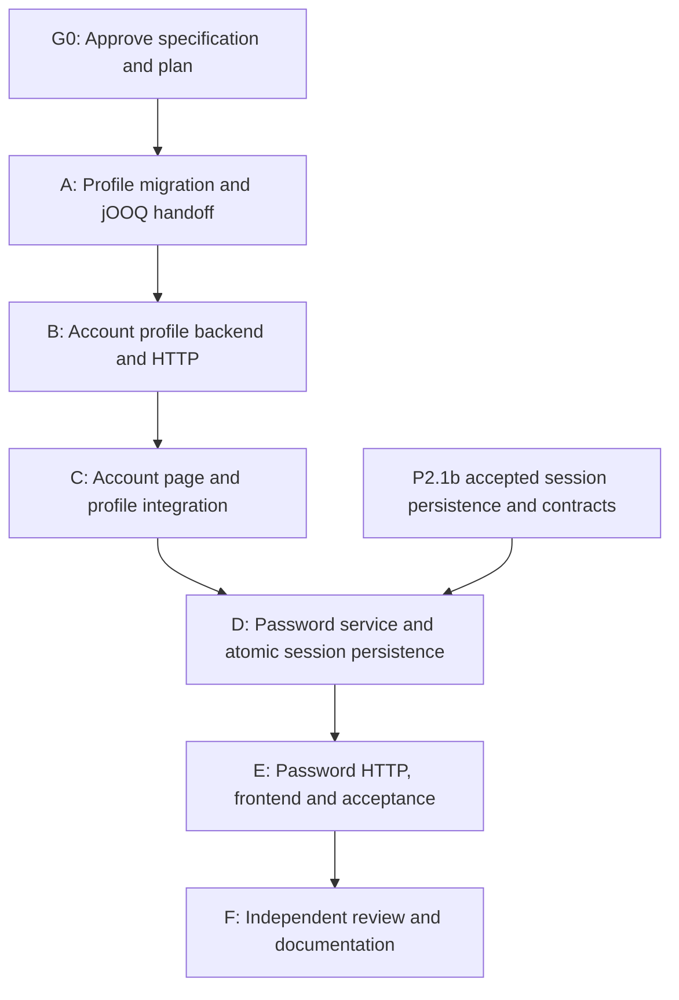

# P2.1c - Account profile and password changes: implementation plan

**Status:** Approved **sequential** implementation plan. Phases A–D are human-accepted; the Phase E backend and frontend are integrated with a green MR pipeline reported by the maintainer. Targeted manual acceptance is encouraging but does not constitute recorded completion of every browser scenario. Phase F review and final merge authorization remain open; see [acceptance](acceptance.md).

## Baseline, ownership and constraints

The implementation includes P2.1a registration/login, P2.1b refresh/logout and reactive renewal, and P2.1c account profiles and password replacement. IAM owns the password/session write transaction; frontend `core/identity` and shared `lib/api` own its HTTP/browser integration. The approved MVP excludes email changes, password recovery, self-service disablement and session/device administration.

Follow [AGENTS.md](../../../../AGENTS.md), the [AI workflow](../../../development/ai-development-workflow.md), [transactions](../../../architecture/transactions.md), [persistence](../../../architecture/persistence.md), [frontend development](../../../development/frontend.md) and [test guide](../../../development/tests.md). Build the backend with Java 25/Maven; compile and test the frontend with Node 24/npm. Do not substitute another SDK or dependency cache to claim offline validation. Real PostgreSQL 18 and human HTTPS browser gates are separate from offline compilation and Unit tests.

**One phase at a time.** Each implementation phase starts from the approved baseline including the preceding approved phase, returns a focused patch and closes only after its tests and human review. No overlapping implementation branches or parallel owners are planned. Do not begin the next phase until the current phase is approved. P2.1b is already accepted and merged. The remaining protected-operation renewal scenarios are tested as part of P2.1c manual acceptance, not as a Phase D service-code prerequisite. The human remains responsible for final acceptance and merging.

## Implementation order

The baseline contains the accepted P2.1b lifecycle and Phase C profile UI. Gate E includes the previously deferred protected-operation browser scenarios (P2.1c.1), without treating P2.1b's earlier smoke-test observations as verification of those scenarios.

## Gate 0 - Approval and source-contract reconciliation

- [x] Review and approve the [specification](specification.md), IAM-C01–C09 contracts and IAM-CT01–CT10 tests. Confirm the display-name bound, `GET`/`PATCH /account` and `POST /auth/password` contracts, password-failure counter behavior, current-session retention and bounded JWT revocation semantics.
- [x] Approve this plan **separately after** specification review. Commit/push both accepted artifacts to the authoritative task branch; keep the local documentation patch unmerged until human acceptance.
- [x] Before Phase D, inspect the accepted P2.1b `SessionStore`/rotation/logout implementation and browser coordinator; record one shared account/session row-lock order and serialization proof. Return to the specification gate if accepted P2.1b behavior conflicts with IAM-C05–C07.

**Gate 0:** Satisfied: the specification and sequential plan were approved before Phases A–C. Their request/response/error contracts remain the reference for D and E.

## Phase A - Profile migration and generated-schema handoff

**Scope:** Add only the IAM-owned Flyway migration for the optional profile table and its one-to-one FK/PK and approved display-name constraints. Preserve registration and existing IAM DDL; no backfill or Group schema changes.

- [x] Prepare and review the migration against the [Phase 2 ER handoff](../../integration/phase-2-foundation.md) (IAM-C02–C03), including runtime-role access through established Flyway grants.
- [x] **Stop at the generator handoff:** the maintainer applies the reviewed migration to PostgreSQL 18, regenerates IAM jOOQ Java sources and supplies them as a patch. Apply and validate the supplied generated code; do not hand-author generated types.
- [x] Test migration, FK/PK constraints, privileges and generated-schema mapping on PostgreSQL 18 (IAM-CT02–CT03).

**Gate A:** Reviewed migration and generated sources match, real database checks pass, and the focused schema patch is human-approved. The maintainer handoff is blocking.

## Phase B - IAM account profile service and bearer HTTP

**Scope:** Implement the IAM-private profile read/write port and application service using verified `IdentityContext`, `Transactions` and jOOQ. Expose bearer-only `GET`/`PATCH /api/iam/v1/account` with strict request validation, narrow account projections, typed outcomes and RFC 9457 errors.

- [x] Unit-test missing/disabled account, own-account scoping, absent/null profile, name validation and typed denials (IAM-C01–C03, C08; IAM-CT01–CT03).
- [x] Test bearer ingress, invalid issuer/type/audience, unknown/missing fields, no-store responses and absence of credential/session secrets (IAM-CT01, CT08).
- [x] Prove first-write upsert concurrency, FK integrity, correct data ownership and rollback against PostgreSQL (IAM-CT02–CT03); run Modulith and backend regression checks.

**Gate B:** Profile backend Unit, HTTP, Modulith and PostgreSQL tests pass; human reviews and approves this backend slice.

## Phase C - Account page and profile integration

**Scope:** Add `/app/account` to the existing workspace layout and account menu, show read-only email and edit/clear controls, and add typed profile calls under `core/identity` using `lib/api`. Keep the future password form for Phase E; do not implement a parallel auth coordinator or refresh flow.

- [x] Test load/update/clear, field errors, loading/disabled states, keyboard/screen-reader feedback, escaping and responsive layout (IAM-C03, C08–C09; profile portion of IAM-CT09).
- [x] Exercise authenticated HTTP profile flows and relevant failure outcomes against the Phase B backend and PostgreSQL (IAM-CT01–CT03, CT08). Verify same-origin HTTPS UI behavior and error presentation manually.
- [x] Test mocked session-context-change/re-authentication states without persisting credentials or replacing P2.1b's coordinator. Run frontend lint, production/test typechecks, Vitest, build and static export on the intended Node 24/npm toolchain.

**Gate C:** Human accepts the integrated profile slice. If P2.1b restoration is not yet accepted, record that browser scenario as pending for Gate E rather than claiming it was tested.

## Phase D - Password service, atomic revocation and PostgreSQL races

**Prerequisite:** Phase C accepted **and** P2.1b's relevant session store, refresh/logout behavior and row-lock contract accepted (satisfied by the merged baseline). Password change acquires the account row lock, then the caller session row lock, then updates other sessions. Refresh/logout acquire a session lock and read account disablement without locking the account; login locks the account first. Verify this order and its serialization on PostgreSQL before Gate D acceptance.

**Scope:** Reuse `PasswordPolicy`, `CredentialEncoder` and `LoginLockoutPolicy` for current-password verification, validation and failure counters. Use verified bearer-derived user/session identity and IAM-private ports; compute PBKDF2 outside long-held write locks. In one `Transactions.execute(...)`, recheck the locked account verifier, account state and eligible caller session, then change the verifier and revoke all *other* sessions. Preserve the caller's refresh generation and deadlines.

- [x] Unit-test current-password denials and lockout, invalid/equal new password, stale verifier, disabled/locked account and invalid `sid` (IAM-C04, C07; IAM-CT04, CT07).
- [x] PostgreSQL-test two-session success, parallel changes, login/refresh/logout races, session eligibility, commit/rollback failures and no stale old-password survivors (IAM-C05–C07; IAM-CT05–CT07).
- [x] Preserve P2.1b's consumed-token history/replay behavior and never return success before commit; run applicable backend regression and Modulith tests.

**Gate D:** Security-sensitive service and database concurrency behavior is demonstrated against PostgreSQL 18 with no unresolved lock-order risk; human approves the atomic credential/session patch.

## Phase E - Password HTTP, Account UI and integrated security acceptance

**Scope:** Add **bearer-only** `POST /api/iam/v1/auth/password` and the separate password-change form on `/app/account`. The integrated frontend scope also places the existing authentication guard around the entire `/app` workspace, with a safe `?next=` login detour, rather than guarding the Account page alone. The auth namespace currently enforces CSRF and exact Origin for all unsafe methods; make an **exact method/path exception** for bearer-only password changes while preserving the fail-closed default for other auth mutations. Continue to require verified bearer ingress and prevent cookie-only access. Frontend bearer injection must include `/auth/password` while refresh/logout retain their cookie-backed rules. Do not add a second security chain, request replacement tokens, or replay an uncertain password POST.

- [x] Test request/response validation, `204` without cookies/tokens, `no-store`, stable errors, no sensitive logging and the distinction between pre-dispatch renewable bearer `401` and post-dispatch session denial (IAM-C01, C04, C08; IAM-CT04, CT08).
- [x] Regression-test CSRF/Origin enforcement for existing and unknown unsafe `/auth/**` routes and bearer-only admission for exactly `POST /auth/password`. Verify absent/invalid bearer and cookie-only request failures through the real chain (IAM-CT08).
- [x] Test UI validation, bad current password, sensitive-field clearing, uncertain-response recovery, account-context changes and success messaging; run frontend lint/typechecks/Vitest/build/static export (IAM-C09, IAM-CT09).
- [ ] Human HTTPS E2E with independent browser sessions: verify A continues, B loses refresh eligibility, new login uses only the replacement password, JWT expiry remains bounded and reload/restoration follows accepted P2.1b behavior (IAM-CT05, CT10).

**Gate E:** IAM/HTTP security, PostgreSQL, frontend and general P2.1c manual browser acceptance (including P2.1c.1 protected-operation restoration/retry scenarios) pass together on the integrated revision; human approves the password UI and transport patch.

## Phase F - Independent review, steady-state documentation and merge authorization

- [ ] Obtain independent security/architecture review of the completed change, especially account/session concurrency, the `/auth/password` security-chain exception, refresh retry behavior and JWT eligibility limits. Resolve confirmed findings in reviewable increments.
- [ ] Record human manual HTTPS acceptance, automated CI and locally unavailable infrastructure; rerun affected checks after corrections. Verify module boundaries, source encoding, Markdown links and `git diff --check`.
- [ ] **Final implementation step:** reconcile the authoritative [security](../../../stack/security.md), [frontend architecture](../../../architecture/frontend.md), [persistence](../../../architecture/persistence.md), [data model](../../../data-model-design.md), [development/testing](../../../development/tests.md), Phase 2 integration handoff and [backlog](../backlog.md) against **verified** behavior.
- [ ] Present the complete diff, validation and deferred scope for human merge authorization. Do not mark P2.1c complete or merge before that decision.

**Gate F:** Independent findings resolved, human acceptance recorded, authoritative docs accurate and final merge authorized. Deferred lifecycle/session-administration features remain out of scope.
