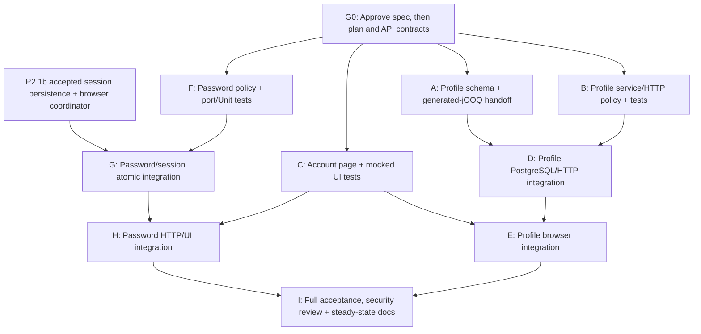

# P2.1c - Account profile and password changes: implementation plan

**Status:** Proposed reviewable implementation sequence. This plan accompanies the [draft specification](specification.md); it is **not approval** to begin implementing a phase. Approve the specification first, then this plan, and commit/push the approved documents to the authoritative task branch before feature work.

## Baseline, ownership and constraints

The supplied source implements P2.1a's IAM registration/login, `identity.users`/`sessions`/`refresh_tokens`, fixed-profile PBKDF2 and the initial browser identity boundary. It has **no** `identity.user_profiles` table or P2.1b refresh/logout implementation. P2.1b and its reactive-renewal workstream are in progress; their [specification](../p2.1b-session-lifecycle/specification.md) and [plan](../p2.1b-session-lifecycle/plan.md) are integration assumptions until accepted code is available. P2.1c is limited to **own-account read/display-name changes and password change with revocation of all other sessions**. The backend `identity` module owns persistence and business rules; frontend `core/identity` owns the typed account API; shared `lib/api` and P2.1b own bearer recovery/cookie coordination.

Follow [AGENTS.md](../../../../AGENTS.md), the [AI workflow](../../../development/ai-development-workflow.md), [transactions](../../../architecture/transactions.md), [persistence](../../../architecture/persistence.md), [frontend development](../../../development/frontend.md) and [test guide](../../../development/tests.md). Build the backend with Java 25/Maven; compile and test the frontend with Node 24/npm. Do not substitute another SDK or dependency cache to claim offline validation. Real PostgreSQL 18 and human HTTPS browser gates are separate from offline compilation and Unit tests.

Each review patch covers one coherent phase on a dedicated branch from the current approved baseline. Do not merge on test success alone. Track completed checkboxes only after the phase's automated evidence **and human approval**; phases may be prepared in parallel but must not be marked accepted speculatively.

## Dependency-aware parallel work

**Parallel ownership:** A/B are IAM profile backend slices; C is the Account route and mock client contract; F is password policy/test design and application behavior against a frozen narrow port. C must not edit P2.1b's `AuthCoordinator`, `AuthSession`, shared `lib/api` retry hook or browser cookie lock concurrently. F must not introduce speculative locking/revocation SQL while P2.1b is WIP. Assign integration ownership for overlapping IAM account/session ports, authentication controller configuration and `core/identity` exports before either branch merges.

## Gate 0 - Approval and source-contract reconciliation

- [ ] Review and approve the [specification](specification.md) and its IAM-C01–C09 contracts and IAM-CT01–CT10 tests. Confirm proposed display-name bound, `GET`/`PATCH`/password route payloads, password-failure counter behavior, password change's current-session retention, and bounded JWT revocation semantics.
- [ ] Approve this plan **separately after** specification review. Commit/push both accepted artifacts to the authoritative task branch; keep the local documentation patch unmerged until human acceptance.
- [ ] When P2.1b reaches its relevant review gate, inspect accepted `SessionStore`/rotation/logout implementations and browser session API. Record a shared account/session row-lock order and serialization proof with the P2.1b owner **before** password persistence; return to the specification gate if its behavior conflicts with IAM-C05–C07.

**Gate 0 completion:** Approved and reproducible task documents; frozen request/response/error contracts. This draft patch does not satisfy approval by itself.

## Phase A - Profile migration and generated-schema handoff

**Scope:** Add only the IAM-owned Flyway migration for the optional profile table and its one-to-one FK/PK and approved display-name constraints. Preserve existing registration and IAM account/session DDL; no initial backfill and no Group-owned schema changes.

- [ ] Prepare and review the migration against the [Phase 2 ER handoff](../../integration/phase-2-foundation.md) (IAM-C02–C03); include runtime-role access through the established Flyway migration owner/default grants.
- [ ] **Stop at the generator handoff:** provide the reviewed migration to the maintainer for application to PostgreSQL 18 and regeneration of IAM's jOOQ Java sources. Apply the maintainer-provided generated-code patch intact and verify it matches the migrated schema. Do not fake or manually edit jOOQ-generated types to unblock an offline build.
- [ ] Test clean migration, constraints, owner privileges and generated-schema mapping on PostgreSQL 18; ensure no existing IAM table is changed unintentionally (IAM-CT02–CT03).

**Gate A:** Migration and generated model match, real database tests pass, and human approves the focused schema patch. The code-generation handoff is an explicit blocking dependency, not an optional test.

## Phase B - IAM profile operations and bearer HTTP API

**Scope:** Define a narrow IAM-private profile read/write port and a focused application service. Use operation-scoped verified `IdentityContext` and `Transactions` to load the account projection and upsert/clear the optional name; do not surface credential records or let callers specify ownership. Add a bearer-protected account HTTP adapter with the proposed `GET`/`PATCH` response and RFC 9457 validation mapping. Keep any schema-dependent adapter code on a branch that can be rebased onto A's generated types.

- [ ] Unit-test missing/disabled account, own-account scoping, absent/null profile, validation and typed failures (IAM-C01–C03, C08; IAM-CT01–CT03).
- [ ] Verify mapped endpoint admission, wrong issuer/type/audience, missing bearer, strict update-field handling, no-store responses and no exposure of password/session columns (IAM-CT01, CT08).
- [ ] Use IAM-private jOOQ and database-side upsert/conditional update without duplicating schema metadata. Prove concurrent initial profile writes, FK integrity and commit/rollback on PostgreSQL (IAM-CT02–CT03).

**Gate B:** Backend Unit/Modulith and applicable HTTP tests pass. PostgreSQL Integration/E2E correctness passes **after Phase A's generator handoff**. Human reviews and approves before claiming this backend profile vertical complete.

## Phase C - Account page and mocked profile experience (parallel with A/B)

**Scope:** Implement `/app/account` in the existing workspace layout, linked from the account menu; show read-only email and profile controls, and stage the separate password form against the agreed request/response contract. Route-specific components own form state; `core/identity` owns typed account calls, and `lib/api` remains the sole transport. Integrate with P2.1b's accepted auth state where available, without implementing a local refresh engine.

- [ ] Test profile load, update/clear, field errors, loading/disabled controls, keyboard and screen-reader feedback, responsive layout and documented design theme (IAM-C03, C08–C09; IAM-CT09).
- [ ] Use injected mocked API/session transport to test reauthentication-required/session-context-changed states; a stale tab suspends writes and does not silently switch the user account. Do not persist credential material.
- [ ] Run lint, frontend production and test typechecks, Vitest, ordinary build and static-export checks with the intended Node 24/npm toolchain. Human review the page/client patch independently of PostgreSQL completion.

**Gate C:** Mock-backed UI/client behavior is accepted. No claim of working end-to-end protected-route restoration without P2.1b and HTTPS browser acceptance.

## Phase D - Profile backend/frontend integration

**Scope:** Join the accepted IAM profile HTTP operations with the Account page and P2.1b's final navigation/session restoration boundary. Resolve contract mismatches in small, reviewable changes rather than adding a second transport or promoting the demo routes to protected product flows.

- [ ] Exercise real authenticated HTTP profile read/set/clear, disabled-account denial, and concurrently created profile state on PostgreSQL (IAM-CT01–CT03, CT08).
- [ ] Manually verify profile behavior through same-origin HTTPS, responsive UI, page reload/session restoration and error displays (profile portion of IAM-CT10).

**Gate D:** Human reviews real backend/browser evidence and accepts the profile vertical; password integration may remain blocked without holding up this reviewed slice.

## Phase E - Password policy, credential service and Unit tests (parallel preparation)

**Scope:** Prepare password-change inputs, results and focused orchestration tests against an agreed IAM-private account/session capability. Reuse P2.1a `PasswordPolicy`, `CredentialEncoder`, `LoginLockoutPolicy`, `Transactions` and verified operation identity. Do not fork the P2.1b session store or invent independent refresh-token mutation rules.

- [ ] Cover current-password verification outside write locks, new-password validation, new-equals-old denial, failure counters/lockout, stale verifier, disabled account and invalid `sid` (IAM-C04, C07; IAM-CT04, CT07).
- [ ] Specify atomic result/transaction outcomes for password update plus revocation, with commit-before-success and uncertain-response policy (IAM-C05–C07). Keep external HTTP/cookies out of the service and avoid returning secrets in outcomes.
- [ ] Run isolated Unit tests and module boundary verification. Defer persistence/HTTP correctness claims until P2.1b's actual session operations and lock order have been reviewed.

**Gate E:** Pure behavior and interface patch accepted; the phase deliberately does not satisfy session atomicity or race gates.

## Phase F - Password/session persistence and concurrency (P2.1b-dependent)

**Prerequisite:** Accepted, available P2.1b session store and verified refresh/logout persistence semantics. Identify actual row locks and the shared serialization order **before writing SQL**; if a safe order cannot be established without altering P2.1b, return the required architecture adjustment for human review first.

- [ ] Implement one `Transactions.execute(...)` segment that rechecks locked account verifier, disabled/lockout state and caller's eligible session, then updates the verifier and revokes all sessions except the caller's. Preserve the existing refresh generation and session deadlines of the caller (IAM-C04–C06).
- [ ] Test two-session success, revoked/expired/wrong-owner session, concurrent password changes, login versus password change, refresh/logout races, rollback and commit failure using independent real PostgreSQL connections (IAM-CT05–CT07).
- [ ] Confirm that P2.1b refresh cannot issue a committed usable successor for a session already revoked at the serialization point, and that old-password login cannot create a durable survivor after a committed change. Preserve the consumed-token replay/history semantics of P2.1b.

**Gate F:** PostgreSQL 18 Integration/E2E race and rollback evidence passes, with no unresolved lock-order/deadlock risk. Human approves the atomic security patch.

## Phase G - Password HTTP, frontend and integrated security acceptance

**Scope:** Wire the bearer-only password endpoint through IAM's existing HTTP security/operation dispatcher, then complete the password form in `/app/account`. Do not request or rotate CSRF/refresh cookies for bearer-only account endpoints or add recursive refresh handling.

- [ ] Exercise authenticated request parsing, error mapping, successful `204`, no cookies/tokens in response, `401` pre-dispatch versus typed post-dispatch error distinction, and no-store headers with the actual security chain (IAM-C01, C04, C08; IAM-CT04, CT08).
- [ ] Test current password errors, validation, uncertain POST outcome, context-change suspension, success state and sensitive-field clearing in frontend Unit/component tests (IAM-C09, IAM-CT09).
- [ ] Run manual HTTPS E2E with two independent browser profiles: change password in A; verify A remains, B cannot renew, already-issued JWT expiry remains bounded, and subsequent login accepts only the replacement password (IAM-CT05, CT10).

**Gate G:** IAM Unit, real PostgreSQL Integration/E2E, HTTP security and frontend lint/typecheck/Vitest/build/static export are green on the integrated revision; human accepts the browser flow. A mocked backend cannot substitute for this gate.

## Phase H - Independent review, documentation and merge authorization

- [ ] Obtain independent security/architecture review of complete changed paths, including concurrent login/refresh/logout and ineligible/stateless-JWT behavior. Resolve confirmed findings through separate reviewable patches.
- [ ] Record human HTTPS manual acceptance, automated test/CI evidence and environment limitations; rerun scenarios affected by corrections. Verify module rules, source encoding, Markdown links and `git diff --check`.
- [ ] **Final implementation step:** reconcile authoritative steady-state [security](../../../stack/security.md), [frontend architecture](../../../architecture/frontend.md), [persistence](../../../architecture/persistence.md), [data model](../../../data-model-design.md), [development/testing](../../../development/tests.md), Phase 2 integration handoff and [backlog](../backlog.md) to the **verified** behavior. Keep task artifacts as approved traceability, not substitutes for architecture docs.
- [ ] Present the full final diff, test/manual evidence and remaining deferrals for human merge authorization. Do not mark P2.1c complete or merge to the approved baseline before that decision.

**Gate H:** Independent review is resolved, manual acceptance is recorded, final documentation is accurate and human authorizes merge. Deferred account lifecycle/session administration work is not reclassified as implicitly completed.
