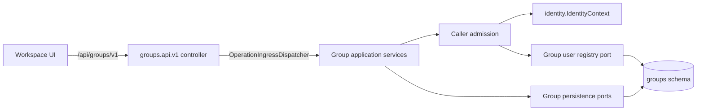

# P2.2a - Group creation and overview

**Status:** Approved specification (November 21, 2026), following the task discussion and specification gate of the [AI development workflow](../../../development/ai-development-workflow.md). It is implemented by the [implementation plan](plan.md), which records deviations and validation evidence; the steady-state documentation describes the resulting system. **Backlog item:** [P2.2a](../backlog.md#p22---group-management-vertical-slices).

The [domain model](../../../data-model-design.md) owns Group invariants, the [Phase 2 IAM/Group handoff](../../integration/phase-2-foundation.md) owns the reviewed column-level ER for `groups.*`, the [application architecture](../../../architecture.md) owns module and port conventions, and the [security design](../../../stack/security.md) owns the trust model. This specification fixes the P2.2a contracts against those documents and records where it deliberately extends them.

## Goal and scope

An authenticated, locally known user can create a group, becomes its first member and administrator, sees the groups they belong to, opens a group's details and, as administrator, edits its name and description. Group Management persists this in its own PostgreSQL schema and exposes it through a versioned HTTP API and workspace UI.

### Included

- A new `groups` Spring Modulith module with its application services, domain values, persistence ports and jOOQ adapters, and HTTP adapter.
- Flyway migration for `groups.users`, `groups.groups`, `groups.group_members` and the `groups.group_role` type, following the handoff ER plus the metadata `version` extension (D4).
- Operations: create group, list the caller's groups, read one group, replace a group's metadata.
- The **caller admission** policy that maps the verified IAM caller to a locally known Group user (closed-world `groups.users`), as the single extension point for P2.2d/P2.2e (S2).
- Workspace UI: group list, create form, group detail with administrator-only edit.
- A developer procedure to provision local `groups.users` rows for manual testing (S3).

### Excluded

- Member listing, role changes, leaving, removal and administrator transfer (**P2.2b**). P2.2a only creates the creator's `admin` membership; additional memberships exist only as test fixtures.
- Invitation links and joining (**P2.2c**); the `groups.invitations` table is created by P2.2c.
- Filling `groups.users` from IAM events (**P2.2d/P2.4a**) or by authoritative IAM lookup (**P2.1d/P2.2e**).
- Group deletion and archival, which remain an [open domain decision](../../../data-model-design.md#open-decisions).
- Accounting currency (Finance's `FinancialGroup`, Phase 3), group images (File IDs, Phase 6), Group attestations (**P2.5**) and integration events about groups (no publication registry before P2.4a).
- Pagination of the group list (D7).

## Architectural solution

### Module and package structure

`de.hsh.favs.sharewise.groups` is a closed application module. Its top-level package **publishes no types** in P2.2a: no other module consumes Group operations yet, and Finance's and P2.5's needs will define the first published contracts. Its declaration lists exactly the APIs it uses:

```java
@ApplicationModule(allowedDependencies = {
    "identity", "shared::di", "shared::jooq", "shared::result", "shared::transactions", "shared::web"})
package de.hsh.favs.sharewise.groups;
```

`shared::transactions` and `shared::jooq` are not yet published on `main`; P2.1a publishes them under exactly these names on its branch (S4). Internally the module separates the HTTP adapter (`groups.api.v1`), application services and their commands/results, domain values and policies, and the persistence adapter with its generated jOOQ types. These sub-packages are internal Modulith packages even where Java requires `public` types.



### Operations and application services

Each HTTP endpoint dispatches one operation-scoped application service through the request-scoped `OperationIngressDispatcher`, so the verified IAM identity is available as `IdentityContext` ([DI architecture](../../../architecture/dependency-injection.md)). Services receive immutable command/query records, return a `Result` with typed expected failures, and perform their database work in **one** `Transactions.execute(...)` segment each. Controllers map results to HTTP; they contain no business rules.

| Operation | Input | Successful result |
| --- | --- | --- |
| **Create group** | `name`, optional `description` | `GroupDetails` of the new group; the caller is its only member, with role `admin` |
| **List my groups** | none (caller from `IdentityContext`) | `GroupSummary` per group in which the caller is a member, including the caller's role |
| **Get group** | `groupId` | `GroupDetails` if the caller is a member |
| **Replace metadata** | `groupId`, `name`, optional `description`, `expectedVersion` | Updated `GroupDetails` with incremented `version` |

`GroupDetails` contains `id`, `name`, `description`, `createdAt`, `version`, `memberCount` and `callerRole`. `GroupSummary` contains `id`, `name`, `description`, `memberCount` and `callerRole`. Both are read projections assembled by single SQL statements in the adapter, never by loading entity graphs. The creator and all membership subjects come from `IdentityContext`; no request field can name a user or choose a role.

### Caller admission and the local user registry

Every Group operation starts by **admitting** the caller: a single Group-internal service obtains `IdentityContext.requireUserId()` and checks that the ID exists in `groups.users` within the operation's transaction segment. The outcome is either an admitted caller (a small value carrying the user ID) or the typed failure `UNKNOWN_USER`. Unauthenticated operations fail earlier with `UnauthenticatedCallerException` (`401`), which IAM's existing handler maps.

The registry port over `groups.users` has two capabilities: an existence check, and an **idempotent provisioning** write (`INSERT … ON CONFLICT DO NOTHING`) of an externally supplied IAM user ID. P2.2a uses provisioning only from test fixtures; it is the single write path that P2.2d's event consumer and P2.2e's eligible-lookup provisioning are expected to call (S2). Group Management never generates user IDs.

Admission establishes local existence only. Whether the caller may read or change a particular group is decided afterwards from current `groups.group_members` rows.

### Group mutation protocol

All Group operations that change an existing group **lock its `groups.groups` row first** (`SELECT … FOR UPDATE`) and only then read the caller's membership and perform the change, all in the same segment. Under PostgreSQL's READ COMMITTED isolation, every statement after the lock sees the latest committed membership state, so an authorization check cannot use a role that a concurrent, committed group mutation has already revoked. P2.2a's metadata replacement is the first such operation. The protocol is the serialization point that P2.2b (final-member/final-administrator invariants) and P2.2c (redemption versus revocation) are expected to adopt. They may refine it in their own specifications.

Creation needs no lock. It inserts the group row and the creator's `admin` membership in one segment; the `group_members.user_id` foreign key to `groups.users` makes the database reject a membership for an unadmitted user, so a failure leaves neither row behind.

Reads take no locks and return a consistent single-statement snapshot.

### Persistence

The migration lives at `db/migration/groups/V<timestamp>__groups_core_tables.sql`, matching the per-context convention introduced by P2.1a, and follows the handoff ER:

| Table | Columns (ER unless noted) | Constraints |
| --- | --- | --- |
| `groups.users` | `id uuid` without default | PK |
| `groups.groups` | `id uuid DEFAULT uuidv7()`, `name varchar(64)`, `description varchar(512) NULL`, `created_at timestamptz DEFAULT now()`, **`version bigint DEFAULT 0`** (D4) | PK; `CHECK (length(btrim(name)) > 0)`; `CHECK (version >= 0)` |
| `groups.group_members` | `id uuid DEFAULT uuidv7()`, `group_id uuid`, `user_id uuid`, `role groups.group_role`, `joined_at timestamptz DEFAULT now()` | PK; FK `group_id` → `groups.groups`; FK `user_id` → `groups.users`; `UNIQUE (group_id, user_id)`; index on `user_id` |

`groups.group_role` is a PostgreSQL enum with the values `member` and `admin`. Foreign keys use the default `NO ACTION`; delete behavior is decided with the group lifecycle and account-deletion policies. There is no FK to any `identity` table.

The adapter uses **database-first generated jOOQ types** produced from the Flyway-migrated PostgreSQL 18 schema, using the same generation mechanism as P2.1a (S4). Generated sources are committed, so ordinary builds stay offline and database-free; a test verifies that the committed types match the migrated schema. Timestamps and IDs are produced by the database and returned with `RETURNING`.

### HTTP API

Endpoints are rooted at `/api/groups/v1`, require a valid primary IAM bearer token, and return the established RFC 9457 `ProblemDetail` shape with a `code` on failure. Bearer APIs do not use cookies for authentication, so these endpoints need no CSRF token.

| Method and path | Request | Success |
| --- | --- | --- |
| `POST /api/groups/v1/groups` | `{ "name", "description"? }` | `201`, `Location` header, `GroupDetails` |
| `GET /api/groups/v1/groups` | none | `200`, `{ "items": [GroupSummary…] }` |
| `GET /api/groups/v1/groups/{groupId}` | none | `200`, `GroupDetails` |
| `PUT /api/groups/v1/groups/{groupId}` | `{ "name", "description", "expectedVersion" }` | `200`, `GroupDetails` |

`PUT` replaces the whole editable metadata: a `null` or absent `description` clears it. The list is wrapped in an object so pagination metadata can be added without breaking clients (D7).

Checks run in this order, and the first failing check determines the response:

| Order | Condition | Response |
| --- | --- | --- |
| 1 | No authenticated caller | `401 unauthenticated` (existing IAM mapping) |
| 2 | Malformed body or path ID, or invalid metadata | `400` through the existing P1.4 request-error mapping; invalid metadata as `400 validation_failed` with `fieldErrors` |
| 3 | Caller not in `groups.users` | `403 group_user_unknown` |
| 4 | Group does not exist, or caller is not a member | `404 group_not_found`, identical in both cases |
| 5 | Caller is a member but not `admin` (replace metadata only) | `403 group_admin_required` |
| 6 | `expectedVersion` differs from the current version | `409 group_version_conflict` |

### Metadata validation

`GroupName` and `GroupDescription` are domain values that validate and normalize input once, before any database access:

- **Name:** required; leading/trailing whitespace is trimmed; the result has 1–64 Unicode code points (PostgreSQL `varchar(n)` counts characters, not UTF-16 units); control characters are rejected.
- **Description:** optional; trimmed; an empty result becomes absent; at most 512 code points; line breaks (`\n`, `\r\n`) are allowed, other control characters are rejected.
- Names are not unique.

The database `CHECK` and column lengths are backstops, not the primary validation.

### Frontend

The workspace gains a **Groups** navigation entry and these routes inside the existing `(app)` shell:

| Route | Content |
| --- | --- |
| `/app/groups` | The caller's groups (name, description, member count, role badge), empty state, and a create action |
| `/app/groups/new` | Create form; on success it navigates to the detail page |
| `/app/groups/view?id=<groupId>` | Group metadata; administrators get an edit form with conflict handling |

The detail page uses a query parameter because the static export cannot pre-render unknown group IDs as path segments (D8). The domain adapter `core/groups/` contains typed request/response models and a `GroupsApi` class that receives an `ApiClient` instance; pages obtain it through one hook, the single point that chooses the authenticated client (S5). Client-side validation mirrors the server limits; server `fieldErrors` are shown on their fields. The UI handles these responses explicitly:

- **`401`:** shows a sign-in-required state.
- **`403 group_user_unknown`:** explains that the account is not yet available to Group Management.
- **`404`:** shows "group not found".
- **`409`:** offers to reload the current metadata, without discarding the user's input silently.

Components follow the established Mantine/SCSS Module and accessibility conventions of the [frontend architecture](../../../architecture/frontend.md).

## Dependency seams

Each dependency on unfinished work is handled by one of two means. Where the other task's contract is already fixed, P2.2a prepares an extension point it will plug into. Where the contract is still open, P2.2a uses a test fixture. No seam introduces production behavior that a later task must remove, and each is confined to one place so an unexpected change in the other task stays local.

| ID | Dependency | P2.2a solution | What the other task changes | Confidence |
| --- | --- | --- | --- | --- |
| **S1** | Verified caller (P2.1.0, merged) | Consume `IdentityContext` unchanged. Service tests bind callers with the existing `IdentityTestFixture`; HTTP tests use test-signed bearer tokens through the real ingress. | Nothing; P2.1a's real tokens use the same verified profile. | High: the contract is implemented. |
| **S2** | Filling `groups.users` (P2.2d events, P2.2e lookup) | Closed world. All operations pass through one caller-admission service; the registry port offers an idempotent provisioning write that P2.2a only calls from fixtures. | P2.2d's consumer calls the provisioning write. P2.2e adds a miss branch inside admission (IAM eligibility → provision or reject). No Group operation changes. | High for the location; the miss-branch details belong to P2.2e. Deletion and ordering are not prepared (P2.1e gate). |
| **S3** | Real users for manual testing (P2.1a registration) | A documented developer procedure provisions `groups.users` for a given IAM user ID, using the application role. It is not a production path and not a Flyway migration. | P2.2d makes it unnecessary; it is then removed or reduced to a bootstrap note. | High. |
| **S4** | jOOQ code generation and the `shared::jooq` / `shared::transactions` named interfaces (P2.1a, unmerged) | Reuse P2.1a's mechanism and names. If P2.1a merges first, P2.2a rebases and adds the `groups` schema to it. If P2.2a's persistence phase comes first, it generalizes the profile to cover several context schemas, coordinated with the P2.1a owner, so that only one mechanism exists. | Ordinary merge resolution with identical named-interface declarations. | Medium: P2.1a can still change; the risk is confined to build configuration and two `package-info.java` files. |
| **S5** | Browser authentication (P2.1a `core/identity`, unmerged) | `GroupsApi` depends only on the `ApiClient` interface; one hook supplies the client. Before P2.1a it is the plain unauthenticated client (requests get `401`, the UI shows sign-in-required); afterwards it returns `useIdentity().api`. | Change the hook's implementation; wire the sign-in link to `/auth/login`. | High: `ApiClient` is the existing transport contract that P2.1a also builds on. |
| **S6** | Group-scoped serialization for P2.2b/P2.2c | Establish the lock-the-group-row-first protocol with metadata replacement as its first user. | P2.2b/P2.2c adopt it, or refine it in their specifications. | Medium-high: the ER already demands a group-scoped protocol. |

Deliberately **not** prepared, because their contracts do not exist yet: a published Group Java API for Finance or attestations, Group integration events (needs P2.4a), account-deletion handling in `groups.users`, and pagination.

## Requirements and invariants

| ID | Requirement |
| --- | --- |
| **GM-01** | Group creation atomically creates one `groups.groups` row and exactly one `groups.group_members` row for the authenticated caller with role `admin`. A failure leaves neither row. |
| **GM-02** | The creator and every membership subject are taken from `IdentityContext`; no request can choose a user ID or role. |
| **GM-03** | Every Group operation requires an authenticated caller (`401` otherwise) whose ID exists in `groups.users` (`403 group_user_unknown` otherwise). Unknown callers cause no Group writes. |
| **GM-04** | Group Management never generates, alters or deletes `groups.users` IDs in P2.2a; the only write path is idempotent provisioning of a supplied ID. |
| **GM-05** | Group reads and metadata replacement are authorized from current `groups.group_members` rows within the operation's transaction segment, never from tokens or earlier responses. |
| **GM-06** | A non-member cannot learn whether a group exists: missing and non-member groups produce identical `404` responses for every operation. |
| **GM-07** | Only a current `admin` member can replace metadata. The membership check happens after the group row lock in the same segment (group mutation protocol). |
| **GM-08** | Metadata replacement succeeds only if `expectedVersion` equals the current version; it then increments the version by exactly one. Concurrent replacements with the same expected version produce exactly one success. |
| **GM-09** | Names and descriptions follow the validation rules above. Invalid input produces `400` with field errors and no writes; database constraints reject invalid values even if application validation is bypassed. |
| **GM-10** | The list contains exactly the groups in which the caller is a member, with the caller's role and the member count, ordered by case-insensitive name and then ID. |
| **GM-11** | The `groups` module uses only its declared dependencies; it accesses no IAM internals or `identity` tables, and other modules cannot access its internals. |
| **GM-12** | Generated jOOQ types match the Flyway-migrated schema; adapters use no hand-written table/field definitions. |
| **GM-13** | The UI never shows edit controls to non-administrators, and the server enforces GM-07 regardless of the UI. |

## Failure and concurrency behavior

All expected failures are typed `Result` failures that end the segment with rollback and leave persistent state unchanged. Unexpected exceptions roll back the segment and propagate as `500 internal_error` through the existing handler. A response or serialization failure after a committed creation cannot undo it; the client sees an error but the group exists and appears in the list.

Concurrent creations by the same caller are independent and both succeed, because names are not unique. Concurrent metadata replacements serialize on the group row lock; the second sees the incremented version and receives `409`. A future concurrent role change (P2.2b) that adopts the same protocol is ordered either before the metadata check, which is then evaluated against the new role, or after the committed update.

## Acceptance tests

Test kinds follow the [backend test architecture](../../../architecture/tests.md): **Unit** (`*Test`), rollback-isolated PostgreSQL **Integration** (`*IT`) and real-commit **E2E** (`*E2E`). HTTP tests use the real IAM bearer ingress with test-signed tokens; the existing IAM ingress tests sign tokens inline, so P2.2a extracts a reusable, explicitly imported test-token fixture into `testsupport` rather than duplicating that code. Additional unit and adapter tests are added during implementation.

| ID | Setup and action | Expected outcome | Kind |
| --- | --- | --- | --- |
| **GM-T01** | Known caller creates a group with a name and description. | `201` with `Location`; one group row, one `admin` membership for the caller; response has `callerRole = admin`, `memberCount = 1`, `version = 0`. | E2E + HTTP |
| **GM-T02** | Call the creation adapter directly with a user ID absent from `groups.users`. | FK violation; no group row remains after the segment. | IT |
| **GM-T03** | Caller with a valid token but no `groups.users` row calls each of the four endpoints. | `403 group_user_unknown`; no rows written. | E2E + HTTP |
| **GM-T04** | Call each endpoint without a token and with an invalid token. | `401`; an invalid token never becomes anonymous access; no rows written. | HTTP |
| **GM-T05** | Create with a blank name, a whitespace-only name, 65 code points, 64 multi-code-unit characters (e.g. emoji), a control character, a 513-code-point description, and a description that is only whitespace. | Invalid cases get `400 validation_failed` with field errors and no writes; the 64-character name succeeds; the whitespace-only description is stored as absent. | Unit + HTTP |
| **GM-T06** | Insert a row with a blank name or negative version directly via SQL. | Rejected by the database constraints. | IT |
| **GM-T07** | Users A and B have different groups, A is `member` in one of B's groups (fixture row); A lists groups. Also list for a known user without groups. | A sees exactly their groups with correct roles, member counts and ordering; the user without groups gets an empty list. | IT + HTTP |
| **GM-T08** | Member reads a group; a non-member reads it; anyone reads a random ID. | Member gets `200`; the two other cases get byte-identical `404 group_not_found` bodies. | HTTP |
| **GM-T09** | Administrator replaces metadata with the correct version, including clearing the description. | `200`; values updated, `version` incremented by one; reading returns the new state. | E2E + HTTP |
| **GM-T10** | A `member` and a non-member attempt replacement. | `403 group_admin_required` and `404 group_not_found` respectively; no change. | HTTP |
| **GM-T11** | Administrator replaces metadata with a stale version. | `409 group_version_conflict`; no change. | HTTP |
| **GM-T12** | Two threads replace metadata of the same group with the same expected version, committing for real. | Exactly one `200` and one `409`; final version incremented once. | E2E |
| **GM-T13** | Hold the group row lock from a separate connection, demote the administrator's fixture membership and commit, then release; meanwhile the administrator's replacement waits. | The waiting replacement observes the demotion and returns `403`; no change. | E2E |
| **GM-T14** | Send creation and replacement bodies that include `userId`, `role` or `memberCount` fields. | `400 malformed_request` without writes, because API request bodies reject unknown fields; the creator is always the authenticated caller with role `admin`. | HTTP |
| **GM-T15** | Run the module verification and the generated-schema check. | `groups` declares exactly its dependencies, violations are rejected; committed jOOQ types match the migrated schema. | Unit + IT |
| **GM-T16** | Provision the same user ID twice through the registry port. | One row; no error. | IT |
| **GM-FT01** | Render the list page with groups, without groups, and with `401`, `403 group_user_unknown` and network errors from a mocked client. | Correct items and role badges, empty state, sign-in-required, account-not-available and retryable error states. | Frontend |
| **GM-FT02** | Submit the create form with invalid values, with server `fieldErrors`, and successfully. | Client validation mirrors server limits; server errors appear on their fields; success navigates to the detail page. | Frontend |
| **GM-FT03** | Render the detail page as `admin` and as `member`; submit an edit that returns `409`. | Only the administrator sees the edit form; the conflict offers reloading without silently dropping input. | Frontend |
| **GM-FT04** | Run axe and keyboard checks on the three pages; build the static export. | No axe violations, operable by keyboard; static export contains the new routes. | Frontend |

### Manual acceptance

Manual browser acceptance requires P2.1a's registration and login (S3, S5). Before that, the human gate for the backend phases is code review plus the automated tests above. The final scenario is:

1. Register user A and user B through the UI. Provision both in `groups.users` with the developer procedure.
2. As A, create a group, see it in the list as administrator, open it and edit its metadata.
3. Insert a `member` row for B via SQL. As B, see the group without edit controls; a crafted `PUT` returns `403`.
4. As a third registered but unprovisioned user, open the groups page and see the account-not-available message.
5. Open two tabs as A, edit in both, and see the conflict handling.
6. Repeat the list and detail views at mobile width and with keyboard only.

## Decisions

| ID | Decision | Rationale |
| --- | --- | --- |
| **D1** | Follow the handoff ER for names, types and limits (name 64, description 512, `group_members`, `group_role` = `member`/`admin`). | The ER is the reviewed cross-team reference; P2.2b/c build on the same tables. |
| **D2** | Non-members receive `404`, identical to missing groups. | Group IDs must not reveal existence or membership to outsiders. |
| **D3** | Unknown local users receive `403 group_user_unknown` for every operation, including reads. | Matches the interim behavior that the backlog defines for P2.2d and keeps one admission point for P2.2e. |
| **D4** | **Extension to the ER:** `groups.groups.version bigint`, incremented by metadata replacement. | Optimistic concurrency for edits, agreed in discussion. P2.2b decides whether membership changes also increment it. |
| **D5** | `PUT` with full metadata replacement instead of `PATCH`. | The edit form always sends all metadata; `PUT` avoids ambiguity between absent and `null` fields. |
| **D6** | jOOQ with generated types, using P2.1a's mechanism. | The persistence plan selects jOOQ and database-first generation; one generation mechanism for all contexts. |
| **D7** | The list is unpaginated but wrapped in `{ "items": [...] }`. | Users belong to few groups initially; the wrapper keeps pagination a compatible addition. |
| **D8** | Detail route `/app/groups/view?id=…`. | The static export cannot pre-render dynamic path segments for unknown IDs; the alternative (Nginx fallback rewrites) changes deployment configuration for one page. |
| **D9** | The `groups` module publishes no Java API yet. | No consumer exists; the first consumer defines the contract it needs. |

## Open questions

These are non-blocking; each has a proposed default that the specification uses unless the reviewer decides otherwise.

| ID | Question | Proposed default |
| --- | --- | --- |
| **Q1** | Should the developer provisioning procedure (S3) also offer a "provision all IAM users" mode? It would read `identity.users` from a developer script, not from application code. | Offer only provisioning of explicit user IDs; finding one's ID is documented via the login response's token `sub`. |
| **Q2** | Should the demonstration routes `/app/dummy1–3` be removed when the Groups navigation entry is added? | Leave them; their removal belongs to the workspace owner. |

## Dependencies and handoffs

- **Implemented baseline:** P1.1 module rules, P1.2–P1.5 persistence, transaction and test foundations, P1.4 API conventions, P2.0a `IdentityContext`, P2.0e frontend foundation, P2.1.0 bearer ingress and production `IdentityContext`.
- **P2.1a (in progress):** jOOQ generation mechanism and named interfaces (S4), browser authentication (S5); required for manual acceptance, not for the backend phases.
- **P2.2b/P2.2c:** build on the tables, caller admission and group mutation protocol.
- **P2.2d/P2.4a, P2.2e/P2.1d:** plug into the registry provisioning write and caller admission (S2).

## Documentation reconciliation

After implementation, the final plan phase updates the steady-state documentation: the [application architecture](../../../architecture.md) and [persistence architecture](../../../architecture/persistence.md) for the `groups` module and its tables, the [Phase 2 handoff](../../integration/phase-2-foundation.md) for the implemented Group tables and the `version` extension, the [frontend architecture](../../../architecture/frontend.md) for the Groups routes and domain adapter, and the [development guide](../../../development.md) for the provisioning procedure. This specification remains a review artifact.
