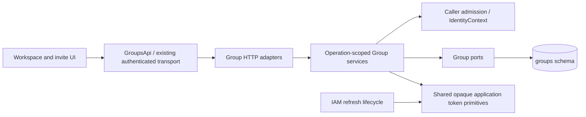

# P2.2b/c - Group membership, invitations and workspace

**Status:** Approved by the maintainer (November 25, 2026). The [implementation plan](plan.md) and [task-local workflow](workflow.md) are review artifacts, not steady-state architecture. **Backlog:** [P2.2b and P2.2c](../backlog.md).

## Scope and starting point

Build on [P2.2a](../p2.2a-group-creation/specification.md): current groups, metadata, caller admission, membership rows, optimistic metadata version and group-root locking. Add authoritative membership reads and administration, shareable invitations, and the responsive group workspace. Preserve the [Phase 2](../../integration/phase-2-foundation.md) and [Phase 3](../../integration/phase-3-foundation.md) integration boundaries, [domain model](../../../data-model-design.md), [transactions](../../../architecture/transactions.md), [persistence](../../../architecture/persistence.md), [security](../../../stack/security.md) and [frontend architecture](../../../architecture/frontend.md).

Excluded: group deletion/archival, direct email invitations, notification delivery, group images, IAM profile lookup/enrichment, IAM-to-Group provisioning/replication, Group attestations, Finance workflows, membership revision and publication, pagination, changes to static export, and new third-party dependencies. Until P2.2d/e, the existing developer provisioning procedure applies to every test account, including newly registered invitees. No cross-schema reads or foreign keys to IAM or Finance.

## Architecture and decisions

Group Management owns authorization from live Group membership state, not IAM profiles or attestations. Each ingress uses the existing operation dispatcher, immutable commands/projections, typed `Result` failures and a single Group transaction segment. Adapters own jOOQ and SQL. Application services own policies. Extend the existing shared group-root mutation protocol and caller admission instead of inventing competing mechanisms.

| ID | Decision | Rationale |
| --- | --- | --- |
| D1 | Multiple administrators; role changes and atomic transfer | Existing two-role domain model, no separate owner. |
| D2 | Retain `groups.groups.version` as metadata-only optimistic concurrency | Membership changes do not invalidate metadata drafts; future `membership_revision` has a separate replication contract. |
| D3 | Roster returns raw user UUIDs; no profile enrichment | Future frontend IAM lookup and bulk mapping can enrich IDs independently. |
| D4 | Address mutations by membership ID | Avoid applying stale administrative commands to a new membership after rejoining. |
| D5 | Positive maximum uses or unlimited; optional expiry | Existing ER supports arbitrary finite limits. |
| D6 | Return invitation secret only on creation | Persist only a verifier, never reversible storage. |
| D7 | Fragment-based invitation URL and explicit authenticated confirmation | Avoid secrets in HTTP request URLs and automatic joins. |
| D8 | Keep query-parameter group routes and static export | No Next.js server required in production. |
| D9 | Configurable existing shell with responsive aside/Drawer | Declarative composition; no imperative slot registration or domain coupling in shell. |
| D10 | Remove dummy entries from visible navigation | Establish real workspace; retain unrelated demo routes unless removal is necessary. |
| D11 | Share opaque application token mechanics via `shared::security` | Two actual consumers of identical security-sensitive behavior; keep domain policies separate. |
| D12 | No deletion or membership publication in this slice | Preserve future lifecycle and replication decisions. |

## Membership contracts (GM)

- **GM-01:** An authenticated, locally admitted member can read the group's metadata, caller membership identity/role and current roster, including membership ID, user ID, role and joined time. Obtain the coherent workspace projection in one SQL statement, with a stable roster ordering and no N+1 or cross-context access. Counts and caller role correspond to the returned roster. Preserve the P2.2a details and list contracts.
- **GM-02:** Only a current administrator can change another member's role or remove another membership. An admitted member may remove their own membership (leave). Administrators may demote themselves if another administrator remains; transfer promotes another current membership and demotes the caller atomically. Transfer to another existing administrator is allowed; self-transfer is rejected. Setting an already-held role is a no-op.
- **GM-03:** A surviving group always has at least one member and administrator. Last-member removal is rejected, as is leaving, removing or demoting the last administrator. No operation silently deletes a group. Rejections leave persistent state unchanged.
- **GM-04:** Admit the verified caller, lock the group root `FOR UPDATE`, then read the caller membership, target membership (scoped to this group) and relevant counts under READ COMMITTED before writing. All existing-group mutations use this same lock; no authorization from stale snapshots or request-supplied actor IDs. A stale target ID cannot affect a different membership, even for the same user. Group creation retains its existing atomic behavior. Role changes and transfer do not re-create memberships. No membership mutation changes the metadata version (D2), nor introduces the future replication counter.
- **GM-05:** Outsiders and nonexistent groups retain identical `404 group_not_found` responses; unadmitted callers retain `403 group_user_unknown`. Ordinary members cannot probe administrative targets. An authorized caller with a nonexistent/foreign target receives a uniform member-not-found result. Use existing request validation and `ProblemDetail` conventions; do not leak membership data through errors.

### Proposed HTTP additions

All endpoints are rooted at `/api/groups/v1`; actor identity comes exclusively from verified IAM authentication. Existing endpoints remain compatible.

| Method and path | Request | Success |
| --- | --- | --- |
| `GET /groups/{groupId}/workspace` | none | `200`, `GroupWorkspace` (existing details, caller membership ID, roster) |
| `PUT /groups/{groupId}/members/{membershipId}/role` | `{ "role": "member" \| "admin" }` | `204` |
| `DELETE /groups/{groupId}/members/{membershipId}` | none | `204` (leave if self, otherwise remove) |
| `POST /groups/{groupId}/members/{membershipId}/transfer-administration` | none | `204` |

Use `403 group_admin_required` for administrative denial; `404 group_member_not_found` for an authorized but missing/foreign target; `409 group_last_member`, `409 group_last_administrator` and `409 group_invalid_transfer` for applicable invariants. Request-shape and authentication failures follow existing framework mapping. Mutation responses intentionally do not carry stale roster copies; clients reload. Check self-target for leave without granting ordinary members arbitrary target lookup. Repeated deletion can return not found; a repeated transfer after demotion cannot bypass current authorization.

## Invitations (GI)

- **GI-01:** Current administrators create, list and revoke invitations for their group. Listing returns nonsecret metadata only: ID, creation/expiry, max uses and use count; include expired/exhausted links until explicitly revoked. Create returns a new bearer only after commit; revocation hard-deletes a scoped record. Never store/log or return a secret or verifier from list/error responses. No retrieval of an existing secret. Authorize before checking arbitrary target records.
- **GI-02:** Use canonical `UUID.base64url(secret)` with 32 CSPRNG bytes, unpadded canonical encoding and a 32-byte SHA-256 verifier of the decoded secret. Extract/reuse the existing IAM generation, parsing, constant-time fixed-length comparison, redaction and defensive-copy semantics through `shared::security`. IAM refresh cookie and storage formats, rotation/replay detection, session binding and failure semantics remain unchanged. Use `ApplicationToken`, `ApplicationTokenGenerator` and `ApplicationTokenParser` (a DI-managed parser, not a static factory); generated-token material may have a distinct type. Shared types have no knowledge of IAM or Group records, persistence, policies or cookies. Each module resolves selectors only in its own credential store; no cross-use authorization.
- **GI-03:** Persist `groups.invitations` per the Phase 2 ER: UUIDv7 selector, group FK and index, verifier `bytea`, creation timestamp, nullable expiration, positive nullable integer max uses, nonnegative integer use count default 0. Enforce hash length, positive/nonnegative counts, count ≤ limit and expiry strictly after creation with database constraints and Group-owned domains as appropriate. Use the established group FK `NO ACTION` pending lifecycle decisions; no orphan invitation or surviving redeemable link after group deletion. A future deletion operation must remove dependent invitations atomically. Do not add deletion endpoints. Generate committed jOOQ sources from the migrated PostgreSQL schema, not by hand.
- **GI-04:** Redeem only through authenticated explicit POST using the admitted caller ID. A preliminary selector lookup may identify the group, but is not authorization. Acquire the group-root lock, re-read the scoped invitation, verify the secret, evaluate expiry using current time after the lock, check use limit and existing membership. For valid new membership, insert role `member` and increment use count in the same segment, including unlimited invitations. Fail closed on count overflow; never wrap. A valid invitation presented by an existing member succeeds without inserting, changing role, or consuming a use. Invalid/expired/revoked/exhausted invitations share one public failure, including for existing members. Creation, revocation and redemption serialize with membership and metadata changes. Rollback of either write leaves neither effect.
- **GI-05:** Expiry is optional and exclusive (invalid at the deadline). Creation validates expiry against the creation instant and max uses against the supported positive integer range. Use a consistent authoritative time source for creation and expiry checks; no client-supplied creation time. Do not evaluate expiry from a transaction-start timestamp after a potentially long lock wait.
- **GI-06:** Do not automatically retry uncertain mutations at application level. Existing transport may replay a request only under its documented pre-dispatch rejection contract. If an invitation create response is lost, the administrator can refresh the list and revoke/recreate; the original secret cannot be recovered. On uncertain redemption, explicit retry of a still-valid link or navigation to the group list can reconcile membership; exhausted single-use links may no longer validate after a successful but unobserved join.

### Proposed HTTP additions

| Method and path | Request | Success |
| --- | --- | --- |
| `GET /groups/{groupId}/invitations` | none | `200`, `{ "items": [InvitationSummary…] }` |
| `POST /groups/{groupId}/invitations` | `{ "expiresAt"?: ISO instant, "maxUses"?: integer }` (null/omitted means unlimited for the respective constraint) | `201`, creation metadata and token |
| `DELETE /groups/{groupId}/invitations/{invitationId}` | none | `204` |
| `POST /invitations/redeem` | `{ "token": string }` | `200`, group ID and outcome (joined/already member) |

Malformed, forged, revoked, expired and exhausted tokens return uniform `404 group_invitation_unavailable` after caller admission for otherwise well-formed requests. Malformed JSON or wrong field types use the existing request error mapping without echoing secrets. Authorized administrative revocation of a missing or foreign invitation returns `404 group_invitation_not_found`. Invalid creation fields use `400 validation_failed`. No public preview endpoint. API responses containing credentials must be uncached and not logged, including errors, request diagnostics and client telemetry.

## Workspace and browser behavior (GW)

- **GW-01:** `/app/groups` uses a compact accessible row list with placeholder group avatar, ellipsized name and member count. Search name and description locally, case-insensitively; no requests per keystroke. Distinguish empty collection, no matches, loading and failure. Keep existing creation flow; one accessible link per row. Responsive layout may compact/hide member count at narrow widths only when necessary.
- **GW-02:** Keep the generic `ApplicationShell` and shared authenticated boundary. Configure shell breadcrumbs and optional aside declaratively through route layout composition; shell owns geometry, responsiveness and disclosure, not Group data. Use Next route groups/nested layouts without changing URLs. A group-scoped resource owner keyed by group ID supplies one workspace projection to breadcrumbs, aside and replaceable center content; no duplicate loaders, global mutable registration or cross-group stale data. Preserve the `id` query parameter in group navigation. No speculative Finance pages. Use existing Mantine styles and icons.
- **GW-03:** On desktop, independently scrollable group information aside shows placeholder avatar, full wrapping name/description, current members by UUID, self marker, roles and allowed admin actions, metadata editing and leave controls. On narrower screens, reuse the same presentation in a right-side accessible Drawer. Prefer discoverable current-group breadcrumb disclosure where it does not conflict with truncation disclosure or ancestor navigation; otherwise use a dedicated header control. Test long Unicode/unbroken strings, narrow and intermediate widths, keyboard, focus return and light/dark appearance. Do not render duplicate active controls or fetch twice. Central overview is a placeholder for later domain pages.
- **GW-04:** Member actions confirm destructive or self-demoting operations; transfer explains resulting roles. Controls derive from server-reported caller role, never act as authority. Reload the coherent workspace after mutations or permission/target conflicts. Leave success returns to groups; membership loss clears inaccessible data. Metadata editor retains its draft version and conflict behavior. Prevent incompatible pending actions, suppress stale outcomes after navigation/session replacement, and reconcile uncertain writes rather than replaying automatically. No bearer-state subscriptions in Group components.
- **GW-05:** Admin invitation management lists usage/expiry state, revokes, creates with sensible presets (including single use, finite positive limit and unlimited; optional expiry), and shows a copyable full invitation URL only after creation. Clipboard failure permits manual copying. Closing/disposal discards the secret; no persistent link cache. Ordinary members see no administrative controls; server enforces all rights.
- **GW-06:** Static `/invite#<token>` route captures capability client-side, removes fragment from visible navigation where feasible, and uses an ephemeral tab-local continuation at the navigation/auth boundary for login or registration. Prefer in-memory state with explicit reopen-link recovery after reload if necessary; never put token in return query, localStorage, logs, history state, cross-tab messages or analytics. Allow only the exact safe invitation continuation alongside existing safe application paths; preserve intent when switching login/register. No open redirect, no automatic acceptance after authentication, no mutation before explicit confirmation under current session. Discard secret on cancellation/completion or invalidated flow; never deliver an old session's response to a replacement session. If authentication/provisioning is unavailable, show actionable recovery without leaking secrets. Successful redemption navigates to the joined group.

## Central acceptance cases

These test scenarios define the required behavior, not exhaustive low-level coverage. Use Unit tests for policy/HTTP mapping, Integration for physical SQL and rollback, E2E for independent transactions/commits and ingress; frontend tests run through the real identity boundary and mocked API transport. Add additional focused tests for technical components.

| ID | Scenario | Required evidence |
| --- | --- | --- |
| T01 | Member reads workspace; outsider/missing group; unadmitted caller | Complete coherent roster, identical 404, 403 admission, no IAM profile fetch (IT + HTTP) |
| T02 | Admin promotes/demotes another; ordinary member denied; role no-op | Correct role, stable membership ID/version, no unauthorized write (Unit + IT + HTTP) |
| T03 | Leave/remove, final member/admin; self-demotion; transfer | Correct transitions; rejected paths unchanged; transfer atomic (Unit + IT/E2E) |
| T04 | Foreign/stale membership ID, leave/rejoin | No unintended target mutation (E2E + HTTP) |
| T05 | Competing final-admin departures/removals/demotions and metadata versus role change | Real independent connections, current authorization after lock, surviving invariants (E2E) |
| T06 | Metadata concurrent edits before/after membership mutation | Existing conflict handling; membership changes do not increment version (E2E) |
| T07 | Opaque application token round-trip and malformed/noncanonical values, wrong secret/selector | Strict format, redaction, defensive copies, no secret persistence; full IAM regression (Unit + existing IAM IT/E2E) |
| T08 | Invitation create/list/revoke, unauthorized, foreign ID, invalid constraints | Verifier only, one-time response, scoped permissions, real constraints (Unit + IT + HTTP) |
| T09 | Valid join, repeat join as member/admin, leave then rejoin, unlimited/finite counts | Exactly one new membership per successful join, never promote/demote, counts correct (E2E) |
| T10 | Forged, malformed, revoked, expired, exhausted and unknown invite | Uniform failure, no writes, deadline equality rejected (Unit + IT/E2E + HTTP) |
| T11 | Concurrent single-use redemptions; revocation versus redemption; delayed expiry | Real commits; one use, no post-revocation join, current deadline after lock (E2E) |
| T12 | Insert/count failure and deletion integrity | Rollback both effects; no orphan link or unsafe deletion; no new group deletion behavior (IT/E2E) |
| T13 | Search and list states; long group names and UUIDs | Case-insensitive name/description match, accessible links, no layout overflow or extra fetches (frontend + browser) |
| T14 | Group route/deep links, edit breadcrumbs, Drawer, switch group | Single owner, no stale data/actions, focus/keyboard/axe; screenshots across widths/themes (frontend + browser/static export) |
| T15 | Membership controls and concurrent authorization changes, uncertain response, leave | Reconcile authoritative state; no accidental repeat; no draft loss on bearer refresh (frontend) |
| T16 | Invite management, secret lifetime, copy, denied admin action | No retrieval/cache/logging; correct errors and reconciliation (frontend + browser) |
| T17 | Invite acceptance signed in/out, login/register switch, cancellation, session replacement, unsafe return path | No token leakage/auto-join, explicit authenticated POST and success navigation (frontend + manual E2E) |
| T18 | Production static export and ingress smoke | Routes/assets reachable without runtime; exercise representative group/invite workflows (static check + human Compose smoke) |

## Acceptance and documentation

Human runs database-backed suites, schema freshness, CI, production deployment smoke and manual end-to-end scenarios using at least two admitted accounts. Exercise invitation creation, sign-in/registration and join, expiry/revocation/single use, promotion/demotion/transfer, leave/removal, metadata editing and responsive workspace. Record tested revision, commands/results and exceptions; self-review is not independent review. The [plan](plan.md) and [workflow](workflow.md) specify the jOOQ and pre-documentation human gates. Update steady-state architecture, persistence, security, frontend, Phase 2 handoff and development/testing instructions after implementation acceptance; preserve the Phase 3 membership revision contract. Do not mark backlog tasks complete until human acceptance and independent review are resolved.
