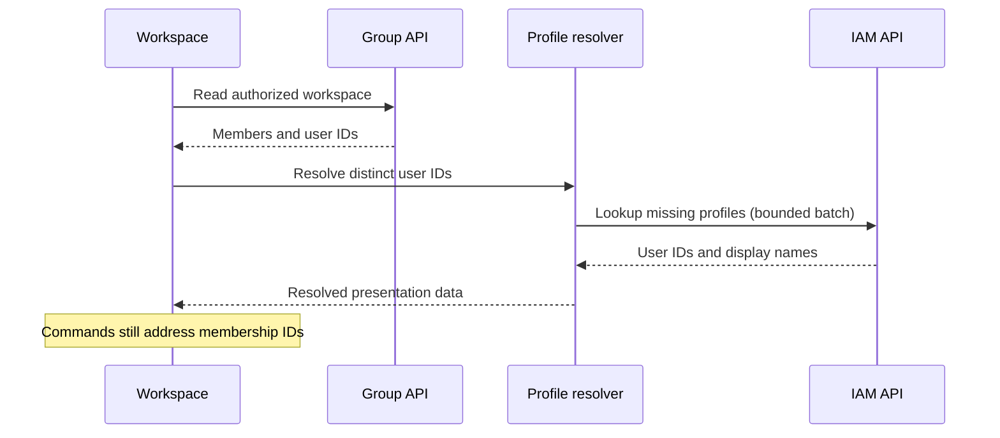

# P2.2f - Mandatory display names and user profile resolution

**Status:** Maintainer-approved specification. The architectural direction and precise API, migration, cache and presentation contracts were approved in task discussion. See the [backlog](../backlog.md) and [implementation plan](plan.md).

## Purpose and scope

The Group workspace currently identifies members by IAM user UUID. A UUID is appropriate for references and commands, but not for recognizing people, especially when selecting expense participants or confirming administrative actions. ShareWise needs a reusable way to present user identities without moving IAM-owned profile data into each domain's persistence or response contracts.

This task follows [P2.1a registration](../p2.1a-registration-auth/specification.md), [P2.1c account profiles](../p2.1c-account-updates/specification.md) and [P2.2b membership administration](../p2.2bc-group-workspace/specification.md). IAM makes display names mandatory and publishes a narrow authenticated lookup; the frontend combines the resulting profiles with Group-owned membership facts. The same capability is usable by Finance when its UI is implemented. No Finance integration, profile search/directory, unique handles, group aliases, profile pictures, replication of names, account lifecycle changes, new credentials or new dependencies are in scope. Existing [distributed authorization](../../../architecture/distributed-authorization.md), identity/session behavior and Group authorization remain unchanged.

## Identity and information ownership

A display name is mutable, non-unique presentation data. UUIDs remain the authoritative identity in persisted references, events, UI selection keys and commands. IAM owns both the private account projection and a separate minimal public-facing projection; Group Management and Finance own the resource facts that identify relevant users. Neither reads IAM tables or needs a synchronous profile capability. The browser resolves IDs through IAM and composes presentation independently of resource admission.

Display names and their associated user IDs are **authenticated-public**: any caller admitted by a valid primary IAM JWT can resolve a known user ID, regardless of shared group membership. The user must be informed of that visibility when choosing or editing a name. UUIDs are not access-control secrets. The lookup does not expose a list-all or search capability, email addresses, credential/session state, membership information or account eligibility. A Group roster attestation would introduce another credential profile, size bounds and historical-member disclosure rules for a relatively low-sensitivity projection; synchronous roster queries would also introduce unnecessary cross-context dependencies. Neither is warranted for the MVP. Disabled accounts remain resolvable while their profile exists, so disabling login does not remove historical attribution. This does not authorize disabled accounts to log in or change the existing stateless bearer admission/revocation model. Permanent deletion/anonymization remains the separate P2.1e policy gate.

## Mandatory profile lifecycle

- **UP-01:** Every successfully registered or migrated IAM account has exactly one profile row with a non-null display name. Preserve the existing `identity.user_profiles` PK/FK and separate credential storage. No uniqueness constraint on the name; multiple accounts may have identical names. The database enforces at most one profile per account, its account FK, non-nullability and existing name checks. The account-to-profile existence invariant is established by migration and maintained by the account creation transaction, not by an additional reverse FK, trigger or cross-context constraint. Direct test/developer seed paths must supply valid profiles too.
- **UP-02:** Require 1–80 Unicode code points including a letter or number and the [shared Unicode input policy](../../../stack/security.md#human-readable-text-validation). Preserve accepted display names exactly; reject disallowed characters rather than silently removing them. Use the same framework-independent singleton for existing human-readable Group name and description input; keep length, meaningful content, normalization and multiline constraints domain-owned. Passwords, email and protocol fields retain their independent policies. Frontend forms provide basic input hints; returned domain text is not revalidated against input rules. Structural and security-sensitive protocol checks remain. Render names as text, not markup; display names do not establish uniqueness, verified legal identity or authority.
- **UP-03:** Add a forward-only Flyway migration after the current migrations. Preserve existing non-null names byte-for-byte; populate existing null names and insert missing profiles for all accounts, including disabled ones, using `User ` followed by the last eight lowercase hexadecimal characters of the canonical user UUID. The fallback is deterministic, valid under the name policy and intentionally non-unique. Do not derive it from email or expose any part of the email. Tighten the column to `NOT NULL` and reconcile the existing CHECK definitions without weakening their non-null value semantics. Migration must not modify credentials, sessions, events, user IDs, membership or history. Apply with registration writers stopped; deploy matching backend/frontend together. The old registration path could create accounts without profiles, so rolling back only the application while retaining the migrated schema is not a supported mixed-version mode. Test fresh and upgrade migrations and regenerate checked-in IAM jOOQ metadata against real PostgreSQL, not manually. The stricter shared input policy does not alter this migration or add a legacy compatibility path. Incompatible development-only data can be reset.
- **UP-04:** Registration validates the complete command before hashing or database effects. Insert the account and its required profile within the same physical IAM transaction as initial session/refresh establishment and any existing registration event publication. Return success only after commit; duplicate email, profile insertion failure, later authentication/publication failure or rollback must leave no orphan account/profile/session or committed registration fact. Preserve password hashing outside the transaction and existing unknown-outcome recovery. Do not put mutable display names into identity lifecycle events or JWTs.
- **UP-05:** Own-account reads return a non-null name. Own-account updates replace the name only, under existing active-account serialization and identity selection. Remove the clear operation, nullable read behavior and first-write upsert as a repair mechanism. A missing profile for an existing account violates the lifecycle invariant and must be treated as an infrastructure/data-integrity failure, not ordinary absence or a silently generated name. Disabled/absent accounts retain existing own-account denial behavior. The account page shows read-only email, current display name, generated avatar and own short identifier; full UUID is available in a detail/copy affordance.

## HTTP and application contracts

The following contracts extend the existing `/api/iam/v1` API. Reuse existing ingress, typed application commands/results, operation scopes, transactions, strict DTO parsing and `ProblemDetail` conventions. Separate registration from login credentials rather than introducing an optional name field in a shared login DTO.

| Method and route | Request | Success |
| --- | --- | --- |
| `POST /auth/register` | `{ "email": "...", "password": "...", "displayName": "Alex Morgan" }` | Existing `201` authentication response and cookie behavior |
| `POST /auth/login` | Existing email/password DTO | Unchanged |
| `GET /account` | Primary bearer | Existing account projection with required `displayName` |
| `PATCH /account` | `{ "displayName": "Alex Morgan" }` | `200` with updated account projection |
| `POST /profiles/lookup` | `{ "userIds": ["<uuid>", ...] }` | `200 { "profiles": [{ "userId": "<uuid>", "displayName": "..." }, ...] }` |

**UP-06:** Registration requires a display name and has no password-confirmation wire field. Account PATCH drops the `clear` field; missing/null/invalid name is rejected. Strict unknown-field handling remains in force. This is a coordinated v1 contract change for the MVP, not a backwards-compatible rolling upgrade. Review every internal caller, test fixture, smoke script and deployed test route using registration/account DTOs. Preserve existing registration/login CSRF and Origin checks, session renewal/recovery behavior, password-change security and error classification. Field validation returns existing typed field errors; malformed JSON/shape returns the existing malformed-request result.

**UP-07:** Profile lookup is an authenticated read-only application operation even though POST carries the bounded request body. It requires a verified primary bearer and does not request supplementary evidence or apply a Group policy. Cookie alone is insufficient. A successful response is non-cacheable by HTTP intermediaries. It contains only the requested, existing user IDs and names. Accept zero to 100 UUIDs per request, count raw entries before deduplication, reject a missing/null list, null or invalid elements, and oversized input with HTTP 400. Deduplicate valid IDs and return each found profile once (deterministic first-request order); empty input returns an empty result without a database query. Omit unknown IDs without per-ID eligibility or membership information. An existing account missing its mandatory profile is an integrity failure, not a known-unknown result. Do not translate outages into an empty response. Use an IAM-owned set-based projection, bounded by the validated batch, with no per-user query, cross-context data access or full-account materialization. Check both the minimal response allowlist and real bearer admission in tests. No dedicated search or anonymous discovery surface.

## Frontend registration and profile resolution

**UP-08:** Extend the registration form with required display name and repeated password fields. Suggest the email local part while the name field remains unedited, provided the suggestion passes the basic frontend input hints. Manual edits, including clearing the field, stop automatic suggestions for that form. Explain that the suggested name is visible to signed-in users; never derive migration defaults from email. Use basic display-name input hints and existing password rules, reject mismatch locally before any registration submission, preserve password text exactly and send only one password. Map server display-name field errors to the correct input; preserve focus/error handling, disabled pending state, invitation return paths and uncertain registration recovery. Do not add credentials to persistence or cross-tab state. Reuse the confirmation pattern for the new password in the Account password-change form (client-only); login continues to use the unchanged two-field contract. Account editing no longer offers clearing the name, and shows its visibility within ShareWise.

**UP-09:** Provide a stateless, batch-oriented profile resolver through the session-bound authenticated API facade. Deduplicate requested IDs, execute serial batches of at most 100 and return the complete per-ID result, distinguishing missing from unavailable. Consumers own their requests and cancellation; canceling skips undispatched batches without delaying unrelated consumers. Check the authenticated lifetime across awaits and reject late results from a replaced session, including replacement with the same session ID. Do not introduce a shared cache, per-ID work queue, polling, rename synchronization or a new framework. Keep profile resolution separate from authorization CC/RC. A new resolution reads current data; already-mounted views have ordinary snapshot semantics. Reconsider caching only after measuring actual request load. Uncertain Account mutation outcomes retain the existing reload-before-retry behavior.

**UP-10:** Resolve a workspace's distinct member IDs in one consumer-level batch operation and compose the result with existing Group DTOs. Name lookup does not block or invalidate the authorized workspace or its mutation capabilities. Loading has an accessible placeholder; a known missing profile has a distinct unknown-user fallback; transient lookup failure preserves an available name from the current view snapshot for the same ID and authenticated facade (including overlapping roster changes), marking it potentially outdated or uses a temporary unavailable label with the stable short ID. Offer bounded user-initiated retry or refresh via the existing view pattern, and never treat failure as an absent profile; authoritative missing results discard retained names. Preserve selected mutation targets, self markers, membership IDs, role restrictions, confirmation behavior and responsive workspace layouts. Resolve data at the consumer/provider boundary, not by making each avatar or row initiate its own HTTP request. Reuse the same result for rows, accessible action labels and confirmation dialogs.

## User presentation and disambiguation

**UP-11:** Provide shared, domain-independent user identity presentation components (for example `UserAvatar` and `UserIdentity`) and pure helpers. The UUID is the stable input to a documented deterministic hash over its canonical hexadecimal representation, deriving hue and saturation in HSL space and constraining lightness to retain at least WCAG AA text contrast against white initials in supported light/dark themes. Do not generate or persist additional profile attributes. Avatar initials derive from the resolved display name and a deterministic fallback is available without a name. The same UUID produces the same color across names, pages and sessions; color collisions are acceptable and color is never the sole discriminator. Keep the mapping centralized and test it with stable vectors. Follow the [frontend design foundation](../../../design/sharewise-design-foundation.md) and existing component/styling conventions.

**UP-12:** Use the last eight lowercase hexadecimal UUID characters as the default secondary identifier (`#a8d291cf`). Because UUIDv7 includes time in its prefix, the suffix is useful for recognition but not guaranteed unique. Compute identifiers for the relevant set of distinct users, extending colliding suffixes until they are unique within that set (up to all 32 hexadecimal characters, or the full UUID). Use the same computed identifier in lists and their confirmation dialogs; no collision can cause two targets to become indistinguishable. Always show the secondary identifier in member administration and consequential selection/confirmation contexts, including future expense participant selectors. Compact informational views may omit it when identity ambiguity is harmless. Display the full ID in detail/copy affordances where useful, without making it the primary label. Names, initials, color and short IDs are never keys for selection or authorization. The own-account short ID helps users communicate which identity belongs to them; contextual extensions retain the same suffix. Keep the secondary identifier visually and directionally isolated from user-supplied name text, including composed administrative accessible labels. Strip explicit bidi controls from those label strings before adding independent name and identifier isolates. Keep compact identity labels on one line with ellipsis for overflow, preserving the complete name in the accessible text and title and allowing wrapping in consequential confirmations. Keep the self marker and secondary identifier visible. Center avatars and member option controls vertically and place the role badge beside the name, top-aligned. Use Admin consistently in user-facing Group role labels, without changing role contracts. Ensure long or duplicate names and identifiers work at mobile widths, with keyboard/screen-reader labels that distinguish targets independently of color. No avatar-picture feature or new persisted field is required.

## Acceptance scenarios

| ID | Level | Required observation |
| --- | --- | --- |
| UP-T01 | PostgreSQL migration/codegen | Upgrade from the predecessor schema with valid existing names, null names and absent rows (including disabled accounts); verify exact preservation/backfill, name constraints, FK/PK and duplicate-name acceptance. Fresh migration and generated-source freshness pass. |
| UP-T02 | Unit + HTTP + PostgreSQL E2E | Required display-name validation for register/update (null, whitespace, boundary lengths, multilingual text, default-ignorables, unsupported characters, control/invalid scalar); shared Group input policy and isolated malformed JSON types; account update cannot clear or target another user. Registration creates account/profile/session atomically; duplicate email and injected profile/later-step failure cannot leave partial state. Existing name/profile update serialization and credential/session regressions remain green. |
| UP-T03 | HTTP + PostgreSQL | Lookup requires real primary bearer (anonymous/invalid/cookie-only denied), resolves arbitrary known IDs without Group evidence, includes disabled targets without exposing status, omits unknown IDs, rejects malformed/null/oversized input, deduplicates and uses a bounded set query. Empty batch succeeds; outages and broken lifecycle are not false missing results. Verify response fields and no-store. |
| UP-T04 | Frontend component + transport | Registration and new-password confirmation block mismatch locally; requests carry no confirmation field, login contract unchanged, validation field focus and invitation/uncertain-outcome paths preserved. Account cannot clear name. |
| UP-T05 | Frontend resolver | Deduplication, 100-ID boundary/chunking, complete large results, fresh reads across calls, failure distinct from missing, view-local stale-name retention across retry and overlapping roster changes, consumer-owned cancellation, session replacement/disposal including late completion. No authorization cache coupling. |
| UP-T06 | Frontend presentation | Deterministic HSL/contrast/initials/suffix mapping, two identically named users with colliding colors and short suffixes, collision extension including full-ID fallback, own label, accessible names and stable UUID action targets. Long names and fallback labels work without overflow or color-only cues. |
| UP-T07 | Deployed HTTPS + human browser | Clean registration (including mismatch), existing migrated account, rename, duplicate names in a group, member removal/role confirmation targeting intended membership, navigation/view snapshot and fresh re-entry resolution, failed lookup fallback/retry and logout/account replacement. Exercise existing refresh and invitation flow; inspect desktop/intermediate/mobile and light/dark. Update production-style smoke and test-only authorization fixtures to use required registration name. |

Acceptance requires applicable Unit, real PostgreSQL Integration/E2E, generated-source freshness, frontend lint/typechecks/tests/builds/static export, deployment smoke and manual browser results, followed by independent review and maintainer merge authorization. Record actual evidence and environmental gaps in task-local acceptance artifacts. Do not treat compilation or mocked persistence as migration/transaction verification.
