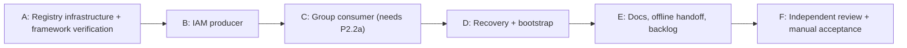

# P2.4a: IAM user registration events implementation plan

**Status:** Phases A–E implemented on `task/p2.4a-iam-user-events` (MR !38); Phase F acceptance in progress. **Workflow:** [AI development and quality assurance](../../../development/ai-development-workflow.md).

## Baseline and sequencing

- [x] Specification and plan are reviewed and committed to `task/p2.4a-iam-user-events` before dependent implementation is accepted.
- [x] Each phase starts from the last approved commit on the task branch, merged with the current `main`. Phases are delivered as separate, reviewable patches; a phase is checked only after the human has reviewed it and its gate passed.
- [x] Validation for every phase: `./mvnw verify` in the dev container (Unit, Integration and E2E against PostgreSQL 18) and the green GitLab pipeline for the pushed commit. A Maven success without PostgreSQL is not evidence for registry behavior.

**Dependency split.** P2.1a (producer) is merged into `main`. P2.2a (`groups.users`, `GroupUserRegistry`) is still under review. Phases A and B depend only on `main` and can be implemented immediately. Phase C and the bootstrap part of Phase D start after P2.2a is merged and the task branch has been updated from `main`.

## Phase A - Registry infrastructure and framework verification

**Scope:** D1, D2, D3, D8, D12; answers Q3. No business event yet.

- [x] Add the Spring Modulith JDBC event registry dependencies (managed by the existing 2.2.0 BOM) and the Jackson serializer required by the registry.
- [x] Add the Flyway migration `platform/V<timestamp>__platform_event_publication_registry.sql`: create schema `messaging`, the current Spring Modulith 2.2 PostgreSQL `event_publication` table and both indexes verbatim, grant `USAGE` on the schema and `SELECT, INSERT, UPDATE, DELETE` on the table to `sharewise_app`.
- [x] Configure `spring.modulith.events.jdbc.schema=messaging`, `spring.modulith.events.jdbc.schema-initialization.enabled=false`, `spring.modulith.events.completion-mode=delete`.
- [x] Bound Boot's application task executor (core = max, bounded queue, graceful shutdown) and add `@EnableAsync` in shared infrastructure (D12).
- [x] **Framework verification E2E (test sources only):** a test-local event, publisher operation and listener (`@Async @TransactionalEventListener(id = …)`) that dispatches an operation through `OperationDispatcher` **without inputs** and commits via `Transactions`. Establish and record:
  - the publication row is visible inside the producer transaction, committed with it (observed on an independent connection while delivery is held) and absent after producer rollback;
  - after a successful consumer commit, the row is deleted;
  - when the consumer throws after a write, its write rolls back and the row remains `FAILED` with `completion_attempts` ≥ 1; resubmission completes it;
  - when the consumer's **commit** fails (deferred constraint), the row remains `FAILED`;
  - stored `listener_id` equals the explicit ID;
  - dispatch without identity inputs yields an anonymous operation (Q3);
  - the listener runs on the bounded executor (thread name prefix `sharewise-async-`).
- [x] Pin `spring.modulith.events.completion=in-interceptor` with a comment explaining the mechanism (D8).
- [x] Exclude the registry auto-configurations from the two database-free component tests (`FullApplicationIamIngressTests`, `IamAuthenticationHttpTests`); rollback-only Integration tests never commit and therefore never deliver.

**Phase A evidence (2026-11-22):** `./mvnw verify` green in the dev container against PostgreSQL 18 with the first version of `EventPublicationRegistryE2E`. The independent review confirmed the migration matches the non-legacy Spring Modulith 2.2 schema, the property names, grants and listener-ID handling, and found that in-listener completion only applies to `@Transactional` listeners, so the setting does not change behavior for our listener (D8 rewritten, value pinned). The review round strengthened the E2E (producer-transaction visibility, held delivery, exception after a write, attempt count, executor thread) and must be re-verified.

**Gate A:** `./mvnw verify` green with the review-round test; human review of the migration and D8.

## Phase B - IAM producer

**Scope:** D4, D5, D11 (producer side); EV-01, EV-02, EV-07; TC-02, TC-03, TC-08 (payload part).

- [x] Create package `de.hsh.favs.sharewise.identity.events` with `@NamedInterface("events")` and the record `UserRegisteredV1(UUID eventId, UUID userId, Instant occurredAt)`.
- [x] Add an IAM-internal port `UserEventPublisher` and a Spring adapter over `ApplicationEventPublisher`; wire it into `RegistrationService` and publish only on the `COMMIT` path, inside the existing segment. `eventId` is generated once at publication.
- [x] Unit tests: `RegistrationService` publishes exactly one event on success and none on `EMAIL_UNAVAILABLE`.
- [x] E2E (with a test-only listener, since the Group consumer arrives in Phase C): committed registration produces one publication row whose payload holds only the three fields; duplicate email and forced rollback produce none.

**Gate B:** `./mvnw verify` green; event contract reviewed (it becomes a persisted format).

**Phase B notes:** `UserRegisteredPublicationE2E` holds a test-only listener, inspects the committed row (listener ID, user ID, no email/credential/session data), and covers ABSTAIN, a signer failure before publication and an injected failure just before the physical commit after publication (TC-02, TC-03, TC-08). `IamAuthenticationIT` uses a no-op publisher because its rollback-only transactions never deliver.

## Phase C - Group consumer (after P2.2a merge)

**Scope:** D6, D7, D11 (consumer side); EV-03, EV-04, EV-05, EV-08, EV-09; TC-01, TC-04, TC-05, TC-06, TC-10, TC-11.

- [x] Update the task branch from `main` (with P2.2a) and run the unchanged checks.
- [x] Add `groups` → `identity::events` to Group's `allowedDependencies`.
- [x] Add the operation-scoped Group entry operation `IamUserProjectionService` that calls `GroupUserRegistry.provision(userId)` in one `Transactions.execute(...)` segment and commits.
- [x] Add the listener `@Async @TransactionalEventListener(id = "groups.iam-user-projection.v1")` that dispatches `IamUserProjectionService` without identity inputs. Remove the Phase B test-only listener.
- [x] Unit tests for the operation (fake registry) and the module-boundary verification (TC-10).
- [x] E2E: TC-01 (register → projected → publication deleted), TC-04 (sequential and concurrent duplicate delivery), TC-05 (first attempt fails, resubmission succeeds), TC-06 (commit failure keeps the publication), TC-11 (immediate group creation is `201` or `403 group_user_unknown`, then succeeds).
- [x] Replace P2.2a's manual `groups.users` provisioning note (S3) with automatic provisioning in the developer docs.

**Phase C notes:** Applied after P2.2a–c landed on `main` (via P2.2bc); the registry and bootstrap migrations were renumbered after the latest `main` migrations (`V202611251400`, `V202611251410`; renumbered again to `V202611281000`, `V202611281010` after P2.2f added `identity/V202611271640`), and `GroupMigrationE2E` now asserts that the bootstrap projects the pre-existing account instead of inserting it manually. The listener dispatches through an event-side `ContributingOperationDispatcher` (Q3). `IamUserProjectionE2E` covers TC-01 (registration → `groups.users` → publication completed), TC-04 (sequential and concurrent duplicates), TC-05 with a real database failure (revoked `INSERT` on `groups.users`, then resubmission) and TC-09 (bootstrap statement on a seeded account, executed twice). TC-06 is proven generically by `EventPublicationRegistryE2E`; TC-07 (restart) and TC-11 (immediate group creation) are part of manual acceptance TC-12. The Phase B probe E2E now filters on its own listener ID because the real consumer also receives each registration.

**Gate C:** `./mvnw verify` green; Dennis reviews the Group-side change.

## Phase D - Recovery and bootstrap

**Scope:** D9, D10; EV-06, EV-10; TC-07, TC-09.

- [x] Configure `republish-outstanding-events-on-restart=true` and the staleness durations (`staleness.published` above the worst-case queue wait); document the single-instance assumption next to the property.
- [x] Add `@EnableScheduling` once in shared infrastructure; the staleness monitor and the resubmitter depend on it.
- [x] Add a scheduled `FailedEventPublications` resubmitter that runs outside any transaction, with backoff (filter on `lastResubmissionDate`/`completionAttempts`, exponential and capped), `withMaxInFlight`, configurable interval and structured log lines.
- [x] Never abandon: keep `abandon-after-attempts=-1`, add a context test asserting that no `AbandonPolicy` bean exists and document that `applyAbandonPolicy()` must not be called (DELETE mode would delete abandoned publications).
- [x] E2E: a publication stuck in `PUBLISHED` becomes `FAILED` through the staleness monitor and is then delivered by the resubmitter.
- [x] Add the Flyway data migration copying existing `identity.users.id` into `groups.users` with `ON CONFLICT DO NOTHING`, versioned after the registry and both feature migrations; document the stop → migrate → start precondition (D10).
- [x] E2E: TC-09 (bootstrap statement on a seeded pre-existing account, executed twice; in `IamUserProjectionE2E`). TC-07 (restart republication) moves to manual acceptance TC-12, because the E2E harness cannot restart a context on the same database.
- [x] Document the operator procedure for renamed or removed listeners (specification failure table).

**Phase D notes:** The recovery part (everything except the bootstrap migration, TC-07 and TC-09) is independent of P2.2a and implemented ahead of Phase C: `EventPublicationRecoveryConfiguration` (`@EnableScheduling`, settings), `FailedPublicationResubmitter` (exponential backoff on `lastResubmissionDate`/`completionAttempts`, `withMaxInFlight`, no-op without a registry), unit tests for the backoff, and `EventPublicationRecoveryE2E` (stuck `PUBLISHED` row → staleness → resubmission → delivered; no `AbandonPolicy`). TC-07 and the bootstrap follow with Phase C because they need the real consumer.

**Gate D:** `./mvnw verify` green; retry/staleness defaults approved (Q4).

## Phase E - Documentation, offline handoff and backlog

- [x] Reconcile steady-state documentation: [messaging architecture](../../../stack/messaging.md) (implemented for the first integration; chosen completion, recovery and retention settings), [persistence architecture](../../../architecture/persistence.md) (`messaging` schema and grants), [Phase 2 foundation](../../integration/phase-2-foundation.md), [backend testing guide](../../../development/tests.md) and [development guide](../../../development.md) (inspecting `messaging.event_publication`, manual resubmission).
- [ ] Refresh and verify the offline dependency handoff after the POM change (`scripts/test-offline-handoff.sh`). **Deferred** to the next handoff: the handoff is an external artifact, not part of this merge (see Phase E notes).
- [x] Backlog: mark P2.4a (and P2.2d's consumer part, if Q1 is accepted) complete; record that P2.4b/P2.4c move to Phase 3 with P3.2 (Q5).

**Phase E notes:** The operator procedure for renamed or removed listeners and the implemented settings are in the [messaging architecture](../../../architecture/messaging.md); inspection and immediate retry are in the [development guide](../../../development.md#inspect-and-resubmit-event-publications). The developer guide no longer asks for manual `groups.users` inserts. The offline handoff is an external artifact, not a repository file: the POM change invalidates existing handoffs, so the next handoff must be repacked with `scripts/create-offline-handoff.sh pack` and checked with `scripts/test-offline-handoff.sh` (still open).

**Gate E:** Docs reviewed; offline handoff test passes.

## Phase F - Review and acceptance

- [x] Independent agent review of the complete MR against this specification; resolve or justify findings.
**Phase F review (2026-11-26):** An independent agent reviewed the full MR merged with `main` (including P3.2a) against the specification and the Spring Modulith 2.2.0 sources. No blockers. Resolved: (1) the resubmitter's backoff filter only saw `maxInFlight` rows because the framework limits its read before filtering, so not-yet-due old failures could starve newer ones; the framework now reads `batchSize` rows and the filter accepts at most `maxInFlight` due ones per run (unit tests added); (2) the filter deserialized payloads for logging, so one incompatible payload would abort every run; it now logs only ID and attempts; (3) TC-04's concurrent part never raced two first inserts; `IamUserProjectionE2E` now holds an uncommitted competing insert of a new ID, verifies the projection waits on it and succeeds after commit with exactly one row; (4) stale status lines and doc details (restart vs. `RESUBMITTED`, clock and payload-compatibility notes). Accepted as is at the time: the registry uses the existing `Clock` bean (documented; superseded by the merge note below); TC-06 is proven with the probe consumer in `EventPublicationRegistryE2E`, not the Group consumer; TC-07 (restart) remains part of manual acceptance.

- [x] Manual acceptance TC-12 on the local production-style Compose stack (register in the browser, create a group without manual provisioning; restart with a pending publication). Record results here.
**Manual acceptance (2026-11-27, Katja):** Local production-style Compose stack (`deploy/`, `bootstrap.sh`, HTTPS on `localhost:8443`) built from `task/p2.4a-iam-user-events` at `61381b7`.
- **TC-12 / TC-11:** A newly registered account created a group directly in the browser, without manual `groups.users` provisioning; the creator was shown as administrator. `messaging.event_publication` was empty afterwards (publication completed and deleted).
- **TC-07 / recovery:** With `INSERT` on `groups.users` revoked from `sharewise_app`, a second new account was registered. Group creation returned *account not yet available* (`403 group_user_unknown`), and the registry held one `groups.iam-user-projection.v1` row in status `FAILED` with one completion attempt. After granting `INSERT` again and restarting the backend, the table was empty within a minute and the second account created a group successfully. Restart republication and scheduled resubmission cannot be told apart in this check; either path completed the outstanding publication without loss.
- Re-creating a group with an already projected account under the revoked grant still succeeded, as expected.

**Merge with `main` (2026-11-28, P2.2f and P2.5):** Conflicts resolved; registration calls in the P2.4a tests pass the new display name; main's new database-free tests use the shared registry exclusion; migrations renumbered to `V202611281000`/`V202611281010` after `identity/V202611271640`. An independent review of the merged state found one blocker: P2.5 added a second unqualified `Clock` bean (`groupAuthorizationClock`) next to `iamClock`, so Spring Modulith's unqualified clock lookup became ambiguous and the full application (IAM enabled) failed to start. Both module clocks are now qualifier-only (`defaultCandidate = false`); the registry falls back to the system UTC clock.

- [ ] Human merge authorization.

## Risks and notes

- **Persisted event type:** `UserRegisteredV1`'s fully qualified class name is stored in the registry. Moving or renaming it later requires draining outstanding publications first.
- **Framework defaults:** Spring Modulith 2.x changed completion and status handling. Phase A treats the framework as untrusted until the E2E evidence exists.
- **Integration suite:** rollback-only tests never commit, so they never deliver events. Delivery behavior is E2E-only, as defined in the [test architecture](../../../architecture/tests.md).
- **Multi-instance deployments** would need to revisit restart republication (D9); ShareWise currently deploys one backend instance.
