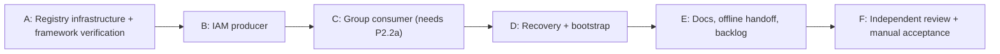

# P2.4a: IAM user registration events implementation plan

**Status:** Draft for review, together with the [P2.4a specification](specification.md). **Workflow:** [AI development and quality assurance](../../../development/ai-development-workflow.md).

## Baseline and sequencing

- [ ] Specification and plan are reviewed and committed to `task/p2.4a-iam-user-events` before dependent implementation is accepted.
- [ ] Each phase starts from the last approved commit on the task branch, merged with the current `main`. Phases are delivered as separate, reviewable patches; a phase is checked only after the human has reviewed it and its gate passed.
- [ ] Validation for every phase: `./mvnw verify` in the dev container (Unit, Integration and E2E against PostgreSQL 18) and the green GitLab pipeline for the pushed commit. A Maven success without PostgreSQL is not evidence for registry behavior.

**Dependency split.** P2.1a (producer) is merged into `main`. P2.2a (`groups.users`, `GroupUserRegistry`) is still under review. Phases A and B depend only on `main` and can be implemented immediately. Phase C and the bootstrap part of Phase D start after P2.2a is merged and the task branch has been updated from `main`.

## Phase A - Registry infrastructure and framework verification

**Scope:** D1, D2, D3, D8, D12; answers Q3. No business event yet.

- [ ] Add the Spring Modulith JDBC event registry dependencies (managed by the existing 2.2.0 BOM) and the Jackson serializer required by the registry.
- [ ] Add the Flyway migration `platform/V<timestamp>__platform_event_publication_registry.sql`: create schema `messaging`, the current Spring Modulith 2.2 PostgreSQL `event_publication` table and both indexes verbatim, grant `USAGE` on the schema and `SELECT, INSERT, UPDATE, DELETE` on the table to `sharewise_app`.
- [ ] Configure `spring.modulith.events.jdbc.schema=messaging`, `spring.modulith.events.jdbc.schema-initialization.enabled=false`, `spring.modulith.events.completion-mode=delete`.
- [ ] Add one bounded async executor and `@EnableAsync` in shared infrastructure (D12), with graceful shutdown.
- [ ] **Framework verification E2E (test sources only):** a test-local event, publisher operation and listener (`@Async @TransactionalEventListener(id = …)`) that dispatches an operation through `OperationDispatcher` **without inputs** and commits via `Transactions`. Establish and record:
  - publication row is written in the producer transaction and absent after producer rollback;
  - after a successful consumer commit, the row is deleted;
  - when the consumer throws, the row remains and is marked failed;
  - when the consumer's **commit** fails, the row remains (decides `spring.modulith.events.completion`, D8);
  - stored `listener_id` equals the explicit ID;
  - dispatch without identity inputs yields an anonymous operation (Q3).
- [ ] Pin the verified `spring.modulith.events.completion` value with a comment explaining the evidence.
- [ ] Confirm existing Unit tests do not start the registry without a datasource, and Integration tests (rollback-only) never trigger after-commit delivery.

**Gate A:** `./mvnw verify` green; migration reviewed; framework verification evidence recorded in this plan; completion setting decided.

## Phase B - IAM producer

**Scope:** D4, D5, D11 (producer side); EV-01, EV-02, EV-07; TC-02, TC-03, TC-08 (payload part).

- [ ] Create package `de.hsh.favs.sharewise.identity.events` with `@NamedInterface("events")` and the record `UserRegisteredV1(UUID eventId, UUID userId, Instant occurredAt)`.
- [ ] Add an IAM-internal port `UserEventPublisher` and a Spring adapter over `ApplicationEventPublisher`; wire it into `RegistrationService` and publish only on the `COMMIT` path, inside the existing segment. `eventId` is generated once at publication.
- [ ] Unit tests: `RegistrationService` publishes exactly one event on success and none on `EMAIL_UNAVAILABLE`.
- [ ] E2E (with a test-only listener, since the Group consumer arrives in Phase C): committed registration produces one publication row whose payload holds only the three fields; duplicate email and forced rollback produce none.

**Gate B:** `./mvnw verify` green; event contract reviewed (it becomes a persisted format).

## Phase C - Group consumer (after P2.2a merge)

**Scope:** D6, D7, D11 (consumer side); EV-03, EV-04, EV-05, EV-08, EV-09; TC-01, TC-04, TC-05, TC-06, TC-10, TC-11.

- [ ] Update the task branch from `main` (with P2.2a) and run the unchanged checks.
- [ ] Add `groups` → `identity::events` to Group's `allowedDependencies`.
- [ ] Add the operation-scoped Group entry operation `ProjectIamUser` that calls `GroupUserRegistry.provision(userId)` in one `Transactions.execute(...)` segment and commits.
- [ ] Add the listener `@Async @TransactionalEventListener(id = "groups.iam-user-projection.v1")` that dispatches `ProjectIamUser` without identity inputs. Remove the Phase B test-only listener.
- [ ] Unit tests for the operation (fake registry) and the module-boundary verification (TC-10).
- [ ] E2E: TC-01 (register → projected → publication deleted), TC-04 (sequential and concurrent duplicate delivery), TC-05 (first attempt fails, resubmission succeeds), TC-06 (commit failure keeps the publication), TC-11 (immediate group creation is `201` or `403 group_user_unknown`, then succeeds).
- [ ] Replace P2.2a's manual `groups.users` provisioning note (S3) with automatic provisioning in the developer docs.

**Gate C:** `./mvnw verify` green; Dennis reviews the Group-side change.

## Phase D - Recovery and bootstrap

**Scope:** D9, D10; EV-06, EV-10; TC-07, TC-09.

- [ ] Configure `republish-outstanding-events-on-restart=true` and the staleness durations; document the single-instance assumption next to the property.
- [ ] Add a small scheduled `FailedEventPublications` resubmitter (configurable interval, minimum age, batch size) with structured log lines; keep `abandon-after-attempts=-1`.
- [ ] Add the Flyway data migration copying existing `identity.users.id` into `groups.users` with `ON CONFLICT DO NOTHING`, versioned after the registry and both feature migrations.
- [ ] E2E: TC-07 (pending publication survives context restart and is delivered), TC-09 (bootstrap migration on a database with pre-existing accounts; idempotent).

**Gate D:** `./mvnw verify` green; retry/staleness defaults approved (Q4).

## Phase E - Documentation, offline handoff and backlog

- [ ] Reconcile steady-state documentation: [messaging architecture](../../../stack/messaging.md) (implemented for the first integration; chosen completion, recovery and retention settings), [persistence architecture](../../../architecture/persistence.md) (`messaging` schema and grants), [Phase 2 foundation](../../integration/phase-2-foundation.md), [backend testing guide](../../../development/tests.md) and [development guide](../../../development.md) (inspecting `messaging.event_publication`, manual resubmission).
- [ ] Refresh and verify the offline dependency handoff after the POM change (`scripts/test-offline-handoff.sh`).
- [ ] Backlog: mark P2.4a (and P2.2d's consumer part, if Q1 is accepted) complete; record that P2.4b/P2.4c move to Phase 3 with P3.2 (Q5).

**Gate E:** Docs reviewed; offline handoff test passes.

## Phase F - Review and acceptance

- [ ] Independent agent review of the complete MR against this specification; resolve or justify findings.
- [ ] Manual acceptance TC-12 on the local production-style Compose stack (register in the browser, create a group without manual provisioning; restart with a pending publication). Record results here.
- [ ] Human merge authorization.

## Risks and notes

- **Persisted event type:** `UserRegisteredV1`'s fully qualified class name is stored in the registry. Moving or renaming it later requires draining outstanding publications first.
- **Framework defaults:** Spring Modulith 2.x changed completion and status handling. Phase A treats the framework as untrusted until the E2E evidence exists.
- **Integration suite:** rollback-only tests never commit, so they never deliver events. Delivery behavior is E2E-only, as defined in the [test architecture](../../../architecture/tests.md).
- **Multi-instance deployments** would need to revisit restart republication (D9); ShareWise currently deploys one backend instance.
