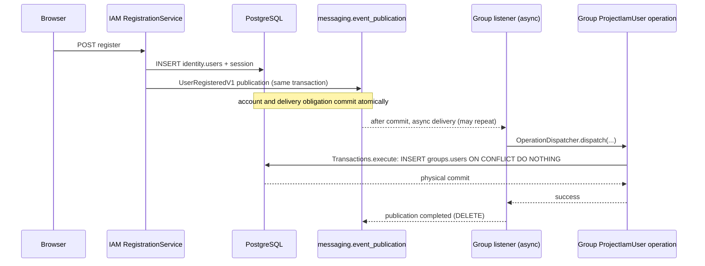

# P2.4a: First durable integration — IAM user registration → Group user projection

**Status:** Draft for review; approval pending. Because the team prioritized P2.4, Phase A (framework verification) was implemented ahead of formal approval; its evidence is recorded in the [plan](plan.md) and feeds back into D8. **Scope:** [P2.4a](../backlog.md#p24---durable-cross-context-event-integration), delivered together with its real consumer from [P2.2d](../backlog.md#p22---group-management-vertical-slices), as the backlog requires ("neither task independently proves the end-to-end delivery guarantee"). **Workflow:** [AI development workflow](../../../development/ai-development-workflow.md); an implementation plan follows after this specification is approved.

## Starting point and objective

`main` contains Spring Modulith 2.2.0 for **structure verification only** (`spring-modulith-api`, test-scoped `spring-modulith-core`), the P1.2 PostgreSQL/Flyway foundation with separate migrator and application roles, the P1.3 `Transactions` and operation-scope (`OperationDispatcher`) foundations, and the P2.1.0 security foundation. The producer side is merged; the consumer side is in flight:

- **P2.1a** (merged): `identity.users` and `RegistrationService.register(...)`, which inserts the account and the initial session in one `Transactions.execute(...)` segment. Its specification explicitly leaves `UserRegistered` publication to P2.4a/P2.2d.
- **P2.2a** (`task/p2.2a-group-creation`): `groups.users(id uuid PRIMARY KEY)` and the Group-internal port `GroupUserRegistry` with an idempotent `provision(UUID)` write (`INSERT … ON CONFLICT DO NOTHING`), documented as the single write path for P2.2d's event consumer. Group operations reject callers missing from `groups.users` with `403 group_user_unknown`.

**Objective:** A user who registers through IAM becomes known to Group Management **automatically and durably**, without any cross-context table access at runtime. IAM records the account and a delivery obligation in one PostgreSQL transaction; Group Management applies the fact in its own, separate transaction. Duplicate, delayed and retried delivery is harmless, and a failure leaves a recoverable publication rather than a silently lost user.

This task establishes the **reusable delivery infrastructure** (registry, listener pattern, recovery configuration, test fixtures) for later events, without building a speculative messaging framework. Infrastructure and producer work (plan Phases A and B) build on `main`; the consumer and bootstrap (Phases C and D) start after P2.2a is merged.

## Out of scope

- **P2.4b/P2.4c** (membership events and their first consumer). The backlog forbids registering unused consumers; the first real membership subscriber is Finance's `FinancialActor` synchronization (P3.2). They are therefore scheduled with Phase 3 and do **not** block P2.4a acceptance.
- **Account deletion** (`UserDeleted`): only the contract name is reserved (D9). Publication and consumption wait for the P2.1e lifecycle/ordering policy.
- **Authoritative IAM lookup on a local miss** (P2.1d/P2.2e). Until then the documented temporary `403` during registration-to-projection lag remains.
- Broker externalization, Kafka/RabbitMQ, a custom outbox, a generic Group inbox, a transactional inbox framework.
- Observability dashboards and alerting beyond structured log lines (P8.1).

## Architectural solution

### Decisions

| ID | Decision | Rationale and consequences |
| --- | --- | --- |
| **D1** | Add Spring Modulith's JDBC event publication registry (`spring-modulith-starter-jdbc` or the equivalent `spring-modulith-events-jdbc` + `spring-modulith-events-jackson` artifacts, versioned by the existing 2.2.0 BOM). | Implements the [messaging architecture](../../../stack/messaging.md) without a custom outbox. The POM change requires **refreshing and revalidating the offline dependency handoff** before merge. |
| **D2** | The registry lives in a dedicated schema **`messaging`**, created by a reviewed Flyway migration under `db/migration/platform/` that installs the **current (non-legacy) Spring Modulith 2.2 PostgreSQL schema** verbatim (table `event_publication` plus its two indexes). Framework schema initialization is disabled (`spring.modulith.events.jdbc.schema-initialization.enabled=false`), the table is referenced via `spring.modulith.events.jdbc.schema=messaging`, and `use-legacy-structure` stays `false`. `sharewise_app` receives `USAGE` on the schema and `SELECT, INSERT, UPDATE, DELETE` on the table; no `CREATE`. | The registry is shared **delivery infrastructure**, not IAM or Group business data, so it belongs to neither context schema. Flyway owns DDL; the application role cannot alter it. Schema upgrades on future Modulith versions become reviewed migrations. |
| **D3** | **Completion mode `DELETE`** (`spring.modulith.events.completion-mode=delete`). | Required by the messaging architecture: completed publications are removed and no completed-publication purge job is needed. Failed and outstanding publications stay. |
| **D4** | **Event contract** `UserRegisteredV1` is an immutable Java record in a new published named interface **`identity::events`** (package `de.hsh.favs.sharewise.identity.events`). Fields: `eventId` (UUID, generated once when published), `userId` (IAM user ID), `occurredAt` (`Instant`, metadata only, not ordering authority). It contains **no** email, password hash, session or token data. There is no separate producer/type/version field: the fully qualified type name (`identity.events`, suffix `V1`) is the logical producer, type and version required by the messaging architecture. | Versioned, minimal business fact; the consumer only needs the stable ID. The record is serialized into the registry, so the class/package name is part of the persistence contract: renaming it requires draining or migrating outstanding publications (messaging architecture). Data minimization keeps PII out of the long-lived registry. |
| **D5** | **Producer:** IAM publishes through an IAM-internal port (e.g. `UserEventPublisher`) backed by Spring's `ApplicationEventPublisher`, called **inside** `RegistrationService`'s existing `Transactions.execute(...)` segment and only on the successful `COMMIT` path. The `EMAIL_UNAVAILABLE` (`ABSTAIN`) path publishes nothing. | Business change and delivery obligation commit or roll back together. Application/domain code does not depend on Spring Modulith types. |
| **D6** | **Consumer ingress:** a thin Group listener annotated with `@Async` and `@TransactionalEventListener(id = "groups.iam-user-projection.v1")`, **not** `@ApplicationModuleListener` and **not** `@Transactional`. It dispatches a Group entry operation (e.g. `ProjectIamUser`) through `OperationDispatcher` **without identity evidence** (event data is historical, not authentication of the consumer). The operation calls `GroupUserRegistry.provision(userId)` in its own `Transactions.execute(...)` segment and commits. | Follows the messaging architecture: the application operation owns the physical transaction; the listener owns none. The explicit, versioned listener ID is stored in the registry and must stay stable across refactoring. Reuses P2.2a's single write path (S2) instead of a second writer. The listener **must stay `@Async`**: restart republication and resubmission invoke it through its proxy from framework code, and `Transactions` refuses to start inside an unrelated Spring transaction, so a synchronous invocation inside a caller's transaction would fail every time. |
| **D7** | **Idempotency without an inbox:** the `groups.users` primary key plus `ON CONFLICT DO NOTHING` makes duplicate and concurrent delivery a no-op. No Group inbox table. | The [Phase 2 foundation](../../integration/phase-2-foundation.md#independent-development-and-eventual-integration) explicitly allows this: inserting a known ID has no further effect, ordering does not matter while only registrations exist. **Revisit when `UserDeleted` arrives** (P2.1e), because then a late registration must not resurrect a deleted identity. |
| **D8** | **Completion only after the consumer's physical commit.** `spring.modulith.events.completion=in-interceptor` is pinned. Spring Modulith's in-listener completion is only attached to listeners that are themselves `@Transactional`; our listener owns no transaction, so the completion interceptor marks the publication completed in a separate transaction **after the listener returned**, which is after `ProjectIamUser`'s segment committed. An exception or commit failure propagates out of the listener and marks the publication failed instead. Phase A proves this with a deferred-constraint commit failure and an exception after a write. | A completion recorded before the consumer commit could lose a user on crash. Duplicate delivery after commit is harmless (D7); lost delivery is not. Pinning the value documents the contract even though both values behave identically for non-transactional listeners. |
| **D9** | **Recovery (single-instance deployment):** `republish-outstanding-events-on-restart=true`; `@EnableScheduling` is configured once (the staleness monitor is a scheduled task and does nothing without it); the staleness monitor moves stuck `PUBLISHED`/`PROCESSING`/`RESUBMITTED` publications to `FAILED`, with `staleness.published` set above the worst-case executor queue wait so queued hand-offs are not duplicated needlessly. A small scheduled job, running **outside** any transaction, resubmits `FAILED` publications via `FailedEventPublications.resubmit(...)` with **backoff** (filter on `lastResubmissionDate` and `completionAttempts`, exponentially spaced and capped) and bounded in-flight resubmissions (`withMaxInFlight`). **Never abandon:** `abandon-after-attempts=-1`, no `AbandonPolicy` beans, and `applyAbandonPolicy()` is never called, because under completion mode `DELETE` abandoned publications are deleted. Each resubmission is logged with publication ID, event type and attempt count; listener failures are logged by Spring's async exception handling. | ShareWise runs **one backend instance** (P2.6), so restart republication is safe; the framework warns against it only for multi-instance deployments, which must revisit this decision. `minAge` alone compares against the original publication date and would retry a poisoned publication every interval forever; backoff and a concurrency bound satisfy the messaging architecture. Exact durations are tunable and not business rules. |
| **D10** | **Bootstrap of existing accounts:** a one-time Flyway **data migration** inserts all existing `identity.users.id` into `groups.users` (`ON CONFLICT DO NOTHING`), ordered after both feature migrations and the registry migration. | The registry cannot replay registrations from before the listener existed. Flyway runs before the application accepts requests and before the listener is registered, so no registration falls into a gap, **provided the previous backend instance is stopped before the new one migrates** (stop → migrate → start, as in the single-instance deployment; messaging architecture: "while application writes are suspended"). The [messaging architecture](../../../stack/messaging.md#recovery-and-retention) explicitly permits such a controlled deployment-time initialization; it is **not** runtime cross-context access. On fresh databases (CI, new deployments) it inserts nothing. |
| **D11** | **Module boundaries:** `identity` adds the named interface `identity::events`; `groups`, which already depends on IAM's top-level API (`IdentityContext`), adds `identity::events` to its `allowedDependencies` and uses no IAM internals. Spring Modulith verification enforces this. A `UserDeletedV1` contract is **reserved by name only** and not created. | Keeps the event contract as the only coupling point. |
| **D12** | **Async execution:** asynchronous listeners run on Spring Boot's application task executor, bounded through `spring.task.execution.*` (fixed pool, core = max, bounded queue) with graceful shutdown; `@EnableAsync` is configured once in shared infrastructure. A full queue rejects the hand-off: Spring runs after-commit listeners in `afterCompletion`, which logs the `TaskRejectedException` without affecting the already committed producer, and the publication stays `PUBLISHED` until the staleness monitor or a restart recovers it (D9). The executor is shared with Spring MVC async processing, which ShareWise does not use. | Avoids unbounded executors and silent loss on shutdown. Phase A asserts that listeners run on this executor (thread name prefix), so a configuration change cannot silently bypass it. |

### Rejected alternatives

- **`@ApplicationModuleListener`:** wraps the handler in `@Transactional(REQUIRES_NEW)`, which would delay the physical commit of our application-owned segment until after the facade returns (messaging architecture).
- **Synchronous call from IAM into Group** during registration: couples IAM's commit to Group availability and violates context ownership.
- **Group inbox table:** no benefit while `groups.users` insertion is already idempotent (D7).
- **Registry in `public` or a context schema:** `public` is not covered by our grants model; a context schema would make delivery infrastructure look like business data of one context.

## Requirements and invariants

| ID | Requirement / invariant |
| --- | --- |
| **EV-01** | A committed registration always has exactly one durable `UserRegisteredV1` publication per registered listener, committed in the **same** transaction as the `identity.users` row. |
| **EV-02** | A rolled-back or abstained registration (e.g. duplicate email, rollback-only, commit failure) leaves **no** publication. |
| **EV-03** | The Group projection is applied in a **separate** transaction owned by a Group operation; IAM registration success never depends on Group processing. |
| **EV-04** | Delivering the same event any number of times, sequentially or concurrently, results in exactly one `groups.users` row and no error. |
| **EV-05** | A publication is completed (deleted) **only after** the consumer's physical commit. A consumer exception, rollback or commit failure leaves it incomplete and recoverable. |
| **EV-06** | Incomplete and failed publications are retried automatically (restart republication, staleness, scheduled resubmission) and are never deleted or abandoned without operator action. |
| **EV-07** | The serialized event contains only `eventId`, `userId` and `occurredAt`; no credentials, email or session data are persisted in the registry. |
| **EV-08** | At runtime, IAM never writes Group tables and Group never reads IAM tables; the only coupling is `identity::events`. The single deployment-time exception is the D10 bootstrap migration. |
| **EV-09** | The listener ID stored in the registry is the explicit, versioned `groups.iam-user-projection.v1`. |
| **EV-10** | After the bootstrap migration, every `identity.users.id` that existed before the listener was deployed is present in `groups.users`. |

## Failure behavior

| Situation | Effect |
| --- | --- |
| Group listener throws / database unavailable during consumption | Consumer transaction rolls back; publication stays `FAILED`; scheduled resubmission retries; registration remains successful. |
| Backend crashes after IAM commit, before delivery | Publication stays outstanding; republished on restart. |
| Backend crashes after consumer commit, before completion | Publication redelivered; `ON CONFLICT DO NOTHING` makes it a no-op; then completed. |
| Executor queue full / shutdown during hand-off | Rejection is logged after the producer committed; the publication stays `PUBLISHED`; the staleness monitor marks it `FAILED` and resubmission delivers it, or restart republication does. |
| Listener ID renamed or listener removed | Resubmission cannot find the listener and the publication stays `FAILED`. Operator procedure: drain outstanding publications before renaming, otherwise update `listener_id` in a reviewed migration or delete the obsolete rows deliberately. |
| Incompatible serialized payload (e.g. renamed class) | Repeated failure, publication retained and logged for operator resolution; never silently dropped. |
| User calls a Group operation before projection completes | Existing P2.2a behavior: `403 group_user_unknown`, no Group writes; succeeds after delivery. Removed later by P2.2e. |

## Test cases

Test kinds follow the [backend test architecture](../../../architecture/tests.md): Unit (`*Test`), rollback-isolated PostgreSQL Integration (`*IT`) and real-commit PostgreSQL E2E (`*E2E`). Registry behavior depends on physical commits, so the delivery cases are **E2E**.

| ID | Kind | Setup → action | Expected outcome |
| --- | --- | --- | --- |
| **TC-01** | E2E | Register a new user through `RegistrationService`. | `identity.users` row and `messaging.event_publication` row committed together; eventually `groups.users` contains the ID and the publication is deleted. |
| **TC-02** | E2E | Register with an already used email. | No new account, **no** publication row. |
| **TC-03** | E2E | Force the registration segment to roll back after publishing (rollback-only / injected failure before commit). | Neither account nor publication exists. |
| **TC-04** | Unit + E2E | Invoke `ProjectIamUser` twice sequentially and from two concurrent physical transactions for the same ID. | Exactly one `groups.users` row; both calls succeed. |
| **TC-05** | E2E | Make the consumer fail (injected fault) for the first attempt, then succeed. | After the failure the publication is still present (`FAILED`, `completion_attempts` ≥ 1); after resubmission the user is projected and the publication deleted. |
| **TC-06** | E2E | Make the consumer's **commit** fail (e.g. deferred constraint or injected commit failure). | Publication **not** completed (proves D8). |
| **TC-07** | E2E | Publish, stop the context before delivery, start a new context. | Restart republication projects the user; publication deleted. |
| **TC-08** | Integration | Read the stored publication. | `listener_id = 'groups.iam-user-projection.v1'`; `serialized_event` contains no email/hash fields. |
| **TC-09** | E2E (migration) | Fresh bootstrapped database migrated with Flyway up to the version before the bootstrap migration, seeded with `identity.users` rows, then migrated fully. | All IDs projected; rerunning the statement is a no-op. |
| **TC-10** | Unit (architecture) | Spring Modulith verification. | `groups` uses IAM only through its top-level API and `identity::events`; no IAM internals are referenced. |
| **TC-11** | E2E | Register a user, then immediately create a group with that user's token. | Either `201` (already projected) or `403 group_user_unknown`; after delivery completes, creation succeeds. No Group writes on the `403`. |
| **TC-12** | Manual E2E | On the local production-style Compose stack: register in the browser, create a group; restart the backend with a pending publication (e.g. listener temporarily failing). | Group creation works without manual `groups.users` provisioning; pending publication is processed after restart. Recorded in the acceptance notes. |

## Acceptance criteria

1. All test cases above pass in CI (Unit, Integration, E2E gates) against PostgreSQL 18.
2. The registry schema is Flyway-owned; Hibernate `validate` and the module verification pass; the offline handoff is refreshed and verified.
3. The developer procedure for manually provisioning `groups.users` (P2.2a S3) is removed or reduced to a note, since registration now provisions automatically.
4. Steady-state documentation is reconciled: [messaging architecture](../../../stack/messaging.md) (status: implemented for the first integration, chosen completion/recovery settings), [persistence architecture](../../../architecture/persistence.md) (`messaging` schema and grants), [Phase 2 foundation](../../integration/phase-2-foundation.md), developer docs (how to inspect/resubmit publications) and the backlog.
5. Independent agent review completed; manual acceptance TC-12 recorded.

## Open questions

| ID | Question | Proposal |
| --- | --- | --- |
| **Q1** | Ownership of the consumer (P2.2d): Katja implements it inside this task, or Dennis adds it to Group Management? | Katja implements the small listener + `ProjectIamUser` operation in this task using P2.2a's `GroupUserRegistry`, with Dennis as reviewer for the Group side. |
| **Q2** | Schema name for the registry. | `messaging`. |
| **Q3** | Does dispatching through `OperationDispatcher` without any identity input work for a system operation today, or does it need an explicit "no evidence" contributor? | Verify in plan Phase A; if needed, add a minimal non-HTTP dispatch path, not a fake identity. |
| **Q4** | Retry cadence and staleness durations (D9). | 1-minute resubmission with 1-minute minimum age, 5-minute staleness; tunable via properties. |
| **Q5** | P2.4b/P2.4c timing: confirm they move to Phase 3 together with P3.2 rather than blocking the Phase 2 gate. | Yes; record in the backlog when P2.4a is marked complete. |
