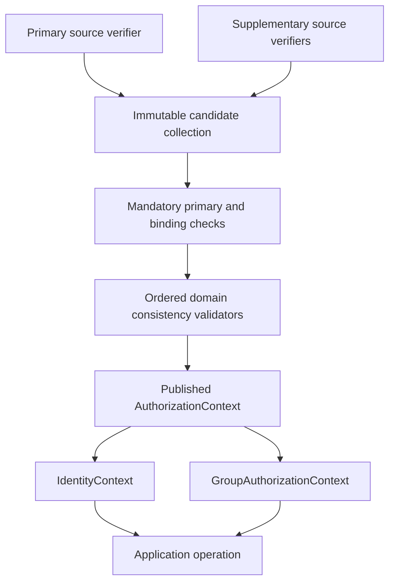
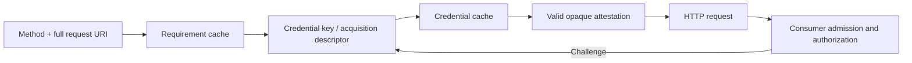
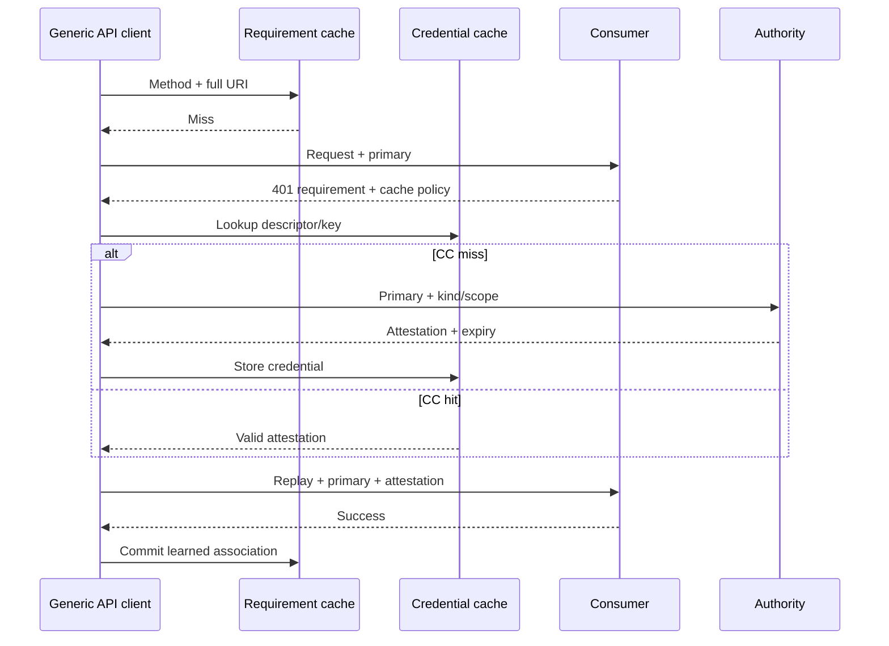

# P2.5 - Distributed authorization: specification

**Status:** Proposed target state for human review, covering P2.5a/b. The architectural direction was agreed during task discussion; this document and the accompanying [implementation plan](plan.md) require approval before implementation. This is not a description of deployed behavior.

## Purpose and scope

ShareWise uses short-lived signed credentials to carry authority-owned facts between bounded contexts without synchronous coupling on ordinary requests. IAM authenticates a user and establishes a stable session. Group Management attests organizational membership; Finance interprets that evidence in conjunction with its own financial invariants. Consumers that need fresher information explicitly consult the relevant authority at the point of use.

P2.5a extends the [implemented claims and JWT foundation](../../../architecture/authorization.md) with independent credential verification, contextual correlation, supplementary HTTP ingress and Group semantic authorization. P2.5b supplies authoritative membership verification, issuance and a generic browser acquisition/recovery protocol. The [security design](../../../stack/security.md), [claims-context proposal](../../../stack/claims-context-proposal.md), [operation scope](../../../architecture/dependency-injection.md) and [frontend architecture](../../../architecture/frontend.md) describe the starting contracts. This specification refines their target-state proposals where indicated; the historical [P2.1.0 specification](../p2.1.0-security-foundation/specification.md) remains the record of that task.

The first production downstream Finance APIs belong to Phase 4. P2.5 proves the vertical using a test-only consuming operation, not a production demonstration endpoint or a new attestation requirement on existing Group CRUD. P4.5 in the [backlog](../backlog.md) owns live Finance integration; Phase 3 remains independent of issuance.

## DA-01 - Authority, consistency and trust

A primary JWT authenticates the principal; a subordinate JWT carries facts issued by an explicitly trusted domain. The trust hierarchy has two levels: primary credentials may enable subordinate issuance, but a subordinate credential cannot authenticate a caller, enable further issuance or replace the primary. All downstream admissions require a valid primary and valid, session-bound supplementary evidence. Session binding is to the primary issuer, issuer-qualified profile trust relationship, user and stable session ID, not JWT ID, signature or bearer generation.

Group issues attestations from current Group-owned membership state using an admitted primary JWT. Issuance does **not** synchronously check IAM session eligibility or attest IAM freshness. A revoked session's unexpired bearer may still enable issuance, but no subordinate extends the usability of the primary: the consumer must independently admit a matching valid primary on every external operation. Refreshing a bearer within the same session preserves compatible attestations, even when the original bearer has expired.

An attestation is a signed, time-bounded projection of authority-owned state. Revocation or downgrade may leave previously issued evidence usable until expiry plus bounded verification skew; a fresh issuance check after a committed role change observes the changed state. An event-projected Finance actor is not organizational authorization. A synchronous authority call establishes point-in-time state, not a lease, lock across domains or elimination of TOCTOU. The consumer chooses freshness requirements based on operation risk (ordinary reads/inconsequential writes may use local evidence; critical writes may require current IAM and Group decisions). Such authority calls occur outside active consumer transaction segments. Finance independently enforces lifecycle, actor eligibility, ownership, revision and monetary invariants.

## DA-02 - Independent verification and contextual admission (P2.5a)

P2.1.0 currently combines subordinate source verification and primary binding in `JwtCredentialCodec.verifySubordinate(token, primary)`. `IamPrimaryCredentialProvider` unwraps `VerifiedJwtCredential` to an `AuthorizationCredential`; `AuthorizationConfiguration` collects ordered operation-scoped providers into an immutable snapshot. Providers have no shared intermediate evidence. The target separates independent verification from correlation without relaxing P2.1.0's requirement that binding precede publication.



**Source verification** checks bounded compact JWS syntax, configured algorithm and key, signature, exact issuer/audience/protected type, lifetime and skew, required claim cardinality/encoding and profile-specific structure. Unverified routing hints only select a locally configured verifier. `JwtCredentialClaims` parses primary `sid` or subordinate `principal_iss`/`principal_sid` without comparing another credential; it retains the verified profile and typed binding information. Domain claim structure (canonical Group UUID and supported role) is validated before publication, not deferred to an arbitrary business caller.

**Contextual admission** runs over an immutable, random-access collection of independently verified proofs. All applicable validation handlers must succeed. Shared mandatory checks enforce zero or one primary, reject subordinate evidence without a primary, enforce trusted issuer-qualified primary profile and exact subject, primary issuer and session linkage for every subordinate. A Group consistency validator rejects conflicting roles for the same issuer/profile/group; it never chooses the stronger role or merges unrelated claims. Identical credential duplicates may be rejected or deduplicated without changing their meaning; the initial wire contract rejects duplicates (DA-03). Different groups may coexist. No handler rewrites claims, drops invalid evidence or synthesizes grants.

The correlation coordinator is a required dependency of `AuthorizationConfiguration`. Mandatory validators are not optional DI contributions; missing mandatory infrastructure fails closed. Domain validators are DI-composed in deterministic order and cannot bypass mandatory validation. Provider ordering no longer determines binding correctness. Preserve scope checks, null rejection, immutable per-credential origin, repeated claim handling and atomic publication: any failed provider or validator aborts admission; no partial `AuthorizationContext` or anonymous fallback escapes. The empty candidate set is legitimate for anonymous operations where admission permits them.

### Conceptual security API

The following contracts illustrate the responsibility split, not mandatory Java names or package placements:

```java
// A profile-bound codec, not a general untrusted JWT decoder.
VerifiedJwtCredentialCandidate verify(String token);

interface AuthorizationCredentialProvider {
    List<VerifiedCredentialCandidate> credentials();
}

interface AuthorizationCredentialValidator {
    void validate(CredentialValidationContext context);
}
```

`VerifiedJwtCredentialCandidate` retains the trusted profile, subject UUID, stable session identifier, optional principal issuer and immutable evidence. Construction is restricted to successful trusted verification. A plain constructible `AuthorizationCredential` is data, not a proof, and cannot satisfy the provider contract. Keep the shared claims API independent of HTTP and domain modules; prefer a narrow format-neutral proof boundary if it can be enforced without a public forgeable constructor or unnecessary abstraction. The exact package/type arrangement must preserve Spring Modulith dependency checks. The published `AuthorizationContext` is the admission boundary; a separate admitted wrapper is needed only if a real intermediate consumer requires it. If compatibility methods such as `verifySubordinate` remain during migration, they must retain their old full-binding guarantee and delegate to the single shared binding algorithm.

Early IAM HTTP admission must still verify primary evidence before dispatch. Carry verified proofs through the existing `OperationInputContributor`, typed `OperationInputRegistry` and scoped initializers (distinct input keys for primary and supplementary collection). Do not use ambient Spring principals, reverify signatures or import another module's internal classes. Ensure candidate correlation is completed before protected operation effects, including when operation beans would otherwise be lazily resolved. Verify scope cleanup on failure and maintain admission for non-HTTP operation fixtures through the same trust boundary. Application-facing identity continues to be derived from the admitted primary, never from subordinate claims.

## DA-03 - Supplementary transport and credential profiles (P2.5a)

The standard `Authorization: Bearer <primary-jwt>` carries only the primary. `ShareWise-Attestation` carries a bounded comma-separated list of compact JWS values; normalize repeated field lines consistently, reject empty/malformed elements and duplicate presented credentials, and never concatenate untrusted input into logs. The router uses `iss` and protected JOSE `typ` solely as untrusted lookup hints into registered profiles. Zero or ambiguous matches, unsupported/untrusted credentials, invalid signature or binding and malformed supplied evidence fail closed, even if unrelated to a particular operation. Valid unrelated evidence cannot grant permission. The API root composes registered handlers without domain-specific routing switches; ingress does not depend on Group persistence. Issuance and IAM cookie operations use their appropriate primary-only/anonymous paths and never require a subordinate.

Profile identifiers remain opaque and explicitly configured. Audience names follow `sw-api-v<version>[-<domain>[-<subdomain>...]]`; the default shared API realm is `sw-api-v1`. There is no wildcard, prefix acceptance or implied hierarchy. Exact configured audience-set validation remains unchanged. Move the current IAM `sharewise-api` default to `sw-api-v1` in a coordinated configuration change (including Compose, examples and tests); outstanding credentials minted with incompatible settings require reauthentication/reissuance. Explicit deployment overrides remain possible and must be coordinated; no silent dual-audience fallback. Shared-realm credentials can intentionally be consumed by several explicitly trusting services, which is a trade-off against per-service audience isolation.

For Group membership the logical authority is `groups`, assertion kind `membership`, protected type `sw-groups-membership+jwt`, local profile `groups-membership`. The predictable `sw-<domain>-<kind>+jwt` and `<domain>-<kind>` conventions do not make a local profile or issuer self-authenticating. Trust still requires configured keys, issuer, profile, type, audience, allowed algorithm and trusted primary profiles. The browser does not parse the JWT to select its trust policy.

| Field | Group attestation |
| --- | --- |
| `iss`, `sub` | Configured Group issuer; verified primary user UUID |
| `principal_iss`, `principal_sid` | Primary issuer and stable session (no primary `sid` claim in subordinate) |
| `aud` | Exact configured audience set, default `["sw-api-v1"]` |
| `jti`, `iat`, `nbf`, `exp` | Unique token ID and bounded temporal validity |
| `group_id`, `role` | Exactly one canonical group UUID and `MEMBER` or `ADMIN` |
| Protected `alg`, `typ`, `kid` | ES256, configured type and trusted key ID |

Default lifetime and maximum lifetime are 120 seconds; use explicitly configured bounded skew within the existing profile limit. Signing uses independent Group key material with the shared ES256 implementation, trusted key selection, overlap during rotation and emergency key removal. IAM keys are never reused for Group signing. Provision persistent independent keys in deployment; reuse suitable key loading/provisioning mechanics without giving IAM ownership of Group trust.

## DA-04 - Semantic Group authorization (P2.5a)

Publish `GroupRole` through the Group module API (reuse the existing organizational enum, not generated persistence types) and an operation-scoped semantic facade:

```java
public interface GroupAuthorizationContext {
    Optional<GroupRole> role(UUID groupId);
    boolean isMember(UUID groupId);
    boolean isAdministrator(UUID groupId);
    Result<GroupRole, GroupAuthorizationFailure> requireMember(UUID groupId);
    Result<GroupRole, GroupAuthorizationFailure> requireAdministrator(UUID groupId);
}
```

The facade selects only admitted evidence from explicitly accepted Group issuer/profile(s) and matches group and role within the same credential. `ADMIN` implies membership. `role()` is empty when evidence does not establish a role, not a statement of current nonmembership. Predicates derive from `role()`; require methods return the established role or typed anonymous, missing-attestation or insufficient-permission failures. Invalid supplied credentials are admission failures, not empty roles. The shared requirement descriptor carries logical authority, assertion kind and scope; consuming services may tag it with their own stable requirement ID. Neither semantic facade nor shared claims layer knows HTTP cache policy. Do not query Group live state from the facade, flatten roles or introduce a generic policy engine.

## DA-05 - Issuance and authoritative Group verification (P2.5b)

Group exposes the following standardized domain-principal namespace, with thin domain-owned adapters and shared protocol DTOs:

```http
POST /api/groups/v1/domain-principal/attestations
Authorization: Bearer <primary-jwt>
Content-Type: application/json
```

```json
{"kind":"membership","scope":"019a9d29-6147-7000-8000-000000000001"}
```

```json
{"attestation":"<compact-jws>","expiresAt":"2026-11-26T12:02:00Z"}
```

The caller requests a kind and scope, never a desired role or arbitrary identity. Validate the supported kind and scope and derive identity/session from admitted primary evidence. Use the existing Group admission and authoritative membership/transaction boundaries (`CallerAdmission`, `GroupAccess`, membership/read ports as appropriate); order the authoritative read against membership updates using the existing Group-root synchronization contract. Check after a committed removal/downgrade must not issue old privileges. An issuance overlapping a later change remains point-in-time evidence, not a reservation. No synchronous IAM eligibility check, persistent attestation table, refresh credential, or event revocation is introduced. Use non-cacheable responses; preserve Group's concealment of inaccessible groups and typed failure semantics. Authority outages and failed signing must not return a credential.

Publish a synchronous local Java API analogous to `IdentityPort`:

```java
public interface GroupAuthorizationPort {
    Result<VerifiedGroupMembership, GroupAuthorizationVerificationFailure>
        verifyCurrent(UUID groupId);
}
```

Success includes the admitted user, group, current role and verification instant. The port checks the current caller's Group membership directly, requires no prior Group attestation, performs no IAM freshness check, and rejects invocation inside an active transaction segment. Follow the established `IdentityPort` distinction between anonymous admission and typed authoritative denial/unavailability. Both issuance and the port share one authoritative membership lookup; Group continues to authorize its own mutations from live state. No schema migration is expected.

The future `/api/{domain}/v{version}/domain-principal/verify` (authoritative current state) and `/domain-principal/introspect` (credential inspection, if needed) endpoints are reserved design directions only. Remote adapters, service authentication and their wire contracts are deferred; verification of authority state is not token introspection.

## DA-06 - Standardized authorization challenges

A consuming operation evaluates semantic authorization before protected effects. Its missing-evidence result identifies the required credential; the consumer assigns a stable, opaque requirement ID local to the operation, distinguishing logical requirements even when authority/kind are identical. The HTTP adapter selects the cache affinity for that requirement ID and serializes a recoverable, effect-free challenge. Controllers do not reimplement membership policy and services do not depend on URI layouts. Multiple independent requirements may have distinct policies; the default is `never` if the adapter cannot establish a stable projection.

```http
HTTP/1.1 401 Unauthorized
Content-Type: application/problem+json
```

```json
{
  "title": "Attestation required",
  "status": 401,
  "code": "attestation_required",
  "detail": "You must be a member of this group to perform this operation.",
  "authorization": {
    "requirementId": "target-membership",
    "credential": {"authority":"groups","kind":"membership","scope":"X"},
    "cache": {"policy":"query_affine","parameters":["target"]}
  }
}
```

Here X is illustrative; Group membership uses a canonical UUID on the wire. The `authorization` extension groups acquisition and affinity information under one root. The shared problem `detail` is safe, human-readable and never parsed for recovery. A terminal issuance denial can surface the original challenge's explanation; retain the cause for classification and diagnostics, and do not disguise an outage as a permission denial. Preserve existing IAM codes and password endpoint behavior. Distinguish invalid supplementary admission (`invalid_attestation`, 401) from missing evidence (`attestation_required`, 401), actual insufficient privilege (`403`), hidden resources (`404`) and authority unavailability (`503` where applicable). An invalid-attestation failure is recoverable only if the ingress identifies the rejected transmitted credential unambiguously (proposed `authorization.rejectedIndex`, a zero-based index in the normalized transmitted list; never echo a token). The handler removes the rejected generation and affected request-local references, then retries without that credential within the same budget; if still required, the consumer may issue a missing-evidence challenge. Ambiguous or uncorrelatable rejection is terminal. Confirm the discriminator and problem mapping in the HTTP implementation review. A valid member attestation when admin is required is a denial, not a renewable challenge.

A recoverable challenge guarantees no protected business effects occurred. Ordinary authorization/input validation is ordered before effects; use Result propagation to stop execution. Checks that require a consumer transaction lock may occur under that lock but must precede effects or guarantee effect-free rollback before a challenge is returned. An arbitrary `401`, uncertain mutation outcome, network failure or non-replayable body never grants permission to replay. No new application policy framework is needed. Standardize challenge response headers with the existing HTTP authentication conventions; no token material, caching or redirection to externally supplied acquisition URLs.

## DA-07 - Generic client handlers and logical request recovery

The existing `lib/api/client.ts` owns transport and one replay through singular hooks. `core/identity/index.ts` supplies IAM-specific hooks; `AuthCoordinator` handles refresh and session lifetime. Extract a generic ordered handler pipeline at the application composition boundary. The transport remains ignorant of IAM routes, Groups, Finance, claim names and domain policy. Domain adapters issue ordinary typed API requests; components do not manage tokens or retries. Existing anonymous routes and caller-supplied explicit Authorization requests do not receive managed session attestations or automatic credential recovery. IAM-specific behavior stays in an IAM handler. A single generic attestation handler speaks the standardized protocol for every compliant authority; no per-authority switch or endpoint-specific credential declaration is required.

Handlers prepare requests, inspect classified failures and propose recovery. The transport owns replay, immutable original body/target, actual transmitted credential generation, cancellation and a shared logical-request recovery context. Issuance detours use a primary-only path within the same context and may recover primary authentication but never acquire subordinate credentials recursively. Derive acquisition URL from a bounded validated authority identifier and configured same-origin API namespace/version; do not follow arbitrary URLs or credential-bearing redirects. Only accept structured challenges from the trusted API origin and intended logical request. Extend the current `ApiError`/`parseErrorResponse` boundary, which drops unknown problem fields, to preserve a validated authorization extension without changing existing field errors or trusting a payload status over the actual HTTP status. Validate response shape, size and expiry; tokens remain opaque to the browser. Preserve existing first-use restoration, stable session binding, single-flight IAM refresh, Web Locks/CSRF, cross-tab context handling, exact bearer invalidation and terminal password-session denial. Uncertain cookie mutations are never retried. Session replacement or cancellation terminates recovery; late results cannot publish stale credentials or associations into a new lifetime.

Proposed initial recovery limits: one primary refresh recovery, at most three distinct supplementary recovery actions, four total recoveries per logical request including detours. Cache-hit challenge replay consumes a recovery action. Track satisfied requirement identity and credential key/generation; repeated identical missing-evidence challenge after presentation terminates, even if a handler could issue again. If distinct requirements ask for an already transmitted valid credential, do not replay an unchanged credential set merely to satisfy another identifier. Changed scope for a requirement may replace the old association but cannot reset the total budget. Keep all necessary supplementary credentials for the current logical request, deduplicated; when a requirement changes remove the old reference unless still needed by another requirement. Preserve the exact prepared business request across allowed retries; the terminal response is never itself a new opportunity to restart the budget. A canceled waiter does not abort unrelated waiters sharing an issuance flight; canceled/replaced operations cannot replay. Final numerical limits are reviewed with implementation configuration, not unbounded protocol behavior.

## DA-08 - Independent credential and requirement caches

Both caches are bounded, private tab-memory state owned by the authenticated lifetime, not a page or API adapter. The credential cache (CC) stores opaque signed attestations and advisory expiry metadata. The requirement cache (RC) stores learned request-context projections and references to CC keys. Neither cache participates in authorization correctness: disabling either only increases network work.

A credential key is a collision-free canonical tuple of logical authority, kind and scope, implicitly scoped to authenticated session and configured API realm/version/audience. The acquisition descriptor contains those same values; it is retained by RC or the referenced immutable key, not independently editable metadata that can disagree with the key. If consumer-specific audiences are introduced, they must become explicit key dimensions. CC holds one current credential generation per key with single-flight acquisition; expiration/eviction removes only that generation. Rejection must not evict a newer generation that another request acquired. No JWT or cache content enters persistent storage or logs.

The RC lookup accepts HTTP method and complete request URI (origin, path and query; no body). It first selects a bucket by exact origin/method/path and then a learned consumer-local requirement ID. Each requirement has its own policy and projected-key-to-credential-key associations. This lets several endpoints refer to one CC entry, and several requirements of one endpoint refer to different entries with independent projections. Scope is opaque; the browser never derives a Group ID from a route template. Projection is structural, distinguishes missing/empty/repeated parameters, and preserves significant ordering; avoid ambiguous string concatenation or unsafe normalization. Use the same canonical pathname and full target that will actually be dispatched (the existing client hooks only receive the pathname). If a selected query cannot be projected unambiguously under the HTTP adapter's parsing semantics, omit the prediction. No body inspection, regex, policy DSL or global transmission of all cached credentials.

| Policy | Projection within exact origin/method/path bucket |
| --- | --- |
| `never` (default/unknown) | No learned association |
| `path_affine` | No query dimension |
| `request_affine` | Entire request query, preserving the actual request-target semantics |
| `query_affine` | Selected named query parameters, bounded list, with all values and presence |

`request_affine` means request target, not headers/body. The HTTP adapter opts in only when the projected components reliably identify the required evidence; body-dependent or conditional requirements use `never` unless a stable URI projection is known. An incorrect prediction may disclose irrelevant evidence and incur a challenge but cannot authorize a different resource. Different learned policies for the same requirement replace that requirement's projection and entries, not other requirements. Malformed/unknown cache policy is treated as `never`, not as a broader match. Bounds apply to policy count, parameter selectors, cache entries, keys and total attached header size; use deterministic bounded eviction and omit excess optional predictions. Never drop newly required evidence silently to bypass a limit: fail the logical request if its required set cannot fit.



At dispatch, resolve all matching RC references and attach only their unexpired CC entries, plus credentials acquired for the current logical request. Deduplicate by credential identity; do not send unrelated credentials or proactively issue for stale affinity entries. On challenge, look up CC first, issue only on miss, and replay with the accumulated applicable evidence. A different scope for the same requirement replaces the affected association, not the valid old credential itself. `never` removes any affected old association and prevents learning a new one, but still permits CC reuse and request-local attachment. Stage learned affinities until successful business replay; failure must not create new associations. Invalidated associations may be removed earlier. A failed acquisition stores no credential; an independently successfully issued credential can remain reusable even if the original business operation later fails. Apply concurrent updates only to the same authenticated lifetime and relevant association/generation; a late response must not overwrite newer learned state. Normal primary rotation preserves both caches; session replacement, logout and invalidation clear both and cancel pending publication. Expired CC entries may leave RC references until bounded eviction; renew lazily on the next challenge.

### Representative flows

A cold request without RC or CC entries adds two round trips to the successful business request: one rejected business attempt to discover the requirement and one issuance request. A new endpoint with an already cached credential adds only the discovery round trip. A warm request needs two local lookups and one business dispatch.



For a transfer with source X in the path, destination Y in the query and a hypothetical Files ownership Z derived from its body, use three requirement IDs with `path_affine`, `query_affine(destination)` and `never` respectively. Sequential cold challenges accumulate X, Y, Z without effects until all requirements pass (seven HTTP requests). On subsequent identical transfers, RC resolves X and Y; the ownership challenge reuses Z from CC without reissuance (two HTTP requests). These are hypothetical integration fixtures, not new production features. A changed destination or timestamp is handled by projection, not policy interpretation in the client. A changed server-side requirement replaces only its old association. If the role no longer suffices, `403` stops recovery. If issuance is denied, the original operation is not replayed.

## Acceptance cases and evidence

The cases below specify central correctness properties; implementation adds focused component tests for its actual APIs. Unit/Spring HTTP tests are not proof of committed PostgreSQL state or deployed ingress behavior. See the [test architecture](../../../architecture/tests.md) and [test guide](../../../development/tests.md).

| ID | Setup and action | Expected outcome | Verification |
| --- | --- | --- | --- |
| DA-T01 | Real signed primary/subordinate fixtures; tamper signature, issuer/type/audience, alg/key, claims, times and boundaries | Valid candidates only; all malformed/untrusted sources rejected, no raw material in errors | Backend Unit/crypto |
| DA-T02 | Independently valid subordinate alone, wrong user/issuer/session/primary profile, multiple primary credentials; reverse provider order | No publication on invalid correlation; valid pair invariant under provider ordering; same-session bearer rotation works | Backend Unit/scope |
| DA-T03 | Null/wrong-scope provider, missing mandatory infrastructure or throwing validator; concurrent/nested operations | Fail closed atomically; independent immutable snapshots, no partial identity or scope leak | Backend Unit/Modulith |
| DA-T04 | A ADMIN, B MEMBER, absent C; conflicting same-group roles; malformed roles | Same-credential resource match; ADMIN is member; B not admin; C missing evidence; conflicts/malformed rejected | Backend Unit |
| DA-T05 | Multiple header lines, valid unrelated, unknown/ambiguous profile, duplicate/empty/oversized input, anonymous primary | Strict bounded routing, no trust discovery; malformed admission before effects; valid unrelated no grant | Spring HTTP/Unit |
| DA-T06 | Issue as member/admin, nonmember/unknown, downgraded/removed after commit, concurrent mutation | Current role only, concealment preserved, outstanding credentials expire within configured bound; no new old-role issuance after commit | PostgreSQL Integration/E2E + crypto |
| DA-T07 | Revoked IAM session with unexpired primary, then expired primary; successful same-session refresh | Issuance uses admitted primary only; consumer requires valid matching primary; no IAM freshness call during issuance | HTTP/Unit + E2E |
| DA-T08 | Invoke port before/inside transaction; member, removed user, authority outage | Authoritative typed decision with observed instant, no attestation prerequisite or implicit IAM lookup; active segment rejected | Unit + PostgreSQL Integration/E2E |
| DA-T09 | Rotate Group keys with overlap then remove old key; use IAM key/token for Group | Old and new accepted only during configured overlap; independent authorities and strict profiles | Crypto/configuration + deployment |
| DA-T10 | Cold request, warm request, new endpoint sharing CC | Respectively 3, 1, 2 HTTP requests; no domain-specific frontend handling | Vitest + HTTP fixture |
| DA-T11 | Path/query-affine requests change target, timestamp, method, origin, repeated/empty/missing query; body/conditional `never` | Correct collision-free selection; no inferred body policy; unknown hints conservative | Vitest |
| DA-T12 | Several requirements, independent projections; same credential satisfies two; changed scope/policy | Accumulate distinct credentials; deduplicate; replace only changed association, preserve unrelated CC/RC | Vitest + HTTP fixture |
| DA-T13 | Expiry, rejected older generation, concurrent acquisition, canceled waiter, session replacement during acquisition/replay | Single flight per key; no stale overwrite or cross-session effects; expiry independent of RC; unaffected waiters complete | Vitest |
| DA-T14 | Repeated challenge, recursive issuance challenge, malformed authority/redirect, exhausted budget | Bounded detours and replay; never contact untrusted origin; no nested budget reset | Vitest/HTTP |
| DA-T15 | Missing attestation vs insufficient role, failed issuance, 503, arbitrary 401, non-repeatable body, timeout | Only explicit pre-effect recoverable challenge replays; preserve detail/cause; no mutation on denied attempts or IAM logout on Group denial | Vitest + Spring HTTP effect counter |
| DA-T16 | Existing login/refresh/password/logout behavior, explicit bearer and anonymous routes, concurrent cookie changes and session replacement | All existing IAM/frontend guarantees survive generic handler migration | Existing and extended frontend/backend regression suites |
| DA-T17 | Real issuance through HTTP, test-only consumer admits then checks role and performs a counted effect | Actual signed evidence round trip, challenge/replay once, no effects on rejected attempts; test-only route absent from production | HTTP integration + deployed ingress smoke/manual operational acceptance |

## Exclusions and review decisions

No durable attestation state, revocation feed, new role schema, generic policy engine, public JWKS discovery, automatic key rotation, remote verification/introspection, body projection, regex/templating DSL, global credential broadcast, batched challenge response, or production Finance feature is part of P2.5. Future audience narrowing or additional affinity strategies extend explicit contracts, not implicit trust. The two-cache and recovery designs remain independent of backend domain policy.

Review before implementation: confirm the suggested profile/header/API spellings and numerical recovery defaults, and the coordinated IAM audience migration. Exact candidate proof/package design, HTTP rejection discriminator, bounded header/cache configuration values and HTTP error mapping are first-phase implementation design details subject to human review; no weakening of the specified guarantees is permitted. Real Finance consumers and operation-specific freshness policy are P4.5 acceptance work, not claimed by P2.5.
