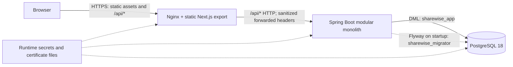

# P2.6a/b: Production packaging and registry publishing specification

**Status:** Architecture and implementation sequence approved November 20, 2026. Local Compose and protected-tag preview publishing were accepted; final release/retention verification and merge authorization remain pending. **Scope:** [P2.6a and P2.6b](../backlog.md#p26---production-packaging-deployment-and-cicd). **Implementation plan:** [Approved plan](plan.md), following the [AI development workflow](../../../development/ai-development-workflow.md).

## Starting point and objective

At the start of P2.6a/b, ShareWise had a Java 25 / Spring Boot 4.1 modular-monolith backend, PostgreSQL 18 with separate application and Flyway roles, a Next.js 16 frontend, a development Compose database, and GitLab build/test/security jobs. The backend Dockerfile packaged an already-built JAR, while the frontend Dockerfile served a Next.js standalone server. The frontend's static-export test established that the available routes could be generated without a Next.js server. The existing backend health route was `GET /api/system/v1/health`, whose readiness indicators included a database check. These are the *historical starting-state facts* against which the approved design was reviewed, not the current implementation status; acceptance evidence is tracked in the [implementation plan](plan.md).

P2.6a delivers images and a production-style Compose stack that can be started locally from a clean checkout, provided a container runtime, access to required images and build dependencies, TLS material and local secrets. P2.6b publishes versioned backend and frontend images through the existing GitLab pipeline without Docker-in-Docker, a host Docker socket or privileged runner access. The same images and configuration interfaces must remain usable by the separate P2.6c host-provisioning and P2.6d deployment tasks.

The package boundary does **not** include IAM/Group business functionality, implementing Spring Modulith event publication, Proxmox provisioning, production DNS/certificate issuance, GitOps controllers, registry pull provisioning on hosts, automated rollout/rollback or later P8 operational hardening. This specification must not imply that planned application features are already present.

## Proposed architectural decisions

The following decisions form the approved planning baseline. D9 required a real runner test; the [Phase A evidence](plan.md#phase-a---prove-a-daemonless-runner-build-p26b-feasibility) records the failed rootless BuildKit probe and accepted maintained Kaniko fallback.

| ID | Proposal | Rationale and consequences |
| --- | --- | --- |
| D1 | Publish exactly two application images, `.../backend` and `.../frontend`. The frontend image contains the exported files and Nginx, which is also the public reverse proxy. PostgreSQL remains a separately sourced image. | One deployed Nginx/static frontend, one Spring modular monolith, one PostgreSQL service; no extra Next.js or API gateway process. |
| D2 | Preserve the development Next.js server and its API rewrite, but add an explicit **production static-export build mode** consumed by the frontend Dockerfile. Reuse the existing static-export probe rather than creating a second route/export implementation. | The browser still calls relative `/api/*`; production does not depend on Next.js runtime or `BACKEND_URL`. The ordinary development and test workflows remain usable. |
| D3 | Use a small Java 25 JRE runtime image with a non-root UID, a fixed application JAR and an executable HTTP readiness probe. Use a multi-stage Dockerfile, or another equally reproducible clean-checkout build contract chosen in the implementation plan, so local Compose does not silently require a previously generated `target/` directory. | Avoids a dev SDK in production and makes Compose startup reproducible. The existing Maven Unit/Integration/E2E jobs, not the image builder, remain test authorities. |
| D4 | Compose provides `frontend` (Nginx), `backend` (Spring) and `postgres` (PostgreSQL 18) with an edge network (`frontend`, `backend`) and a data network (`backend`, `postgres`). Publish only the front-end HTTP/HTTPS ports. | Backend port 8080 and database port 5432 are reachable only from the relevant internal services; no host networking or container control socket. |
| D5 | Nginx serves static export files including nested extensionless routes, proxies `/api/*` **without stripping `/api`**, enforces its configured hostnames, and terminates TLS using externally supplied certificate/key files. HTTP redirects to HTTPS. | One browser origin for app and API. No SPA catch-all rewriting unknown paths to the homepage. TLS issuance/renewal itself is P2.6c/d. |
| D6 | Nginx overwrites inbound proxy metadata with trusted values and removes untrusted `Forwarded`/`X-Forwarded-*` variants. Accept only configured frontend hostnames; preserve the intended host, path, query, method, body, and `Set-Cookie` response headers. Configure Spring's forwarded-header handling consistently with this trust boundary. | Avoids forged scheme/client metadata and preserves same-origin cookie and future CSRF semantics. Nginx does not rewrite application cookie attributes or paths. Security-sensitive cookie settings remain owned by the future IAM implementation. |
| D7 | Compose injects configuration and secrets at runtime. Use Compose secrets or protected file mounts for the PostgreSQL administrator password, application-role password, migration-role password and Nginx TLS key; keep only a template and instructions in Git. Add a production-specific PostgreSQL first-initialization script, **not** the existing test bootstrap scripts with `_dev` passwords. | Avoids committing passwords or passing them as Docker build arguments. Use PostgreSQL's `POSTGRES_PASSWORD_FILE` and make Spring read its password values from mounted files (for example via Spring config tree). Required production values fail closed if absent. |
| D8 | PostgreSQL's one-time initialization creates the two logical roles and database grants on an empty volume. PostgreSQL readiness precedes backend startup; Flyway runs as migrator before the backend is ready; runtime SQL uses `sharewise_app`. The frontend may start after backend readiness. | Preserves schema authority, Flyway history and Hibernate validation. Restarting a populated volume does not rerun init scripts; role-password rotation therefore needs separate documented operations later. |
| D9 | Try GitLab's **rootless BuildKit** (`buildctl-daemonless.sh`) first. Prove namespace/mount support on the actual university runner before committing to it; if blocked, evaluate a maintained daemonless Kaniko fork (for example `osscontainertools/kaniko`) and/or rootless Buildah on the same runner. Never use the archived upstream `gcr.io/kaniko-project/executor` image or require Docker socket/privileged mode. | Rootless BuildKit is GitLab's recommended path, but an unprivileged self-managed Docker executor can reject its required system calls. Builder choice is an operational compatibility decision, not a change to image semantics. Pin selected CI builder images to reviewed versions/digests. |
| D10 | Adopt a shared `MAJOR_VERSION.MINOR_VERSION.CI_PIPELINE_IID` version. Protected `main` pushes use the plain version; protected `dev-<slug>` Git tag pushes use `-<slug>` as an opt-in prerelease suffix. Use initial `MAJOR_VERSION=0`, `MINOR_VERSION=1` as the approved planning default. Publish a versioned tag for **both** application images; update `latest` only from the main branch. | Pipeline-local version is consistent across the two deliverables and unique per pipeline. Deliberate preview tags prevent ordinary feature pushes from filling the registry. A `latest` tag is a convenience alias, not a deployment lock. |
| D11 | Record the resulting **registry image digests** in CI artifacts alongside the version, commit and image names. P2.6d can later deploy a matching, immutable-by-content pair using digest-qualified image references; retries must not silently replace an accepted release without scrutiny. | A registry tag can be overwritten even when its name looks immutable. Digest references and retention policy protect rollback and auditability. |
| D12 | Keep CI image publication downstream of the current backend Unit, PostgreSQL Integration/E2E, frontend lint/typecheck/Vitest/static-export, offline-handoff and security gates. Use GitLab stage dependencies or explicit, complete `needs` dependencies; do not accidentally make publishing run before a gate by adding a narrow `needs` list. | Images are published only from validated revisions; existing SAST, secret detection and reports remain intact. |

### Runtime data and control flow

On first start, PostgreSQL initializes its persistent data directory and runs the production role/grant initialization with mounted secrets. Once it reports healthy, Spring connects with its two roles, validates/applies Flyway migrations, and becomes ready only when its system readiness check succeeds. Nginx handles all browser-origin traffic and forwards only API requests to the backend. If PostgreSQL or migration fails, the backend must remain unhealthy; a proxy `502/503` is preferable to an application that wrongly reports readiness. Compose `depends_on` determines startup order but does not replace health-based recovery, restart policy or an operational rollback mechanism.

The production config must override the development credentials in `application.properties` for **both** the datasource and Flyway. A missing production secret must cause startup/configuration failure rather than falling back to the checked-in development password. Use a dedicated Spring production profile or equivalent unambiguous fail-closed configuration. Avoid requiring the PostgreSQL superuser credentials in the backend at any point.

### Image and configuration contracts

- The backend image runs one Spring Boot executable JAR using Java 25. Maven builds the application from reviewed source and resolved dependencies; the runtime image excludes Maven caches, compiler, build sources, tests and database secrets. Build identifiers can be OCI labels; secrets must not appear in image layers or build logs. The exact image bases and digest pins are selected and checked in implementation.
- The frontend build uses the checked-in npm lockfile with the existing lifecycle-script policy, generates static assets, and copies only the export and Nginx configuration into the runtime image. It must not contain `node_modules`, Next.js standalone server files or a Node runtime. The normal `next dev` proxy stays available for development.
- Provide a documented Compose configuration template for local acceptance with an empty database volume, generated disposable development certificate, and **new local-only secrets**. No committed `.env` values, private keys, generated assets or data volumes. Production deployment may reference externally provisioned secrets/certs without rewriting product images.
- Nginx serves HTML with revalidation, fingerprinted Next.js assets with immutable caching, and API responses with no intermediary caching. Disable accidental access to dotfiles and configuration paths; provide sensible request-body/time limits without changing backend error semantics. Preserve HTTP headers needed for future secure cookies and authorization.
- Health checks must be executable with actual binaries included in each runtime image: PostgreSQL via `pg_isready`, backend via `GET /api/system/v1/health` **including the database readiness result**, frontend via a local Nginx probe. Do not substitute an open TCP port for the backend's application readiness contract.
- Compose must not publish PostgreSQL or backend ports. Published HTTP/HTTPS port bindings, image tags/digests, TLS files and secret paths must be configurable for local testing and later host provisioning without a second hardcoded Compose stack.

### Image publishing and version behavior

`construct-version` writes one small artifact containing the full version for both images. A protected `main` push derives `0.1.<pipeline-IID>` under the initial prefix. A protected `dev-<slug>` Git tag push derives `0.1.<pipeline-IID>-<slug>` (for example, `dev-demo` becomes `0.1.143-demo`). Ordinary feature-branch pushes never publish, and preview tags never update `latest`. Configure a protected-tag rule for `dev-*` in the authoritative GitLab project before attempting a preview publication. Both image jobs consume the **same** version artifact, push into distinct GitLab registry paths, and report their resulting digest references. Only the main branch is allowed to update each image's `latest` alias. A versioned deployment reference must be resolvable independently of `latest`; protected/pinned base and builder images, cache isolation, source commit labels and registry retention are part of reproducible release evidence.

CI uses GitLab-provided scoped registry credentials, not secrets committed in files or passed as Dockerfile arguments. A job must fail on missing authentication, rejected push, missing digest or an incomplete pair of images. Publish only for protected `main` branch pushes or protected, deliberately named `dev-<slug>` tag pushes in the authoritative project; untrusted fork MR pipelines run verification but must not gain registry-write credentials. Avoid creating a release descriptor for a pair where only one image was successfully pushed. Protect main's `latest` update against unauthorized refs. Preview tag slug validation and GitLab `CI_PIPELINE_IID` assumptions are tested in an isolated version-script test, not reproduced separately by each build job.

The production image CI may use registry layer caches scoped per application, provided cache content cannot overwrite deployment tags or leak credentials. Avoid mixing image-build caches with Maven/npm package-manager caches; continue using existing lockfile/POM cache keys and retain existing JUnit/test artifacts. Do not add a Docker service to existing unit/integration/E2E jobs or alter their PostgreSQL service provisioning.

## Requirements and acceptance cases

Each test is an implementation acceptance obligation, not evidence that it already passes. Scenario identifiers also provide traceability for the subsequent `plan.md`.

| ID | Requirement / scenario | Setup, action and expected observation | Verification |
| --- | --- | --- | --- |
| A-01 | Static frontend without Node runtime | Build the frontend image from a clean checkout; inspect image contents/process. Static exports exist and Nginx starts without Node.js or a Next.js server. | Image inspection, local Compose |
| A-02 | Complete static routing | Request `/`, `/app`, several nested workspace routes, generated JS/CSS assets, and one nonexistent route over Nginx. Existing routes and assets return valid content; nonexistent route returns 404, not a homepage fallback. | HTTP smoke test |
| A-03 | Same-origin API and path | `GET /api/system/v1/health` over the frontend HTTPS origin returns `200` / `UP` when PostgreSQL is ready. The backend sees the original path/query; nothing is forwarded to Next.js. | Compose HTTP smoke and backend logs |
| A-04 | TLS and forwarding trust | HTTP redirects to HTTPS. Send forged incoming `Forwarded` and `X-Forwarded-*` headers through Nginx; backend-observed scheme/host/client metadata follows trusted proxy configuration, not the forged values. | Reverse-proxy integration probe |
| A-05 | Headers and cache policy | Send API requests with auth headers, cookies and bodies; check forwarded data and returned `Set-Cookie` are not altered by Nginx, and API responses are not cached. Verify appropriate static asset cache headers. | HTTP proxy test with test backend |
| A-06 | Database initialization / permissions | Start with empty volume and new local-only role secrets. PostgreSQL creates the database roles, Flyway creates its schema; application role cannot perform DDL or read Flyway history. | Compose and PostgreSQL SQL checks |
| A-07 | Restart and migration failure | Restart against populated persistent volume. Data remains and init scripts do not reset roles; deliberately invalid Flyway/DB credentials prevent backend readiness and are visible in logs. | Compose failure/restart tests |
| A-08 | Secrets and exposure | Start without one required production secret and confirm fail-closed behavior. Inspect Compose config, logs and images for dev passwords/private keys; only Nginx publishes host ports. | Negative configuration and inspection tests |
| A-09 | Service failure and readiness | Stop PostgreSQL or make its health probe fail. The backend health endpoint reports unhealthy/unavailable and Nginx cannot silently report API readiness. Restore database and confirm recovery according to declared restart policy. | Compose operational test |
| B-01 | CI gate preservation | Run the pipeline with the existing backend Unit/Integration/E2E, frontend tests/build/static-export, SAST, secret detection and offline-handoff checks. Publication cannot bypass failed gates. | GitLab CI lint and pipeline graph |
| B-02 | Daemonless builder compatibility | On the actual university runner, build both Dockerfiles with the chosen executor in unprivileged mode, without Docker daemon/socket or DinD. If BuildKit fails due to user namespace restrictions, record failure and test a maintained fallback. | Runner job and captured logs |
| B-03 | Version calculation | Simulate protected main and preview-tag pushes, long/invalid tag slugs, non-publishing feature branches and distinct pipeline IIDs. Both image jobs use exactly the expected, valid shared version; `latest` only on main. | Local script tests and CI variables |
| B-04 | Registry publication | Authenticated runner pushes both image paths, downloads/pulls each by tag and digest, and confirms the application images start and identify the expected source commit/version. | GitLab runner + local container acceptance |
| B-05 | Missing auth and partial failure | Reject registry credentials or fail one image build. Job/pipeline fails; no successful two-image release manifest is produced. | CI negative test, safe isolated ref |
| B-06 | Rollback reference and retention | Record both full digest-qualified image references and ensure they remain resolvable after a later main pipeline updates `latest`. Document/enforce the GitLab retention/immutability policy or use immutable digest references. | Two pipeline runs + registry inspection |
| B-07 | Fork MR security | An untrusted fork MR cannot publish images or obtain registry-write credentials. Its relevant non-publishing quality gates still execute. | GitLab pipeline rule inspection and safe test |

## Implementation sequence and review boundaries

This outline records the approved architectural sequencing. The separately reviewed [implementation plan](plan.md) supplies the actionable phases, tests and gates.

1. **Runner feasibility and contract spike:** Verify rootless builder constraints on the university runner independently of image functionality; select and record a maintained, pinned builder. If the runner cannot execute BuildKit, prove the chosen fallback rather than silently enabling privileged mode. The full Compose design can proceed independently.
2. **P2.6a production images:** Introduce static-export production mode and two lean images. Validate routes, backend JAR boot and image composition, retaining existing developer workflow; review this increment before stacking networking changes.
3. **P2.6a production-style stack:** Add Nginx, production PostgreSQL secret-based bootstrap, TLS/config templates, network isolation, health ordering and failure-mode smoke tests. Reconcile `docs/development.md`, stack overview and frontend architecture with the actually implemented state. Obtain human review and manual local Compose acceptance before updating the approved baseline.
4. **P2.6b publishing:** Add tested version logic, CI image stages, scoped registry auth and digest artifacts while preserving current tests and security checks. Verify from the real GitLab runner, then obtain human review and manual registry/pull acceptance; do not merge without approval.

The [implementation plan](plan.md) breaks this work into independently reviewable changes, verification gates and final documentation reconciliation. Its human-approved sequencing governs the separate implementation review gates.

## Operational risks and decisions to verify

- **Q1: Initial version prefix.** Use `0.1` for the pre-MVP application; the unrelated reference project uses `1.0`. Changing the accepted versioning strategy requires review.
- **Q2: Runner builder.** Resolved by the university runner probes: rootless BuildKit failed at RootlessKit startup under the current Docker executor, while the maintained, pinned Kaniko fork built the `RUN`/`COPY` fixture and subsequently published both application images. The administrative privileged-mode setting was not independently confirmed; no private privileged runner is a prerequisite.
- **Q3: Release scope.** Which non-main refs are trusted to publish pre-release images, and should external/fork MRs remain build/test-only? Accepted Phase E policy: protected `main` pushes publish stable images; protected `dev-<slug>` tag pushes opt into prereleases; ordinary branch pushes do not publish. Only `main` owns `latest`.
- **Q4: Local certificate interface.** Resolved for local acceptance: Nginx serves HTTPS with an explicit `localhost` public hostname and an untracked, self-signed test certificate; the deployment scripts import it through the Docker API for DooD compatibility. P2.6c/d own trusted public certificates, production ports and renewal.
- **Q5: Image retention and release metadata.** Confirm GitLab Container Registry tag-protection/retention capabilities and how long digest artifacts are retained. P2.6d needs resolvable content-addressed release references, not `latest` alone.
- **Q6: Production bootstrap policy.** Production init scripts run only on an empty database volume; credential rotation and recovery on an existing volume are not delegated to those scripts. The P2.6a local smoke instructions should call this out; durable host provisioning and rotation automation remain P2.6c/d/P8.

## References

- [Application/HTTP architecture](../../../architecture.md), [technical stack](../../../stack/overview.md), [frontend architecture](../../../architecture/frontend.md), [persistence foundation](../../../architecture/persistence.md) and [developer guide](../../../development.md).
- [Backend test architecture](../../../architecture/tests.md) and [test execution guide](../../../development/tests.md).
- [GitLab's current rootless BuildKit guide](https://docs.gitlab.com/ci/docker/using_buildkit/) documents both its daemonless invocation and runner user-namespace caveat.
- [Community-maintained Kaniko fork](https://github.com/osscontainertools/kaniko) is a fallback candidate; the original upstream Kaniko project is archived.
- [Versioning and image-job reference](https://github.com/frederik-hoeft/wkg-framework-demo/blob/master/.gitlab-ci.yml) supplies the intended `CI_PIPELINE_IID` pattern, not an executor image to copy uncritically.
