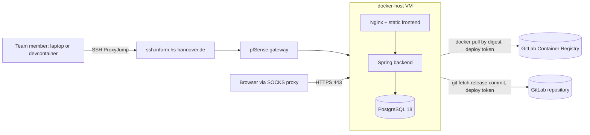

# P2.6c/d: Deployment host and scripted deployment specification

**Status:** Draft for review; not yet approved. Host facts marked *to verify* are confirmed in plan Phase A once administrative SSH access to the eduDScloud exists. **Scope:** [P2.6c and P2.6d](../backlog.md#p26---production-packaging-deployment-and-cicd). **Workflow:** [AI development workflow](../../../development/ai-development-workflow.md); an implementation plan follows after this specification is approved.

## Starting point and objective

P2.6a/b deliver two published application images (`backend`, `frontend`), a production-style Compose stack in [`deploy/`](../../../../deploy/README.md) with Nginx TLS ingress, PostgreSQL 18 with secret-based role bootstrap, a one-shot IAM signing-key initializer, idempotent local bootstrap/cleanup scripts, and a CI release descriptor (`image-release/release.json`) holding the validated, digest-qualified image pair for each `main` pipeline. The PostgreSQL and IAM key-init images are **built locally** from the repository; CI publishes only backend and frontend.

The course provides each group with an **eduDScloud** network on Proxmox: a pfSense gateway VM and a Debian `docker-host` VM with Docker preinstalled, in a private network reachable only through the HsH Informatik SSH server (`ssh.inform.hs-hannover.de`, key-based) and, for browsers, an SSH SOCKS proxy.

**Objective:** The group's `docker-host` VM runs the ShareWise stack as the **production host**. A new `main` release can be deployed with **one documented command**, verified by a health/smoke check, and rolled back to the previous release; secrets stay out of the repository; host setup is reproducible and does not depend on one team member's workstation.

## Out of scope

- A staging VM (optional per backlog; proposed to skip, Q1).
- Public DNS, publicly trusted certificates and Internet exposure: the eduDScloud network is private.
- Automatic deployment on every `main` push (CI runners cannot reach the private network, Q4); Doco-CD unless the evaluation in plan Phase A shows it works without extra infrastructure.
- Full backup/restore strategy, monitoring and alerting, signing-key rotation, multi-instance operation: P8.

## Architecture

### Decisions

| ID | Decision | Rationale and consequences |
| --- | --- | --- |
| **D1** | **One production host:** the group's eduDScloud `docker-host` VM. No staging VM (Q1). | The backlog makes staging optional; the local disposable Compose acceptance (`test-compose.sh`) already covers pre-deployment verification. |
| **D2** | **Administrative access:** every team member logs in with their **own** HsH account through `ssh.inform.hs-hannover.de` as `ProxyJump` and their own SSH key on the VM. The default `student` password is replaced, SSH password authentication is disabled, and a documented `~/.ssh/config` template ships in the repo. | Satisfies "no individual's VPN or workstation as a mandatory dependency": any member with an HsH account and an authorized key can operate the host. |
| **D3** | **Release input:** a deployment names one `main` **release descriptor** (CI artifact) or its version. The host pulls `backend` and `frontend` **by digest** from the descriptor and checks out the **release commit** of the repository to build the small local images (PostgreSQL bootstrap, IAM key-init) and to use that commit's `deploy/compose.yaml`. | Digest references are the authoritative, rollback-safe identity (P2.6b D11). Building the two auxiliary images on the host avoids changing the accepted CI publishing scope; Q5 asks whether CI should publish them instead. |
| **D4** | **Registry and repository credentials:** one GitLab **project deploy token** with only `read_registry` and `read_repository`, stored root-only on the host (Docker credential file and Git credential), never in the repository or command history. | Least privilege; revocable independently of personal tokens. Requires outbound HTTPS from the VM to `gitlab.gwdg.de` (*to verify*, Q3). |
| **D5** | **Host bootstrap script** (`deploy/host/bootstrap-host.sh`), idempotent and run over SSH: OS security updates and unattended upgrades, Docker/Compose version check, a dedicated deployment directory, host firewall allowing only SSH and HTTP/HTTPS, SSH hardening, deploy-token installation (interactive, not logged), production `.env` from a reviewed template, and the existing secret/TLS volume import. | Reproducible host setup documented as code; reuses the P2.6a secret and volume model instead of a second mechanism. |
| **D6** | **Exposure and TLS:** Nginx publishes 80 (redirect) and 443 on the VM's private address; backend and PostgreSQL stay unpublished. `SHAREWISE_PUBLIC_HOST` is the VM's stable private hostname or IP (*to verify*). TLS uses a **self-signed certificate** for that name, generated by the bootstrap, whose fingerprint is documented for browser trust (Q2). IAM issuer is the same HTTPS origin. | No public DNS exists, so a publicly trusted certificate is impossible; HTTPS still protects cookies and tokens and keeps the P2.6a same-origin model. |
| **D7** | **Deployment script** (`deploy/scripts/deploy.sh`, run on the host): `deploy <version>` downloads and validates the release descriptor, records the currently running release, takes a `pg_dump` backup, pulls the images by digest, checks out the release commit, rebuilds auxiliary images, runs `docker compose up -d`, then waits for the **smoke check** (Nginx HTTPS → `/api/system/v1/health` returning `UP` including database readiness). Success records the new release as current; failure triggers automatic rollback (D8). Idempotent: deploying the current release again is a no-op apart from the check. | One low-friction command with equivalent guarantees to GitOps for this course setting. |
| **D8** | **Rollback:** `rollback` (and automatic rollback on a failed smoke check) redeploys the previously recorded release by digest. Flyway migrations are **forward-only**: a rollback across a migration is safe only if the previous release tolerates the newer schema; otherwise the documented procedure is to restore the pre-deploy `pg_dump` backup. Backups older than the last N (initial proposal: 5) are pruned. | Images can roll back instantly; data cannot be silently rolled back, so the script makes the backup explicit instead of pretending otherwise. |
| **D9** | **IAM signing keys:** the first host bootstrap provisions keys once with `generate-if-absent`, then `.env` is switched to `require-existing`; the issuer and key ID are production values, not the local samples. | Follows the P2.6a key-lifecycle guidance; losing the key volume fails closed instead of silently rotating identities. |
| **D10** | **Doco-CD evaluation (P2.6d):** evaluated in plan Phase A against the actual network: it needs the Docker socket on the host, polling of a Git repository from the VM, and a separate desired-state change after each image publication. Adopt it only if VM egress to GitLab works and it adds no further infrastructure; otherwise the script (D7) is the accepted delivery. The evaluation result is recorded either way. | The backlog allows the script alternative; a GitOps controller that needs extra commits or tunnels would add friction without benefit for a single private host. |
| **D11** | **Failure visibility:** the script exits non-zero with a clear message on every failed step, prints the last service logs on a failed smoke check, and keeps a deployment log on the host (`deploy/.local/deployments.log`: time, operator, version, digests, result). | "Failure visibility" without introducing monitoring infrastructure before P8. |

### Rejected alternatives

- **CI-triggered deployment job:** the university runners cannot reach the private eduDScloud network without exposing SSH credentials and a tunnel in CI.
- **Deploying by mutable tag (`latest`):** not reproducible and not safely rollbackable.
- **Copying images from a laptop (`docker save`/`load`):** makes one workstation a production dependency.

## Requirements and acceptance cases

| ID | Requirement / scenario | Verification |
| --- | --- | --- |
| C-01 | Clean host: `bootstrap-host.sh` completes; rerunning it changes nothing and preserves secrets, keys and data. | Run twice on the VM, compare state |
| C-02 | The host pulls both application images by digest with the deploy token; pulling without the token fails. | Manual + script output |
| C-03 | Stack starts; HTTPS front page and `/api/system/v1/health` (`UP`, database ready) work through the SOCKS proxy from a team member's browser. | Browser + `curl` on the host |
| C-04 | Only SSH, 80 and 443 are reachable on the VM; backend 8080 and PostgreSQL 5432 are not. Password SSH login is rejected. | Port scan from the gateway network, SSH attempt |
| C-05 | No secret, token or private key in the repository, image layers, `.env`, script output or deployment log. | Inspection, `git grep`, log review |
| C-06 | At least two team members can administer the host with their own accounts and keys. | Two independent logins |
| D-01 | `deploy <new version>` upgrades a running release; smoke check passes; deployment log records both digests. | Two consecutive `main` releases |
| D-02 | A deliberately broken release (failing health check) is rolled back automatically to the previous release; the script exits non-zero and shows logs. | Injected failure (e.g. invalid backend configuration) |
| D-03 | `rollback` restores the previous release; data written before the deploy is still present. | Manual rollback after D-01 |
| D-04 | A pre-deploy `pg_dump` backup exists and can be restored into a disposable PostgreSQL container. | Restore rehearsal |
| D-05 | Registration and login work end to end on the deployed host (existing IAM HTTP smoke against the host origin). | `iam-http-smoke.py` or browser |

## Open questions

| ID | Question | Proposal |
| --- | --- | --- |
| **Q1** | Staging VM? | Skip for the MVP (backlog: optional). |
| **Q2** | TLS without public DNS: is a self-signed certificate plus SOCKS access acceptable for the course demonstration? | Yes; document fingerprint and trust steps. |
| **Q3** | Can the VM reach `gitlab.gwdg.de` (registry and Git over HTTPS) directly, or only through the HsH HTTP proxy? | Verify in plan Phase A; configure Docker and Git proxy settings if required. |
| **Q4** | Deployment trigger: manual `deploy.sh` after a green `main` pipeline, or Doco-CD? | Script first (D7); Doco-CD only if D10's evaluation is positive. |
| **Q5** | Should CI also publish the PostgreSQL and IAM key-init images, so the host needs no source checkout? | Not for the MVP (D3); revisit if host builds prove fragile. |
| **Q6** | VM resources (CPU, RAM, disk) sufficient for backend, Nginx, PostgreSQL and backups? | Verify in plan Phase A; document minimums. |
| **Q7** | Who receives administrative access (D2)? | All four team members. |

## References

- [P2.6a/b specification](../p2.6-production-packaging/specification.md) and [deployment README](../../../../deploy/README.md).
- eduDScloud user guide (course material, Exercise 6) and the Chrome SOCKS guide for browser access.
- [Doco-CD documentation](https://doco.cd/latest/).
