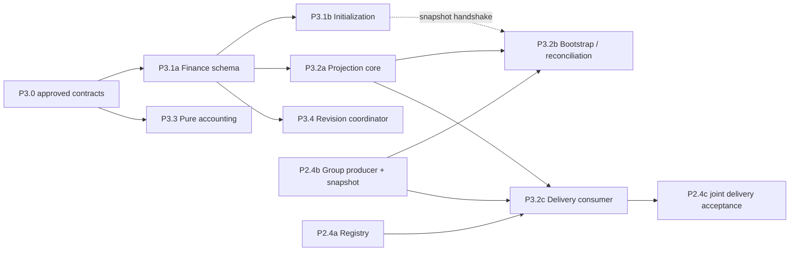

# P3.0 - Finance foundation contract: planning and review sequence

**Status:** Proposed documentation-only plan. Specification and architecture gate **pending human review**. See [specification](specification.md), [technical ER handoff](../../integration/phase-3-foundation.md) and [AI development workflow](../../../development/ai-development-workflow.md).

## Planning increment A - Establish shared design (this patch)

- Inventory current Phase 3, P2.4b/c, existing P2 technical ER, Finance domain model, Modulith/persistence/transaction/messaging contracts and missing source-version assumptions.
- Draft the Finance Phase 3 technical ER, ownership/defaults/constraints, Group→Finance projection and snapshot ordering semantics, initialization alternatives, and the financial revision protocol without adding feature tables or framework code.
- Restructure backlog work into schema/API ownership, parallel starts, explicit integration edges and application/real-PostgreSQL acceptance cases. Avoid a forced frontend-only handoff and avoid bundling pure accounting with event delivery.
- [ ] Human reviews the ER and explicitly selects the **initialization/currency policy**, Group membership source-revision contract, bootstrap scope, safe pre-initialization event handling and contradictory-event failure policy. Reconcile approved choices into this specification/handoff before implementation plans claim approval.

**Gate A:** Approved P3.0 contract and data model. This patch is **for review only**; documentation does not imply a deployed table or approved source schema change.

## Proposed downstream execution lanes (not authorized by this plan)

| Lane | Start condition | Deliverable / gate | Parallel with |
| --- | --- | --- | --- |
| **P3.1a Finance schema** | Gate A and P1 persistence foundation | Versioned Flyway DDL for the two Finance tables, internal adapters, local FK/unique/check constraints and PostgreSQL migration tests | P3.3, P2.4b, initial P3.4 design |
| **P3.1b Finance initialization** | P3.1a; approved currency workflow | Authorized, idempotent group initialization with atomic membership snapshot; test Group capability with fixture until integration | P3.2a, P3.3, P3.4 |
| **P3.2a Projection core** | P3.1a table contract; agreed versioned event/snapshot DTOs | Finance-owned version-guarded apply/reconcile operation, Unit and concurrent PostgreSQL tests, no listener requirement | P3.1b, P3.3, P3.4 |
| **P3.2b Bootstrap/reconciliation** | P3.2a + authoritative Group snapshot and selected rollout policy | Existing-data initialization, migration when necessary, watermark-safe reconciliation; no runtime Group SQL access | P3.2c, P3.3, P3.4 |
| **P3.2c Delivery integration** | P3.2a + P2.4a registry and P2.4b producer; jointly with P2.4c | Real listener/producer handshake, retry/reorder, independent commit and registry completion E2E | P3.2b (agree fixture and merge boundary) |
| **P3.3 Pure accounting** | Gate A; does **not** await DDL/Group/events | Exact Money, Percentage, strategies, conservation and deterministic rounding Unit tests | All other Phase 3 tasks |
| **P3.4 Revision primitive** | P3.1a FinanceGroup DDL + P1 transaction foundation | Reusable Finance-local locking/revision operation and PostgreSQL contention/rollback E2E; P4 later owns journal DDL | P3.1b, P3.2a/b/c, P3.3 |

A lane may **design and unit-test against approved test doubles before its production integration prerequisite** exists, but cannot claim its full gate is met. A shared column's migration belongs to the schema owner P3.1a; later tasks use subsequent non-overlapping migrations only for additional justified fields. Coordinate P2.4b's source revision with Group Management *before* Group membership event publication, not after writing Finance consumers.

## Execution and final acceptance

- Each owning task drafts and obtains human approval for its own target specification and tested implementation plan; deliver narrow branches/patches without merging to the approved baseline before review.
- Exercise the affected offline Java Unit checks, PostgreSQL Integration and E2E suites separately; use the existing fixtures and `Transactions` port, not a new cross-context persistence framework.
- Integrate P3.1b with the Group snapshot provider and the absent-group event handshake, P3.2b with the approved initial-population policy and P3.2c with P2.4b/c only after their independently reviewable unit slices stabilize.
- Obtain independent agent review, explicit manual acceptance where the integration has a user-facing workflow, and final human merge authorization for each increment. Reconcile steady-state `docs/architecture/`, `docs/data-model-design.md` and developer docs **only once corresponding behavior is implemented**, preserving this document's design status until then.

**Phase 3 acceptance:** Finance data/actor identity and initial membership converge to Group authority; event failure/replay and race tests pass on PostgreSQL; exact split behavior conserves totals; group-local finance writes allocate unique committed logical revisions; the existing module/transaction boundaries remain intact. Phase 4 depends on these integrated guarantees, not solely on individual green Unit tests.
