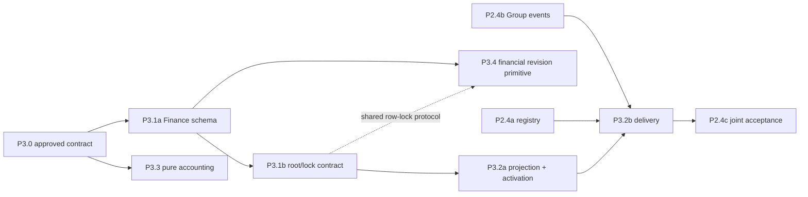

# P3.0 - Finance foundation contract: planning and review sequence

**Status:** Revised documentation-only plan; [specification](specification.md), [technical handoff](../../integration/phase-3-foundation.md) and [AI development workflow](../../../development/ai-development-workflow.md). Human specification and plan gates remain **pending**; no implementation is authorized by this document alone.

## Planning increment A - Approve common contracts (this patch)

- Establish `finance.groups(id)` / `finance.actors(group_id,user_id)` with their provenance-based columns, local FK, `PROVISIONING` lifecycle, `deleted`, `upstream_revision`, and independent financial `current_revision`. Require a standalone `GroupCreatedV1` and a separately published initial-owner member-add at Group revision `1`; neither owner nor revision belongs in GroupCreated. No synchronous Group snapshot or Finance-side pending-event queue for normal delivery.
- Record one fixed implicit two-decimal MVP accounting denomination. Leave currency out of Finance DDL; explicitly defer per-group currency and any future nonconverting Flyway population of currency metadata to a separately reviewed vertical.
- Define per-actor version-guarded event effects, conditional no-op upserts and diagnostics, and the first-observed-event/root creation race with PostgreSQL tests. Distinguish **Group creation observed** from **owner replicated** and **all subsequent membership events caught up**; signed Group attestations authorize reads without manufacturing an actor.
- Reduce task dependencies: only P3.1a owns shared DDL, P3.1b owns root/lock operations, P3.2a owns projection effects, P3.2b owns delivery integration, P3.3 is pure, and P3.4 owns financial revision allocation. Move optional periodic drift-repair to operational hardening, not the Phase 3 critical path.
- [ ] Human reviews and approves the technical ER and column provenance, lifecycle and actor-independent activation, Group producer revision/publication contract, revision/timestamp constraints, attestation-versus-actor rule, amount-unit assumption, deferred Group deletion and reconciliation/backfill, and test matrix. Record any required changes before downstream specifications/implementation plans are approved.

**Gate A:** Approved proposed P3.0 design. The artifact is a review proposal, not a deployed relational schema, production contract or implemented test.

## Independently reviewable downstream tasks

| Lane | Starts after | Deliverable and focused gate | Can proceed alongside |
| --- | --- | --- | --- |
| **P3.1a Finance schema** | Gate A + P1 persistence foundation | First Finance Flyway migration for `finance.groups` and `finance.actors`, `finance.group_state`, bigint constraints, composite PK/local FK and `updated_at` trigger. PostgreSQL migration/constraint tests | P2.4b, P3.3 |
| **P3.1b Root provisioning** | P3.1a; agreed internal operation API | Transactional `ensure/lock` root primitive; safe concurrent insert-if-absent, no external lookup; typed not-ready behavior. PostgreSQL contention/rollback tests | P2.4b, P3.3, P3.4 design |
| **P3.2a Projection core** | P3.1a schema + approved P3.1b contract | Independent `applyMembershipFact` and `applyGroupCreated`: version-guarded `deleted`/tombstone upserts and lifecycle activation without owner data, using the common lock. Unit + PostgreSQL concurrency and timestamp tests | P2.4b producer, P3.3, P3.4 |
| **P3.2b Registry consumer** | P3.2a + P2.4a registry + P2.4b event DTOs | Finance listeners with independent commit/recovery; P2.4c joint E2E covering atomic publication of two independent initial Group/owner facts, either delivery order, replay and actor-independent authorized reads | P3.3, P3.4 |
| **P3.3 Fixed-unit accounting** | Gate A (fixed two-decimal scale) | Exact Money/Percentage and equal/fixed/percentage splits; deterministic rounding and conservation Unit/property tests. No DB, Group or messaging prerequisite | All other lanes |
| **P3.4 Financial revision coordination** | P3.1a, P1 transaction foundation; approved shared root-lock contract | Reusable Finance-local, group-scoped revision allocation guarded by financial lifecycle; PostgreSQL contention/rollback tests. P4/P5 own journal record schema | P3.2a/b, P3.3 |

A task can design/test against the approved contract before another owner completes its production adapter, but integration acceptance waits for all relevant prerequisites. The only shared Finance schema migration belongs to P3.1a; avoid overlapping edits to its first migration. P2.4b owns Group revision generation/GroupCreated payload and producer publication; P3.2b owns consumer wiring. No task introduces a new outbox, Group SQL join or speculative background scheduler.

## Validation, review and follow-up

- Downstream specifications cover F3-01–F3-09 and F3-T01–F3-T09 from the [P3.0 specification](specification.md), with Unit, real PostgreSQL Integration/E2E and Modulith boundary evidence as appropriate. Offline Unit success alone is not PostgreSQL evidence.
- Apply the idempotent insert/lock protocol atomically with actor updates. Test initial `MemberAdded(owner, rev 1)` before/after `GroupCreated(groupId)` (with neither owner nor revision in GroupCreated), unrelated later membership events arriving first, unknown-member tombstones, conflicting same-revision events, no UPDATE on stale events, commit/registry completion failures, and locks on independent Finance groups.
- For initial MVP deployment, create new Group data only with the Finance listener registered; explicitly reset disposable earlier data or coordinate a writes-suspended Flyway backfill. Such a backfill is a **release action**, not a required P3.2 runtime feature. Do not assert historical events are available for replay.
- Track observed long-lived delivery drift and missing pre-subscriber Group enrollment as **deferred operational concerns**; introduce snapshot-based reconciliation and scheduled retry only after a separate scoped approval, not as speculative P3.2 infrastructure.
- Obtain human specification and plan approval for each owning lane, focused patch/increment review, independent architectural review, and relevant manual acceptance. Once behavior is implemented, reconcile authoritative `docs/architecture/`, `docs/data-model-design.md` and developer docs to the actual MVP state, keeping proposals distinguishable from deployed behavior meanwhile.

**Phase 3 acceptance:** Finance roots and actors preserve local referential integrity through reordering/replay, the independent initial-owner membership event establishes the actor (not GroupCreated), per-actor source ordering prevents ABA regressions, finance-only revisions are serialized, and fixed-unit calculations conserve totals. Runtime Group authorization is separate from eventual Finance projection. This gate does **not** require automatic drift repair, historical pre-subscriber enrollment or currency configuration.
